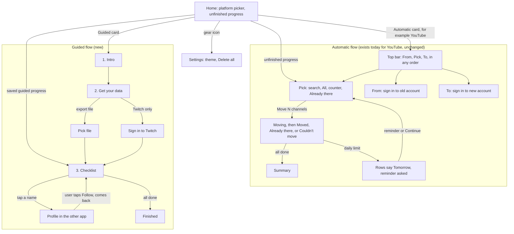
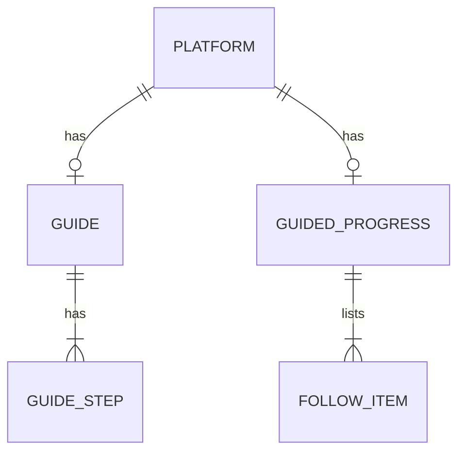

# Feature Specification: Multi-Platform Picker and Guided Migration

**Feature Branch**: `feature/multi-platform-picker`

**Created**: 2026-11-12

**Status**: Draft

**Input**: User description: "Multi-platform support: a platform picker and guided migration flow. The home screen shows a grid of platform cards in two sections, Automatic (YouTube now; Bluesky, Reddit, GitHub later) and Guided (Facebook, Instagram, Threads, TikTok, X, Twitch). Automatic platforms come first and must work before any Guided platform ships. Choosing an Automatic platform opens that platform's existing migration flow. Choosing a Guided platform opens one shared guided flow: intro, get your data, checklist, resume. The app never scripts taps or automates the other platform. Guide text and screenshots are per platform, bundled and updatable without an app release. Export files are parsed on the device only."

## How the screens connect

## User Scenarios & Testing *(mandatory)*

### User Story 1 - Choose a platform on Home (Priority: P1)

A user opens the app and sees one grid of platform cards in two sections. The first section is called Automatic and holds platforms where the app moves the follows for the user. The second section is called Guided and holds platforms where the user taps Follow themselves while the app shows the way. Each card shows the platform logo, its name, and one short line, such as "We subscribe for you" or "Step-by-step guide". The user taps a card to start.

**Why this priority**: This is the front door of every other part of the feature. Automatic platforms ship first, so this story must work with only the Automatic section.

**Independent Test**: Open the app on an Android phone and an iPhone. Check that the Automatic section and its card show, and that the Guided section shows only the platforms that are ready. Tap the YouTube card and confirm the existing YouTube flow opens unchanged. Tap a Guided card and confirm its intro opens.

**Acceptance Scenarios**:

1. **Given** the app opens on Home, **When** the user looks at the screen, **Then** the Automatic section shows YouTube with logo, name, and one-line label. The Guided section shows each Guided platform that is ready, in the same way, and is hidden while none is ready.
2. **Given** the user taps the YouTube card, **When** the flow opens, **Then** it behaves exactly as it did before this feature, with no new steps.
3. **Given** the user taps a Guided card, **When** the screen opens, **Then** it shows the intro for that platform.
4. **Given** the user has saved progress for a platform, **When** Home shows, **Then** that card shows a short "Continue" note with the saved count, and tapping it opens that progress at the saved place.
5. **Given** the phone is small or the text size is large, **When** Home shows, **Then** every card stays readable and tappable, and the grid scrolls instead of cutting cards off.
6. **Given** a screen reader is on, **When** the user moves over a card, **Then** it reads the name and the one-line label.

---

### User Story 2 - The Automatic flow keeps working from the picker (Priority: P1)

Everything the app does today for YouTube still works, and the user reaches it from the YouTube card. That means the From, Pick, and To steps in any order, picking channels with search and All, the Move button, the Moving, Moved, Already there, and Couldn't move states, the daily limit with the reminder, the list of unfinished progresses, and Settings with the theme choice and Delete all.

**Why this priority**: Automatic platforms must be ready before Guided ones. This story protects the product that already works and makes it the first platform in the picker.

**Independent Test**: From Home, tap the YouTube card and run a full move between two test accounts, hit the daily limit, close the app, and continue from the reminder. Every result matches the earlier specs for the move flow, theme and settings, and the Magpie rebrand.

**Acceptance Scenarios**:

1. **Given** the user taps the YouTube card, **When** the flow opens, **Then** the top bar shows From, Pick, and To, and the steps work in any order as before.
2. **Given** the user moves channels, **When** the move runs, **Then** the row states, summary, and Already there handling are the same as before.
3. **Given** the daily limit is reached, **When** the user taps the reminder later, **Then** the app opens that progress's channel list with a Continue button, as before.
4. **Given** there are several unfinished YouTube progresses, **When** the user opens the YouTube flow, **Then** they see the same list of unfinished progresses as before, and Home also shows a Continue note on the YouTube card.
5. **Given** the user opens Settings from Home, **When** they choose a theme, **Then** it applies to the picker, the Automatic flow, and the Guided flow.
6. **Given** the user uses Delete all in Settings, **When** it finishes, **Then** YouTube progresses, tokens, and saved guided lists are all removed.
7. **Given** the user wants to go back to Home from inside a flow, **When** they use the back action, **Then** they return to Home with no data lost.

---

### User Story 3 - Follow the guide to get my data (Priority: P2)

A user picks a Guided platform. The intro says in plain words what they will do, about how long it takes, and that the app never signs in to their social accounts and never taps for them. The next screen shows numbered steps with pictures for asking the platform for the user's data, and a Pick file button to choose the file when it arrives. For Twitch there is no file: the screen shows a Sign in button that reads the list of channels the user follows.

**Why this priority**: The user cannot move any follows until the app has their list. This is the first half of the guided flow, which ships after the Automatic flow.

**Independent Test**: Choose a Guided platform, read the intro, follow the data steps, and pick a sample export file. Confirm the checklist opens with the right number of accounts. Repeat for Twitch using sign-in.

**Acceptance Scenarios**:

1. **Given** the user opens a Guided platform, **When** the intro shows, **Then** it states the task, a rough time, and that the app never signs in to the user's social accounts and never taps for them.
2. **Given** the data steps show, **When** the user reads them, **Then** each step has a short sentence and a picture, and the steps match the platform's current screens.
3. **Given** the user taps Pick file, **When** they choose a valid export, **Then** the app reads it on the phone and opens the checklist with one row per account found.
4. **Given** the user chooses a file that is not the expected export, **When** the app reads it, **Then** it says in plain words that this is not the right file, shows what the right file looks like, and lets the user pick another.
5. **Given** the user chooses a very large export, **When** the app reads it, **Then** it shows that it is working and does not freeze.
6. **Given** the platform is Twitch, **When** the data screen shows, **Then** it shows a Sign in button in place of Pick file, and after sign-in the checklist lists the channels the user follows.
7. **Given** the user has no internet when the steps are due to refresh, **When** the screen shows, **Then** the steps still show from the copy that came with the app.

---

### User Story 4 - Work through the checklist (Priority: P2)

The checklist shows one row per account, with a progress bar such as "34 / 120". Each row has a tick box and the account name as a link, marked with an open-in-other-app icon. Tapping the name takes the user to that profile in the other app. The user taps Follow there, comes back, and ticks the row. The app never taps Follow for the user.

**Why this priority**: This is the second half of the guided flow and the value the user came for.

**Independent Test**: Load a sample list of 10 accounts. Tap the name on one row, confirm the profile opens in the other app or the browser, come back, tick the row, and confirm the bar moves from 0 / 10 to 1 / 10.

**Acceptance Scenarios**:

1. **Given** the checklist shows, **When** the user taps an account name, **Then** that account's profile opens in the other app, or in the phone's browser if the other app is not installed.
2. **Given** the user comes back from the other app, **When** the checklist shows again, **Then** it is at the same place, and the row they opened is easy to find.
3. **Given** the user ticks a row, **When** the tick is saved, **Then** the bar and the count update at once.
4. **Given** the user ticked a row by mistake, **When** they tap the row again, **Then** the tick is removed and the count goes down.
5. **Given** an account no longer exists or cannot be opened, **When** the user taps the name, **Then** the user can mark the row as Skipped, and skipped rows show apart from ticked and open rows.
6. **Given** every row is ticked or skipped, **When** the last one is done, **Then** a finished screen shows the totals.
7. **Given** the list has hundreds of rows, **When** the user scrolls, **Then** the list stays smooth.
8. **Given** the user has not signed in to their new account in the other app, **When** the checklist first shows, **Then** a short note near the top reminds the user to sign in to the new account in the other app before following.

---

### User Story 5 - Stop and continue later (Priority: P2)

The user can close the app at any point and later continue exactly where they stopped. Progress is saved on the phone for each platform.

**Why this priority**: Following hundreds of accounts takes more than one sitting. Without saved progress, users would give up.

**Independent Test**: Tick 5 rows, close the app fully, open it again, and confirm Home shows Continue for that platform and the checklist still has 5 ticked.

**Acceptance Scenarios**:

1. **Given** the user ticked rows and closed the app, **When** they open it again, **Then** the platform card shows Continue and the checklist keeps every tick and skip.
2. **Given** saved progress exists, **When** the user taps Start again on that platform, **Then** a confirmation asks first, and on yes the saved list and ticks for that platform are removed.
3. **Given** the user uses the existing Delete all action, **When** it finishes, **Then** all saved guided progress and lists are removed too.
4. **Given** saved progress for two platforms, **When** the user opens each, **Then** each shows its own list and ticks, with no mixing.

---

### User Story 6 - Guides stay correct when platforms change (Priority: P3)

Platforms change their screens often. The app keeps a built-in copy of every guide, so guides work offline. When the phone is online, the app can also fetch newer guide text and pictures from a fixed guide address, with no app update. The app sends nothing about the user when it does this.

**Why this priority**: Out-of-date steps cause the most failed attempts in a guided flow. Fixing them without an app release keeps the guides useful.

**Independent Test**: Publish a changed step on the guide address. Open the app online and confirm the new step shows. Turn off the network and confirm the built-in copy shows.

**Acceptance Scenarios**:

1. **Given** the phone is offline on first launch, **When** the user opens a guide, **Then** the built-in guide shows in full.
2. **Given** a newer guide exists on the guide address, **When** the phone is online, **Then** the app uses the newer guide the next time the guide opens.
3. **Given** the newer guide is broken or incomplete, **When** the app reads it, **Then** the app ignores it and keeps showing the last good guide.
4. **Given** the app fetches guides, **When** the request is made, **Then** it carries no account, no list, and no device identifier.

---

### Edge Cases

- The export contains accounts the platform has since removed, renamed, or made private: the user can skip the row.
- The export contains the same account twice: it shows once.
- The export is empty or has zero accounts: the app says so in plain words and offers to pick another file.
- The export is a zip file, or the platform offers more than one format: the data steps tell the user which format to ask for.
- The user opens a profile, follows, then leaves the app for a long time: saved progress is kept and nothing expires.
- The other app is not installed: Open uses the browser.
- The phone has low storage: the app tells the user in plain words that it cannot save progress, and does not lose the ticks already shown on screen.
- The platform changes its export format after release: the app shows the not-the-right-file message and the guide host can carry the fix for the steps.
- A guided platform later gets an official follow API: it can move from Guided to Automatic without changing the picker.
- The user rotates the phone or changes the theme or text size on the checklist: progress and scroll place are kept.

## Requirements *(mandatory)*

### Functional Requirements

**Picker**

- **FR-001**: Home MUST show the platform picker as a grid of cards in two sections, Automatic and Guided. A section MUST be hidden while it has no ready platform, so the picker works with Automatic only.
- **FR-002**: Each card MUST show the platform's official logo, its name, and one short plain-words label.
- **FR-003**: Which section a platform sits in MUST come from one list of platforms, so moving a platform between sections needs no new screen.
- **FR-004**: Tapping an Automatic card MUST open that platform's migration flow. The YouTube flow MUST NOT change in behavior or steps, and every behavior in the move flow, theme and settings, and Magpie rebrand specs MUST stay available. Settings and Delete all MUST be reachable from Home.
- **FR-005**: Tapping a Guided card MUST open the shared guided flow for that platform.
- **FR-006**: Every card MUST have an accessibility label that reads the name and the one-line label.
- **FR-007**: A card for a platform with saved progress MUST show a Continue note with the saved count.

**Guided flow**

- **FR-008**: The guided flow MUST have four parts in order: intro, get your data, checklist, finished. It MUST be one shared flow for all Guided platforms, with only the guide text, the pictures, the file reading, and the profile link rules differing by platform.
- **FR-009**: The intro MUST state the task, a rough time, and that the app never signs in to the user's social accounts and never taps for them.
- **FR-010**: The get-your-data screen MUST show numbered steps with a picture for each, in the platform's current wording.
- **FR-011**: The get-your-data screen MUST offer Pick file for platforms that give an export file, and Sign in for Twitch.
- **FR-012**: The app MUST read the chosen export on the phone only. It MUST NOT upload the file or its contents anywhere.
- **FR-013**: The app MUST list each account once, remove duplicates, and tell the user in plain words when the file is not the expected export or has no accounts.
- **FR-014**: For Twitch, the app MUST ask only for permission to read the list of followed channels. The user taps Follow themselves, because Twitch no longer lets apps follow for a user.
- **FR-015**: The checklist MUST show one row per account with a tick box and the account name as a link marked with an open-in-other-app icon, and a progress bar with count (ticked and skipped against total).
- **FR-016**: Tapping the account name MUST take the user to the account's profile in the other app, or in the browser when the other app is not installed. Tapping the tick box MUST NOT open the profile.
- **FR-017**: The user MUST be able to tick, untick, and skip a row. Ticked, skipped, and open rows MUST look different.
- **FR-018**: The app MUST NOT tap Follow, open a hidden browser, read the other app's screen, use an accessibility service, or otherwise act on the user's behalf in the other platform. The user taps Follow.
- **FR-019**: The app MUST NOT ask for or keep the user's password for any Guided platform.
- **FR-020**: The checklist MUST remind the user, in one short note, to sign in to the new account in the other app before following.

**Saved progress**

- **FR-021**: The app MUST save each platform's list and every tick and skip on the phone after each change, so a closed app loses nothing.
- **FR-022**: Progress for each platform MUST be kept apart from every other platform.
- **FR-023**: The user MUST be able to start again for one platform, after a confirmation, and the existing Delete all action MUST also remove all guided lists and progress as well as YouTube progresses and tokens.
- **FR-024**: Saved lists and progress MUST stay only on the phone and MUST NOT be sent anywhere.

**Guide content**

- **FR-025**: Every Guided platform MUST ship with a built-in guide, so guides work offline.
- **FR-026**: When online, the app MAY fetch a newer guide for a platform from the single fixed guide address and use it in place of the built-in one.
- **FR-027**: The app MUST check a fetched guide for completeness before use, and MUST keep the last good guide when the check fails.
- **FR-028**: Fetching a guide MUST send no account, list, token, or device identifier, and MUST be the only new network use this feature adds, apart from Twitch sign-in and its read of followed channels.

**Brand and wording**

- **FR-029**: Platform logos MUST be the official ones, unmodified, used only to name the platform, and MUST NOT be used in the app icon or the app name.
- **FR-030**: All new user-facing text MUST use simple everyday words and live with the other app text. Every new button and card MUST have an icon or logo, a label, and an accessibility label.

**Both phone types**

- **FR-031**: The feature MUST work on Android and iOS. Where behavior differs, it MUST follow the table in Platform differences.

### Platform differences (Android and iOS)

| Area | Android | iOS |
| --- | --- | --- |
| Open a profile in the other app | The phone can open the profile in the other app when it is installed. A phone that hides installed apps from this app needs the other app declared in advance. Browser is the fallback. | The app must declare in advance which other apps it may check for. Without it, the check fails and the browser opens instead. |
| Pick the export file | The system file picker shows files from Downloads and cloud drives. | The Files app shows files from iCloud Drive, On My iPhone, and other drives. |
| Zip exports | The user may need to unzip first, or the app reads the zip directly. The guide says which. | Files can unzip a zip, or the app reads the zip directly. The guide says which. |
| Coming back from the other app | The back gesture or the recent-apps switch returns to the app. | The back-to-app link in the status bar or the app switcher returns to the app. |
| Saved progress after the app is closed by the system | Progress is saved after each tap, so nothing is lost. | Same. |

### Key Entities *(include if feature involves data)*

- **Platform**: A service the app can work with. It has a name, a logo, one short label, and a section: Automatic or Guided.
- **Guide**: The plain-words help for one Guided platform: the intro, the data steps, and the notes for the checklist. It exists as a built-in copy and, when online, a newer copy from the guide address.
- **Guide Step**: One numbered step with a short sentence and a picture.
- **Guided Progress**: One user's saved work on one Guided platform: the list of accounts and the state of each one.
- **Follow Item**: One account from the user's list, with a display name, the link to its profile, and a state: open, ticked, or skipped.

## Success Criteria *(mandatory)*

### Measurable Outcomes

- **SC-001**: A user can reach the first screen of any platform's flow from Home in one tap.
- **SC-002**: A first-time user can go from opening a Guided platform to the first ticked row in under 5 minutes, not counting the time the platform takes to prepare the export.
- **SC-003**: After the app is closed and opened again, 100% of ticks and skips for each platform are still there.
- **SC-004**: With the network off, 100% of Guided platforms still show their full guide.
- **SC-005**: A checklist of 1,000 accounts scrolls without visible stutter and a tick shows within half a second.
- **SC-006**: In a check of the app's network use during the guided flow, no request carries the user's list, export contents, or account details.
- **SC-007**: In testing, at least 9 of 10 new users finish the data steps and pick the right file on the first try.
- **SC-008**: The existing YouTube flow passes all its existing tests with no change.

## Assumptions

- Automatic comes first. The picker and the Automatic flow ship and must work before any Guided platform ships. The Guided section stays hidden until a Guided platform is ready.
- At launch, YouTube is the only Automatic platform. Bluesky, Reddit, and GitHub appear in Automatic later, each in its own feature with its own spec. The picker takes a new Automatic platform from the single list of platforms with no new screen.
- Guided platforms (Facebook, Instagram, Threads, TikTok, X, and Twitch) ship one at a time, each when its export format is verified and its guide is written. The order is decided later and none blocks the others.
- The user must request their export from the old account. The app cannot do this for them.
- The user is signed in to their new account in the other app. The app cannot check this and only reminds the user.
- A platform's export gives a list of followed accounts with enough information to build a profile link. If a platform's export does not, that platform needs a different approach and is out of scope here.
- Twitch needs one developer registration with Twitch, done by the project owner. Reading followed channels needs no Twitch review.
- Guide pictures are simple and show the platform's own screens. They may go out of date, which is why guides can be updated without an app release.
- There is one static guide address, owned by the project, that serves guide text and pictures and holds no user data.
- Out of scope: moving follows for any platform automatically without an official follow API, any account sign-in for Guided platforms other than Twitch, and in-app editing of guide content.
- Platform logos are used under each brand's own guidelines. The project owner checks them before release.
