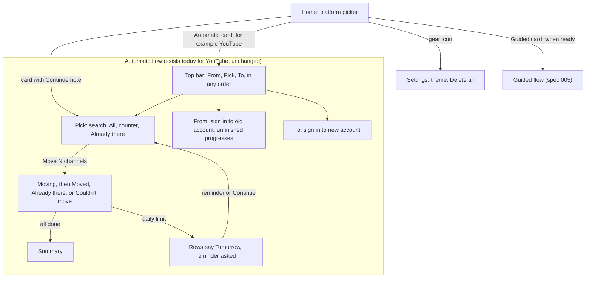

# Feature Specification: Platform Picker (Automatic First)

**Feature Branch**: `feature/multi-platform-picker`

**Created**: 2026-11-12

**Status**: Draft

**Input**: User description: "Multi-platform support: a platform picker. The home screen shows a grid of platform cards in two sections, Automatic (YouTube now; Bluesky, Reddit, GitHub later) and Guided (Facebook, Instagram, Threads, TikTok, X, Twitch). Automatic platforms come first and must work before any Guided platform ships. Choosing an Automatic platform opens that platform's existing migration flow. The Guided flow is specified and implemented separately."

**Related**: [005 Guided Migration](../005-guided-migration/spec.md) adds platforms to the Guided section and builds on this feature.

## Clarifications

### Session 2026-11-12

- Q: When a platform has several unfinished progresses, what does the card's Continue note show and open? → A: The note shows the total channels left across all unfinished progresses for that platform. With one progress, tapping it opens that progress at the saved place. With several, it opens the platform's existing list of unfinished progresses.

## How the screens connect

## User Scenarios & Testing *(mandatory)*

### User Story 1 - Choose a platform on Home (Priority: P1)

A user opens the app and sees one grid of platform cards in two sections. The first section is called Automatic and holds platforms where the app moves the follows for the user. The second section is called Guided and holds platforms where the user taps Follow themselves while the app shows the way. Each card shows the platform logo, its name, and one short line, such as "We move them for you" or "Step-by-step guide". A section with no ready platform is hidden, so at first only Automatic shows. The user taps a card to start.

**Why this priority**: This is the front door for every platform. Automatic platforms ship first, so this story must work with only the Automatic section.

**Independent Test**: Open the app on an Android phone and an iPhone. Check that the Automatic section shows the YouTube card and the Guided section is hidden. Tap the YouTube card and confirm the existing YouTube flow opens unchanged. Mark a test Guided platform as ready and confirm the Guided section appears.

**Acceptance Scenarios**:

1. **Given** the app opens on Home, **When** the user looks at the screen, **Then** the Automatic section shows YouTube with logo, name, and one-line label, and the Guided section is hidden while no Guided platform is ready.
2. **Given** a Guided platform is ready, **When** Home shows, **Then** the Guided section shows its card in the same way, and tapping it opens that platform's guided flow.
3. **Given** the user has unfinished progress for a platform, **When** Home shows, **Then** that card shows a short "Continue" note with the total count left across all its unfinished progresses. Tapping the note opens the progress at the saved place when there is one, or the platform's list of unfinished progresses when there are several.
4. **Given** the phone is small or the text size is large, **When** Home shows, **Then** every card stays readable and tappable, and the grid scrolls instead of cutting cards off.
5. **Given** a screen reader is on, **When** the user moves over a card, **Then** it reads the name and the one-line label.

---

### User Story 2 - The Automatic flow keeps working from the picker (Priority: P1)

Everything the app does today for YouTube still works, and the user reaches it from the YouTube card. That means the From, Pick, and To steps in any order, picking channels with search and All, the Move button, the Moving, Moved, Already there, and Couldn't move states, the daily limit with the reminder, the list of unfinished progresses, and Settings with the theme choice and Delete all.

**Why this priority**: Automatic platforms must be ready before Guided ones. This story protects the product that already works and makes it the first platform in the picker.

**Independent Test**: From Home, tap the YouTube card and run a full move between two test accounts, hit the daily limit, close the app, and continue from the reminder. Every result matches the earlier specs for the move flow, theme and settings, and the Magpie rebrand.

**Acceptance Scenarios**:

1. **Given** the user taps the YouTube card, **When** the flow opens, **Then** the top bar shows From, Pick, and To, and the steps work in any order as before.
2. **Given** the user moves channels, **When** the move runs, **Then** the row states, summary, and Already there handling are the same as before.
3. **Given** the daily limit is reached, **When** the user taps the reminder later, **Then** the app opens that progress's channel list with a Continue button, as before.
4. **Given** there are several unfinished YouTube progresses, **When** the user opens the YouTube flow, **Then** they see the same list of unfinished progresses as before.
5. **Given** the user opens Settings from Home, **When** they choose a theme, **Then** it applies to the picker and the Automatic flow.
6. **Given** the user uses Delete all in Settings, **When** it finishes, **Then** every account, token, and progress the app saved is removed, for every platform.
7. **Given** the user is inside a flow, **When** they use the back action, **Then** they return to Home with no data lost.

---

### Edge Cases

- No Guided platform is ready: the Guided section is hidden and the Automatic section fills the screen.
- A Guided platform later gets an official follow API: it moves from Guided to Automatic by changing its section in the list of platforms, with no new screen.
- A reminder opens the app while Home is showing: the app goes straight to that progress, as before.
- The user rotates the phone or changes the theme or text size on Home: the grid reflows and nothing is cut off.
- Only one Automatic platform exists: its section still shows its header, so later platforms fit without a layout change. A section with no ready platform shows no header.
- A logo cannot be drawn: the card shows the name and label without the logo, and stays tappable.
- The user goes Home while a move is running: the move keeps running, and the Continue note updates when it ends or pauses.
- A reminder is tapped while Settings is open: Settings closes and the progress opens.
- The count in a Continue note changes while Home shows: the note updates without a reload.

## Requirements *(mandatory)*

### Functional Requirements

**Picker**

- **FR-001**: Home MUST show the platform picker as a grid of cards in two sections, Automatic and Guided. Only ready platforms MUST show, with no "Coming soon" cards for planned ones. A section MUST be hidden while it has no ready platform.
- **FR-002**: Each card MUST show the platform's official logo, its name, and one short plain-words label of at most 6 words. Cards inside a section follow the order of the list of platforms.
- **FR-003**: Which section a platform sits in, and whether it is ready, MUST come from one list of platforms, so adding a platform or moving it between sections needs no new screen.
- **FR-004**: Tapping an Automatic card MUST open that platform's migration flow.
- **FR-005**: Tapping a Guided card MUST open that platform's guided flow, defined in spec 005.
- **FR-006**: Every card MUST have an accessibility label that reads the name and the one-line label.
- **FR-007**: A card for a platform with unfinished progress MUST show a Continue note with the total count left across all its unfinished progresses. Tapping the note MUST open that progress at the saved place when there is one, and the platform's list of unfinished progresses when there are several.

**Automatic flow**

- **FR-008**: The YouTube flow MUST NOT change in behavior or steps. Every behavior in the move flow, theme and settings, and Magpie rebrand specs MUST stay available.
- **FR-009**: Reminders MUST still open the matching progress directly, without stopping on Home.
- **FR-010**: The user MUST be able to return from any flow to Home with no data lost, using a Home button (house icon, label "Home") in the flow's top bar. On Android the system back action MUST do the same. A running move MUST keep running.

**Settings**

- **FR-011**: Settings MUST be reachable from Home with a gear icon and the label "Settings", in the same place as in the flow's top bar. Delete all MUST remove every account, token, and progress the app saved, for every platform, including data added by later platform features.

**Layout and accessibility details**

- **FR-015**: Section headers MUST read "Automatic" and "Guided" and MUST be marked as headings for screen readers. A section with no ready platform MUST show no header.
- **FR-016**: The card body and the Continue note MUST be separate tap targets, each at least 48 x 48 points. Tapping the body opens the flow as FR-004 and FR-005 say. Tapping the note acts as FR-007 says.
- **FR-017**: A screen reader MUST read a card as its name and label, then its Continue note as one action that names the platform and the count left (for example "Continue YouTube, 12 left"). The logo MUST be hidden from screen readers.
- **FR-018**: Card text MUST keep a contrast ratio of at least 4.5 to 1 in the Light and Dark looks. A name MUST wrap to at most 2 lines and a label to at most 3 lines, with no cutting off.
- **FR-019**: A card MUST show without its Continue note while the saved progress is read, and MUST add the note when it is ready. It MUST NOT show a loading indicator for the note.
- **FR-020**: If a card's logo cannot be drawn, the card MUST still show the name and label.

**Brand, wording, and both phone types**

- **FR-012**: Platform logos MUST be the official ones, unmodified, used only to name the platform, and MUST NOT be used in the app icon or the app name.
- **FR-013**: All new user-facing text MUST use simple everyday words and live with the other app text. Every new card and button MUST have an icon or logo, a label, and an accessibility label.
- **FR-014**: The feature MUST work on Android and iOS the same way. It has no platform-specific behavior.

### Key Entities *(include if feature involves data)*

- **Platform**: A service the app can work with. It has a name, a logo, one short label, a section (Automatic or Guided), and whether it is ready to show.
- **Progress**: The existing saved move progress from the move flow spec. The picker reads it only to show the Continue note.

## Success Criteria *(mandatory)*

### Measurable Outcomes

- **SC-001**: A user can reach the first screen of any platform's flow from Home in one tap.
- **SC-002**: The existing YouTube flow passes all its existing tests with no change to what they check.
- **SC-003**: Adding a new Automatic platform to the picker needs only a new entry in the list of platforms and that platform's flow, with no change to Home.
- **SC-004**: On a phone 320 points wide and at the largest system text size, every card's name and label can be read in full, within the line limits in FR-018.

## Assumptions

- Automatic comes first. This feature ships and must work before any Guided platform ships.
- At launch, YouTube is the only Automatic platform. Bluesky, Reddit, and GitHub appear in Automatic later, each in its own feature with its own spec.
- The Guided flow is spec 005, planned and built after this feature.
- Platform logos are used under each brand's own guidelines. The project owner checks them, including each brand's minimum logo size, before release. The release is blocked until the owner confirms.
- Layout on tablets, folding phones, and landscape beyond reflowing the grid is outside this spec and is covered by a later adaptive layout spec.
