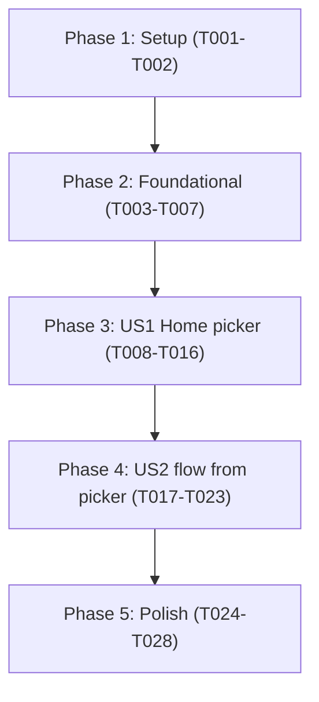

---

description: "Task list for the platform picker"
---

# Tasks: Platform Picker (Automatic First)

**Input**: Design documents from `specs/004-multi-platform-picker/` (plan.md, spec.md, research.md, data-model.md, contracts/platform-list.md, quickstart.md)

**Prerequisites**: plan.md and spec.md (both present). Constitution v1.4.0 checked in the plan (all Pass). The UX checklist in `checklists/ux.md` is reviewer-owned and does not block tasks.

**Tests**: Required by the constitution (principle II). Test tasks come before the code they check and must fail first. No test calls a real platform API.

**Organization**: Grouped by user story. US1 (Home picker) and US2 (YouTube flow reached from the picker) are both P1. US2 builds on US1 because it needs Home to exist.

## Format: `[ID] [P?] [Story] Description`

- **[P]**: Can run in parallel (different files, no dependency on an unfinished task)
- **[Story]**: US1, US2. Setup, Foundational, and Polish tasks have no label
- Paths are from the repository root

## Phase 1: Setup

**Purpose**: A known-good start

- [ ] T001 Confirm `assets/platforms/youtube.png` exists, is the unmodified `yt_icon_red_digital.png` (PNG, 1255 x 1075), and is tracked by git. No other logo file is added (plan R5).
- [ ] T002 Run `npm test`, `npm run typecheck`, and `npm run lint` on the branch before any code change. All three must pass. Write the test count in the commit message of T005 so SC-002 can be compared at the end.

---

## Phase 2: Foundational (blocks US1 and US2)

**Purpose**: The strings, the state field, and the platform list that Home and the flow both use.

**CRITICAL**: No user story work starts before this phase is done.

- [ ] T003 [P] Add the Home strings to `src/strings.ts`, with the texts from contracts/platform-list.md: `home` "Home", `sectionAutomatic` "Automatic", `sectionGuided` "Guided", `platformYoutube` "YouTube", `youtubeLine` "We move them for you", `guidedLine` "Step-by-step guide", `continueLeft(n)` "Continue: {n} left", `continueLabel(name, n)` "Continue {name}, {n} left", Also `homeTitle` "Magpie". Simple words, one idea per sentence (constitution I).
- [ ] T004 [P] Write `tests/unit/appState.test.ts` for the reducer in `src/state/AppState.tsx`: initial `platform` is `null`; `openPlatform { platform: 'youtube' }` sets `platform` and sets `settingsOpen` to false and keeps every other field; `goHome` sets `platform` to `null` and `settingsOpen` to false and keeps every other field (FR-010); `reset` keeps the current `platform` and clears everything else (see T028 for why).
- [ ] T005 Add the `platform` field (`PlatformId | null`, initial `null`) and the `openPlatform` and `goHome` actions to `src/state/AppState.tsx`. The `reset` case returns `{ ...initialState, platform: state.platform }`. Make T004 pass. Existing reducer behavior is unchanged.
- [ ] T006 [P] Write `tests/unit/platforms.test.ts` for `src/platforms/platforms.ts`: the list has exactly one entry at launch, `youtube`, with `section: 'automatic'`, `ready: true`, name "YouTube", label `strings.youtubeLine`; every entry's label has at most 6 words (FR-002); `readyBySection()` returns only ready entries, Automatic before Guided, and omits a section with no ready entry (FR-001); `youtube.unfinished()` returns `{ left: 0, ids: [] }` with no progress and the sum of `left` across all unfinished progresses with their ids when there are several (FR-007, use the `expoSqlite` mock and `progressStore` the way `tests/unit/progressStore.test.ts` does); `youtube.open(dispatch)` dispatches `openPlatform { platform: 'youtube' }`.
- [ ] T007 Create `src/platforms/platforms.ts` per contracts/platform-list.md: `PlatformId` (`'youtube'`), `Section`, `Platform` type with `id`, `name`, `label`, `logo`, `section`, `ready`, `open`, `unfinished`; one `PLATFORMS` array holding the YouTube entry (logo `require('../../assets/platforms/youtube.png')`, `unfinished` built on `listUnfinished()` from `src/store/progressStore.ts`); and `readyBySection()`. No `if (platform === ...)` chain anywhere (constitution IV). Make T006 pass.

**Checkpoint**: Reducer and platform list tested. No screen has changed yet.

---

## Phase 3: User Story 1 - Choose a platform on Home (Priority: P1) MVP

**Goal**: The app opens on a grid of cards in two sections. Only ready platforms show. Tapping the YouTube card opens the existing flow. A card shows a Continue note when there is unfinished progress.

**Independent Test**: Quickstart checks 1, 2, 3, 5, 6, and 8. Open the app, see the Automatic section with the YouTube card and no Guided section, tap the card, and see the existing flow.

### Tests for User Story 1 (write first, they must fail)

- [ ] T008 [P] [US1] Write `tests/components/home.test.tsx` for `HomeView` (it takes an optional `platforms` prop so a test list can mark a Guided entry ready): Automatic header shows with the YouTube card and no Guided header while no Guided entry is ready (US1-1); a ready test Guided entry shows a Guided header and its card, and tapping it calls its `open` (US1-2, FR-005); a section with no ready entry shows no header (FR-015); both headers have the `header` accessibility role (FR-015); a card's accessibility label is `"<name>. <label>"` (FR-006); the logo is hidden from screen readers (FR-017); when the logo `Image` fires `onError` the name and label still show and the card stays tappable (FR-020); no Continue note with no progress; one progress with 12 left shows "Continue: 12 left" and tapping the note calls `openProgress` for that id (FR-007); two progresses with 12 and 5 left show "Continue: 17 left" and tapping the note opens the YouTube flow on the From step with the Unfinished list (FR-007); the note's accessibility label is "Continue YouTube, 12 left" (FR-017); the card body and the note are separate pressables with a minimum 48 x 48 point hit area (FR-016); the note is absent on first render and added when the read finishes, with no loading indicator (FR-019); the note count updates when `moveState` changes while Home shows.
- [ ] T009 [P] [US1] Write `tests/unit/gridColumns.test.ts` for `columnsFor(width, fontScale)`: `clamp(floor(width / (160 * fontScale)), 1, 3)` (research R3). Cases: 320 wide at scale 1 gives 2; 320 at scale 2 gives 1; 411 at scale 1 gives 2; 1000 at scale 1 gives 3; never below 1 or above 3.
- [ ] T010 [P] [US1] Write `tests/components/homeLayout.test.tsx`: with `useWindowDimensions` mocked to 320 wide and `PixelRatio.getFontScale` mocked to 2, `HomeView` renders one column; a card's name `Text` has `numberOfLines` 2 and its label has `numberOfLines` 3 (FR-018, SC-004); the grid is inside a scroll view (US1-4).

### Implementation for User Story 1

- [ ] T011 [P] [US1] Create `src/ui/gridColumns.ts` exporting `columnsFor(width: number, fontScale: number): number` per research R3. One pure function, no React. Make T009 pass.
- [ ] T012 [P] [US1] Create `src/ui/PlatformCard.tsx`: one pressable card body with the logo `Image` (`accessibilityElementsHidden`, `importantForAccessibility="no-hide-descendants"`, `onError` hides only the logo), the name (`numberOfLines={2}`), the label (`numberOfLines={3}`), and an optional Continue note as a second pressable with icon `time-outline`, text from `strings.continueLeft`, accessibility label from `strings.continueLabel`, and `hitSlop` or `minHeight` 48. The card accessibility label is `"<name>. <label>"` and role `button`. Colors from `src/theme/theme.tsx` only. Use the `makeStyles(colors)` pattern from `src/ui/TopBar.tsx`.
- [ ] T013 [P] [US1] Create `src/ui/HomeBar.tsx`: a top bar with the title `strings.homeTitle` and one right-hand button: gear icon with label `strings.settings` that dispatches `openSettings`, or an arrow-back icon with label `strings.back` that dispatches `closeSettings` while Settings is open. It copies the gear button style from `src/ui/TopBar.tsx`. The title is marked as a heading.
- [ ] T014 [US1] Create `src/ui/HomeView.tsx` (depends on T007, T011, T012): reads `readyBySection()` (or the `platforms` prop), draws a header (role `header`) and a `FlatList` per section with `scrollEnabled={false}` inside one `ScrollView`, `numColumns` from `columnsFor(useWindowDimensions().width, PixelRatio.getFontScale())`, and `key` including the column count. Each card's `unfinished()` is read in a `useEffect` whose deps are `state.platform`, `state.moveState`, `state.progressId`, `state.channels`, and the note shows only once the read is done. Card body calls `platform.open(dispatch)`. Note tap: one id calls `openProgress(dispatch, id)` from `src/state/flows.ts`; several ids call `platform.open(dispatch)` and `dispatch({ type: 'setStep', step: 'from' })`. Make T008 and T010 pass.
- [ ] T015 [US1] Edit `App.tsx` `Screen`: pick the screen from `settingsOpen`, then `platform`: when `platform` is `null` show `HomeBar` and then `SettingsView` (if `settingsOpen`) or `HomeView`; when `platform` is `'youtube'` show the existing `TopBar` and steps exactly as today. Do not touch the YouTube step components.
- [ ] T016 [US1] Add `renderApp()` to `tests/components/helpers.tsx`: it renders `<App />`, waits for Home, and presses the YouTube card, so tests start in the YouTube flow as before (research R7). Then run `grep -l "render(<App />)" tests/components/*.tsx` and replace each `render(<App />)` with `renderApp()` in every file listed. Keep the checks in those files unchanged; only the start line changes. Where a test renders twice to simulate a restart, `renderApp()` is used for both.

**Checkpoint**: Home shows, YouTube card opens the flow, and the whole existing suite passes (SC-002). This is the MVP.

---

## Phase 4: User Story 2 - The Automatic flow keeps working from the picker (Priority: P1)

**Goal**: Everything the YouTube flow did before still works, reached from the YouTube card, with a way back to Home and reminders opening progress directly.

**Independent Test**: Quickstart checks 3, 4, 7, 9, and 10. Run a full move from Home, hit the daily limit, go Home, continue from the reminder.

### Tests for User Story 2 (write first, they must fail)

- [ ] T017 [P] [US2] Extend `tests/components/topBar.test.tsx`: inside the YouTube flow the top bar has a button with accessibility label "Home" (house icon) to the left of the steps; pressing it shows Home; pressing the YouTube card again shows the flow with the signed-in old account and the picked channels unchanged (FR-010, US2-7).
- [ ] T018 [P] [US2] Extend `tests/components/progresses.test.tsx`: tapping a reminder while Home shows opens that progress on the To step with no stop on Home (FR-009, US2-3); tapping a reminder while Settings is open closes Settings and opens the progress (edge case); unknown reminder ids are still ignored.
- [ ] T019 [P] [US2] Write `tests/components/homeNav.test.tsx`: with the Android `BackHandler` mocked, the back press inside the YouTube flow goes Home and returns `true`; with Settings open it closes Settings; on Home it returns `false` so the system handles it (FR-010); Settings opens from Home with the label "Settings", and choosing a theme there changes the colors Home uses (US2-5, FR-011); Delete all from Home Settings removes every progress and the YouTube card then shows no Continue note, while an open YouTube flow stays on YouTube (US2-6); starting a move, going Home before it ends, then letting the mocked subscribe calls finish updates the Continue note and the move is not cancelled (edge case, FR-010).

### Implementation for User Story 2

- [ ] T020 [US2] Edit `src/ui/TopBar.tsx`: add a left-hand Home button (icon `home-outline`, accessibility label `strings.home`, role `button`) that dispatches `goHome`. Do not change the tabs, their labels, or the gear. Make T017 pass.
- [ ] T021 [US2] Edit `App.tsx`: add a `BackHandler` `hardwareBackPress` listener in a `useEffect`: when `settingsOpen` dispatch `closeSettings` and return `true`; else when `platform` is not `null` dispatch `goHome` and return `true`; else return `false`. Remove the listener on cleanup. It does nothing on iOS (no system back action there). Make T019 pass.
- [ ] T022 [US2] Edit `src/state/flows.ts` `openProgress`: dispatch `openPlatform { platform: 'youtube' }` before the other dispatches, so a reminder opens the progress directly from Home or Settings (FR-009). No other change to the file. Make T018 pass.
- [ ] T023 [US2] Check `src/ui/SettingsView.tsx` and `src/ui/FromStep.tsx` need no change: Delete all dispatches `reset` (keeps `platform`), and deleting the open progress in `FromStep` also dispatches `reset` (stays in the YouTube flow). If a test shows otherwise, fix the reducer, not the screens. Make the Delete all case in T019 pass.

**Checkpoint**: Both stories work. Run the whole suite; every pre-existing test passes unchanged in what it checks.

---

## Phase 5: Polish & Cross-Cutting Concerns

- [ ] T024 [P] Add a contrast test to `tests/unit/theme.test.ts`: for Light and Dark, the text and muted text colors used by `PlatformCard` have a contrast ratio of at least 4.5 to 1 against `colors.background` (FR-018). If a color fails, change the token in `src/theme/theme.tsx` and say which one in the commit message.
- [ ] T025 [P] Check that every new text is in `src/strings.ts`, every new button has an icon, a label, and an accessibility label, and no new file is a catch-all (constitution I and IV). Fix anything found.
- [ ] T026 Run `npm test`, `npm run typecheck`, and `npm run lint`. All pass. Compare the test count with T002: every earlier test still runs and passes (SC-002).
- [ ] T027 Walk through `quickstart.md` checks 1 to 10 on an Android device or emulator, and checks 1 to 9 on an iPhone or simulator. Write results in the pull request description. Check 10 is Android only.
- [ ] T028 [P] Check that `plan.md`, `data-model.md`, `research.md`, and `contracts/platform-list.md` still match what was built (file list, `reset` rule, `renderApp()`, strings). Fix any drift in the docs.

---

## Dependencies and order

- T005 needs T004. T007 needs T006. T014 needs T007, T011, T012. T015 needs T013 and T014. T016 needs T015.
- US2 needs US1 done, because the Home button and the reminder tests need Home.
- `App.tsx` is edited in T015 and T021. Do them in order, not in parallel.

## Parallel examples

- Foundational: T003, T004, and T006 touch different files and can start together.
- US1 tests: T008, T009, and T010 can be written together. Then T011, T012, and T013 can be built together.
- US2 tests: T017, T018, and T019 can be written together.

## Implementation strategy

1. **MVP**: Phases 1 to 3. At the checkpoint the app opens on Home and the YouTube flow works through the card, with the full old suite passing.
2. **Then** US2 for the way back, Android back action, and reminders.
3. **Last** polish, the contrast check, and the manual run on both phones.
4. **Owner to-dos before release** (not tasks): YouTube brand use request, which settles the minimum logo size (research R5, open item 7 in `specs/003-magpie-rebrand/tasks.md`).
