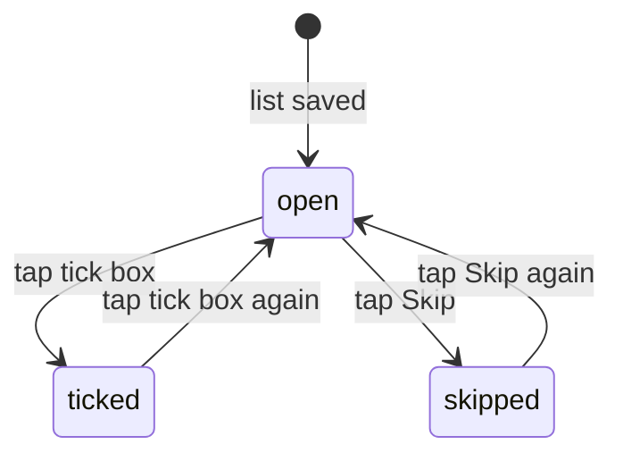
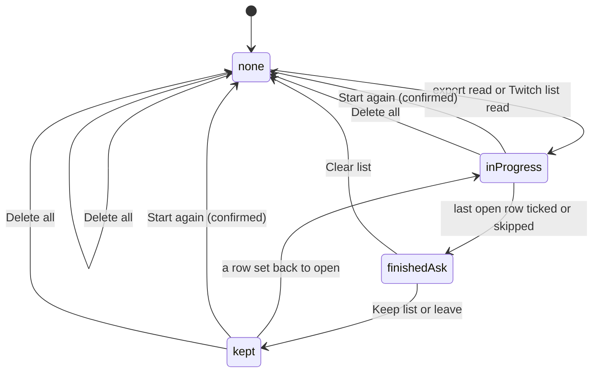

# Data Model: Guided Migration

## Tables (in `progress.db`, owned by `src/store/guidedStore.ts`)

### guided_progress

One row per Guided platform with a saved list.

| Column | Type | Rule |
| --- | --- | --- |
| `platform_id` | TEXT PK | A Guided `PlatformId`. Keeps platforms apart (FR-016). |
| `kept` | INTEGER NOT NULL DEFAULT 0 | 1 after the user chooses Keep list or leaves the finished screen. |
| `created_at` | INTEGER NOT NULL | ms since epoch. |
| `updated_at` | INTEGER NOT NULL | Set on every item change. |

### follow_item

| Column | Type | Rule |
| --- | --- | --- |
| `platform_id` | TEXT NOT NULL REFERENCES guided_progress ON DELETE CASCADE | |
| `item_key` | TEXT NOT NULL | Lowercase handle (or account id on X). Unique per platform; removes duplicates (FR-007). |
| `handle` | TEXT NOT NULL | Validated against the platform's handle pattern. Used to build the link. |
| `display_name` | TEXT NOT NULL | Shown on the row. Falls back to `handle`. |
| `followed_at` | INTEGER NULL | ms since epoch, when the export gives it. |
| `position` | INTEGER NOT NULL | Order in the export. Tie-breaker for items with no time. |
| `state` | TEXT NOT NULL DEFAULT 'open' CHECK (state IN ('open','ticked','skipped')) | |
| `updated_at` | INTEGER NOT NULL | |
| PK | (`platform_id`, `item_key`) | |

Checklist order: `ORDER BY followed_at IS NULL, followed_at DESC, position`.

Profile links are not stored. They are built from `handle` and the platform's link template each time (contract), so a changed template needs no data change and the file never supplies a URL.

## Follow item states

## Guided progress lifecycle

`kept` returns to 0 when a row goes back to open, so the Continue note shows again.

## Store functions

| Function | Does |
| --- | --- |
| `saveList(platformId, items)` | Replaces the platform's list in one transaction. Only called when no list exists or after Start again. |
| `getItems(platformId)` | Ordered rows. |
| `setState(platformId, key, state)` | One row; updates `updated_at`; resets `kept` when state is `open`. |
| `getSummary(platformId)` | `{ total, ticked, skipped, open, kept }` or `null`. |
| `setKept(platformId)` | Sets `kept = 1`. |
| `clearPlatform(platformId)` | Deletes the progress row (items cascade). Used by Start again and Clear list. |

`deleteAll()` in `progressStore.ts` adds `DELETE FROM guided_progress`.

## Guide (in memory)

See [contracts/guide-content.md](contracts/guide-content.md). The last good fetched copy is stored as JSON text in the existing `setting` table under the key `guides`.

## Not stored

- Export files: the cached copy is deleted after reading.
- Twitch tokens: memory only, revoked after the read.
