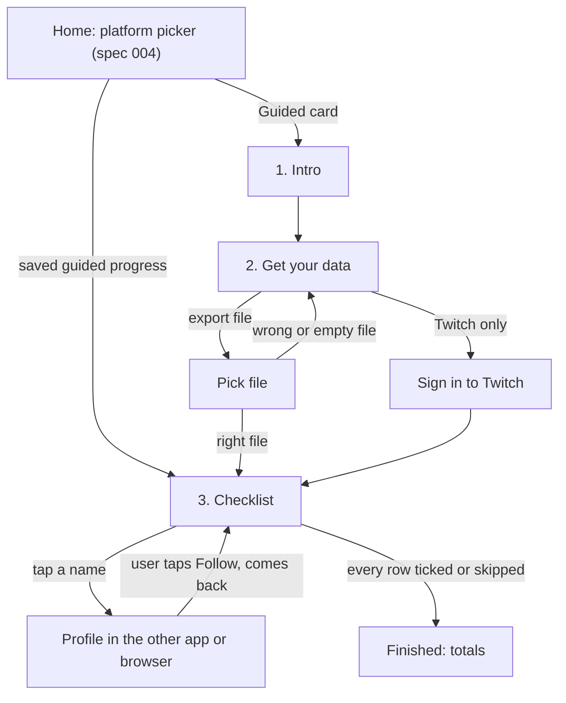
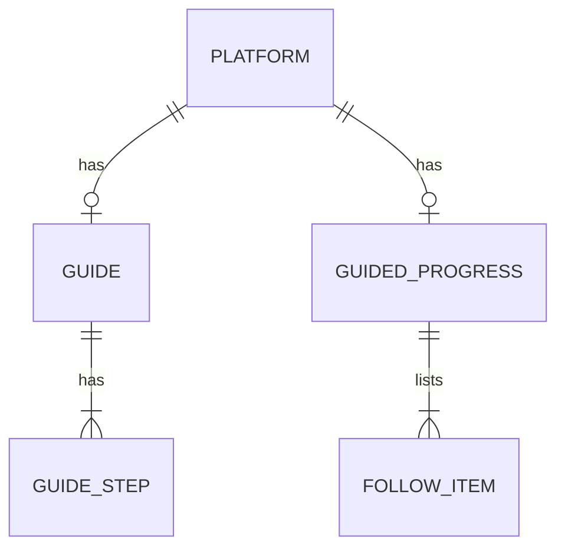

# Feature Specification: Guided Migration

**Feature Branch**: `feature/multi-platform-picker` (spec only; implementation gets its own branch)

**Created**: 2026-11-12

**Status**: Draft

**Depends on**: [004 Platform Picker](../004-multi-platform-picker/spec.md). This feature adds platforms to the picker's Guided section.

**Input**: User description: "Choosing a Guided platform opens one shared guided flow: intro, get your data, checklist, resume. Guided platforms are Facebook, Instagram, Threads, TikTok, X, and Twitch. Each checklist item is a link to the profile. The app never scripts taps or automates the other platform. Guide text and screenshots are per platform, bundled and updatable without an app release. Export files are parsed on the device only. Automatic platforms ship first; Guided is implemented separately."

## Clarifications

### Session 2026-11-12

- Q: After Twitch sign-in reads the followed-channels list, what happens to the Twitch sign-in token? → A: The app uses it once to read the list, then revokes and deletes it. Nothing is kept. Reading the list again needs a new sign-in.
- Q: After every row is ticked or skipped, what happens to the saved list and progress? → A: The finished screen asks the user to Keep list or Clear list. Clear list removes that platform's list and ticks. Keep list (also the result when the user leaves without choosing) keeps them: the card shows no Continue note, and tapping the card opens the kept checklist.
- Q: How are checklist rows ordered and found? → A: Rows are sorted by follow time, newest first. Rows with no follow time in the export go last, in export order. A search box filters rows by name. Ticked and skipped rows stay in place and do not move.

## How the screens connect

## User Scenarios & Testing *(mandatory)*

### User Story 1 - Follow the guide to get my data (Priority: P1)

A user picks a Guided platform. The intro says in plain words what they will do, about how long it takes, and that the app never signs in to their social accounts and never taps for them. The next screen shows numbered steps with pictures for asking the platform for the user's data, and a Pick file button to choose the file when it arrives. For Twitch there is no file: the screen shows a Sign in button that reads the list of channels the user follows.

**Why this priority**: The user cannot follow anyone until the app has their list. This is the first half of the guided flow.

**Independent Test**: Choose a Guided platform, read the intro, follow the data steps, and pick a sample export file. Confirm the checklist opens with the right number of accounts. Repeat for Twitch using sign-in.

**Acceptance Scenarios**:

1. **Given** the user opens a Guided platform, **When** the intro shows, **Then** it states the task, a rough time, and that the app never signs in to the user's social accounts and never taps for them.
2. **Given** the data steps show, **When** the user reads them, **Then** each step has a short sentence and a picture, and the steps match the platform's current screens.
3. **Given** the user taps Pick file, **When** they choose a valid export, **Then** the app reads it on the phone and opens the checklist with one row per account found.
4. **Given** the user chooses a file that is not the expected export, **When** the app reads it, **Then** it says in plain words that this is not the right file, shows what the right file looks like, and lets the user pick another.
5. **Given** the user chooses a very large export, **When** the app reads it, **Then** it shows that it is working and does not freeze.
6. **Given** the platform is Twitch, **When** the data screen shows, **Then** it shows a Sign in button in place of Pick file, and after sign-in the checklist lists the channels the user follows.
7. **Given** the user has no internet, **When** the steps show, **Then** they still show from the copy that came with the app.

---

### User Story 2 - Work through the checklist (Priority: P1)

The checklist shows one row per account, with a progress bar such as "34 / 120". Each row has a tick box and the account name as a link, marked with an open-in-other-app icon. Tapping the name takes the user to that profile in the other app. The user taps Follow there, comes back, and ticks the row. The app never taps Follow for the user.

**Why this priority**: This is the second half of the guided flow and the value the user came for.

**Independent Test**: Load a sample list of 10 accounts. Tap the name on one row, confirm the profile opens in the other app or the browser, come back, tick the row, and confirm the bar moves from 0 / 10 to 1 / 10.

**Acceptance Scenarios**:

1. **Given** the checklist shows, **When** the user taps an account name, **Then** that account's profile opens in the other app, or in the phone's browser if the other app is not installed.
2. **Given** the user comes back from the other app, **When** the checklist shows again, **Then** it is at the same place, and the row they opened is easy to find.
3. **Given** the user taps a tick box, **When** the tick is saved, **Then** the bar and the count update at once, and no profile opens.
4. **Given** the user ticked a row by mistake, **When** they tap the tick box again, **Then** the tick is removed and the count goes down.
5. **Given** an account no longer exists or cannot be opened, **When** the user sees this in the other app, **Then** they can mark the row as Skipped, and skipped rows show apart from ticked and open rows.
6. **Given** every row is ticked or skipped, **When** the last one is done, **Then** a finished screen shows the totals and offers Keep list and Clear list.
7. **Given** the list has hundreds of rows, **When** the user scrolls, **Then** the list scrolls as SC-004 requires.
8. **Given** the checklist first shows, **When** the user looks at the top, **Then** a short note reminds them to sign in to the new account in the other app before following.
9. **Given** the finished screen shows, **When** the user taps Clear list, **Then** that platform's list and ticks are removed. **When** the user taps Keep list or leaves without choosing, **Then** the list is kept, the card shows no Continue note, and tapping the card opens the kept checklist.

---

### User Story 3 - Stop and continue later (Priority: P2)

The user can close the app at any point and later continue exactly where they stopped. Progress is saved on the phone for each platform.

**Why this priority**: Following hundreds of accounts takes more than one sitting. Without saved progress, users would give up.

**Independent Test**: Tick 5 rows, close the app fully, open it again, and confirm Home shows Continue for that platform and the checklist still has 5 ticked.

**Acceptance Scenarios**:

1. **Given** the user ticked rows and closed the app, **When** they open it again, **Then** the platform card shows Continue with the count of rows still open and the checklist keeps every tick and skip, unless the user chose Clear list.
2. **Given** saved progress exists, **When** the user taps Start again on that platform, **Then** a confirmation asks first, and on yes the saved list and ticks for that platform are removed.
3. **Given** the user uses Delete all in Settings, **When** it finishes, **Then** all saved guided progress and lists are removed too.
4. **Given** saved progress for two platforms, **When** the user opens each, **Then** each shows its own list and ticks, with no mixing.

---

### User Story 4 - Guides stay correct when platforms change (Priority: P3)

Platforms change their screens often. The app keeps a built-in copy of every guide, so guides work offline. When the phone is online, the app can also fetch newer guide text and pictures from a fixed guide address, with no app update. The app sends nothing about the user when it does this.

**Why this priority**: Out-of-date steps cause the most failed attempts in a guided flow. Fixing them without an app release keeps the guides useful. Built-in guides alone are enough for a first release.

**Independent Test**: Publish a changed step on the guide address. Open the app online and confirm the new step shows. Turn off the network and confirm the built-in copy shows.

**Acceptance Scenarios**:

1. **Given** the phone is offline on first launch, **When** the user opens a guide, **Then** the built-in guide shows in full.
2. **Given** a newer guide exists on the guide address, **When** the phone is online, **Then** the app uses the newer guide the next time the guide opens.
3. **Given** the newer guide is broken or incomplete, **When** the app reads it, **Then** the app ignores it and keeps showing the last good guide.
4. **Given** the app fetches guides, **When** the request is made, **Then** it carries no account, no list, and no device identifier.

---

### Edge Cases

- The export contains accounts the platform has since removed, renamed, or made private: the user can skip the row.
- The export contains the same account twice: it shows once.
- The export is empty or has zero accounts: the app says so in plain words and offers to pick another file.
- The export is a zip file, or the platform offers more than one format: the data steps tell the user which format to ask for.
- The user opens a profile, follows, then leaves the app for a long time: saved progress is kept and nothing expires.
- The other app is not installed: tapping the name opens the browser.
- The phone has low storage: the app tells the user in plain words that it cannot save progress, and does not lose the ticks already shown on screen.
- The platform changes its export format after release: the app shows the not-the-right-file message, and the guide host can carry the fix for the steps.
- The user rotates the phone or changes the theme or text size on the checklist: progress and scroll place are kept.
- The other app shows a login page because the user is not signed in to the new account: the user signs in there and comes back, and the note at the top of the checklist already told them to do this first.
- The user waits on Twitch's approval page: the app shows a waiting message with a Cancel button, and if the code runs out it says so in plain words and offers to try again.
- A large export takes a while to read: the app shows a working indicator with the count of accounts found so far and a Cancel button that returns to the data screen.
- The phone is closed by the system while a list is open: the card shows Continue on the next start and nothing is lost.

## Requirements *(mandatory)*

### Functional Requirements

**Guided flow**

- **FR-001**: Each Guided platform MUST appear in the picker's Guided section (spec 004) only once its guide and file reading are ready and its reader has been checked against a real export from a test account.
- **FR-002**: The guided flow MUST have four parts in order: intro, get your data, checklist, finished. It MUST be one shared flow for all Guided platforms, with only the guide text, the pictures, the file reading, and the profile link rules differing by platform.
- **FR-003**: The intro MUST state the task, a rough time in whole minutes taken from the platform's guide, and that the app never follows or taps for the user and never asks for their password. For Twitch, it MUST also say that Twitch asks the user to sign in only so the app can read the list.
- **FR-004**: For platforms that give an export file, the get-your-data screen MUST show numbered steps with a picture for each, in the platform's current wording. Each picture MUST have a text alternative stored with the guide. For Twitch, it MUST show no export steps: the user signs in with the old account and the app reads the list of followed channels, then the checklist opens.
- **FR-005**: The get-your-data screen MUST offer Pick file for platforms that give an export file, and Sign in for Twitch.
- **FR-006**: The app MUST read the chosen export on the phone only. It MUST NOT upload the file or its contents anywhere.
- **FR-007**: The app MUST list each account once, remove duplicates, and tell the user in plain words when the file is not the expected export or has no accounts.
- **FR-008**: For Twitch, the app MUST ask only for permission to read the list of followed channels. The user taps Follow themselves, because Twitch no longer lets apps follow for a user. The app MUST use the Twitch sign-in once to read the list, then revoke and delete it, and MUST NOT keep any Twitch token. Reading the list again needs a new sign-in.

**Checklist**

- **FR-009**: The checklist MUST show one row per account with a tick box and the account name as a link marked with an open-in-other-app icon, and a progress bar with count (ticked and skipped against total; Home shows the rows still open instead). Rows MUST be sorted by follow time, newest first, with rows that have no follow time last in export order. Ticked or skipped rows MUST stay in place. A search box MUST filter rows by display name or handle, ignoring case and accents and matching part of the text. It MUST NOT change the order or the counts. When nothing matches, the checklist MUST say so in plain words.
- **FR-010**: Tapping the account name MUST take the user to the account's profile in the other app, or in the browser when the other app is not installed. Tapping the tick box MUST NOT open the profile.
- **FR-011**: The user MUST be able to tick, untick, and skip a row. Ticked, skipped, and open rows MUST look different, and the state MUST show by an icon and a word, not by color alone. Each row reads left to right: tick box, name with the open-in-other-app icon, Skip. The row the user opened last MUST stay highlighted until they tick or skip it or leave the checklist.
- **FR-027**: Every row control MUST be at least 48 x 48 points. A screen reader MUST read a row as the name and its state, with separate actions "Mark <name> as done", "Skip <name>", and "Open <name> in the other app". The progress bar MUST read as "<done> of <total>". Names MUST wrap to at most 2 lines and then end with an ellipsis, and text direction MUST follow the text.
- **FR-028**: If a tick or skip cannot be saved, the row MUST keep its new state on screen, a plain note MUST say the change was not saved, and the user MUST be able to try the same tap again.
- **FR-012**: The app MUST NOT tap Follow, open a hidden browser, read the other app's screen, use an accessibility service, or otherwise act on the user's behalf in the other platform. The user taps Follow.
- **FR-013**: The app MUST NOT ask for or keep the user's password for any Guided platform.
- **FR-014**: The checklist MUST remind the user, in one short note, to sign in to the new account in the other app before following.

**Saved progress**

- **FR-015**: The app MUST save each platform's list and every tick and skip on the phone after each change, so a closed app loses nothing.
- **FR-016**: Progress for each platform MUST be kept apart from every other platform.
- **FR-017**: A Start again button (icon and label) MUST be in the checklist header. Pick file and Sign in MUST be offered only when the platform has no saved list, so a second export cannot be mixed into an existing list. The user MUST be able to start again for one platform after a confirmation. Delete all in Settings MUST also remove all guided lists and progress.
- **FR-018**: Saved lists and progress MUST stay only on the phone and MUST NOT be sent anywhere.
- **FR-019**: A Guided card with saved progress MUST show the Continue note that spec 004 defines, with the count of rows still open.
- **FR-026**: When every row is ticked or skipped, the finished screen MUST show the totals and offer Keep list and Clear list. Clear list MUST remove that platform's list and progress. Keep list, or leaving without choosing, MUST keep them; the card MUST then show no Continue note, and tapping the card MUST open the kept checklist.

**Guide content**

- **FR-020**: Every Guided platform MUST ship with a built-in guide, so guides work offline.
- **FR-021**: When online, the app MAY fetch a newer guide for a platform from the single fixed guide address and use it in place of the built-in one.
- **FR-022**: The app MUST check a fetched guide for completeness before use, and MUST keep the last good guide when the check fails.
- **FR-023**: Fetching a guide MUST send no account, list, token, or device identifier. Apart from Twitch sign-in and its read of followed channels, it MUST be the only new network use this feature adds.

**Wording and both phone types**

- **FR-024**: All new user-facing text MUST use simple everyday words and live with the other app text. Every new button and row action MUST have an icon, a label, and an accessibility label.
- **FR-025**: The feature MUST work on Android and iOS. Where behavior differs, it MUST follow the table in Platform differences.

### Platform differences (Android and iOS)

| Area | Android | iOS |
| --- | --- | --- |
| Open a profile in the other app | The profile opens as a normal web link. The phone opens the other app when it is installed, and the browser when it is not. Nothing needs to be declared in advance. | Same. The phone opens the other app when it is installed, and Safari when it is not. Nothing needs to be declared in advance. |
| Pick the export file | The system file picker shows files from Downloads and cloud drives. | The Files app shows files from iCloud Drive, On My iPhone, and other drives. |
| Zip exports | The user may need to unzip first, or the app reads the zip directly. The guide says which. | Files can unzip a zip, or the app reads the zip directly. The guide says which. |
| Coming back from the other app | The back gesture or the recent-apps switch returns to the app. | The back-to-app link in the status bar or the app switcher returns to the app. |
| Saved progress after the app is closed by the system | Progress is saved after each tap, so nothing is lost. | Same. |

### Key Entities *(include if feature involves data)*

- **Platform**: Defined in spec 004. This feature uses the Guided ones.
- **Guide**: The plain-words help for one Guided platform: the intro, the data steps, and the notes for the checklist. It exists as a built-in copy and, when online, a newer copy from the guide address.
- **Guide Step**: One numbered step with a short sentence and a picture.
- **Guided Progress**: One user's saved work on one Guided platform: the list of accounts and the state of each one.
- **Follow Item**: One account from the user's list, with a display name, the link to its profile, the time the user followed it when the export gives one, and a state: open, ticked, or skipped.

## Success Criteria *(mandatory)*

### Measurable Outcomes

- **SC-001**: A first-time user can go from opening a Guided platform to the first ticked row in under 5 minutes, not counting the time the platform takes to prepare the export.
- **SC-002**: After the app is closed and opened again, 100% of ticks and skips for each platform are still there.
- **SC-003**: With the network off, 100% of Guided platforms still show their full guide.
- **SC-004**: A checklist of 1,000 accounts scrolls without visible stutter and a tick shows within half a second, on a mid-range phone with at least 1 GB of free storage.
- **SC-005**: In a check of the app's network use during the guided flow, no request carries the user's list, export contents, or account details.
- **SC-006**: In testing, at least 9 of 10 new users finish the data steps and pick the right file on the first try, counted by the test observer as picking the right file without any wrong-file message.

## Assumptions

- Spec 004 ships first. This feature is planned, tasked, and built after it.
- Guided platforms (Facebook, Instagram, Threads, TikTok, X, and Twitch) ship one at a time, each when its export format is verified and its guide is written. The order is decided later and none blocks the others.
- The project owner checks each guide against the platform's current screens before the platform ships and again at least every 3 months.
- The user must request their export from the old account. The app cannot do this for them.
- The user is signed in to their new account in the other app. The app cannot check this and only reminds the user.
- A platform's export gives a list of followed accounts with enough information to build a profile link. If a platform's export does not, that platform needs a different approach and is out of scope here.
- Twitch needs one developer registration with Twitch, as a public client, done by the project owner. Reading followed channels needs no Twitch review.
- Guide pictures are simple and show the platform's own screens. They may go out of date, which is why guides can be updated without an app release.
- There is one static guide address, owned by the project, that serves guide text and pictures and holds no user data.
- Out of scope: following for the user on any platform without an official follow API, account sign-in for Guided platforms other than Twitch, and in-app editing of guide content.
