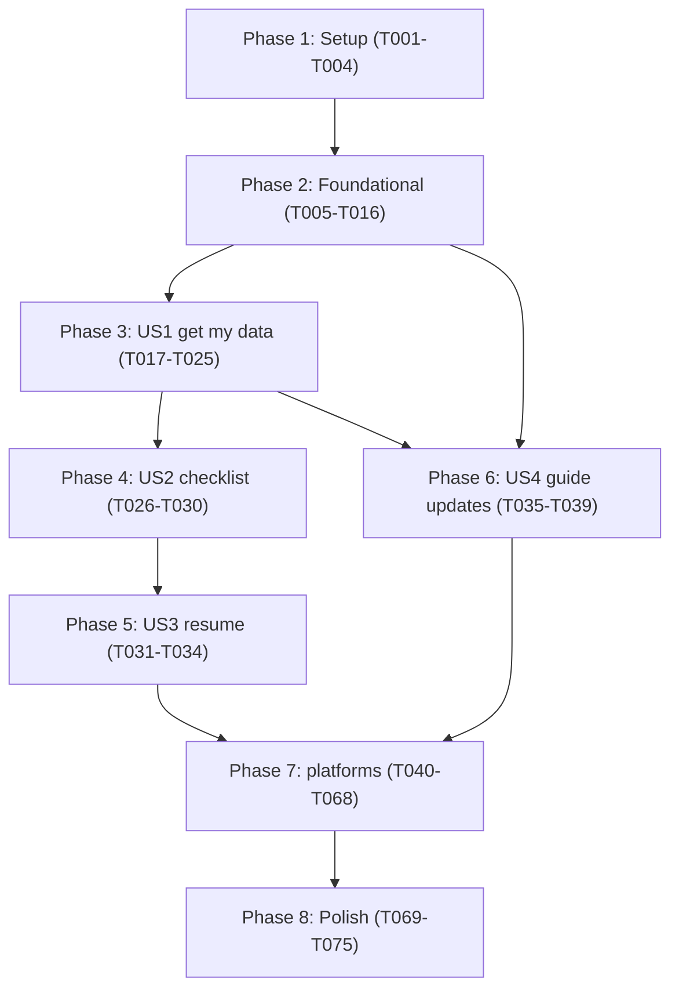

---

description: "Task list for the guided migration"
---

# Tasks: Guided Migration

**Input**: Design documents from `specs/005-guided-migration/` (plan.md, spec.md, research.md, data-model.md, contracts/guided-platform.md, contracts/guide-content.md, quickstart.md)

**Prerequisites**: Spec 004 (platform picker) merged, because this feature adds entries to its platform list and uses its Continue note. Constitution v1.4.0 merged (device code flow for Twitch). plan.md and spec.md present. The UX checklist in `checklists/ux.md` is reviewer-owned and does not block tasks.

**Tests**: Required by the constitution (principle II). Test tasks come before the code they check and must fail first. Parsers are tested on small made-up fixture exports, never on real user data. No test calls a real platform. Real exports are used only in the manual "real export check" tasks, kept outside the repo.

**Organization**: Shared flow first (Phases 1 to 6), then one group per platform (Phase 7). A platform's `ready` flag stays `false` until its group passes the real export check, so the shared flow can merge before any platform ships. Platform groups are independent and can ship in any order the owner picks, except Twitch, which also needs the Twitch app registration.

## Format: `[ID] [P?] [Story] Description`

- **[P]**: Can run in parallel (different files, no dependency on an unfinished task)
- **[Story]**: US1 to US4. Setup, Foundational, Platform, and Polish tasks have no label
- Paths are from the repository root

## Phase 1: Setup

**Purpose**: Dependencies, config, and a known-good start

- [ ] T001 Install the Expo modules with `npx expo install expo-document-picker expo-file-system expo-web-browser`. Check the Expo docs for each module and add a config plugin to `app.config.ts` only if the docs say one is needed on Android or iOS.
- [ ] T002 Install the unzip library with `npm install fflate` (pure TypeScript, no dependencies, research R4). Commit `package.json` and `package-lock.json`. Run `npm audit` and note any high or critical issue (constitution III.11).
- [ ] T003 [P] Add `EXPO_PUBLIC_TWITCH_CLIENT_ID=` and `EXPO_PUBLIC_GUIDE_HOST=` with empty values and a one-line comment each (public values only, no secrets) to `.env.example`. Do not touch `.env`.
- [ ] T004 Run `npm test`, `npm run typecheck`, and `npm run lint` before any code change. All pass. Write the test count in the commit message of T006.

---

## Phase 2: Foundational (blocks all user stories)

**Purpose**: Storage, list rules, guide rules, export reading, strings, and the types every platform plugs into.

**CRITICAL**: No user story work starts before this phase is done.

- [ ] T005 [P] Write `tests/unit/guidedStore.test.ts` for `src/store/guidedStore.ts` using the `expoSqlite` mock as `tests/unit/progressStore.test.ts` does: `saveList` stores items and a `guided_progress` row in one transaction; `getItems` returns rows ordered by `followed_at IS NULL, followed_at DESC, position`; `setState` moves a row between `open`, `ticked`, and `skipped`, updates `updated_at`, and sets `kept` back to 0 when the new state is `open`; a state outside `('open','ticked','skipped')` is rejected; the same `item_key` saved twice for one platform keeps one row; `getSummary` returns `{ total, ticked, skipped, open, kept }` or `null`; `setKept` sets `kept = 1`; `clearPlatform` deletes the progress row and its items; two platforms never see each other's rows (FR-016).
- [ ] T006 Create `src/store/guidedStore.ts` per data-model.md: tables created with `CREATE TABLE IF NOT EXISTS` in the existing database (`initStore()` from `src/store/progressStore.ts`): `guided_progress` (`platform_id TEXT PK`, `kept INTEGER NOT NULL DEFAULT 0`, `created_at INTEGER NOT NULL`, `updated_at INTEGER NOT NULL`) and `follow_item` (`platform_id TEXT NOT NULL REFERENCES guided_progress ON DELETE CASCADE`, `item_key TEXT NOT NULL`, `handle TEXT NOT NULL`, `display_name TEXT NOT NULL`, `followed_at INTEGER NULL`, `position INTEGER NOT NULL`, `state TEXT NOT NULL DEFAULT 'open' CHECK (state IN ('open','ticked','skipped'))`, `updated_at INTEGER NOT NULL`, `PRIMARY KEY (platform_id, item_key)`) with `PRAGMA foreign_keys = ON`. Export `saveList`, `getItems`, `setState`, `getSummary`, `setKept`, `clearPlatform`. Make T005 pass. The create-table statements run from a `initGuidedStore()` that `src/store/progressStore.ts` `initStore()` calls, so one open of the database creates every table.
- [ ] T007 [P] Extend `tests/unit/progressStore.test.ts`: `deleteAll()` also removes every `guided_progress` and `follow_item` row (FR-017, constitution III.6).
- [ ] T008 Edit `src/store/progressStore.ts` `deleteAll()` to run `DELETE FROM guided_progress` (items cascade). No other change. Make T007 pass.
- [ ] T009 [P] Write `tests/unit/followList.test.ts` for `src/guided/followList.ts`: `buildList(raw, handlePattern)` drops handles that fail the pattern; removes duplicates by lowercase handle, first one wins (FR-007); sorts by `followedAt` newest first with rows that have no time last in export order (clarification 2026-11-12); falls back to the handle when `displayName` is empty; `searchList(items, text)` matches display name or handle, ignores case and accents, matches part of the text, and returns the same order (FR-009); empty text returns everything.
- [ ] T010 Create `src/guided/followList.ts` with `RawFollow` (`{ handle, displayName, followedAt: number | null }`), `buildList`, and `searchList`. Pure functions, no React, no storage. Make T009 pass.
- [ ] T011 [P] Write `tests/unit/guides.test.ts` (validator part) for `src/guided/guides.ts`: a guide passes with `revision` a positive integer, `steps` of 1 to 12 items each with non-empty `text` of at most 300 characters, non-empty `alt` of at most 200 characters, and `image`, plus non-empty `exportHint` and `sampleImage`; each way to fail from contracts/guide-content.md is rejected (steps empty or more than 12, `text` empty or over 300 characters, `alt` empty or over 200 characters, remote image not `https` or not on the guide host); a fetched file with `version` not 1 or `guides` missing is rejected; unknown platform ids are ignored without an error.
- [ ] T012 Create `src/guided/guides.ts` with the `Guide` type, `validateGuide`, `validateGuidesFile(json, host)`, and `bundledGuide(platformId)` that reads `assets/guides/<id>.json`. No network yet (US4). Make T011 pass.
- [ ] T013 [P] Write `tests/unit/exportFile.test.ts` for `src/guided/exportFile.ts` with mocked `expo-document-picker` and `expo-file-system`: `pickExport()` returns the bytes of the chosen file and deletes the cached copy afterwards, also when reading throws (constitution III.6); a cancelled pick returns `null`; `readEntry(bytes, entryPath)` returns only the zip entry matching the pattern and does not inflate other entries; an entry larger than 50 MB uncompressed is rejected with a typed error; bytes that are not a zip are returned as one unnamed entry when the pattern is `null`; no function makes a network call.
- [ ] T014 Create `src/guided/exportFile.ts` using `expo-document-picker` (`copyToCacheDirectory: true`), `expo-file-system`, and `fflate` `unzipSync` with a `filter` for the one entry path (research R3, R4). Make T013 pass.
- [ ] T015 [P] Add the guided strings to `src/strings.ts` with the drafts in contracts/guided-platform.md: `guidedIntro(name, minutes)`, `pickFile`, `twitchSignIn`, `wrongFile`, `emptyFile`, `reading`, `readingCount(n)` "Found {n} so far", `cancel` (exists), `newAccountNote(name)`, `skip`, `skipped`, `done`, `searchPeople`, `noOneFound` "No one found", `progressCount(done, total)`, `finishedTitle`, `keepList`, `clearList`, `startAgain`, `startAgainAsk(name)`, `cantSave`, `retry`, `twitchWaiting`, `twitchExpired`, `markDone(name)`, `skipName(name)`, `openName(name)`. Simple words, one idea per sentence, no technical terms (constitution I).
- [ ] T016 Create `src/guided/guidedPlatforms.ts` with the `GuidedPlatform` type from contracts/guided-platform.md (`id`, `source` as a `file` or `twitch` kind, `handlePattern`, `profileUrl`, `guide`, `minutes`), `GUIDED_PLATFORMS` as an empty array, and `getGuidedPlatform(id)`. Platform entries are added only in Phase 7. Tests use `jest.mock('@/guided/guidedPlatforms')` with a fixture platform.

**Checkpoint**: Storage, list rules, guide checks, and export reading are tested. No screen has changed.

---

## Phase 3: User Story 1 - Follow the guide to get my data (Priority: P1) MVP

**Goal**: A user picks a Guided platform, reads the intro and the steps, picks an export file (or signs in to Twitch), and ends up on a checklist with one row per account.

**Independent Test**: Quickstart checks 1 to 4, 11, and 12 with the fixture platform in tests and one real platform when its group is done.

### Tests for User Story 1 (write first, they must fail)

- [ ] T017 [P] [US1] Write `tests/components/guidedFlow.test.tsx` with a mocked fixture `GuidedPlatform` and mocked `exportFile`: opening the platform shows the intro with its name, "about {minutes} minutes", and the promise that the app never follows or taps for the user and never asks for a password (US1-1, FR-003); the intro for a Twitch-kind platform also says Twitch asks the user to sign in only so the app can read the list; Continue shows the numbered steps, each with a sentence and a picture that has its `alt` text (US1-2, FR-004); with `fetch` mocked to fail the built-in steps still show (US1-7); Pick file with a valid export opens the checklist with one row per account and the count (US1-3); an export that is not the expected file shows the wrong-file message and the sample picture and lets the user pick again (US1-4); an export with zero valid accounts shows the empty-file message (FR-007); a slow read shows the working indicator with the count found so far and a Cancel button that returns to the data screen (US1-5); duplicates show once; Pick file is not offered when the platform already has a saved list (FR-017); a Twitch-kind platform shows Sign in with Twitch instead of Pick file and no export steps (US1-6, FR-004, FR-005).
- [ ] T018 [P] [US1] Write `tests/unit/twitchAuth.test.ts` for `src/auth/twitch.ts` with `fetch` mocked: `startSignIn()` posts to `https://id.twitch.tv/oauth2/device` with `client_id` and `scopes=user:read:follows` only and validates the response shape (`device_code`, `user_code`, `verification_uri`, `expires_in`, `interval`); `waitForToken()` polls `https://id.twitch.tv/oauth2/token` at `interval` with `grant_type=urn:ietf:params:oauth:grant-type:device_code`, keeps waiting on `authorization_pending`, stops with `expired` after `expires_in`, and stops on cancel; `revoke(token)` posts `client_id` and `token` to `https://id.twitch.tv/oauth2/revoke`; the token is never written to storage, logs, or state outside the call (constitution III.3, III.7, clarification 2026-11-12); a malformed response is rejected before use (III.8).
- [ ] T019 [P] [US1] Write `tests/unit/twitchApi.test.ts` for `src/api/twitch.ts` with `fetch` mocked: `listFollowedChannels(token)` reads `GET https://api.twitch.tv/helix/users` for the user id, then `GET https://api.twitch.tv/helix/channels/followed?user_id=...&first=100`, follows `pagination.cursor` as `after` until the pagination object is empty, and maps `broadcaster_login`, `broadcaster_name`, and `followed_at` to `RawFollow`; a response with a wrong shape is rejected; a failed call after sign-in still calls revoke (the flow wrapper test: revoke runs in `finally` on success, on error, and on cancel).

### Implementation for User Story 1

- [ ] T020 [P] [US1] Create `src/auth/twitch.ts` per research R2 and contracts/guided-platform.md: Device Code Grant Flow as a public client, `startSignIn`, `waitForToken`, `revoke`, and `openVerification(uri)` using `WebBrowser.openBrowserAsync`. Client id from `process.env.EXPO_PUBLIC_TWITCH_CLIENT_ID`. Hosts only `id.twitch.tv` and `api.twitch.tv`. Make T018 pass.
- [ ] T021 [P] [US1] Create `src/api/twitch.ts` with `listFollowedChannels` per T019. Make T019 pass.
- [ ] T022 [P] [US1] Create `src/ui/GuidedIntro.tsx`: intro text from `strings.guidedIntro(name, minutes)`, the Twitch sign-in note when the source is `twitch`, and a Continue button with an icon and a label and accessibility label.
- [ ] T023 [US1] Create `src/ui/GuidedData.tsx`: numbered steps (`Image` with `accessibilityLabel` from the step `alt`), the `exportHint`, a Pick file button (icon `document-outline`) for file platforms or a Sign in with Twitch button for the Twitch kind with the waiting message, Cancel button, and expired-code message; the reading state with the working indicator, the count so far, and Cancel. Reading yields to the UI every 500 items (research R6, comment `// ponytail: single JS thread with yields; move parsing to a worklet only if real exports freeze the UI.`). Pick file and Sign in show only when `getSummary(platformId)` is `null`.
- [ ] T024 [US1] Create `src/ui/GuidedFlow.tsx`: holds the part (`intro`, `data`, `checklist`, `finished`) in `useState`; opens on `checklist` when `getSummary` finds a list, else on `intro`; after a valid read calls `buildList`, `saveList`, then shows `checklist`; maps errors to `wrongFile` and `emptyFile`; for Twitch runs `startSignIn`, `openVerification`, `waitForToken`, `listFollowedChannels`, and `revoke` in a `finally`, dropping the token afterwards. The checklist and finished parts are placeholders until Phase 4. Make T017 pass.
- [ ] T025 [US1] Edit `App.tsx` `Screen` (spec 004): when `platform` is the id of a Guided platform show `GuidedFlow`, under the Home top bar rules from spec 004; the YouTube branch is unchanged. Add the Guided back behavior: the Android back action and the Home button leave `GuidedFlow` for Home with the saved list kept.

**Checkpoint**: With a fixture platform the flow goes intro, steps, file or sign-in, and a saved list. Nothing is shown on Home yet because no platform is `ready`.

---

## Phase 4: User Story 2 - Work through the checklist (Priority: P1)

**Goal**: A user works through rows: tap the name to open the profile, tick, untick, skip, search, and finish.

**Independent Test**: Quickstart checks 5 to 7 and 9. Load a list of 10 accounts, open one profile, tick it, and see 1 / 10.

### Tests for User Story 2 (write first, they must fail)

- [ ] T026 [P] [US2] Write `tests/components/guidedChecklist.test.tsx` with `Linking.openURL` mocked and a seeded store of 10 items: rows show tick box, name with the open-in-other-app icon, and Skip in that order, with a count "0 / 10" (FR-009, FR-011); tapping a name calls `Linking.openURL(profileUrl(handle))` and does not change state (US2-1, FR-010); tapping the tick box changes the count to "1 / 10" at once and opens nothing (US2-3); tapping it again restores "0 / 10" (US2-4); Skip marks the row skipped, shown apart from ticked and open by an icon and a word and not by color alone (US2-5, FR-011); rows keep newest-first order and do not move when ticked or skipped (FR-009); search filters by name or handle and keeps order and counts, and shows "No one found" when nothing matches (FR-009); the top note about signing in to the new account shows (US2-8, FR-014); when the app becomes active again (mocked `AppState` change) the scroll offset is kept and the row opened last is highlighted until it is ticked or skipped or the checklist is left (US2-2, FR-011); the accessibility labels are `Mark <name> as done`, `Skip <name>`, `Open <name> in the other app`, a row reads as the name and its state, and the progress bar reads "<done> of <total>" (FR-027); every row control has at least 48 x 48 points of hit area; a name wraps to at most 2 lines then ends with an ellipsis (FR-027); a failing `setState` keeps the new state on screen, shows the not-saved note, and a second tap retries (FR-028); with 1,000 rows the `FlatList` has `getItemLayout` and a memoized row (SC-004).
- [ ] T027 [P] [US2] Write `tests/components/guidedFinished.test.tsx`: when the last open row is ticked or skipped the finished screen shows the totals with Keep list and Clear list (US2-6, FR-026); Clear list calls `clearPlatform` and returns Home; Keep list calls `setKept`; leaving without choosing also keeps the list (US2-9); a kept list opens straight on the checklist and ticking a row back to open resets `kept`.

### Implementation for User Story 2

- [ ] T028 [P] [US2] Create `src/ui/FollowRow.tsx` (memoized): tick box, name as a link with icon `open-outline`, Skip button, state icon and word, highlight style, accessibility labels from T015 strings, 48 point minimum hit areas, `numberOfLines={2}` with `ellipsizeMode="tail"`, and `writingDirection` left to the text. Colors from `src/theme/theme.tsx`. Make the row part of T026 pass.
- [ ] T029 [US2] Create `src/ui/GuidedChecklist.tsx`: header with the progress bar and the count (`progressCount(ticked + skipped, total)`), the sign-in-to-new-account note, the search box (`searchPeople`), and a `FlatList` of `FollowRow` with `getItemLayout`, fixed row height, and `initialNumToRender`. Reads `getItems`, uses `searchList`, writes with `setState`, shows the not-saved note and retries (FR-028), and keeps the scroll offset with `onScroll` and a ref across `AppState` `active` changes. The Start again button is added in Phase 5. Make T026 pass.
- [ ] T030 [P] [US2] Create `src/ui/GuidedFinished.tsx` with the totals, Keep list and Clear list (icons and labels), and wire it in `src/ui/GuidedFlow.tsx` so the part switches to `finished` when `getSummary().open === 0`. Make T027 pass.

**Checkpoint**: A fixture list can be worked from first tap to the finished screen.

---

## Phase 5: User Story 3 - Stop and continue later (Priority: P2)

**Goal**: Closing the app loses nothing. Home shows Continue with the rows left. Start again and Delete all work.

**Independent Test**: Quickstart checks 8 and 10. Tick 5 rows, close the app, reopen, and see Continue and 5 ticked.

### Tests for User Story 3 (write first, they must fail)

- [ ] T031 [P] [US3] Write `tests/components/guidedResume.test.tsx` with the real store and the `expoSqlite` mock: after ticking 5 of 10 rows and unmounting the app, a new render shows the platform card with "Continue: 5 left" and tapping the card opens the checklist with 5 ticked (US3-1, SC-002); a kept finished list shows no Continue note and opens the checklist (FR-026); Start again asks first (`Alert.alert` answered with `answerAlert` from `tests/components/helpers.tsx`), and on yes removes the list and ticks for that platform only (US3-2, FR-017); two platforms keep their own lists (US3-4, FR-016); Delete all in Settings removes every guided list (US3-3, FR-017); with the fixture platform `ready: true` the Guided section appears on Home and with none ready it is hidden (spec 004 FR-001).
- [ ] T032 [P] [US3] Extend `tests/unit/platforms.test.ts` (spec 004 file): a Guided entry's `unfinished()` returns `{ left: <open rows>, ids: [<platformId>] }` when a list exists and is not kept, and `{ left: 0, ids: [] }` when none exists or it is kept (research R11).

### Implementation for User Story 3

- [ ] T033 [US3] Edit `src/platforms/platforms.ts`: add `guidedEntry(g: GuidedPlatform): Platform` that builds a Guided entry (`section: 'guided'`, label `strings.guidedLine`, `ready` from `g.ready`, `open` dispatching `openPlatform`, `unfinished` from `getSummary`), and append `...GUIDED_PLATFORMS.map(guidedEntry)` to `PLATFORMS`. Add a `ready` field to `GuidedPlatform` in `src/guided/guidedPlatforms.ts`, default `false`. Make T032 pass.
- [ ] T034 [US3] Edit `src/ui/GuidedChecklist.tsx`: add the Start again button (icon `refresh-outline`, label `strings.startAgain`) to the header; it asks with `Alert.alert(strings.startAgain, strings.startAgainAsk(name), ...)` and on yes calls `clearPlatform` then shows the data screen. Make T031 pass.

**Checkpoint**: Progress survives restart and clean-up works.

---

## Phase 6: User Story 4 - Guides stay correct when platforms change (Priority: P3)

**Goal**: With a guide host set, a newer guide replaces the bundled one without an app release. Without a host, only bundled guides are used.

**Independent Test**: Quickstart check 13 with a test host.

### Tests for User Story 4 (write first, they must fail)

- [ ] T035 [P] [US4] Extend `tests/unit/guides.test.ts` with `fetch` mocked and `EXPO_PUBLIC_GUIDE_HOST` set: `refreshGuides()` requests exactly `https://<host>/guides.json` with no query string, no cookies, no custom headers, and no account, list, token, or device identifier (US4-4, FR-023, SC-005); a valid file with a higher `revision` is saved in the `setting` table under the key `guides` and `loadGuide(platformId)` returns it next time (US4-2); a broken or incomplete file is ignored and the last good guide stays (US4-3, FR-022); a lower or equal `revision` keeps the bundled guide; a 10 second timeout or any network failure keeps the current guide with no error shown; with no host set `refreshGuides()` makes no request (research R9); it runs at most once per app start.
- [ ] T036 [P] [US4] Extend `tests/components/guidedFlow.test.tsx`: a fetched guide's remote image that fails to load falls back to the bundled picture of the same step (research R9).

### Implementation for User Story 4

- [ ] T037 [US4] Extend `src/guided/guides.ts` with `refreshGuides()` (`fetch` with `AbortController` timeout 10 s, validate with `validateGuidesFile`, save with `setSetting('guides', ...)` from `src/store/progressStore.ts`) and `loadGuide(platformId)` (last good fetched guide if its `revision` is higher, else the bundled one). Make T035 pass.
- [ ] T038 [US4] Edit `App.tsx` to call `refreshGuides()` once in the existing start-up `useEffect`, and `src/ui/GuidedData.tsx` to read the guide with `loadGuide` and fall back to the bundled step image on image error. Make T036 pass.
- [ ] T039 [US4] Add `https://<guide host>` to the host list in `specs/005-guided-migration/plan.md` Technical Context only after the owner has chosen the host. Until then leave `EXPO_PUBLIC_GUIDE_HOST` empty so no request is made.

**Checkpoint**: Shared flow complete. No platform is `ready` yet.

---

## Phase 7: Platforms (one group each, any order, none blocks another)

**Purpose**: Each platform adds a reader, a guide, and an entry. A platform shows on Home only after its real export check passes. Entry tasks edit the same two files (`src/guided/guidedPlatforms.ts` and the `PlatformId` union in `src/platforms/platforms.ts`), so do them one platform at a time, not in parallel. Every platform also needs its brand logo from the platform's own brand resources, unmodified, in `assets/platforms/<id>.png`, and the owner's check of its logo rules (spec 004 FR-012).

Each file-based group follows the same five tasks. Candidate export paths and link templates come from research R5 and contracts/guided-platform.md and MUST be confirmed against a real export in the real export check.

### Instagram

- [ ] T040 [P] Write `tests/fixtures/exports/instagram/` (a small made-up zip with a following JSON of 5 accounts: one duplicate, one bad handle, one with no time) and `tests/unit/parsers/instagram.test.ts` for `src/guided/parsers/instagram.ts`: returns `RawFollow[]` with handle, display name, and follow time; a file without the expected entry raises the wrong-file error; zero accounts raises the empty-file error.
- [ ] T041 Create `src/guided/parsers/instagram.ts` (entry path from research R5, `handlePattern`, `profileUrl` `https://www.instagram.com/<handle>/` with the handle URL-encoded). Make T040 pass.
- [ ] T042 [P] Write `assets/guides/instagram.json` (a `Guide` that passes `validateGuide`: `revision` 1, steps with `text` and `alt`, `exportHint` naming the JSON format) and `assets/guides/instagram/step-<n>.png` and `sample.png`. The owner supplies the screenshots; use placeholders clearly named `TODO` only on a branch that does not set `ready`.
- [ ] T043 Add the `instagram` id to `PlatformId` in `src/platforms/platforms.ts` and an Instagram entry (`ready: false`, `minutes`) to `GUIDED_PLATFORMS` in `src/guided/guidedPlatforms.ts`. Add `assets/platforms/instagram.png`.
- [ ] T044 Real export check (manual, owner): request a JSON export from a test Instagram account, read it in a dev build, confirm the row count and the profile links, then set `ready: true`. Keep the export outside the repo and delete it after the check. Note the result in the pull request description.

### Facebook

- [ ] T045 [P] Write `tests/fixtures/exports/facebook/` and `tests/unit/parsers/facebook.test.ts` for `src/guided/parsers/facebook.ts` with the same four cases as T040.
- [ ] T046 Create `src/guided/parsers/facebook.ts` (link `https://www.facebook.com/<handle>`). Make T045 pass.
- [ ] T047 [P] Write `assets/guides/facebook.json`, its step pictures, and the sample picture as in T042.
- [ ] T048 Add the `facebook` id, entry, and `assets/platforms/facebook.png` as in T043.
- [ ] T049 Real export check for Facebook as in T044, then set `ready: true`.

### Threads

- [ ] T050 [P] Write `tests/fixtures/exports/threads/` and `tests/unit/parsers/threads.test.ts` for `src/guided/parsers/threads.ts` with the same four cases as T040.
- [ ] T051 Create `src/guided/parsers/threads.ts` (link `https://www.threads.com/@<handle>`). Make T050 pass.
- [ ] T052 [P] Write `assets/guides/threads.json`, its step pictures, and the sample picture as in T042.
- [ ] T053 Add the `threads` id, entry, and `assets/platforms/threads.png` as in T043.
- [ ] T054 Real export check for Threads as in T044, then set `ready: true`.

### TikTok

- [ ] T055 [P] Write `tests/fixtures/exports/tiktok/` and `tests/unit/parsers/tiktok.test.ts` for `src/guided/parsers/tiktok.ts` with the same four cases as T040. TikTok may give JSON or TXT: cover both if the real export check shows both.
- [ ] T056 Create `src/guided/parsers/tiktok.ts` (link `https://www.tiktok.com/@<handle>`). Make T055 pass.
- [ ] T057 [P] Write `assets/guides/tiktok.json`, its step pictures, and the sample picture as in T042.
- [ ] T058 Add the `tiktok` id, entry, and `assets/platforms/tiktok.png` as in T043.
- [ ] T059 Real export check for TikTok as in T044, then set `ready: true`.

### X

- [ ] T060 [P] Write `tests/fixtures/exports/x/` (the `data/following.js` shape: a JavaScript wrapper around JSON, per research R5) and `tests/unit/parsers/x.test.ts` for `src/guided/parsers/x.ts` with the same four cases as T040, plus: a file that gives only numeric ids yields rows whose handle is the id and whose link is `https://x.com/i/user/<id>`.
- [ ] T061 Create `src/guided/parsers/x.ts` (link `https://x.com/<handle>` or `https://x.com/i/user/<id>`). Make T060 pass.
- [ ] T062 [P] Write `assets/guides/x.json`, its step pictures, and the sample picture as in T042.
- [ ] T063 Add the `x` id, entry, and `assets/platforms/x.png` as in T043.
- [ ] T064 Real export check for X as in T044, then set `ready: true`. If the real archive has no usable follow list, say so in the pull request and stop this group (spec assumption: out of scope).

### Twitch (needs the Twitch app registered as a public client)

- [ ] T065 Owner to-do, not code: register the Twitch app as a public client and set `EXPO_PUBLIC_TWITCH_CLIENT_ID` in `.env` and in the EAS environment. Never commit the value of a real key to `.env.example`.
- [ ] T066 [P] Write `assets/guides/twitch.json` with only the intro-side text and the notes (no export steps, FR-004), still valid under `validateGuide` (one step explaining the sign-in), plus its picture and `alt`.
- [ ] T067 Add the `twitch` id and a Twitch entry (`source: { kind: 'twitch' }`, `handlePattern` for Twitch logins, `profileUrl` `https://www.twitch.tv/<login>`, `ready: false`) and `assets/platforms/twitch.png`.
- [ ] T068 Real sign-in check (manual, owner): with a test Twitch account that follows a few channels, sign in through the device code flow in a dev build, confirm the checklist, confirm in the network log that a revoke call is made and that nothing Twitch-related is stored on the phone, then set `ready: true`.

---

## Phase 8: Polish & Cross-Cutting Concerns

- [ ] T069 [P] Add a network audit test to `tests/unit/`: with `fetch` mocked, run the guided flow for a fixture platform from export read to finished and assert that no request is made other than the allowed hosts (`id.twitch.tv`, `api.twitch.tv`, the guide host) and that no request body or URL contains export contents, handles, or account names (FR-023, SC-005, constitution III.5).
- [ ] T070 [P] Add a log audit: search `src/guided/`, `src/auth/twitch.ts`, and `src/api/twitch.ts` for `console.` and `log(` and confirm none writes a token, handle, name, or export content (constitution III.7). Fix anything found and add a test if code is changed.
- [ ] T071 [P] Check that every new text is in `src/strings.ts`, every new button and row action has an icon, a label, and an accessibility label (FR-024), and no new file is a catch-all (constitution I and IV).
- [ ] T072 [P] Add a contrast test for the state colors used by `FollowRow` (4.5 to 1 against the background in Light and Dark) in `tests/unit/theme.test.ts` and fix any token that fails.
- [ ] T073 Run `npm test`, `npm run typecheck`, `npm run lint`, and `npm audit`. All pass with no high or critical audit issue. Compare the test count with T004.
- [ ] T074 Walk through `quickstart.md` checks 1 to 13 for each platform that is `ready`, on Android and iOS. Write results in the pull request description.
- [ ] T075 [P] Update the design docs to match what was built: add `alt` to Guide Step in `data-model.md`, the Start again and retry rules, and any file that was added or renamed in plan.md Source Code.

---

## Dependencies and order

- Spec 004 must be merged before T025, T033, and T034, because they edit its files.
- T006 needs T005. T010 needs T009. T012 needs T011. T014 needs T013. T024 needs T020 to T023. T029 needs T028. T030 needs T029.
- US4 needs only Phase 2 and the data screen from US1. It can be built next to US2 and US3 by a second person, but `App.tsx` and `src/ui/GuidedData.tsx` are edited in T025, T023, T038: do those in order.
- Platform groups are independent of each other. A platform group needs Phases 1 to 5; it needs Phase 6 only to use fetched guides.
- Twitch also needs T065 (the owner's registration) before T068.

## Parallel examples

- Foundational: T005, T007, T009, T011, T013, and T015 touch different files and can start together.
- US1 tests: T017, T018, and T019 together; then T020, T021, and T022 together.
- Platform groups: while the owner prepares real exports, the fixture and parser tasks of different platforms (T040, T045, T050, T055, T060) can all be written together.

## Implementation strategy

1. **MVP**: Phases 1 to 5 plus one platform group from Phase 7. The first platform ships with its guide bundled and no guide host.
2. **Then** the other platforms, one at a time in the order the owner picks. A platform ships only after its real export check.
3. **Then** Phase 6 when the owner has chosen and set up the guide host.
4. **Twitch last**: it needs the owner's registration and the device code flow checks.
5. **Owner to-dos before release** (not code): platform logos and their brand rules, screenshots for each guide, the Twitch app registration, the guide host.
