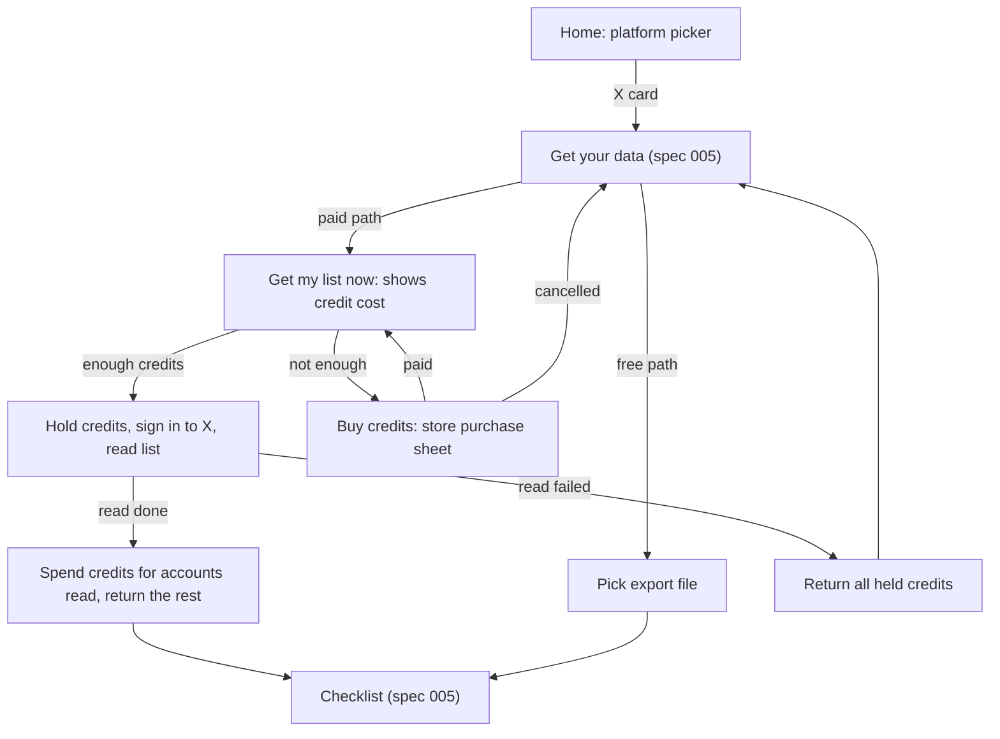
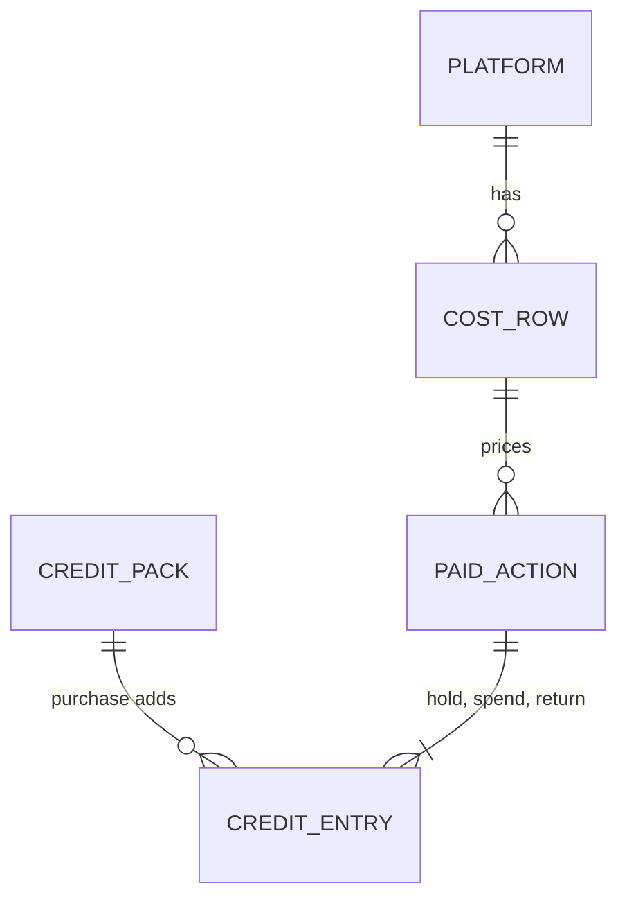
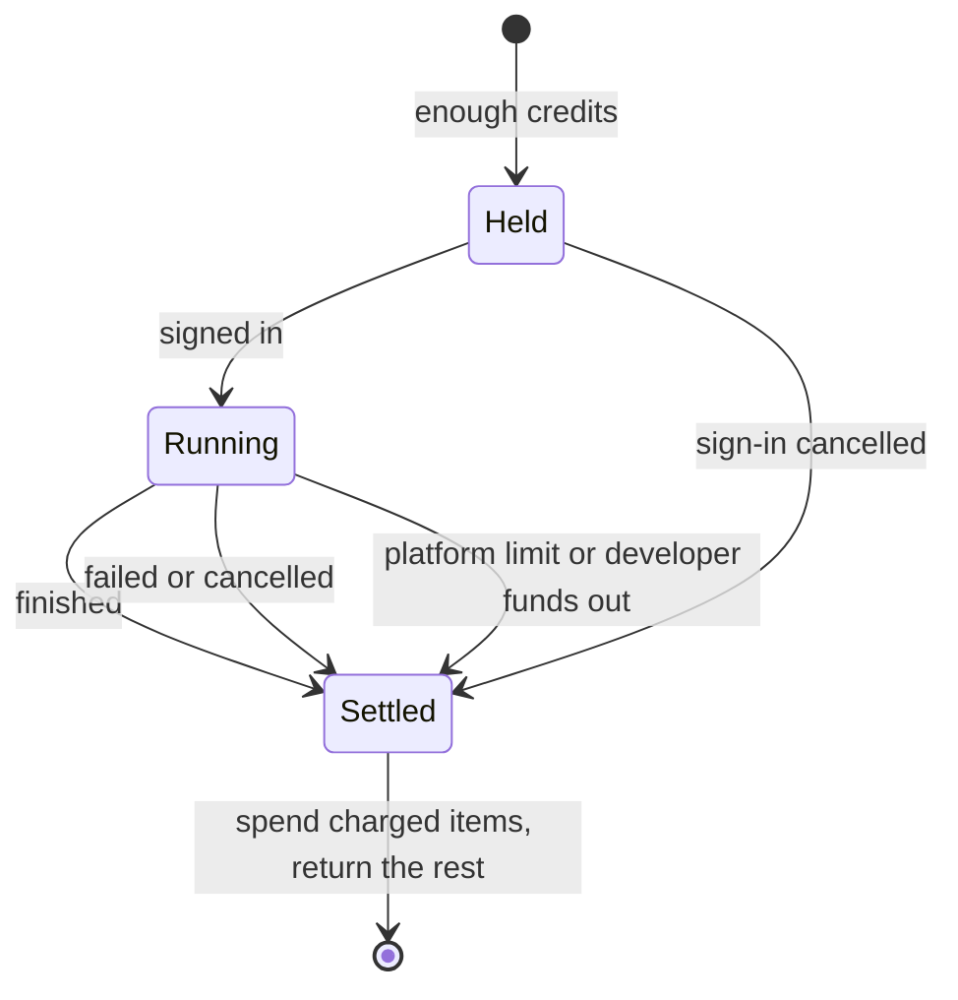

# Feature Specification: Credits for Paid Platform APIs

**Feature Branch**: `feature/paid-api-credits`

**Created**: 2026-11-12

**Status**: Draft

**Depends on**: [004 Platform Picker](../004-multi-platform-picker/spec.md) and [005 Guided Migration](../005-guided-migration/spec.md). Credits plug into a platform's flow only where that platform's API charges money per call.

**Input**: User description: "Allow users to purchase credit for platforms that charge based on API calls or actions. Research which platforms in the automatic flow charge fees to call their API. Write the pricing in the spec, suggest a mechanism to track credit for each platform, and leave the pricing model open for discussion. List what Google Play and the App Store may restrict."

## Research summary: which platforms charge for API calls

Checked in November 2026. Prices change often, and most numbers come from third-party summaries of the platform's own console. The project owner MUST check each price in the platform's developer console before release.

| Platform | Section today | Charges per call? | What it costs the app | Can credits help? |
| --- | --- | --- | --- | --- |
| YouTube | Automatic | No | Free. Shared quota of 10,000 units per day per project. `subscriptions.insert` costs 50 units. More quota cannot be bought, only asked for through Google's audit form. | No. Money cannot buy quota. |
| Bluesky | Automatic (planned) | No | Free. Per-account write budget (about 5,000 points per hour, 35,000 per day; one create costs 3 points). | No. |
| GitHub | Automatic (planned) | No | Free. Rate limit of about 5,000 requests per hour per signed-in user. | No. |
| Reddit | Automatic (planned) | Only for commercial use | Free for non-commercial use (about 100 requests per minute per app). An app that sells anything counts as commercial: it needs Reddit's written approval and a contract with a price Reddit sets. The widely quoted price is $0.24 per 1,000 calls, but Reddit publishes no rate card. Since late 2025 every app needs approval under the Responsible Builder Policy. | Maybe, after Reddit approves the app and names a price. |
| X | Guided | Yes, pay-per-use | Reading the user's own following list ("owned read") is about $0.001 per account returned (since April 2026). Other reads are about $0.005 to $0.010 per item. Creating a follow is no longer offered on any self-serve plan (removed April 2026). It is Enterprise only, reported from about $42,000 per month. | Yes, for reading the list only. X stays Guided: the user still taps Follow. |
| Mastodon | Not planned yet | No | Free. Each server sets its own rate limits. | No. |
| Spotify | Not planned yet | No | Free, but apps with more than 5 users need extended access, which needs a registered company with at least 250,000 monthly active users. | No. Blocked by access rules, not money. |
| Twitch | Guided | No | Free. Reading followed channels needs no payment. Following through the API was removed in 2023. | No. |

**Finding**: no platform in the Automatic section charges per call today. The only paid API with a clear self-serve price is X, and only for reading the user's own following list. That read replaces the X export file in the Guided flow (spec 005): the X export takes about a day to arrive, the paid read takes seconds. Reddit is the second candidate, but only once Reddit approves the app and sets a price. Credits therefore start as an optional "get my list now" for X, built so more platforms and actions can be added by price table.

## How it fits the existing flows

## User Scenarios & Testing *(mandatory)*

### User Story 1 - See the cost before I pay (Priority: P1)

A user is on a step that uses a paid platform API, for example getting their X follow list. The app shows two choices side by side: the free way (for X, the export file, which takes about a day) and the paid way, labeled with its credit cost and the user's current balance, for example "Get my list now: about 12 credits. You have 40." When the app cannot know the exact count before it starts, it shows a top limit ("up to 12 credits") and says the user pays only for what is used.

**Why this priority**: a user must never pay without knowing. The store review also rejects apps whose price is unclear.

**Independent Test**: Open the X data step with a test balance. Check that both choices show, that the paid choice shows cost and balance, and that the free choice works with zero credits.

**Acceptance Scenarios**:

1. **Given** a step has a paid option, **When** it shows, **Then** the free option is also shown and works with zero credits.
2. **Given** the cost depends on a count the app does not know yet, **When** the paid option shows, **Then** it shows a top limit and the words "you pay only for what is used".
3. **Given** the user's balance covers the top limit, **When** they tap the paid option, **Then** the action starts with no extra confirm step.
4. **Given** the balance does not cover the top limit, **When** they tap the paid option, **Then** the app opens Buy credits with the smallest pack that covers the gap marked.
5. **Given** a screen reader is on, **When** focus moves to the paid option, **Then** it reads the action, the cost, and the balance.

---

### User Story 2 - Buy credits (Priority: P1)

A user opens Buy credits from a paid step or from Settings. They see a short list of packs, each with the number of credits and the local price from the store. They tap one, the phone's store sheet opens, they confirm, and the balance goes up at once. If they cancel, nothing changes.

**Why this priority**: without a purchase there is nothing to spend.

**Independent Test**: In the store's test mode, buy each pack on Android and iPhone. Check that the balance goes up by the right amount, that a cancelled purchase changes nothing, and that a purchase completed while the app was closed is added on next open.

**Acceptance Scenarios**:

1. **Given** Buy credits opens, **When** it shows, **Then** each pack shows credits and the store's local price, and no price is typed into the app.
2. **Given** the user confirms a purchase, **When** the store says it is paid, **Then** the balance goes up by the pack's credits and the app marks the purchase as delivered.
3. **Given** the user cancels or the payment fails, **When** the sheet closes, **Then** the balance is unchanged and the app says so in plain words.
4. **Given** the app closed during a purchase, **When** it opens again, **Then** it finds the paid purchase, adds the credits once, and marks it delivered.
5. **Given** the store later refunds a purchase, **When** the app learns of it, **Then** it removes those credits, and the balance may go below zero only until the next purchase.
6. **Given** the store is not available (for example no store account on the phone), **When** Buy credits opens, **Then** it says buying is not possible right now and the free path still works.

---

### User Story 3 - Pay only for what worked (Priority: P1)

When a paid action starts, the app holds the top-limit amount from the balance. As each paid call finishes, the app spends credits only for what the platform charged for, for example each account read. When the action ends, failed, cancelled, or stopped by a platform limit, the app returns every held credit it did not spend. The user sees "Used 9 credits. 3 returned."

**Why this priority**: the user trusts the app with money. Charging for failed work breaks that trust and invites refunds.

**Independent Test**: Run a paid read with a mocked platform that fails half way. Check that spent credits match the accounts read before the failure and that the rest are returned.

**Acceptance Scenarios**:

1. **Given** a paid action starts, **When** credits are held, **Then** the shown balance drops by the held amount and shows "held" next to it.
2. **Given** the action finishes, **When** the app settles, **Then** it spends credits for each charged item and returns the rest in one step.
3. **Given** the action fails, is cancelled, or the app closes, **When** the app next runs, **Then** it settles the hold from what was actually received and returns the rest. A hold never stays open.
4. **Given** the platform returns the same account twice, **When** the app settles, **Then** it charges as the platform charged. The cost table says how each platform counts.
5. **Given** a paid action ends, **When** the user looks, **Then** they see credits used and credits returned.

---

### User Story 4 - See where my credits went (Priority: P2)

In Settings, a Credits row shows the balance. Tapping it shows a simple history: each purchase, each paid action with platform, date, credits used and returned, and each refund.

**Why this priority**: a clear history answers "where did my credits go?" without support, and it is the record the app uses for its own balance.

**Independent Test**: Buy one pack, run one paid action, and refund a test purchase. Check that the history shows three entries and the balance equals the sum.

**Acceptance Scenarios**:

1. **Given** the user opens Credits, **When** it shows, **Then** the balance equals the sum of all history entries.
2. **Given** a paid action ran, **When** the user looks at its entry, **Then** it shows the platform, the action, the date, credits used, and credits returned.
3. **Given** the user taps Delete all in Settings, **When** they have credits left, **Then** the confirm message says the credits will be lost too and states the number.

---

### Edge Cases

- A platform raises its price after release: the app's cost table changes and the new cost shows before the next action. Actions already held keep the old cost.
- The platform charges the app more than the cost table says (for example it counts an item the app did not expect): the user pays only the shown cost. The project owner sees the gap in the cost tracking (FR-019).
- The platform's daily or monthly cap for the app is reached: the paid option shows as "not available today", the free path still works, and no credits are held.
- The developer account at the platform runs out of prepaid funds: same as a cap. The user is never charged for it.
- The user buys credits on one phone and opens the app on another phone or the other phone type: see the clarification on where the balance lives (FR-014).
- The user reinstalls the app: same as above.
- A child buys credits: the store's own parental controls apply. The app adds no extra step.
- A platform stops offering the paid endpoint: its paid option is hidden. Credits stay and can be used on other platforms, or refunded under the store's rules.

## Requirements *(mandatory)*

### Functional Requirements

**Cost and choice**

- **FR-001**: A step that calls a paid platform API MUST also offer the free path for the same goal when one exists, and the free path MUST work with zero credits.
- **FR-002**: Before a paid action, the app MUST show its cost in credits (exact, or a top limit with "you pay only for what is used") and the user's balance.
- **FR-003**: Credit costs MUST come from one cost table: one row per platform and paid action, with what is counted (for example "per account read") and credits per unit. Adding a platform or action MUST need only a new row and that platform's flow.
- **FR-004**: Free platforms (YouTube, Bluesky, GitHub, Mastodon, Twitch) MUST NOT show or use credits.

**Buying**

- **FR-005**: Credits MUST be sold only through the phone's store purchase system (Google Play Billing on Android, In-App Purchase on iOS), as consumable packs.
- **FR-006**: Pack prices MUST come from the store, in the user's local currency. The app MUST NOT type prices into its own text.
- **FR-007**: The app MUST add credits for a purchase exactly once, including purchases completed while the app was closed, and MUST mark each purchase as delivered so the store does not refund it automatically.
- **FR-008**: The app MUST remove credits when the store reports a refund or cancelled purchase.
- **FR-009**: Credits MUST NOT expire.

**Spending**

- **FR-010**: Starting a paid action MUST hold its top-limit cost. Finishing, failing, or cancelling it MUST spend credits only for items the platform charged for and return the rest.
- **FR-011**: A hold left open (app closed, phone off) MUST be settled the next time the app runs.
- **FR-012**: A paid action MUST NOT start when the balance is below its top limit.
- **FR-013**: The app MUST stop a paid action and settle when a platform limit, cap, or payment problem on the developer side is reached, and MUST show it as "not available right now", not as the user's fault.

**Tracking**

- **FR-014**: The balance MUST be the sum of a history of entries (purchase, hold, spend, return, refund), never a number stored on its own. [NEEDS CLARIFICATION: Where does the history live? (A) on the phone only: no backend, but the balance is lost on reinstall or a new phone, and a user who edits app data can spend credits the developer then pays for; (B) a small server owned by the project that checks store receipts, keeps the history, and makes the paid calls with the developer's platform key: safe and survives reinstall, but needs a constitution amendment (Principle III.5 forbids an own backend) and a new host in the allowlist; (C) the server checks receipts and keeps the history, but the phone makes the paid calls with the user's own sign-in.]
- **FR-015**: The Credits screen MUST show the balance and the history, newest first, with platform, action, date, credits used, and credits returned.
- **FR-016**: Delete all MUST warn when credits are left, state the number, and say they will be lost.
- **FR-017**: History entries MUST NOT contain follow lists, account names, tokens, or email addresses. They hold only platform, action, counts, credits, date, and store purchase reference.

**Pricing model**

- **FR-018**: The price of a credit and the size of each pack MUST follow the pricing model chosen by the project owner. [NEEDS CLARIFICATION: Which pricing model? See Question 1 in the pricing discussion below.]

**Cost tracking for the project owner**

- **FR-019**: For each platform with a paid API, the project MUST be able to compare credits spent by users against what the platform billed for the same period, per platform and action, so a wrong cost row or price change is found within one billing cycle. This compares totals only and carries no user data.

**Scope**

- **FR-020**: The first paid action MUST be: X, read the user's own following list, as the fast path in the X Guided flow. [NEEDS CLARIFICATION: Should Reddit's Automatic flow be built on credits now, assuming Reddit approves commercial use, or wait until Reddit names a price?]

**Plain words, both phone types**

- **FR-021**: All new text MUST use simple words (for example "credits", "used", "returned", "not available right now"). Every new button MUST have an icon, a label, and an accessibility label.
- **FR-022**: The feature MUST behave the same on Android and iOS apart from the store differences listed below.

### Platform-specific: X (paid read of following list)

| Item | Value |
| --- | --- |
| Paid action | Read the signed-in user's own following list |
| What X counts | Each account returned (owned read) |
| X price (Nov 2026, check console) | about $0.001 per account |
| Sign-in | X OAuth 2.0 with PKCE, user context, scopes `follows.read users.read tweet.read` (read only) |
| New hosts for the allowlist | `x.com` (sign-in page), `api.x.com` (token and list read) |
| What the user still does | Taps Follow on each profile in the Guided checklist. X no longer lets self-serve apps follow for a user. |
| Developer setup | X developer account on pay-per-use with prepaid funds and a monthly spend cap, done by the project owner |

### Platform-specific: Reddit (candidate, not committed)

| Item | Value |
| --- | --- |
| Paid action | Read subscribed subreddits, join subreddits on the target account |
| Reddit price | Not published. Set by Reddit in a commercial agreement. The widely quoted figure is $0.24 per 1,000 calls. |
| Blocker | Reddit's approval for commercial use. Selling credits in the app makes the app commercial. |

### Store differences

| Item | Android (Google Play) | iOS (App Store) |
| --- | --- | --- |
| Purchase system | Google Play Billing, consumable product | In-App Purchase, consumable product |
| Must mark as delivered | Yes, within 3 days, or Play refunds the user automatically | Yes, finish the transaction after crediting |
| Refunds | User can get a refund from Play; the app learns of it through Play's voided purchases | User asks Apple; the app learns of it through Apple's refund notice |
| Restore on new phone | Consumables are not restored by the store | Consumables are not restored by the store |
| Store fee | 15% on the first $1M per year, then 30% | 15% in the Small Business Program, else 30% |
| Test buying | License testers and test cards | Sandbox testers and TestFlight |

### Key Entities *(include if feature involves data)*

- **Credit pack**: a store product. It has a number of credits and a store price.
- **Cost row**: one paid action on one platform. It has what is counted and credits per unit.
- **Credit entry**: one line in the history: purchase, hold, spend, return, or refund. It has a count of credits, a date, and a link to a purchase or a paid action.
- **Paid action**: one run of a paid platform call. It has a platform, an action, a held amount, and how many items were charged.

### Paid action states

## Pricing discussion (for the project owner)

This section is input for the decision in FR-018. It is not a requirement.

**Cost floor for X.** 1 account read costs the app about $0.001. After the store fee (15%), $0.99 buys about $0.84 of X reads, so about 840 accounts at cost. A typical user follows a few hundred accounts on X.

| Model | How it works | Pros | Cons |
| --- | --- | --- | --- |
| A. Credit packs | 1 credit = 1 account read on X. Packs such as 500 credits for $0.99, 2,000 for $2.99. Later platforms get their own credits per unit in the cost table. | Fair: pay for what you use. Matches FR-010 hold and return. Works for any future platform. | Users must think about credits. Leftover credits feel like lost money. Needs a balance and history. |
| B. One price per move | "Get my X list now: $1.99", any size up to a fair-use cap (for example 5,000 accounts). | Simplest for users. No balance to explain. | Large lists cost you more than small ones. Each new platform needs its own product. Still a consumable, so the same store rules. |
| C. Subscription | Monthly plan that covers paid reads up to a cap. | Steady income. | Wrong fit: most users migrate once. High churn and refund risk. More store rules (auto-renew text, cancel flow). |
| D. Free, owner pays | No purchase. The owner pays X directly, with a monthly cap. | No store billing work at all. | Owner pays all costs. Cap runs out for everyone at once. |

Recommendation: start with **A**, with packs sized so one pack covers a typical X list, and show cost in plain numbers. B is the fallback if A tests as confusing.

## Store and platform restrictions to know before building

These are risks for the project owner. They are not app requirements, but several requirements above exist because of them.

**Google Play**

- Digital items used inside the app, credits included, MUST be sold through Google Play Billing. Linking to a web payment page is allowed only in some countries under Play's alternative or external billing programs, with their own fees and reporting.
- Unacknowledged purchases are refunded automatically after 3 days.
- Play's policy forbids apps that help users break another service's terms. Every paid call MUST stay within the platform's developer terms (Principle V).
- Selling anything needs a Play payments profile with real identity, bank, and tax details, and a merchant account in each country where the app sells.
- The Data safety form MUST list purchase history if the app or a server keeps it.

**Apple App Store**

- Guideline 3.1.1: credits MUST be sold through In-App Purchase, and credits bought that way MUST NOT expire. In the US storefront only, apps may also link to an outside payment page.
- Guideline 5.2.2: using a third-party service is allowed only if its terms allow it. Apple may ask for proof (for example the X or Reddit agreement).
- Selling needs the Paid Apps Agreement, bank, and tax forms in App Store Connect.
- App Review tests the purchase in sandbox and needs a working demo account for the paid platform (for example a test X account).
- If the app adds user accounts for a server balance, Guideline 5.1.1(v) requires in-app account deletion. Delete all already covers this if the server balance is tied to it.

**Platforms**

- X: the paid read needs an X developer account with prepaid funds. Set a monthly spend cap in the X console so a bug cannot run up costs.
- Reddit: charging users makes the app commercial. Reddit approval and a contract come first.
- YouTube: YouTube stays free in this app. If Magpie sells anything, check whether YouTube's Developer Policies (section III.J, commercialization) need written approval, and include the credits feature in the YouTube API audit.

## Success Criteria *(mandatory)*

### Measurable Outcomes

- **SC-001**: In every test run, the credits spent on a paid action equal the items charged, and the credits returned equal held minus spent.
- **SC-002**: In every test run, the balance equals the sum of the history.
- **SC-003**: 100% of test purchases, including those finished while the app was closed, add credits exactly once.
- **SC-004**: A user can go from a paid step with too few credits to a finished purchase and back to the step in under 1 minute.
- **SC-005**: Monthly, credits spent per platform and action differ from what the platform billed by less than 5%.
- **SC-006**: Every free path works with zero credits, checked on both phone types.

## Assumptions

- The first paid action is the X list read. X stays in the Guided section, because the user still taps Follow.
- Credits are spent across platforms: one balance, priced per platform in the cost table.
- Prices in this spec are from November 2026 third-party summaries and MUST be checked in each platform's console before release.
- The project owner sets up the store merchant accounts, the X developer account with prepaid funds and a spend cap, and any platform agreements. These are outside the app.
- The store's own parental controls and purchase limits are enough. The app adds no age check.
- Out of scope: selling anything other than credits, subscriptions, ads, gifting or moving credits between users, and paying for free platforms' quota.

## Sources

- [X API pay-per-use pricing summary](https://www.outstand.so/blog/x-api-pricing), [X changelog](https://docs.x.com/changelog), [TechCrunch on X pay-per-use](https://techcrunch.com/2025/10/21/x-is-testing-a-pay-per-use-pricing-model-for-its-api/)
- [Reddit Data API terms and commercial use summary](https://prowlo.com/blog/reddit-data-api), [Reddit API pricing summary](https://snitchfeed.com/blog/reddit-api-pricing)
- [YouTube quota costs](https://developers.google.com/youtube/v3/determine_quota_cost), [YouTube Developer Policies](https://developers.google.com/youtube/terms/developer-policies)
- [Bluesky rate limits summary](https://adaptlypost.com/blog/bluesky-api-rate-limit)
- [Spotify Web API extended access criteria](https://developer.spotify.com/blog/2025-04-15-updating-the-criteria-for-web-api-extended-access)
- [Google Play billing rules summary](https://www.ganakys.com/blog/google-play-payment-policies-external-billing-2026)
- [Apple guideline 3.1.1 update, May 2025](https://mjtsai.com/blog/2025/05/02/app-review-guidelines-updated-for-epic-anti-steering/)
