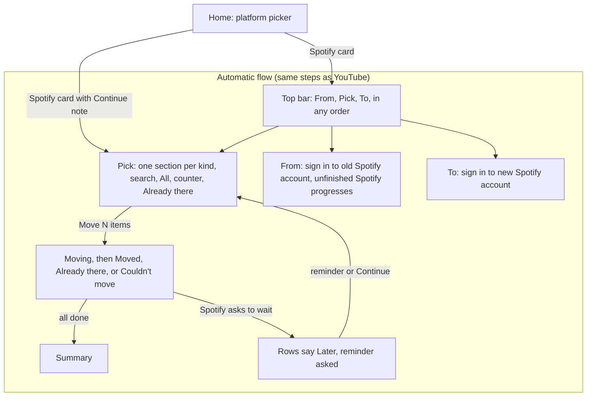
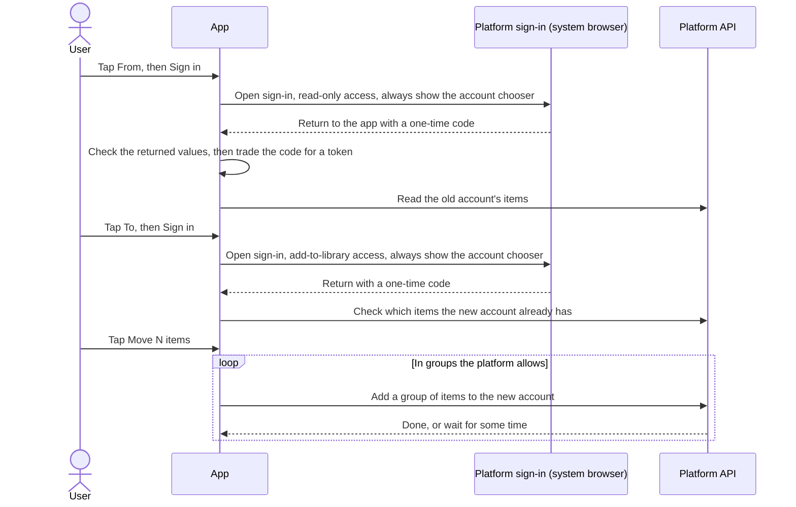
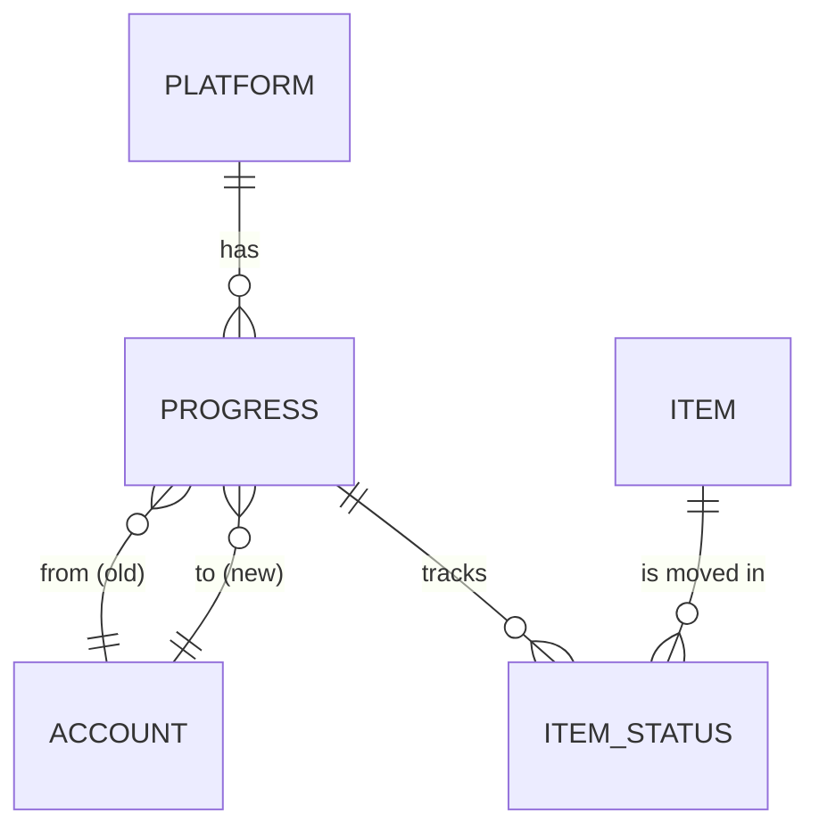

# Feature Specification: Spotify Platform

**Feature Branch**: `feature/spotify-platform`

**Created**: 2026-11-13

**Status**: Cancelled. Spotify gives wider API access only to registered organisations with at least 250,000 monthly active users, so Magpie can serve at most 5 test accounts.

**Input**: User description: "add platform Spotify. If you need me do anything (such as creating Auth app), list out here"

**Related**: [004 Platform Picker](../004-multi-platform-picker/spec.md) adds the card to Home. [001 Subscription Migration](../001-subscription-migration/spec.md) defines the Automatic flow that Spotify reuses. [006 Paid API Credits](../006-paid-api-credits/spec.md) holds the earlier research on Spotify access rules.

## Why cancelled

The project owner cancelled this spec on 2026-11-13. Spotify's test mode (Development Mode) serves at most 5 named accounts, and Magpie does not meet the rules for wider access. The spec is kept as a record.

From Spotify's [Quota modes](https://developer.spotify.com/documentation/web-api/concepts/quota-modes) page:

> **Quota Extension Request for New Potential Partners**
>
> Please note that as of May 15th 2025, Spotify only accepts applications from organizations (not individuals). For more information on this update, read [here](https://developer.spotify.com/blog/2025-04-15-updating-the-criteria-for-web-api-extended-access).
>
> Application must be sent through a company email by using this form. Check out the implementation requirements below to make sure your company is compatible before submitting your application.
>
> Implementation requirements:
>
> - Established Business Entity (legally registered business or organisation)
> - Operating an active, and Launched Service
> - Maintaining a minimum of active users (at least 250k MAUs)
> - Being available in key Spotify markets
> - Commercial Viability
> - Adherence to Terms

## Summary

Spotify becomes the second Automatic platform. The user picks the Spotify card on Home, signs in to an old Spotify account, picks what to move, signs in to a new Spotify account, and taps Move. The app adds the picked items to the new account through Spotify's official API. The screens, steps, row states, saved progress, and Settings work the same way as for YouTube. Only the platform-specific parts differ: sign-in, what can be moved, the limits, and the words for the items.

## How the screens connect

## How sign-in and the move work

## Clarifications

### Session 2026-11-13

- Q: Which kinds of Spotify items should a migration move? → A: Followed artists, saved podcasts, and followed playlists made by others. After the To sign-in, the app checks each playlist with the new account and greys out the ones it cannot reach, with the reason. Any playlist that still fails during the move shows the actual reason in simple words.

## User Scenarios & Testing *(mandatory)*

### User Story 1 - Move followed Spotify items to a new account (Priority: P1)

A user has an old Spotify account and a new one. They open the app, tap the Spotify card, sign in to the old account on From, sign in to the new account on To, and see the old account's items on Pick, all picked. Items the new account already has show "Already there". They tap Move, watch each row change in place, and see a summary at the end. The items that can be moved are listed in FR-SP-001.

**Why this priority**: This is the whole value of the feature. Without it, the Spotify card has no purpose.

**Independent Test**: With two test accounts, where the old account follows a few artists and the new account follows one of them, run a full move from the Spotify card. Confirm the new account now follows every picked artist, the shared one shows "Already there", and the old account is unchanged.

**Acceptance Scenarios**:

1. **Given** the Spotify card is on Home, **When** the user taps it, **Then** the top bar shows From, Pick, and To, and the steps work in any order, as for YouTube.
2. **Given** the user signs in to the old account, **When** Pick opens, **Then** it lists every item the old account follows, grouped by kind, each with a picture and a name, all picked by default.
3. **Given** the new account already has some of those items, **When** both accounts are signed in, **Then** those rows show "Already there" and cannot be picked.
4. **Given** items are picked and both accounts are signed in, **When** the user taps "Move N items", **Then** each row changes in place to Moving, then Moved or Couldn't move, and a summary shows at the end.
5. **Given** a move ran, **When** the user checks the old account, **Then** nothing on it has changed.

---

### User Story 2 - Sign in to two different Spotify accounts (Priority: P1)

The user signs in to the old account, then to a different new account, on the same phone. Spotify remembers the last account in the browser, so the app always shows Spotify's account chooser and tells the user in simple words how to switch account there.

**Why this priority**: The move needs two different accounts. If the second sign-in silently reuses the first account, the feature cannot work.

**Independent Test**: Sign in to account A on From. Then tap Sign in on To and confirm Spotify shows who is signed in and offers a way to use another account. Sign in to account B and confirm both steps show the right account. Try account A on To and confirm the app refuses it.

**Acceptance Scenarios**:

1. **Given** the user taps Sign in on any step, **When** Spotify's sign-in opens, **Then** it always asks which account to use, even if one was used before.
2. **Given** Spotify's sign-in is about to open for the second account, **When** the user taps Sign in, **Then** the app first shows a short hint, for example "Spotify may show your old account. Tap 'Not you?' to use your new one."
3. **Given** the user signs in with the same account on From and To, **When** sign-in ends, **Then** the app refuses it with a simple message, as for YouTube.
4. **Given** the user cancels Spotify's sign-in, **When** they return to the app, **Then** the step stays signed out and shows "Sign-in didn't finish. Try again."
5. **Given** the user's Spotify account is not on the app's allowed list, **When** they try to sign in, **Then** the app shows "This Spotify account can't use Magpie yet." and nothing else changes. See FR-SP-012.

---

### User Story 3 - Wait, remind, and continue later (Priority: P2)

Spotify limits how fast an app can make requests. When Spotify asks the app to wait for a short time, the app waits on its own and goes on. When Spotify asks for a long wait, the app stops, marks the remaining rows "Later", saves the progress, and offers a reminder, as YouTube does at the daily limit.

**Why this priority**: Most users have a few hundred items or fewer and will not hit the limit. Users with many items, or many users at once, need it to finish at all.

**Independent Test**: Simulate a short wait and confirm the move pauses and goes on without any message. Simulate a long wait after 6 items, confirm the message and "Later" rows, close the app, tap the reminder, and confirm Continue moves only the rest.

**Acceptance Scenarios**:

1. **Given** Spotify asks the app to wait for a short time, **When** the move runs, **Then** the app waits and goes on, and the rows keep showing Moving.
2. **Given** Spotify asks for a long wait, **When** the move runs, **Then** the app stops, marks the rest "Later", and shows "Spotify needs a break. We'll remind you when you can move the rest."
3. **Given** the user allowed reminders, **When** the wait is over, **Then** the app sends one reminder for that progress, and tapping it opens the progress with a Continue button.
4. **Given** there is an unfinished Spotify progress, **When** Home shows, **Then** the Spotify card shows a Continue note with the count left, as spec 004 says.

---

### User Story 4 - Sign out and remove access (Priority: P2)

The user signs out of a Spotify account or uses Delete all. The app deletes its Spotify tokens and data from the phone. [NEEDS CLARIFICATION: Spotify offers apps no way to cancel a token, so the app cannot cancel its access the way the constitution asks (Principle III, rule 3). Is this exception approved: delete the tokens from the phone, and show a link to the Spotify page where the user removes Magpie's access?]

**Why this priority**: The constitution requires sign-out to remove access. The feature cannot ship without an approved answer.

**Independent Test**: Sign in to both steps, sign out of one, and confirm the app holds no token for it. Use Delete all and confirm no Spotify account, token, or progress is left on the phone.

**Acceptance Scenarios**:

1. **Given** a Spotify account is signed in, **When** the user signs out, **Then** its token is deleted from the phone and the step shows signed out.
2. **Given** the user uses Delete all, **When** it ends, **Then** every Spotify account, token, list, and progress is gone from the phone.
3. **Given** the user signs out of a Spotify account, **When** sign-out ends, **Then** the app shows how to remove Magpie's access in Spotify, if the exception above is approved.

---

### Edge Cases

- The old account follows nothing that can be moved: Pick says "This account doesn't follow anything yet" and Move is not offered.
- A followed playlist cannot be reached by the new account (deleted, made private, or not available in its country): after the To sign-in, its row shows greyed out as "Not available" with the reason, and cannot be picked (FR-SP-018).
- An item no longer exists on Spotify, or is not available in the new account's country, and this shows only during the move: its row shows "Couldn't move" with the actual reason, and the rest go on (FR-SP-019).
- An item is owned by Spotify itself (for example an editorial playlist) and the API does not return or accept it: the app leaves it out of the list, or marks it "Couldn't move", and says why in simple words.
- The old account has thousands of items: the list loads in parts, shows a loading line, and stays searchable when it ends.
- The token runs out during a move: the app renews it without asking the user. If renewal fails, the step shows signed out and the progress is saved.
- The internet drops during a move: the move pauses, unfinished rows go back to waiting, and the user sees "No internet. Try again when you're online."
- The user closes the app during a move: on return, moved items stay Moved and the rest are waiting.
- The user's account is removed from the app's allowed list after sign-in: the next request fails, the step shows "This Spotify account can't use Magpie yet.", and the progress is saved.
- The Spotify app is installed on the phone: sign-in still happens in the system browser or Spotify's own sign-in screen, never in an embedded web view.
- Spotify changes or removes an API the app uses: the affected kind of item fails with "Couldn't move", and the other kinds still work.

## Requirements *(mandatory)*

### Functional Requirements

**Picker and flow**

- **FR-SP-001**: The Spotify card MUST appear in the Automatic section of Home, after YouTube, through the one list of platforms (spec 004, FR-003). The app MUST move three kinds of items: followed artists, saved podcasts, and followed playlists made by others.
- **FR-SP-002**: Tapping the Spotify card MUST open the same From, Pick, To flow as YouTube, with the same steps, row states, summary, saved progress, unfinished progress list, Home button, and Settings. The flow MUST NOT get Spotify-only screens.
- **FR-SP-003**: When the old account has more than one kind of item, Pick MUST split the list into one section per kind, each under a short heading ("Artists", "Podcasts", "Playlists"). A kind with no items MUST NOT show a section. With only one kind, Pick MUST show a plain list with no heading. Search, All, and the counter MUST work across all sections.
- **FR-SP-018**: After the To sign-in, the app MUST check each followed playlist with the new account. A playlist the new account cannot reach (for example deleted, made private, or not available in its country) MUST show greyed out as "Not available" with a short reason, and MUST NOT be pickable. The check MUST only read; it MUST NOT follow anything.
- **FR-SP-019**: When an item fails during the move, its "Couldn't move" row MUST show the actual reason in simple words (for example "Playlist was deleted" or "Not available in your country"), never a raw error.
- **FR-SP-004**: All user-facing text MUST say "items" or the kind name (for example "Move 12 items", "12 of 340 picked") instead of "channels" in the Spotify flow, and MUST live with the other app text.

**Accounts and sign-in**

- **FR-SP-005**: Users MUST be able to sign in to a Spotify account on From and on To. Each step MUST show the account's picture (or a plain placeholder when it has none) and display name, and a Switch button.
- **FR-SP-006**: Every Spotify sign-in MUST show Spotify's account chooser, even when the browser remembers an account. Before the second sign-in, the app MUST show a one-line hint on how to pick another account.
- **FR-SP-007**: The app MUST refuse the same Spotify account on From and To, with a simple message.
- **FR-SP-008**: The app MUST ask only for read access on the old account, and only for the access needed to read and add items on the new account. The exact access list is in the Spotify section below.
- **FR-SP-009**: The move MUST only add items to the new account. It MUST NOT change or remove anything on the old account, and MUST NOT remove anything on the new account.

**Limits and progress**

- **FR-SP-010**: When Spotify asks the app to wait for 60 seconds or less, the app MUST wait and go on without a message. When Spotify asks for a longer wait, the app MUST stop, mark the rest "Later", save the progress, show "Spotify needs a break. We'll remind you when you can move the rest.", and ask for reminders as YouTube does at the daily limit.
- **FR-SP-011**: The app MUST add items in the largest groups Spotify allows per request, to keep the number of requests low.
- **FR-SP-012**: When Spotify refuses an account because it is not on the app's allowed list, the app MUST show "This Spotify account can't use Magpie yet." and MUST NOT show a raw error. Who can see the Spotify card at all: [NEEDS CLARIFICATION: Spotify lets an app in test mode serve only 5 named accounts, and wider access needs a registered company with 250,000 monthly users. Should the Spotify card show to everyone (and refuse accounts not on the list), only in test builds, or only after the user turns it on in Settings?]

**Data, security, and both phone types**

- **FR-SP-013**: Spotify tokens MUST be stored only in the phone's secure storage and deleted on sign-out and on Delete all. Delete all MUST remove every Spotify account, token, list, and progress.
- **FR-SP-014**: The app MUST keep only what the move needs: account ID, display name, picture, item IDs, item names and pictures, and progress. It MUST NOT log tokens, codes, names, emails, or item lists.
- **FR-SP-015**: The app MUST talk to Spotify only on the hosts listed in the Spotify section below, over HTTPS.
- **FR-SP-016**: The Spotify logo MUST be the official one, unmodified, used only to name the platform, and follow Spotify's brand rules.
- **FR-SP-017**: The feature MUST work the same way on Android and iOS. Any difference in how sign-in returns to the app MUST be marked in the plan.

### Key Entities *(include if feature involves data)*

- **Platform**: Spotify is a new entry in the existing list of platforms, in the Automatic section.
- **Account**: A signed-in Spotify account on From or To, with an ID, a display name, and a picture.
- **Item**: Something the old account follows or saved that can be moved. It has a kind (artist, podcast, or playlist), a name, and a picture. This is what YouTube calls a channel.
- **Progress**: The existing saved move progress, now tied to a platform. One progress per old and new account pair per platform.

### Row states

| State | Spotify text | Same as YouTube? |
| --- | --- | --- |
| Waiting | (no label) | Yes |
| Already there | Already there | Yes |
| Moving | Moving… | Yes |
| Moved | Moved | Yes |
| Paused by limit | Later | No. YouTube says "Tomorrow" because its limit resets daily. Spotify's wait has no fixed length. |
| Not reachable by the new account | Not available, with the reason | No. New state, only for playlists the To check could not reach (FR-SP-018). Greyed out, cannot be picked. |
| Failed | Couldn't move, with the reason | Yes, plus the reason (FR-SP-019). |

## Spotify section *(platform-specific)*

These details come from Spotify's Web API and its rules for developers as of November 2026. The plan MUST check them against Spotify's current documentation, because Spotify changed its rules in November 2024, February 2026, and July 2026.

**Sign-in flow (Principle III, rule 2)**: OAuth 2.0 Authorization Code with PKCE, opened in the system browser, with Spotify's "always show the account chooser" option. The plan MUST decide whether Spotify's native sign-in SDK can be used instead (it ranks higher in the constitution). It qualifies only if it supports PKCE without a client secret, works without the Spotify app installed, can force the account chooser, and fits the Expo build. The plan MUST name the chosen flow and why the higher one was not used. The app MUST check the returned `state` and redirect address before use.

**Access per account (Principle III, rule 1)**: artists, podcasts, and followed playlists are moved (FR-SP-001).

| Account | Access asked | Why |
| --- | --- | --- |
| Old (From) | `user-follow-read` | Read followed artists. |
| Old (From) | `user-library-read` | Read saved podcasts. |
| Old (From) | `playlist-read-private` | Read followed playlists. |
| New (To) | `user-follow-read`, `user-follow-modify` | Check and add followed artists. |
| New (To) | `user-library-read`, `user-library-modify` | Check and add saved podcasts. |
| New (To) | the smallest access that lets the app follow a playlist | Follow playlists, and read them for the check in FR-SP-018. The plan MUST check whether Spotify's newer library request covers this, to avoid asking for access to change the user's own playlists. |

**Hosts (Principle III, rule 5)**: `accounts.spotify.com` (sign-in and token), `api.spotify.com` (API), and Spotify's image hosts for item pictures (for example `i.scdn.co`). The plan MUST list the final image hosts.

**Limits**:

- Spotify has no published daily quota. It limits requests over a rolling 30-second window and answers "too many requests" with a wait time. Since July 2026 the limit is shared by all test-mode apps of one developer account.
- An app in test mode (Spotify calls it Development Mode) serves at most 5 Spotify accounts, which the app owner adds by name and email in Spotify's developer dashboard. The app owner MUST have Spotify Premium.
- Wider access (Extended Quota Mode) needs a registered company with at least 250,000 monthly active users. Magpie does not qualify today.
- Spotify has no request to cancel a token. Users remove an app's access on their Spotify account page.
- Some Spotify-owned content (for example editorial playlists) is not returned to apps created after November 2024.

**Redirect back to the app**: a custom address owned by the app (for example `magpie://spotify-auth`). Spotify accepts custom app addresses, and plain HTTP only for loopback. The plan MUST confirm the final address on Android and iOS, and the developer dashboard MUST list the same one.

## Success Criteria *(mandatory)*

### Measurable Outcomes

- **SC-001**: A user on the allowed list can move 50 followed artists from one Spotify account to another in under 3 minutes, from tapping the Spotify card to seeing the summary.
- **SC-002**: After a move, the new account follows 100% of the picked items that did not show "Couldn't move", and the old account is unchanged.
- **SC-003**: The YouTube flow passes all its existing tests with no change to what they check.
- **SC-004**: Adding Spotify needs no change to Home beyond the new entry in the list of platforms (spec 004, SC-003).
- **SC-005**: In testing, a second sign-in never silently reuses the first account: 10 out of 10 tries show the account chooser.
- **SC-006**: A move of 1,000 items finishes, across one or more pauses, with no item moved twice and none lost.

## Assumptions

- Spotify reuses the Automatic flow from specs 001 and 004. Any part of that flow that is tied to YouTube today (for example the word "channels" or a single platform in saved progress) is made platform-neutral in the plan, without changing YouTube's behavior.
- Liked songs, saved albums, and the user's own playlists are out of scope. They are a library copy, not follows, and copying own playlists means creating new playlists on the new account.
- Followed users (people, not artists) are out of scope, because Spotify's API cannot read the list of users an account follows.
- The app has no server. The client ID is public and ships in the app. No client secret is used.
- Until Spotify grants wider access, only the 5 accounts on the app's allowed list can use Spotify. This is enough for testing and for the project owner's own use.
- Spotify's rate limit is enough for a few hundred items per user per session in normal use. The plan measures this with test accounts.

## What the project owner needs to do

These steps need your accounts and cannot be done by an agent. They block the plan's sign-in work, not this spec.

1. **Spotify Premium**: make sure the Spotify account that will own the developer app has Premium. Spotify requires it for Development Mode since February 2026.
2. **Create the developer app**: sign in at <https://developer.spotify.com/dashboard>, accept the developer terms, and tap Create app. Name it "Magpie", add a short description, and tick **Web API** (also tick **Android** and **iOS** if the plan picks the native SDK).
3. **Redirect address**: add the redirect URI the plan picks (for example `magpie://spotify-auth`) under Redirect URIs, and save.
4. **Android and iOS details** (only if the plan picks the native SDK): add package name `io.github.dodotechhub.magpie` with the SHA-1 fingerprint of the debug and EAS release keys, and iOS bundle ID `io.github.dodotechhub.magpie`.
5. **Allowed accounts**: under User Management, add up to 5 test accounts (name and email of each Spotify account). Use at least two of your own: one old account that follows some artists, and one new account.
6. **Client ID**: copy the Client ID into your local `.env` as `EXPO_PUBLIC_SPOTIFY_CLIENT_ID` and into the EAS environment variables. It is public, so this is safe. **Never copy the Client secret anywhere.** The app does not use it.
7. **Answer the open questions** in this spec (FR-SP-012, User Story 4), or run `/speckit-clarify`.
8. **Logo check**: before release, check the Spotify logo use against Spotify's brand rules, as for other platforms.
