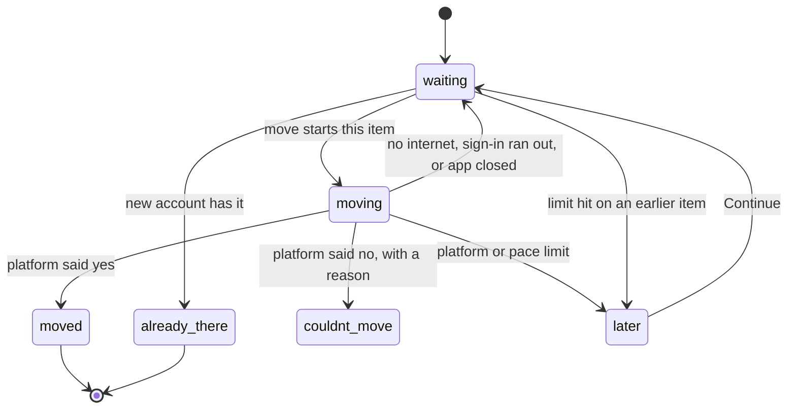
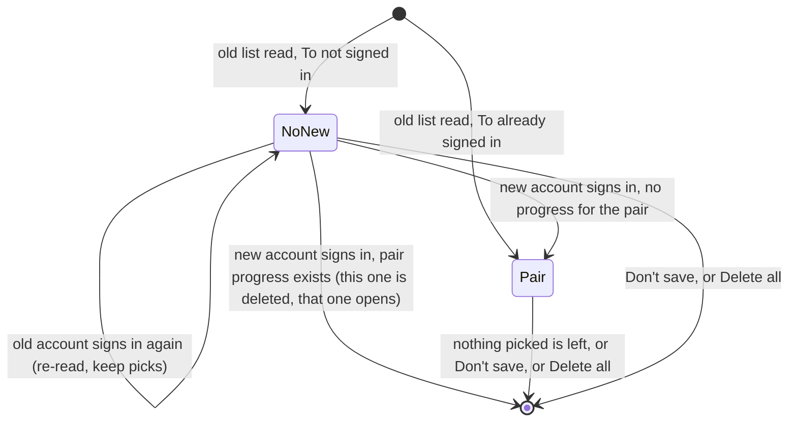

# Data Model: GitHub Platform

Two parts. Part A changes the existing tables so they hold any platform (restructure, research R10). Part B adds what only GitHub needs.

## Part A. Platform-neutral store

### Migration

The database gets a version number (`PRAGMA user_version`). Version 0 is today's schema. Version 1 is below. The step from 0 to 1 runs once, in one transaction: create the new tables, copy every row, drop the old tables. A fresh install creates version 1 directly.

| Today | Version 1 | Copy rule |
| --- | --- | --- |
| `progress` | `progress` | `platform = 'youtube'`. `old_email` and `new_email` become `old_handle` and `new_handle`. |
| `progress_channel` | `progress_item` | `channel_id` becomes `item_id`. `kind = 'channel'`. Status `tomorrow` becomes `later`. |
| `setting` | `setting` | No change. |

### progress

| Field | Type | Rule |
| --- | --- | --- |
| id | text, key | As today. |
| platform | text | A platform ID from the platform list. |
| old_account_id, old_handle, old_name, old_photo_url | text | `handle` is what the step shows under the title: the email for YouTube, the username for GitHub. |
| new_account_id, new_handle, new_name, new_photo_url | text | Same. |
| created_at, updated_at | integer | As today. |
| limit_hit_at | integer or null | As today. |
| resume_at | integer or null | When a paused move can go on. Set with `limit_hit_at`. Used for the reminder. |

Unique: (`platform`, `old_account_id`, `new_account_id`). One progress per account pair per platform (spec, Key Entities). Version 2 makes the new account optional (Part C).

### progress_item

| Field | Type | Rule |
| --- | --- | --- |
| progress_id | text | Refers to `progress`. Rows go when the progress goes. |
| item_id | text | Unique inside a progress. The driver builds it. YouTube: the channel ID. GitHub: kind and ID, for example `repo:1296269`. |
| kind | text | One of the driver's kinds. YouTube: `channel`. |
| title, thumbnail_url | text | What the row shows. |
| data | text or null | JSON that only the driver reads, checked on read. Holds what the add call needs. YouTube: null. |
| picked | integer | As today. |
| status | text | See states below. Checked in TypeScript, not by a table rule, so a new state needs no table rebuild. |
| reason | text or null | Short plain text for `couldnt_move` and the left-out count of a list. |
| updated_at | integer | As today. |

Key: (`progress_id`, `item_id`). Order: by kind (driver order), then title.

### Item states

`later` is today's `tomorrow`. The label comes from the platform: "Tomorrow" for YouTube, "Later" for GitHub. `moved` and `already_there` are final.

### Types in code

| Today | After Part A |
| --- | --- |
| `AccountInfo { id, email, name, photoUrl }` | `AccountInfo { id, handle, name, photoUrl }` |
| `NewChannel { channelId, title, thumbnailUrl }` | `NewItem { itemId, kind, title, thumbnailUrl, data }` |
| `StoredChannel` | `StoredItem = NewItem & { picked, status, reason }` |
| `Status` with `tomorrow` | `Status` with `later` |

### App state (reducer)

| Field | Change |
| --- | --- |
| `channels` | Renamed `items`. |
| `signInCode: { role, code, hint } or null` | New. The code a sign-in is waiting on. The account card shows it in place. Platforms with a native sign-in never set it. |
| `granted: string[]` | New. Kinds the new account has access for, from the scopes GitHub granted. YouTube: always `['channel']`. |

`openProgress()` reads the platform from the saved progress and no longer assumes YouTube.

## Part B. GitHub

### Kinds and item data

| Kind | Heading | Scope | `item_id` | `data` | Row picture |
| --- | --- | --- | --- | --- | --- |
| `repo` | Stars | `public_repo` | `repo:<id>` | `{ fullName, nodeId }` | Owner's picture |
| `person` | People | `user:follow` (or `user`) | `person:<id>` | `{ login }` | The person's picture |
| `gist` | Gists | `gist` | `gist:<id>` | `{ gistId }` | Owner's picture |
| `list` | Lists | `user` | `list:<node id>` | `{ description, isPrivate, repoItemIds: string[] }` | None (icon) |

Title: `owner/name` for a repository, the username for a person, the description or first file name for a gist, the name for a list.

Rules:

- A person whose ID equals the new account's ID is returned by `checkNew` and shows "Already there". The new account ID is known only after the To sign-in, so `listOld` cannot leave it out (spec, Edge Cases).
- The old list holds only public repositories (no scope), so there is no "Not available" state (FR-GH-016 removed).
- A row whose kind is not in `granted` is greyed out and not movable, with the section's "Allow" button (FR-GH-020). Gists are never asked for on the first To sign-in. This is shown from state, not saved as a status, so the row is ready the moment access is given.
- A `list` moves after its repositories. Its `reason` says how many repositories were left out (FR-GH-018).

### add_log (new table)

| Field | Type | Rule |
| --- | --- | --- |
| account_key | text | Platform and new account ID, for example `github:583231`. |
| at | integer | Time of one add. |

Rows older than 1 hour are deleted on each write. The pacer reads this table (research R9). Delete all empties it.

### Tokens (not in the database)

| Token | Where | Deleted |
| --- | --- | --- |
| Old account | Memory only | As soon as the old list is read. |
| New account | `expo-secure-store`, key `github.new`, value `{ token, accountId, scopes, expiresAt }` | Summary shows, Sign out, Delete all, or `expiresAt` passed. An "Allow" sign-in replaces it. |

Tokens run out after 8 hours (`expires_in` 28800). The refresh token is never saved. `granted` is rebuilt from the saved `scopes` when a progress opens.

## Part C. Progress from the old sign-in (2026-11-15)

Research R12 and R13. Spec FR-GH-021 and FR-GH-022.

### Migration to version 2

Version 1 to 2 rebuilds `progress` in one transaction: rename it, create the version 2 table, copy every row, drop the old one. `progress_item` rows keep their `progress_id`. A fresh install creates version 2 directly, and a version 0 database runs 0 to 1, then 1 to 2.

| Change | Rule |
| --- | --- |
| `new_account_id`, `new_handle`, `new_name` | Nullable. All three are null together, or none is. |
| `UNIQUE (platform, old_account_id, new_account_id)` | Kept. SQLite treats nulls as distinct, so it applies only to pairs. |
| New index `progress_no_new` | `UNIQUE (platform, old_account_id) WHERE new_account_id IS NULL`. At most one progress with no new account per old account per platform. |

### Progress lifecycle

### Store functions

| Function | Change |
| --- | --- |
| `getOrCreateProgress(platform, old, new or null)` | `new` may be null. With null, finds or creates the progress with no new account. |
| `attachNew(progressId, new)` | New. Sets the new account. If the pair already has a progress, deletes this one and returns the pair's ID. |
| `saveItems(progressId, items)` | Also deletes `waiting` rows whose item is no longer in `items`, so a re-read drops items the old account no longer has. Other states stay. |
| `UnfinishedProgress.newAccount` | `AccountInfo` or `null`. The From list shows "New account not chosen yet" for null. |

### App state (reducer)

| Field or action | Change |
| --- | --- |
| `flowPlatform: PlatformId or null` | New. The platform of the flow in the reducer, kept while Home shows. |
| `startFlow(platform)` | New action. Resets every flow field to its start value, sets `platform` and `flowPlatform`. |
| `setItems`, `setProgress`, `setMoveState` from a move | Carry `progressId`. The reducer ignores them when it is not the open `progressId`. |

### What Delete all removes

Every row of `progress`, `progress_item`, `add_log`, and `setting`, the secure-store key, every scheduled reminder, and the YouTube sign-in as today (FR-GH-013).
