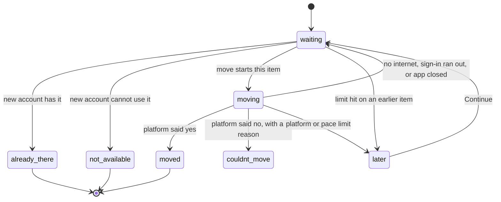

# Data Model: GitHub Platform

Two parts. Part A changes the existing tables so they hold any platform (restructure, research R10). Part B adds what only GitHub needs.

## Part A. Platform-neutral store

### Migration

The database gets a version number (`PRAGMA user_version`). Version 0 is today's schema. Version 1 is below. The step from 0 to 1 runs once, in one transaction: create the new tables, copy every row, drop the old tables. A fresh install creates version 1 directly.

| Today | Version 1 | Copy rule |
| --- | --- | --- |
| `progress` | `progress` | `platform = 'youtube'`. `old_email` and `new_email` become `old_handle` and `new_handle`. |
| `progress_channel` | `progress_item` | `channel_id` becomes `item_id`. `kind = 'channel'`. Status `tomorrow` becomes `later`. |
| `setting` | `setting` | No change. |

### progress

| Field | Type | Rule |
| --- | --- | --- |
| id | text, key | As today. |
| platform | text | A platform ID from the platform list. |
| old_account_id, old_handle, old_name, old_photo_url | text | `handle` is what the step shows under the title: the email for YouTube, the username for GitHub. |
| new_account_id, new_handle, new_name, new_photo_url | text | Same. |
| created_at, updated_at | integer | As today. |
| limit_hit_at | integer or null | As today. |
| resume_at | integer or null | When a paused move can go on. Set with `limit_hit_at`. Used for the reminder. |

Unique: (`platform`, `old_account_id`, `new_account_id`). One progress per account pair per platform (spec, Key Entities).

### progress_item

| Field | Type | Rule |
| --- | --- | --- |
| progress_id | text | Refers to `progress`. Rows go when the progress goes. |
| item_id | text | Unique inside a progress. The driver builds it. YouTube: the channel ID. GitHub: kind and ID, for example `repo:1296269`. |
| kind | text | One of the driver's kinds. YouTube: `channel`. |
| title, thumbnail_url | text | What the row shows. |
| data | text or null | JSON that only the driver reads, checked on read. Holds what the add call needs. YouTube: null. |
| picked | integer | As today. |
| status | text | See states below. Checked in TypeScript, not by a table rule, so a new state needs no table rebuild. |
| reason | text or null | Short plain text for `couldnt_move`, `not_available`, and the left-out count of a list. |
| updated_at | integer | As today. |

Key: (`progress_id`, `item_id`). Order: by kind (driver order), then title.

### Item states

`later` is today's `tomorrow`. The label comes from the platform: "Tomorrow" for YouTube, "Later" for GitHub. `not_available` is new and is never picked. `moved`, `already_there`, and `not_available` are final.

### Types in code

| Today | After Part A |
| --- | --- |
| `AccountInfo { id, email, name, photoUrl }` | `AccountInfo { id, handle, name, photoUrl }` |
| `NewChannel { channelId, title, thumbnailUrl }` | `NewItem { itemId, kind, title, thumbnailUrl, data }` |
| `StoredChannel` | `StoredItem = NewItem & { picked, status, reason }` |
| `Status` with `tomorrow` | `Status` with `later` and `not_available` |

### App state (reducer)

| Field | Change |
| --- | --- |
| `channels` | Renamed `items`. |
| `signInCode: { role, code, hint } or null` | New. The code a sign-in is waiting on. The account card shows it in place. Platforms with a native sign-in never set it. |
| `unlocked: string[]` | New. Kinds opened by an optional sign-in (GitHub: `gist`). Empty for YouTube. |

`openProgress()` reads the platform from the saved progress and no longer assumes YouTube.

## Part B. GitHub

### Kinds and item data

| Kind | Heading | `item_id` | `data` | Row picture |
| --- | --- | --- | --- | --- |
| `repo` | Stars | `repo:<id>` | `{ fullName, nodeId, private }` | Owner's picture |
| `person` | People | `person:<id>` | `{ login }` | The person's picture |
| `gist` | Gists | `gist:<id>` | `{ gistId }` | Owner's picture |
| `list` | Lists | `list:<node id>` | `{ description, isPrivate, repoItemIds: string[] }` | None (icon) |

Title: `owner/name` for a repository, the username for a person, the description or first file name for a gist, the name for a list.

Rules:

- A person whose ID equals the new account's ID is left out (spec, Edge Cases).
- A `repo` with `private: true` becomes `not_available` after the To sign-in (research R7).
- A `gist` row is greyed out and not movable while `unlocked` has no `gist` (FR-GH-020). This is shown from state, not saved as a status, so the row is ready the moment access is given.
- A `list` moves after its repositories. Its `reason` says how many repositories were left out (FR-GH-018).

### add_log (new table)

| Field | Type | Rule |
| --- | --- | --- |
| account_key | text | Platform and new account ID, for example `github:583231`. |
| at | integer | Time of one add. |

Rows older than 1 hour are deleted on each write. The pacer reads this table (research R9). Delete all empties it.

### Tokens (not in the database)

| Token | Where | Deleted |
| --- | --- | --- |
| Old account | Memory only | As soon as the old list is read. |
| New account | `expo-secure-store`, key `github.new`, value `{ token, accountId, expiresAt }` | Summary shows, Switch, Delete all, or `expiresAt` passed. |
| Gist access | `expo-secure-store`, key `github.gists`, same shape | Same. |

No refresh token is read or saved (FR-GH-019). `unlocked` is rebuilt from `github.gists` when a progress opens.

### What Delete all removes

Every row of `progress`, `progress_item`, `add_log`, and `setting`, both secure-store keys, every scheduled reminder, and the YouTube sign-in as today (FR-GH-013).
