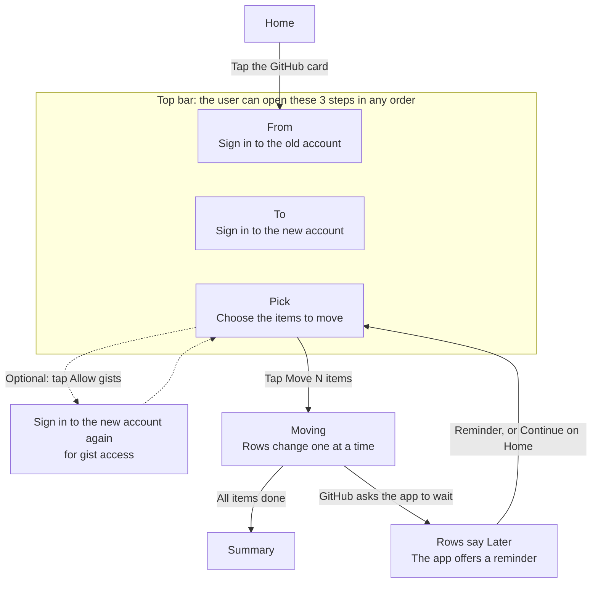
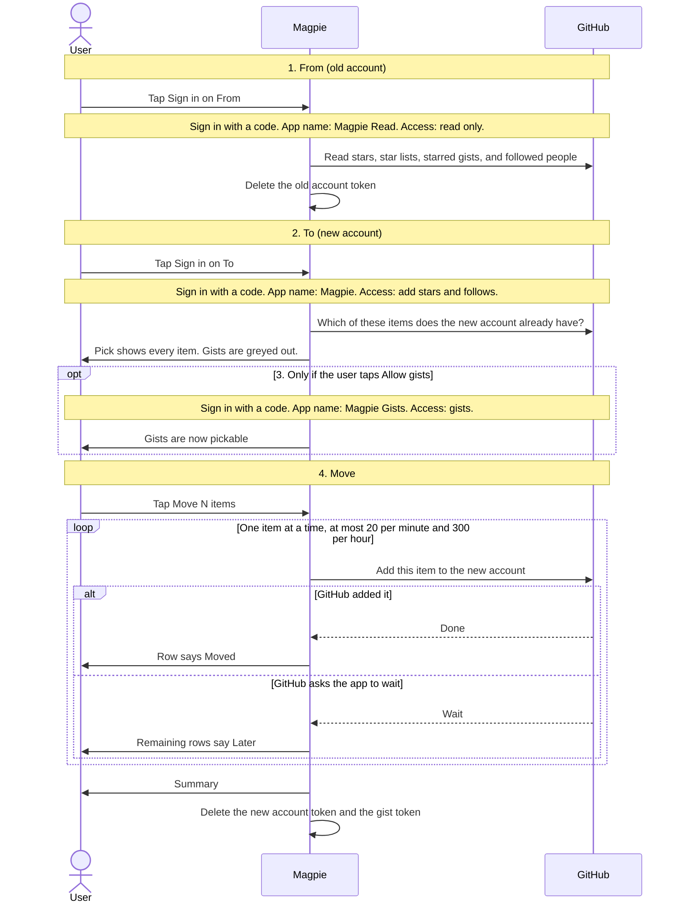
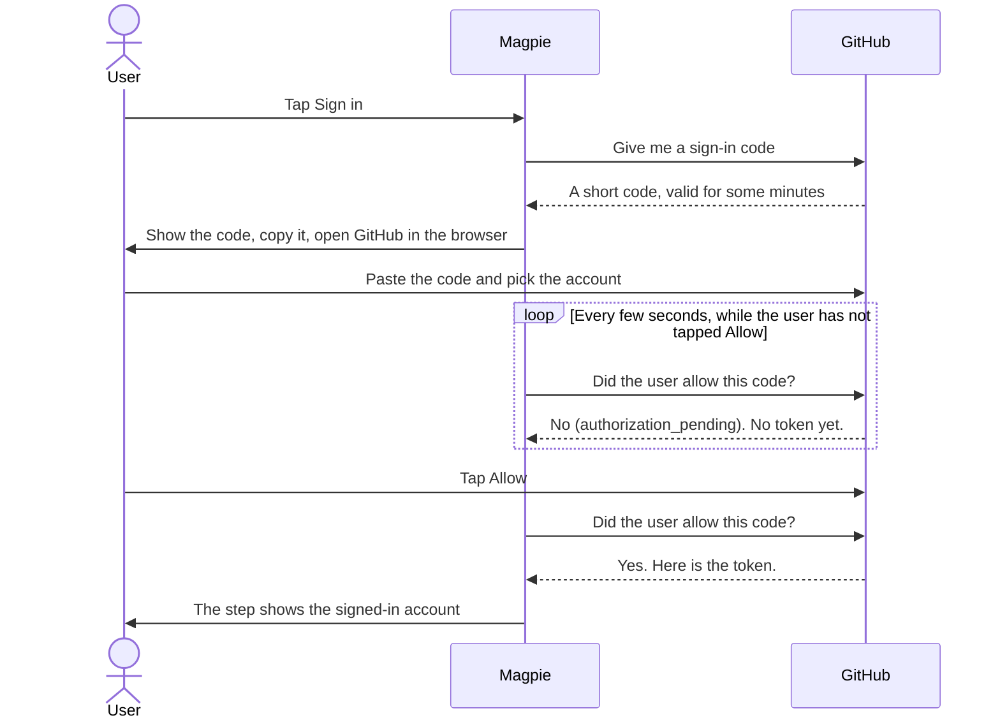
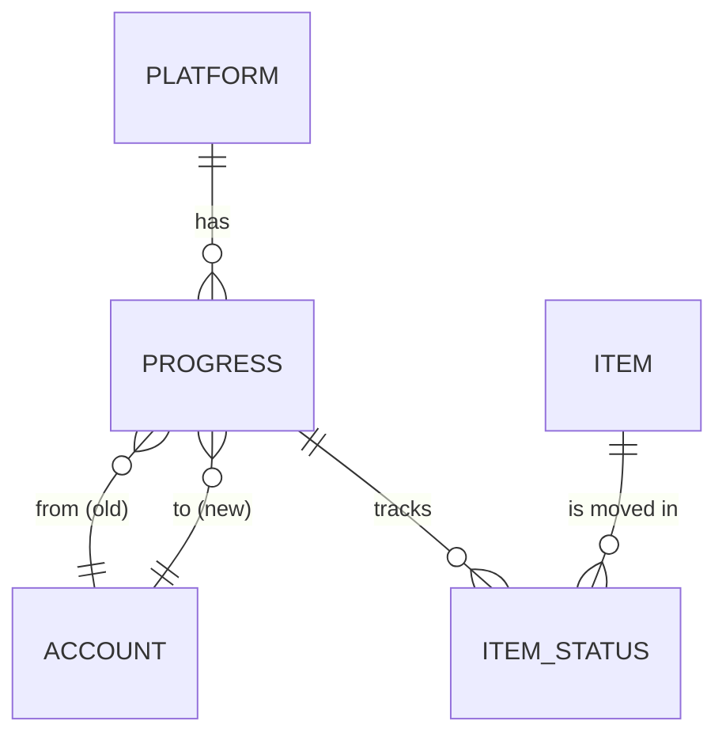

# Feature Specification: GitHub Platform

**Feature Branch**: `feature/github-platform`

**Created**: 2026-11-13

**Status**: Draft

**Input**: User description: "GitHub platform. Then let's discuss which items GitHub supports, and whether this feature is feasible (not facing any platform limitations)."

**Related**: [004 Platform Picker](../004-multi-platform-picker/spec.md) adds the card to Home. [001 Subscription Migration](../001-subscription-migration/spec.md) defines the Automatic flow that GitHub reuses. [006 Paid API Credits](../006-paid-api-credits/spec.md) lists GitHub as a free platform. [007 Spotify Platform](../007-spotify-platform/spec.md) was cancelled for access limits; this spec checks GitHub against the same risks.

## Summary

GitHub becomes the second Automatic platform. The user picks the GitHub card on Home, signs in to an old GitHub account, picks what to move, signs in to a new GitHub account, and taps Move. The app adds the picked items to the new account through GitHub's official API. The screens, steps, row states, saved progress, and Settings work the same way as for YouTube. Only the platform-specific parts differ: sign-in, what can be moved, the limits, and the words for the items.

## Feasibility

GitHub is feasible. Unlike YouTube and Spotify, it has no test-user cap, no app review, and no paid tier for the API. The risks are about pace and GitHub's rules, not about access.

| Question | Answer | Blocks the feature? |
| --- | --- | --- |
| Can anyone sign in, or only test users? | Anyone. GitHub apps need no review and have no user cap. | No |
| Does the API cost money? | No. | No |
| Can the app read the old account's items? | Yes, for stars and follows. | No |
| Can the app add items to the new account? | Yes, for stars and follows. See "What GitHub supports" for the rest. | No |
| Can a GitHub App token star any public repository and edit star lists? | Not confirmed. The plan found one report that it cannot. | Open. The owner runs one test before any GitHub work (plan, research R1). |
| Can the app sign in without a secret? | Yes, with the device code flow. The browser flow still needs a client secret, which a phone app cannot keep. | No, but the sign-in has one extra step (enter a short code). |
| Can the app cancel its access on sign-out? | No. Cancelling a token needs the client secret. | No. The project owner approved an exception with 3 safeguards (FR-GH-019). |
| Are there speed limits? | Yes. About 5,000 requests per hour per user, and about 80 adds per minute and 500 adds per hour. | No. A few hundred items fit in one hour. |
| Do GitHub's rules allow automated starring or following? | GitHub's Acceptable Use Policies name "rank abuse, such as automated starring or following" and "starring and/or following accounts or repositories in large volume in a short period of time" as not allowed. | Risk, not a blocker. The user moves their own items once, at a slow pace, which the app enforces (FR-GH-010). |
| Can one person have two accounts? | GitHub's Terms allow one free personal account per person (plus one machine account). Most users move from an old account they then close, or between a paid work account and a personal one. | No. The app does not check this. See Assumptions. |

## What GitHub supports

This table answers "which items can be moved". The plan MUST check each row against GitHub's current documentation, because the docs site was not reachable when this spec was written.

| Item | Read from old account | Add to new account | Access needed | Verdict |
| --- | --- | --- | --- | --- |
| Starred repositories | Yes | Yes | Starring | In scope |
| Followed people | Yes | Yes | Followers | In scope |
| Star lists (named groups of stars) | Yes, through GitHub's newer query API | Yes, create list and add items | Starring (plan to confirm) | In scope |
| Watched repositories | Yes | Only with a classic OAuth app and a broad access (`notifications` or `repo`). Not with GitHub App tokens. | Broad | Out of scope. It breaks least privilege (Principle III, rule 1). |
| Starred gists | Yes | Yes | Gists (plan to confirm the smallest level) | In scope |
| Followed organizations | Plan to confirm | Plan to confirm | Followers | Out of scope until the plan confirms the API. |
| Starred topics | No API | No API | None | Not possible |
| Sponsorships | Yes | No. They involve payment. | None | Not possible |
| Organization and team membership, repository access | Yes | No. An owner must invite the new account. | None | Not possible |
| Own repositories | Yes | Transfer is a different, risky action. | Broad | Out of scope. Not a follow. |

## How the screens connect

## How a move works, from start to end

Each "Sign in with a code" box is the same sign-in, shown step by step in the next diagram. Only the app name and the account change.

## How "Sign in with a code" works

GitHub does not tell the app when the user taps Allow. The app must ask again and again until GitHub answers with a token.

| If | Then |
| --- | --- |
| The code runs out before the user taps Allow | The app stops asking. The step stays signed out with "Sign-in didn't finish. Try again." |
| The user taps Cancel on GitHub | The app stops asking. The step stays signed out. |
| The app goes to the background | The app continues to ask when the user returns. |

## Clarifications

### Session 2026-11-13

- Q: Which kinds of GitHub items should a migration move? → A: Starred repositories, followed people, star lists, and starred gists (everything GitHub allows an app to add).
- Q: The app cannot cancel a GitHub token on sign-out (Principle III, rule 3). Is an exception approved? → A: Yes, with 3 safeguards: delete the old account token right after its list is read, never save the refresh token, and delete the new account token when the summary shows, on sign-out, and on Delete all. After sign-out, show a link to the GitHub page where the user removes Magpie's access.
- Q: Gists may need write access that also lets the app change the user's own gists. Can users choose what they share? → A: Yes. GitHub asks the user to accept all of an app's permissions at once, so gist access is a separate, optional sign-in. The app moves only the kinds the user granted access for.

## User Scenarios & Testing *(mandatory)*

### User Story 1 - Move stars and follows to a new GitHub account (Priority: P1)

A user has an old GitHub account and a new one. They open the app, tap the GitHub card, sign in to the old account on From, sign in to the new account on To, and see the old account's items on Pick, all picked. Items the new account already has show "Already there". They tap Move, watch each row change in place, and see a summary at the end.

**Why this priority**: This is the whole value of the feature. Without it, the GitHub card has no purpose.

**Independent Test**: With two test accounts, where the old account stars a few repositories and follows a few people, and the new account already stars one of them, run a full move from the GitHub card. Confirm the new account now stars and follows every picked item, the shared one shows "Already there", and the old account is unchanged.

**Acceptance Scenarios**:

1. **Given** the GitHub card is on Home, **When** the user taps it, **Then** the top bar shows From, Pick, and To, and the steps work in any order, as for YouTube.
2. **Given** the user signs in to the old account, **When** Pick opens, **Then** it lists every starred repository and followed person, grouped by kind, each with a picture and a name, all picked by default.
3. **Given** the new account already has some of those items, **When** both accounts are signed in, **Then** those rows show "Already there" and cannot be picked.
4. **Given** items are picked and both accounts are signed in, **When** the user taps "Move N items", **Then** each row changes in place to Moving, then Moved or Couldn't move, and a summary shows at the end.
5. **Given** a move ran, **When** the user checks the old account, **Then** nothing on it has changed.

---

### User Story 2 - Sign in to two different GitHub accounts (Priority: P1)

The user signs in to the old account, then to a different new account, on the same phone. GitHub's sign-in for phone apps uses a short code: the app shows the code, copies it, and opens GitHub's sign-in page in the system browser. The user pastes the code and allows access. The browser remembers the last account, so before the second sign-in the app tells the user in simple words how to switch account.

**Why this priority**: The move needs two different accounts. If the second sign-in silently reuses the first account, the feature cannot work.

**Independent Test**: Sign in to account A on From. Tap Sign in on To and confirm the hint shows. In the browser, switch to account B, enter the code, and confirm both steps show the right account. Try account A on To and confirm the app refuses it.

**Acceptance Scenarios**:

1. **Given** the user taps Sign in, **When** the app gets a code, **Then** it shows the code in large text, copies it, and opens GitHub's sign-in page in the system browser.
2. **Given** the user enters the code and allows access, **When** they return to the app, **Then** the step shows the account's picture and name within a few seconds, with no extra tap.
3. **Given** the second sign-in is about to open, **When** the user taps Sign in, **Then** the app first shows a short hint, for example "GitHub may show your old account. Tap your picture, then 'Switch account', to use your new one."
4. **Given** the user signs in with the same account on From and To, **When** sign-in ends, **Then** the app refuses it with a simple message, as for YouTube.
5. **Given** the user does not finish sign-in before the code runs out, **When** they return to the app, **Then** the step stays signed out and shows "Sign-in didn't finish. Try again."

---

### User Story 3 - Slow pace, wait, and continue later (Priority: P2)

GitHub limits how fast an app can add stars and follows, and its rules forbid starring or following in large volume in a short time. The app adds items one at a time at a slow, steady pace. When GitHub asks the app to wait for a short time, the app waits on its own and goes on. When GitHub asks for a long wait, the app stops, marks the remaining rows "Later", saves the progress, and offers a reminder, as YouTube does at the daily limit.

**Why this priority**: Most users have a few hundred items or fewer and finish in one session. Users with many items need it to finish at all, and the slow pace protects the new account from being flagged.

**Independent Test**: Start a move of 30 items and confirm the pace stays at or under the limit in FR-GH-010. Simulate a short wait and confirm the move goes on without a message. Simulate a long wait after 6 items, confirm the message and "Later" rows, close the app, tap the reminder, and confirm Continue moves only the rest.

**Acceptance Scenarios**:

1. **Given** a move runs, **When** the user watches the rows, **Then** items are added one at a time at the pace in FR-GH-010, and Pick shows the expected time left (for example "About 4 minutes").
2. **Given** GitHub asks the app to wait for a short time, **When** the move runs, **Then** the app waits and goes on, and the rows keep showing Moving.
3. **Given** GitHub asks for a long wait or the hourly limit is reached, **When** the move runs, **Then** the app stops, marks the rest "Later", and shows "GitHub needs a break. We'll remind you when you can move the rest."
4. **Given** the user allowed reminders, **When** the wait is over, **Then** the app sends one reminder for that progress, and tapping it opens the progress with a Continue button.
5. **Given** there is an unfinished GitHub progress, **When** Home shows, **Then** the GitHub card shows a Continue note with the count left, as spec 004 says.

---

### User Story 4 - Sign out and remove access (Priority: P2)

The user signs out of a GitHub account or uses Delete all. The app deletes its GitHub tokens and data from the phone. GitHub lets an app cancel a token only with the client secret, which a phone app cannot hold. The project owner approved an exception to Principle III, rule 3, with 3 safeguards that keep each token on the phone for as short a time as possible (FR-GH-019). A deleted token stays valid on GitHub until it runs out, at most 8 hours after sign-in, unless the user removes Magpie's access in GitHub.

**Why this priority**: The constitution requires sign-out to remove access. The safeguards are the approved way to meet that rule as closely as GitHub allows.

**Independent Test**: Sign in to From and confirm the old account token is gone once Pick shows the list. Sign in to To, run a move, and confirm the token is gone when the summary shows. Sign in again, sign out, and confirm the app holds no token. Use Delete all and confirm no GitHub account, token, or progress is left on the phone.

**Acceptance Scenarios**:

1. **Given** a GitHub account is signed in, **When** the user signs out, **Then** its token is deleted from the phone and the step shows signed out.
2. **Given** the user uses Delete all, **When** it ends, **Then** every GitHub account, token, list, and progress is gone from the phone.
3. **Given** the user signs out of a GitHub account, **When** sign-out ends, **Then** the app shows a short line, for example "To fully remove Magpie's access, open GitHub settings.", with a button that opens that GitHub page in the system browser.
4. **Given** the old account's list is read, **When** Pick shows it, **Then** the app holds no token for the old account.
5. **Given** a move ends, **When** the summary shows, **Then** the app holds no token for the new account. Continue after a pause uses the saved token only while the move is unfinished.

---

### User Story 5 - Choose to share gist access (Priority: P3)

Starred gists need extra access that also lets the app change the user's own gists. GitHub asks the user to accept all of an app's permissions at once, so the app keeps gist access in a separate, optional sign-in. On Pick, the Gists section shows the old account's starred gists greyed out with one button, "Allow gists". Only users who tap it and sign in again give that access. Users who skip it move everything else.

**Why this priority**: Gists are the smallest kind and the only one that needs broad access. Keeping them optional lets most users share only star and follow access.

**Independent Test**: Run a move without tapping "Allow gists" and confirm stars, lists, and people move, and gists stay greyed out and are not moved. Run again, tap "Allow gists", sign in to the new account, and confirm the gists become pickable and move.

**Acceptance Scenarios**:

1. **Given** the old account has starred gists and gist access is not given, **When** Pick shows, **Then** the Gists section shows them greyed out with the line "Magpie needs extra access to move gists." and an "Allow gists" button.
2. **Given** the user taps "Allow gists", **When** the gist sign-in ends with the new account, **Then** the gist rows become pickable and all picked, and Move includes them.
3. **Given** the user signs in to a different account on the gist sign-in, **When** sign-in ends, **Then** the app refuses it with "Use your new account for gists too."
4. **Given** gist access is not given, **When** the user taps Move, **Then** the move runs for the other kinds and the summary does not count gists as failed.

---

### Edge Cases

- The old account stars and follows nothing: Pick says "This account doesn't follow anything yet" and Move is not offered.
- A starred repository is private and the new account cannot see it, or was deleted: after the To sign-in, its row shows greyed out as "Not available" with the reason, and cannot be picked (FR-GH-016).
- A followed person deleted their account or blocked the new account: the row shows "Couldn't move" with the reason, and the rest go on (FR-GH-017).
- The old account follows the new account, or the new account would follow itself: the app leaves that row out, because an account cannot follow itself.
- The old account has thousands of stars: the list loads in parts, shows a loading line, and stays searchable when it ends. The time-left line shows that the move takes more than one session.
- The token runs out during a move: the step shows signed out, the progress is saved, and the user signs in again to continue.
- GitHub flags the new account for unusual activity: the next add fails, the app stops, saves the progress, and shows "GitHub paused your account's activity. Try again later." It does not retry in a loop.
- The internet drops during a move: the move pauses, unfinished rows go back to waiting, and the user sees "No internet. Try again when you're online."
- The user closes the app during a move: on return, moved items stay Moved and the rest are waiting.
- The user switches to the browser during sign-in and the app goes to the background: when they return, the app goes on checking until sign-in ends or the code runs out.
- GitHub changes or removes an API the app uses: the affected kind of item fails with "Couldn't move", and the other kinds still work.

## Requirements *(mandatory)*

### Functional Requirements

**Picker and flow**

- **FR-GH-001**: The GitHub card MUST appear in the Automatic section of Home, after YouTube, through the one list of platforms (spec 004, FR-003). The app MUST move four kinds of items: starred repositories, star lists, starred gists, and followed people.
- **FR-GH-002**: Tapping the GitHub card MUST open the same From, Pick, To flow as YouTube, with the same steps, row states, summary, saved progress, unfinished progress list, Home button, and Settings. The flow MUST NOT get GitHub-only screens. The sign-in code (FR-GH-006) shows in place on the From or To step.
- **FR-GH-003**: When the old account has more than one kind of item, Pick MUST split the list into one section per kind, each under a short heading ("Stars", "Lists", "Gists", "People"). A kind with no items MUST NOT show a section. With only one kind, Pick MUST show a plain list with no heading. Search, All, and the counter MUST work across all sections.
- **FR-GH-004**: All user-facing text MUST say "items" or the kind name (for example "Move 12 items", "12 of 340 picked") instead of "channels" in the GitHub flow, and MUST live with the other app text.
- **FR-GH-018**: Moving a star list MUST create a list with the same name and description on the new account, or reuse one with the same name, and add to it every repository of the list that is Moved or Already there. Repositories of the list that are not picked or fail MUST be left out of the list, and the list row MUST say how many were left out. Picking a list MUST NOT pick its repositories on its own.
- **FR-GH-016**: After the To sign-in, the app MUST check each starred repository with the new account. A repository the new account cannot see (private, deleted, or blocked) MUST show greyed out as "Not available" with a short reason, and MUST NOT be pickable. The check MUST only read.
- **FR-GH-017**: When an item fails during the move, its "Couldn't move" row MUST show the actual reason in simple words (for example "Account was deleted"), never a raw error.

**Accounts and sign-in**

- **FR-GH-005**: Users MUST be able to sign in to a GitHub account on From and on To. Each step MUST show the account's picture and username, and a Switch button.
- **FR-GH-006**: Sign-in MUST show a short code in large text, copy it, and open GitHub's sign-in page in the system browser. The app MUST check for the result on its own and finish sign-in without an extra tap when the user returns. If the code runs out, the step MUST stay signed out with "Sign-in didn't finish. Try again."
- **FR-GH-007**: Before the second sign-in, the app MUST show a one-line hint on how to switch account in the browser. The app MUST refuse the same GitHub account on From and To, with a simple message.
- **FR-GH-008**: The app MUST ask only for read access on the old account, and only for the access needed to read and add items on the new account. The exact access list is in the GitHub section below.
- **FR-GH-009**: The move MUST only add items to the new account. It MUST NOT change or remove anything on the old account, and MUST NOT remove anything on the new account.

**Pace and progress**

- **FR-GH-010**: The app MUST add items one at a time, at no more than 20 per minute and 300 per hour per new account, to stay well under GitHub's limits and its rule against large-volume starring or following. The plan MAY tune these numbers after testing, but MUST keep them under GitHub's published limits with a margin.
- **FR-GH-011**: Pick MUST show the expected time left for the picked items at that pace before the user taps Move.
- **FR-GH-012**: When GitHub asks the app to wait for 60 seconds or less, the app MUST wait and go on without a message. When GitHub asks for a longer wait, or the hourly pace in FR-GH-010 is reached, the app MUST stop, mark the rest "Later", save the progress, show "GitHub needs a break. We'll remind you when you can move the rest.", and ask for reminders as YouTube does at the daily limit.

**Data, security, and both phone types**

- **FR-GH-019**: The app MUST keep each GitHub token on the phone for as short a time as possible, as an approved exception to Principle III, rule 3: (a) delete the old account token as soon as its list is read; (b) never save a refresh token; (c) delete the new account and gist tokens when the summary shows, on sign-out, and on Delete all. After sign-out, the app MUST show a button that opens the GitHub page where the user removes Magpie's access.
- **FR-GH-020**: Gist access MUST be a separate, optional sign-in to the new account, started only by the "Allow gists" button on Pick. Without it, gist rows MUST stay greyed out and MUST NOT be moved, and the rest of the move MUST work. The app MUST move only the kinds the user gave access for.
- **FR-GH-013**: GitHub tokens MUST be stored only in the phone's secure storage and deleted on sign-out and on Delete all. Delete all MUST remove every GitHub account, token, list, and progress.
- **FR-GH-014**: The app MUST keep only what the move needs: account ID, username, picture, item IDs, item names and pictures, and progress. It MUST NOT log tokens, codes, usernames, emails, or item lists.
- **FR-GH-015**: The app MUST talk to GitHub only on the hosts listed in the GitHub section below, over HTTPS. The GitHub logo MUST be the official mark, unmodified, used only to name the platform. The feature MUST work the same way on Android and iOS.

### Key Entities *(include if feature involves data)*

- **Platform**: GitHub is a new entry in the existing list of platforms, in the Automatic section.
- **Account**: A signed-in GitHub account on From or To, with an ID, a username, and a picture.
- **Item**: Something the old account stars or follows that can be moved. It has a kind (repository, list, gist, or person), a name, and a picture. This is what YouTube calls a channel.
- **Progress**: The existing saved move progress, tied to a platform. One progress per old and new account pair per platform.

### Row states

| State | GitHub text | Same as YouTube? |
| --- | --- | --- |
| Waiting | (no label) | Yes |
| Already there | Already there | Yes |
| Moving | Moving… | Yes |
| Moved | Moved | Yes |
| Paused by limit | Later | No. YouTube says "Tomorrow" because its limit resets daily. GitHub's wait is about an hour. |
| Not reachable by the new account | Not available, with the reason | No. Same state as spec 007 planned, for repositories the To check could not see (FR-GH-016). |
| Failed | Couldn't move, with the reason | Yes, plus the reason (FR-GH-017). |

## GitHub section *(platform-specific)*

These details come from GitHub's changelog, its policy pages, and search results as of November 2026. GitHub's docs site was not reachable from the spec session, so the plan MUST check every item below against GitHub's current documentation.

**App type**: a GitHub App, not a classic OAuth app. A GitHub App can ask for narrow user permissions ("Starring", "Followers"). A classic OAuth app needs the `public_repo` access to star, which also lets it change code in the user's public repositories. That breaks least privilege.

**Sign-in flow (Principle III, rule 2)**: OAuth 2.0 Device Authorization Grant (device code flow), opened in the system browser. Why no higher flow:

| Flow | Available? | Why not used |
| --- | --- | --- |
| Native sign-in SDK | No | GitHub has no native sign-in SDK for phone apps. |
| Authorization Code with PKCE | Partly | GitHub added PKCE in July 2025, but the code-for-token step still needs the client secret. A phone app cannot keep a secret, and the app has no server. |
| Device code flow | Yes | Needs no secret. Must be turned on in the app settings. |

The app MUST check the device code response shape before use, and MUST stop checking when the code runs out. The plan MUST confirm that GitHub has not made the secret optional for PKCE; if it has, the plan MUST switch to PKCE with `prompt=select_account`, which forces GitHub's account chooser.

**Access per account (Principle III, rule 1)**: a GitHub App has one fixed set of permissions, and the user accepts all of them at once. Read-only access for the old account and optional gist access each need their own app.

| App | Used for | User permissions | Why |
| --- | --- | --- | --- |
| Magpie Read | Old (From) | Starring: read. Followers: read. Gists: read. | Read stars, star lists, starred gists, and follows, including stars of private repositories the user can see. |
| Magpie | New (To) | Starring: read and write. Followers: read and write. | Check and add stars, star lists, and follows. |
| Magpie Gists | New (To), only after "Allow gists" | Gists: read and write. | Check and star gists. This access also lets the app create, change, and delete the user's own gists, which is why it is optional (FR-GH-020). The plan MUST check whether a smaller level can star a gist, and use it if so. |

The plan MUST confirm which permission star lists need.

**Hosts (Principle III, rule 5)**: `github.com` (device sign-in page and token), `api.github.com` (API), `avatars.githubusercontent.com` (pictures). The plan MUST confirm the final list, and whether star lists need `api.github.com/graphql` (same host).

**Limits**:

- About 5,000 requests per hour per signed-in user.
- Adds (content-creating requests) are capped at about 80 per minute and 500 per hour, counted across the web and the API. GitHub says these limits change without notice and offers no way to check them in advance. When hit, GitHub answers 403 or 429, sometimes with a wait time.
- GitHub's Acceptable Use Policies forbid "rank abuse, such as automated starring or following" and name "starring and/or following accounts or repositories in large volume in a short period of time" as disrupting other users. FR-GH-010 keeps the pace low for this reason.
- GitHub App user tokens expire after 8 hours by default. Renewing them may need the client secret; the plan MUST check. A move of a few hundred items finishes well inside 8 hours.
- Cancelling a token needs the client secret. Users remove an app's access in GitHub Settings, Applications, Authorized GitHub Apps. FR-GH-019 lists the approved safeguards.

**Redirect back to the app**: none. The device code flow does not redirect. The user returns to the app on their own, and the app checks for the result.

## Success Criteria *(mandatory)*

### Measurable Outcomes

- **SC-001**: A user can move 50 starred repositories and followed people from one GitHub account to another in under 5 minutes, from tapping the GitHub card to seeing the summary.
- **SC-002**: After a move, the new account stars or follows 100% of the picked items that did not show "Couldn't move" or "Not available", and the old account is unchanged.
- **SC-003**: The YouTube flow passes all its existing tests with no change to what they check.
- **SC-004**: Adding GitHub needs no change to Home beyond the new entry in the list of platforms (spec 004, SC-003).
- **SC-005**: In testing, a second sign-in never silently reuses the first account: 10 out of 10 tries end with the account the user picked, or with the same-account refusal.
- **SC-006**: A move of 1,000 items finishes, across one or more pauses, with no item moved twice and none lost, and no test account is flagged by GitHub.

## Assumptions

- GitHub reuses the Automatic flow from specs 001 and 004. Any part of that flow that is tied to YouTube today is made platform-neutral in the plan, without changing YouTube's behavior.
- The app has no server. The client IDs are public and ship in the app. No client secret is used.
- Watched repositories are out of scope, because adding them needs a classic OAuth app with broad access.
- Own repositories, organization membership, sponsorships, and starred topics are out of scope. They are not follows, or GitHub offers no way to add them.
- The app does not check whether the user is allowed to keep two GitHub accounts. That is between the user and GitHub's Terms.
- Users with a few hundred items finish in one session at the pace in FR-GH-010. Users with more finish across several sessions.

## What the project owner needs to do

These steps need your GitHub account and cannot be done by an agent. They block the plan's sign-in work, not this spec.

1. **Create three GitHub Apps** at <https://github.com/settings/apps/new>: "Magpie Read", "Magpie", and "Magpie Gists". For each, set a homepage URL (the repository page is fine), turn off Webhook, and tick **Enable Device Flow**.
2. **Permissions**: under Account permissions, set Magpie Read to Starring, Followers, and Gists: Read-only. Set Magpie to Starring and Followers: Read and write. Set Magpie Gists to Gists: Read and write only. Leave every Repository and Organization permission at No access.
3. **Who can install**: choose "Any account", so any user can sign in.
4. **Token lifetime**: keep "Expire user authorization tokens" on.
5. **Client IDs**: copy each Client ID into your local `.env` as `EXPO_PUBLIC_GITHUB_READ_CLIENT_ID`, `EXPO_PUBLIC_GITHUB_CLIENT_ID`, and `EXPO_PUBLIC_GITHUB_GISTS_CLIENT_ID`, and into the EAS environment variables. They are public, so this is safe. **Do not generate a client secret or private key.** The app does not use them.
6. **Test accounts**: have two GitHub accounts ready, one that stars and follows a few items and one new.
