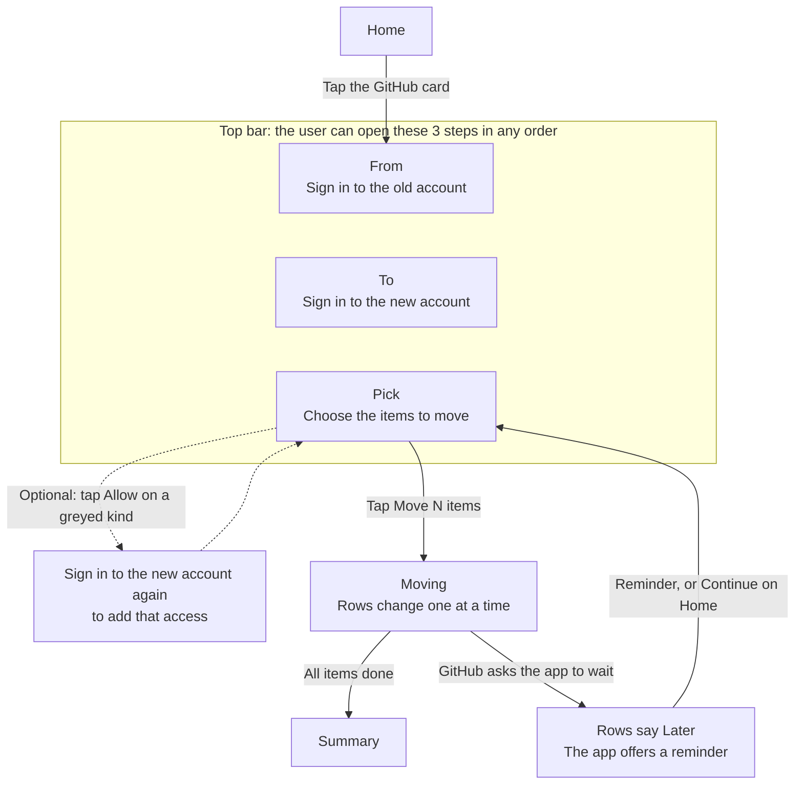
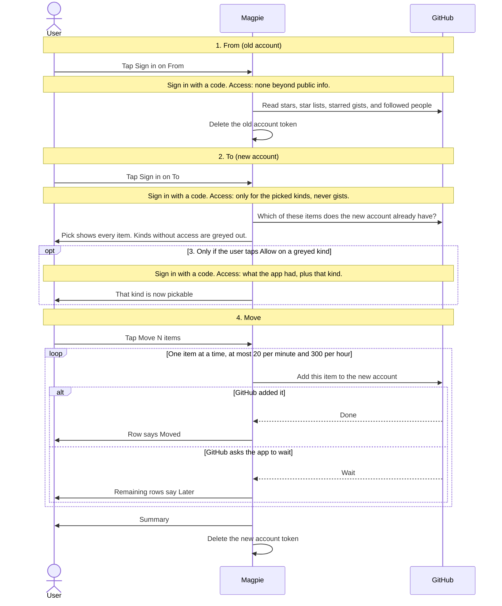
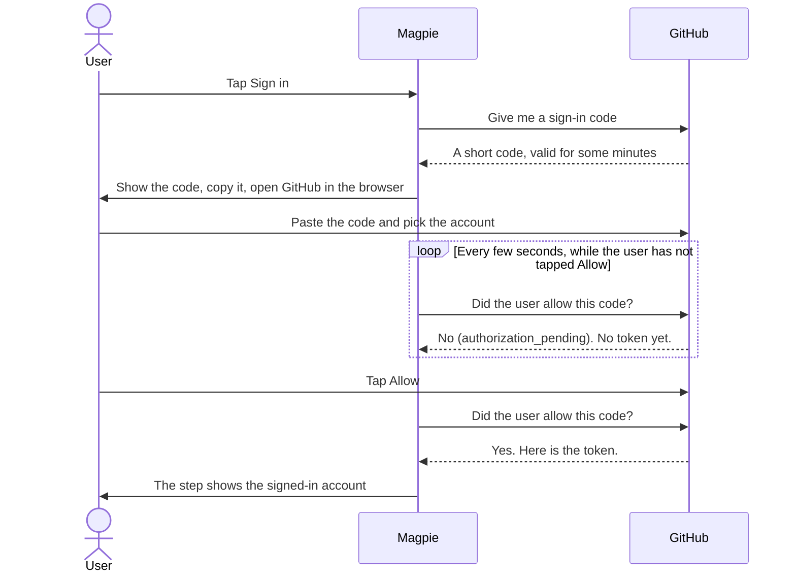
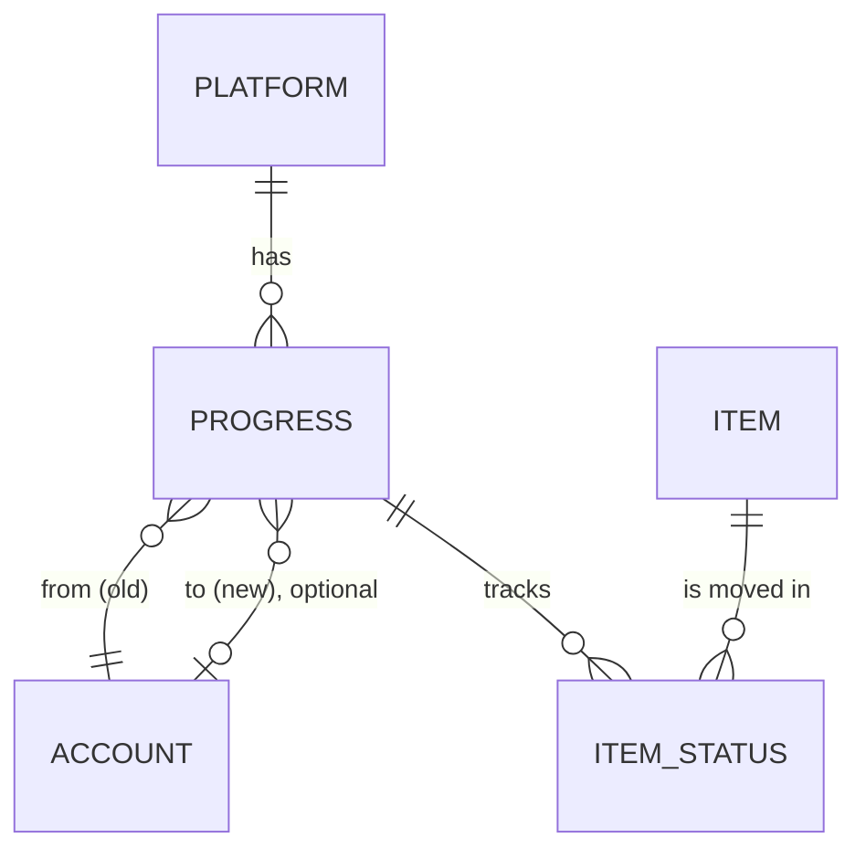

# Feature Specification: GitHub Platform

**Feature Branch**: `feature/github-platform`

**Created**: 2026-11-13

**Status**: Implemented

**Input**: User description: "GitHub platform. Then let's discuss which items GitHub supports, and whether this feature is feasible (not facing any platform limitations)."

**Related**: [004 Platform Picker](../004-multi-platform-picker/spec.md) adds the card to Home. [001 Subscription Migration](../001-subscription-migration/spec.md) defines the Automatic flow that GitHub reuses. [006 Paid API Credits](../006-paid-api-credits/spec.md) lists GitHub as a free platform. [007 Spotify Platform](../007-spotify-platform/spec.md) was cancelled for access limits; this spec checks GitHub against the same risks.

## Summary

GitHub becomes the second Automatic platform. The user picks the GitHub card on Home, signs in to an old GitHub account, picks what to move, signs in to a new GitHub account, and taps Move. The app adds the picked items to the new account through GitHub's official API. The screens, steps, row states, saved progress, and Settings work the same way as for YouTube. Only the platform-specific parts differ: sign-in, what can be moved, the limits, and the words for the items.

## Feasibility

GitHub is feasible. Unlike YouTube and Spotify, it has no test-user cap, no app review, and no paid tier for the API. The risks are about pace and GitHub's rules, not about access.

| Question | Answer | Blocks the feature? |
| --- | --- | --- |
| Can anyone sign in, or only test users? | Anyone. GitHub OAuth apps need no review and have no user cap. | No |
| Does the API cost money? | No. | No |
| Can the app read the old account's items? | Yes, for stars and follows. | No |
| Can the app add items to the new account? | Yes, for stars and follows. See "What GitHub supports" for the rest. | No |
| Which app type can move stars? | Only a classic OAuth app. GitHub's docs say starring needs read access to the repository, and a GitHub App has that only where it is installed. A classic OAuth app stars any public repository with the `public_repo` scope. | No. The project owner chose a classic OAuth app with an approved exception (Clarifications, 2026-11-14). |
| Can the app sign in without a secret? | Yes, with the device code flow. The browser flow still needs a client secret, which a phone app cannot keep. | No, but the sign-in has one extra step (enter a short code). |
| Can the app cancel its access on sign-out? | No. Cancelling a token needs the client secret. With "Expire user access tokens" on, a token runs out 8 hours after sign-in (confirmed by the access check). | No. The project owner approved an exception with safeguards (FR-GH-019). |
| Are there speed limits? | Yes. About 5,000 requests per hour per user, and about 80 adds per minute and 500 adds per hour. | No. A few hundred items fit in one hour. |
| Do GitHub's rules allow automated starring or following? | GitHub's Acceptable Use Policies name "rank abuse, such as automated starring or following" and "starring and/or following accounts or repositories in large volume in a short period of time" as not allowed. | Risk, not a blocker. The user moves their own items once, at a slow pace, which the app enforces (FR-GH-010). |
| Can one person have two accounts? | GitHub's Terms allow one free personal account per person (plus one machine account). Most users move from an old account they then close, or between a paid work account and a personal one. | No. The app does not check this. See Assumptions. |

## What GitHub supports

This table answers "which items can be moved". Rows were checked against GitHub's docs and the access check on 2026-11-14.

| Item | Read from old account | Add to new account | Access needed | Verdict |
| --- | --- | --- | --- | --- |
| Starred repositories | Yes | Yes | `public_repo` | In scope |
| Followed people | Yes | Yes | `user:follow` | In scope |
| Star lists (named groups of stars) | Yes, public lists, through GitHub's newer query API | Yes, create list and add items | `user` (confirmed by the access check) | In scope |
| Watched repositories | Yes | Yes, with the `notifications` scope | `notifications` | Out of scope. Not one of the four kinds the owner chose. |
| Starred gists | Yes | Yes | `gist` (there is no smaller level) | In scope |
| Followed organizations | Not checked | Not checked | `user:follow` | Out of scope. Not one of the four kinds the owner chose. |
| Starred topics | No API | No API | None | Not possible |
| Sponsorships | Yes | No. They involve payment. | None | Not possible |
| Organization and team membership, repository access | Yes | No. An owner must invite the new account. | None | Not possible |
| Own repositories | Yes | Transfer is a different, risky action. | Broad | Out of scope. Not a follow. |

## How the screens connect

## How a move works, from start to end

Each "Sign in with a code" box is the same sign-in, shown step by step in the next diagram. Only the access asked for and the account change.

## How "Sign in with a code" works

GitHub does not tell the app when the user taps Allow. The app must ask again and again until GitHub answers with a token.

| If | Then |
| --- | --- |
| The code runs out before the user taps Allow | The app stops asking. The step stays signed out with "Sign-in didn't finish. Try again." |
| The user taps Cancel on GitHub | The app stops asking. The step stays signed out. |
| The app goes to the background | The app continues to ask when the user returns. |

## Clarifications

### Session 2026-11-13

- Q: Which kinds of GitHub items should a migration move? → A: Starred repositories, followed people, star lists, and starred gists (everything GitHub allows an app to add).
- Q: The app cannot cancel a GitHub token on sign-out (Principle III, rule 3). Is an exception approved? → A: Yes, with 3 safeguards: delete the old account token right after its list is read, never save the refresh token, and delete the new account token when the summary shows, on sign-out, and on Delete all. After sign-out, show a link to the GitHub page where the user removes Magpie's access.
- Q: Gists may need write access that also lets the app change the user's own gists. Can users choose what they share? → A: Yes. GitHub asks the user to accept all of an app's permissions at once, so gist access is a separate, optional sign-in. The app moves only the kinds the user granted access for. (On 2026-11-14 the app type changed to a classic OAuth app; the opt-in idea stays and now covers every kind, FR-GH-020.)

### Session 2026-11-14

- Q: GitHub's docs show a GitHub App can star only repositories where it is installed. Which app type should Magpie use? → A: One classic OAuth app. Each sign-in asks only for the scopes of the kinds the user picked, and the user can remove scopes on GitHub's page. The owner approved an exception to Principle III, rule 1 (`public_repo` also allows writing code in public repositories, and `user` allows editing profile info) and a wider exception to rule 3 (classic tokens do not run out on their own). Safeguards are in FR-GH-019.
- Update (2026-11-14): GitHub OAuth apps now offer "Expire user access tokens". The owner turned it on, and the access check showed tokens run out after 8 hours. The rule 3 exception shrinks back to "deleted on the phone, not cancelled, runs out within 8 hours".
- Access check (2026-11-14): with no scope, the old account reads stars, follows, starred gists, and star lists. GitHub's error for `createUserList` names `user` as the required scope, so star lists stay in scope.

### Session 2026-11-15

- Q: Device test found a bug: on GitHub Pick with a list, the user goes Home and taps YouTube, and GitHub's Pick still shows. What should happen? → A: Tapping a different platform's card while another platform has an active progress MUST ask whether to save that progress. Save keeps it and opens the tapped platform fresh. This applies to every Automatic platform (FR-GH-022).
- Q: When does a progress start? Today it starts only when both accounts are signed in. → A: A progress is the saved state of whatever the user is doing, starting from the first old account sign-in. The new account is optional until Move. This applies to every Automatic platform (FR-GH-021).
- Q: Pick section headings are small and every section is always open. → A: Headings MUST be larger and each section MUST be collapsible. This applies to every platform whose Pick has sections (FR-GH-003, FR-GH-023).
- Q: After the Part B device test, the owner asked for an "All" checkbox on each section, apart from the All for the whole list. → A: Each section heading gets its own All checkbox for that kind (FR-GH-024). This applies to every platform whose Pick has sections.

## User Scenarios & Testing *(mandatory)*

### User Story 1 - Move stars and follows to a new GitHub account (Priority: P1)

A user has an old GitHub account and a new one. They open the app, tap the GitHub card, sign in to the old account on From, sign in to the new account on To, and see the old account's items on Pick, all picked. Items the new account already has show "Already there". They tap Move, watch each row change in place, and see a summary at the end.

**Why this priority**: This is the whole value of the feature. Without it, the GitHub card has no purpose.

**Independent Test**: With two test accounts, where the old account stars a few repositories and follows a few people, and the new account already stars one of them, run a full move from the GitHub card. Confirm the new account now stars and follows every picked item, the shared one shows "Already there", and the old account is unchanged.

**Acceptance Scenarios**:

1. **Given** the GitHub card is on Home, **When** the user taps it, **Then** the top bar shows From, Pick, and To, and the steps work in any order, as for YouTube.
2. **Given** the user signs in to the old account, **When** Pick opens, **Then** it lists every starred repository, star list, starred gist, and followed person, grouped by kind, each with a picture and a name, all picked by default.
3. **Given** the new account already has some of those items, **When** both accounts are signed in, **Then** those rows show "Already there" and cannot be picked.
4. **Given** items are picked and both accounts are signed in, **When** the user taps "Move N items", **Then** each row changes in place to Moving, then Moved or Couldn't move, and a summary shows at the end.
5. **Given** a move ran, **When** the user checks the old account, **Then** nothing on it has changed.

---

### User Story 2 - Sign in to two different GitHub accounts (Priority: P1)

The user signs in to the old account, then to a different new account, on the same phone. GitHub's sign-in for phone apps uses a short code: the app shows the code, copies it, and opens GitHub's sign-in page in the system browser. The user pastes the code and allows access. The browser remembers the last account, so before the second sign-in the app tells the user in simple words how to switch account.

**Why this priority**: The move needs two different accounts. If the second sign-in silently reuses the first account, the feature cannot work.

**Independent Test**: Sign in to account A on From. Tap Sign in on To and confirm the hint shows. In the browser, switch to account B, enter the code, and confirm both steps show the right account. Try account A on To and confirm the app refuses it.

**Acceptance Scenarios**:

1. **Given** the user taps Sign in, **When** the app gets a code, **Then** it shows the code in large text, copies it, and opens GitHub's sign-in page in the system browser.
2. **Given** the user enters the code and allows access, **When** they return to the app, **Then** the step shows the account's picture and name within a few seconds, with no extra tap.
3. **Given** the second sign-in is about to open, **When** the user taps Sign in, **Then** the app first shows a short hint, for example "GitHub may show your old account. Tap your picture, then 'Switch account', to use your new one."
4. **Given** the user signs in with the same account on From and To, **When** sign-in ends, **Then** the app refuses it with a simple message, as for YouTube.
5. **Given** the user does not finish sign-in before the code runs out, **When** they return to the app, **Then** the step stays signed out and shows "Sign-in didn't finish. Try again."

---

### User Story 3 - Slow pace, wait, and continue later (Priority: P2)

GitHub limits how fast an app can add stars and follows, and its rules forbid starring or following in large volume in a short time. The app adds items one at a time at a slow, steady pace. When GitHub asks the app to wait for a short time, the app waits on its own and goes on. When GitHub asks for a long wait, the app stops, marks the remaining rows "Later", saves the progress, and offers a reminder, as YouTube does at the daily limit.

**Why this priority**: Most users have a few hundred items or fewer and finish in one session. Users with many items need it to finish at all, and the slow pace protects the new account from being flagged.

**Independent Test**: Start a move of 30 items and confirm the pace stays at or under the limit in FR-GH-010. Simulate a short wait and confirm the move goes on without a message. Simulate a long wait after 6 items, confirm the message and "Later" rows, close the app, tap the reminder, and confirm Continue moves only the rest.

**Acceptance Scenarios**:

1. **Given** a move runs, **When** the user watches the rows, **Then** items are added one at a time at the pace in FR-GH-010, and Pick shows the expected time left (for example "About 4 minutes").
2. **Given** GitHub asks the app to wait for a short time, **When** the move runs, **Then** the app waits and goes on, and the rows keep showing Moving.
3. **Given** GitHub asks for a long wait or the hourly limit is reached, **When** the move runs, **Then** the app stops, marks the rest "Later", and shows "GitHub needs a break. We'll remind you when you can move the rest."
4. **Given** the user allowed reminders, **When** the wait is over, **Then** the app sends one reminder for that progress, and tapping it opens the progress with a Continue button.
5. **Given** there is an unfinished GitHub progress, **When** Home shows, **Then** the GitHub card shows a Continue note with the count left, as spec 004 says.

---

### User Story 4 - Sign out and remove access (Priority: P2)

The user signs out of a GitHub account or uses Delete all. The app deletes its GitHub tokens and data from the phone. GitHub lets an app cancel a token only with the client secret, which a phone app cannot hold. The project owner approved an exception to Principle III, rule 3, with safeguards that keep each token on the phone for as short a time as possible and point the user to GitHub's page to remove Magpie's access (FR-GH-019). A deleted token stays valid on GitHub until it runs out, 8 hours after sign-in, unless the user removes Magpie's access there first.

**Why this priority**: The constitution requires sign-out to remove access. The safeguards are the approved way to meet that rule as closely as GitHub allows.

**Independent Test**: Sign in to From and confirm the old account token is gone once Pick shows the list. Sign in to To, run a move, and confirm the token is gone when the summary shows. Sign in again, sign out, and confirm the app holds no token. Use Delete all and confirm no GitHub account, token, or progress is left on the phone.

**Acceptance Scenarios**:

1. **Given** a GitHub account is signed in, **When** the user taps Sign out on that step, **Then** its token is deleted from the phone and the step shows signed out.
2. **Given** the user uses Delete all, **When** it ends, **Then** every GitHub account, token, list, and progress is gone from the phone.
3. **Given** the app deleted the new account token (at the summary or on Sign out), **When** the To step shows, **Then** it shows a short line, for example "Magpie's access ends on its own within 8 hours. To end it now, open GitHub settings.", with a button that opens that GitHub page in the system browser. Settings shows the same button next to Delete all.
4. **Given** the old account's list is read, **When** Pick shows it, **Then** the app holds no token for the old account.
5. **Given** a move ends, **When** the summary shows, **Then** the app holds no token for the new account. Continue after a pause uses the saved token only while the move is unfinished.

---

### User Story 5 - Choose what to share (Priority: P2)

Each kind needs its own access on the new account, and some access is broad: stars need access that also allows writing code in public repositories, lists need access that allows editing the profile, and gists need access that allows changing the user's own gists. The To sign-in asks only for the access of the kinds that are picked at that moment, and never for gists. On GitHub's page the user can untick any access. On Pick, a kind without access shows greyed out with one "Allow" button. Tapping it signs in to the new account again and asks for that access too. The app moves only the kinds the user gave access for.

**Why this priority**: The owner asked that users share only what they want. It also keeps users who move only people or gists away from the broad star access.

**Independent Test**: Untick everything but People on Pick, sign in to To, and confirm GitHub asks only for follow access. Confirm Stars, Lists, and Gists show greyed with "Allow". Tap "Allow" on Stars, sign in again, and confirm stars become pickable and move. Sign in on To with stars picked but untick the star access on GitHub's page, and confirm Stars show greyed.

**Acceptance Scenarios**:

1. **Given** some kinds are picked, **When** the user signs in on To, **Then** GitHub's page lists only the access of those kinds, and never gist access.
2. **Given** the new account has no access for a kind, **When** Pick shows, **Then** that kind's section is greyed out with a line such as "Magpie needs extra access to move gists." and an "Allow" button.
3. **Given** the user taps "Allow", **When** sign-in ends with the new account, **Then** that kind's rows become pickable and all picked, and the access the app had before is kept.
4. **Given** the user signs in to a different account on an "Allow" sign-in, **When** sign-in ends, **Then** the app refuses it with "Use your new account here too."
5. **Given** the user unticks an access on GitHub's page, **When** sign-in ends, **Then** the app reads the access GitHub actually granted, and that kind stays greyed.
6. **Given** a kind has no access, **When** the user taps Move, **Then** the move runs for the other kinds and the summary does not count that kind as failed.

---

### Edge Cases

- The old account stars and follows nothing: Pick says "This account doesn't follow anything yet" and Move is not offered.
- A starred repository was deleted or made private after the list was read, or its owner blocked the new account: the add fails and the row shows "Couldn't move" with the reason (FR-GH-017). The old account's list never holds private repositories, because the old sign-in asks for no scope.
- A followed person deleted their account or blocked the new account: the row shows "Couldn't move" with the reason, and the rest go on (FR-GH-017).
- The old account follows the new account: after the To sign-in, that row shows "Already there" and cannot be picked, because an account cannot follow itself.
- The old account has thousands of stars: the list loads in parts, shows a loading line, and stays searchable when it ends. The time-left line shows that the move takes more than one session.
- The token runs out (8 hours after sign-in) or the user removes Magpie's access on GitHub during a move: the next add fails with a sign-in error, the step shows signed out, the progress is saved, and the user signs in again to continue.
- GitHub flags the new account for unusual activity: the next add fails, the app stops, saves the progress, and shows "GitHub paused your account's activity. Try again later." It does not retry in a loop.
- The internet drops during a move: the move pauses, unfinished rows go back to waiting, and the user sees "No internet. Try again when you're online."
- The user closes the app during a move: on return, moved items stay Moved and the rest are waiting.
- The user is on GitHub Pick, goes Home, and taps YouTube: the app asks "Save your GitHub progress?" (FR-GH-022). Save opens YouTube from the start, and the GitHub card shows a Continue note.
- A GitHub move is running when the user taps another platform's card: Save keeps the move running, as when the user goes Home (spec 004). Don't save stops it first.
- The user collapses a section, then searches: sections with matches open while the search has text, and the collapsed one closes again when the search is cleared.
- The user switches to the browser during sign-in and the app goes to the background: when they return, the app goes on checking until sign-in ends or the code runs out.
- GitHub changes or removes an API the app uses: the affected kind of item fails with "Couldn't move", and the other kinds still work. If reading one kind from the old account fails, Pick shows the other kinds with the line "Some items couldn't load. The rest can still move."

## Requirements *(mandatory)*

### Functional Requirements

**Picker and flow**

- **FR-GH-001**: The GitHub card MUST appear in the Automatic section of Home, after YouTube, through the one list of platforms (spec 004, FR-003). The app MUST move four kinds of items: starred repositories, star lists, starred gists, and followed people.
- **FR-GH-002**: Tapping the GitHub card MUST open the same From, Pick, To flow as YouTube, with the same steps, row states, summary, saved progress, unfinished progress list, Home button, and Settings. The flow MUST NOT get GitHub-only screens. The sign-in code (FR-GH-006) shows in place on the From or To step.
- **FR-GH-003**: When the old account has more than one kind of item, Pick MUST split the list into one section per kind, each under a short heading ("Stars", "Lists", "Gists", "People") in the same text style as the section headings on Home ("Automatic"), followed by the section's item count. A kind with no items MUST NOT show a section. With only one kind, Pick MUST show a plain list with no heading. Search, All, and the counter MUST work across all sections.
- **FR-GH-023**: Each Pick section MUST be collapsible, for every platform whose Pick has sections. Tapping the heading MUST collapse or expand the section, and the heading MUST show an arrow that points down when open and right when collapsed. The whole heading row MUST be one tap target of at least 48 x 48 points, and screen readers MUST read it as a button with its open or collapsed state. Every section MUST be open when Pick opens; the app MUST NOT save which sections are collapsed. While the search box has text, every section with a match MUST show open, and clearing the search MUST restore the user's choice. All, the counter, and Move MUST include items in collapsed sections. A greyed kind (FR-GH-020) keeps its "Allow" button visible in the heading row when collapsed.
- **FR-GH-024**: Each Pick section heading MUST have its own "All" checkbox, apart from the All for the whole list, for every platform whose Pick has sections. It MUST pick or unpick every item of that kind that can be picked (while the search box has text, only the matching ones, as the list's All does), and MUST show checked only when all of them are picked. It MUST work when the section is collapsed, and tapping it MUST NOT collapse or expand the section. It MUST be its own tap target of at least 48 x 48 points, and screen readers MUST read it as a checkbox named "All" plus the heading (for example "All Stars"). A greyed kind (FR-GH-020) and a kind with nothing left to pick MUST NOT show it.
- **FR-GH-004**: All user-facing text MUST say "items" or the kind name (for example "Move 12 items", "12 of 340 picked") instead of "channels" in the GitHub flow, and MUST live with the other app text.
- **FR-GH-018**: Moving a star list MUST create a list with the same name and description on the new account, or reuse one with the same name, and add to it every repository of the list that is Moved or Already there. Repositories of the list that are not picked or fail MUST be left out of the list, and the list row MUST say how many were left out. Picking a list MUST NOT pick its repositories on its own. Moving a list MUST NOT take a repository out of any list it is already in on the new account.
- **FR-GH-016**: Removed on 2026-11-15. The old sign-in asks for no scope, so the old account's list holds only public repositories, and any account can star a public repository. The app MUST NOT spend a request per repository to check this before the move. A repository the new account cannot star fails at move time with its reason (FR-GH-017).
- **FR-GH-017**: When an item fails during the move, its "Couldn't move" row MUST show the actual reason in simple words (for example "Account was deleted"), never a raw error.

**Accounts and sign-in**

- **FR-GH-005**: Users MUST be able to sign in to a GitHub account on From and on To. Each step MUST show the account's picture and username, and a Sign out button (YouTube keeps its Switch button).
- **FR-GH-006**: Sign-in MUST show a short code in large text, copy it, and open GitHub's sign-in page in the system browser. The app MUST check for the result on its own and finish sign-in without an extra tap when the user returns. If the code runs out, the step MUST stay signed out with "Sign-in didn't finish. Try again." If the user taps Cancel on GitHub's page, the app MUST stop checking, and the step MUST stay signed out with no error line. The code panel MUST have a Cancel button that stops the wait and leaves the step signed out. The code stays on the clipboard after sign-in; this is accepted, because a code is useless once it is used or has run out.
- **FR-GH-007**: When the other step already has an account, in either order, the app MUST show a one-line hint with the sign-in code on how to switch account in the browser. The app MUST refuse the same GitHub account on From and To, with a simple message.
- **FR-GH-008**: The app MUST ask for no scope on the old account beyond public info, and on the new account only for the scopes of the kinds the user picked (FR-GH-020). The exact scope per kind is in the GitHub section below.
- **FR-GH-009**: The move MUST only add items to the new account. It MUST NOT change or remove anything on the old account, and MUST NOT remove anything on the new account.

**Pace and progress**

- **FR-GH-010**: The app MUST add items one at a time, at no more than 20 per minute and 300 per hour per new account, to stay well under GitHub's limits and its rule against large-volume starring or following. The plan MAY tune these numbers after testing, but MUST keep them under GitHub's published limits with a margin. Each add of a repository to a star list counts as one add.
- **FR-GH-011**: Pick MUST show the expected time left for the picked items at that pace before the user taps Move.
- **FR-GH-012**: When GitHub asks the app to wait for 60 seconds or less, or gives no time (then the app waits 60 seconds), the app MUST wait and try the same item again without a message. When GitHub asks for a longer wait, asks again to wait for the same item, or the hourly pace in FR-GH-010 is reached, the app MUST stop, mark the rest "Later", save the progress, show "GitHub needs a break. We'll remind you when you can move the rest.", and ask for reminders as YouTube does at the daily limit. The reminder MUST be set for the time GitHub gave, or the time the hourly pace allows the next add, or 1 hour later when GitHub gave no time, whichever is latest.

**Progress and switching platforms (every Automatic platform)**

- **FR-GH-021**: A progress MUST start as soon as the old account's list is read, with or without a new account, and MUST save the list, the picks, and both accounts as they change. Signing in again to an old account that already has an unfinished progress with no new account on that platform MUST open that progress, re-read the list, keep the picks for items still on it, and pick new items. When the new account signs in and a progress for that old and new pair already exists, the app MUST open that progress and delete the one without a new account. The unfinished progress list and the Continue note (spec 004, FR-007) MUST include progresses with no new account, shown as "New account not chosen yet".
- **FR-GH-022**: Going Home and tapping the same platform's card MUST return to the step and state the user left. Tapping a different platform's card while the current platform has an unfinished progress MUST ask "Save your <platform> progress?" with three choices. Save keeps the progress and opens the tapped platform's flow from the start. Don't save stops a running move, deletes the progress and that platform's tokens, and opens the tapped platform's flow from the start; items already moved stay on the new account. Cancel stays on Home. With no unfinished progress, or when a reminder opens a progress, the app MUST switch with no question.

**Data, security, and both phone types**

- **FR-GH-019**: The app MUST keep each GitHub token on the phone for as short a time as possible, as an approved exception to Principle III, rule 3: (a) delete the old account token as soon as its list is read; (b) delete the new account token when the summary shows, on Sign out, and on Delete all; (c) never save the refresh token GitHub sends. GitHub's sign-out is Sign out on a step, or Delete all. Because the token stays valid on GitHub until it runs out (8 hours after sign-in), the summary MUST say so in one line with a button that opens GitHub's page where the user removes Magpie's access. The To step after Sign out and Settings next to Delete all MUST show the same button.
- **FR-GH-020**: The To sign-in MUST ask only for the scopes of the kinds picked at that moment (all kinds except gists when the old list is not read yet), and never for gists. The app MUST read the scopes GitHub actually granted. A kind without its scope MUST show greyed out with an "Allow" button, MUST NOT be moved, and MUST NOT count as failed. "Allow" MUST sign in to the same new account again, asking for the granted scopes plus that kind's scope. The rest of the move MUST work without it.
- **FR-GH-013**: GitHub tokens MUST be stored only in the phone's secure storage, and deleted at the moments in FR-GH-019. Delete all MUST remove every GitHub account, token, list, and progress.
- **FR-GH-014**: The app MUST keep only what the move needs: account ID, username, picture, item IDs, item names and pictures, progress, and the times of recent adds for the pace (FR-GH-010, deleted after 1 hour). It MUST NOT log tokens, codes, usernames, emails, or item lists.
- **FR-GH-015**: The app MUST talk to GitHub only on the hosts listed in the GitHub section below, over HTTPS. The GitHub logo MUST be the official mark, unmodified, used only to name the platform. Settings MUST say that Magpie is not made by or linked with GitHub. The feature MUST work the same way on Android and iOS.

### Key Entities *(include if feature involves data)*

- **Platform**: GitHub is a new entry in the existing list of platforms, in the Automatic section.
- **Account**: A signed-in GitHub account on From or To, with an ID, a username, and a picture.
- **Item**: Something the old account stars or follows that can be moved. It has a kind (repository, list, gist, or person), a name, and a picture. This is what YouTube calls a channel.
- **Progress**: The saved state of a move on one platform, from the old account's sign-in on (FR-GH-021). The new account is optional until Move. One progress per old and new account pair per platform, and at most one unfinished progress with no new account per old account per platform.

### Row states

| State | GitHub text | Same as YouTube? |
| --- | --- | --- |
| Waiting | (no label) | Yes |
| Already there | Already there | Yes |
| Moving | Moving… | Yes |
| Moved | Moved | Yes |
| Paused by limit | Later | No. YouTube says "Tomorrow" because its limit resets daily. GitHub's wait is about an hour. |
| Failed | Couldn't move, with the reason | Yes, plus the reason (FR-GH-017). |

## GitHub section *(platform-specific)*

These details come from GitHub's docs (checked 2026-11-14), changelog, and policy pages. Star list scopes are not in the docs; the access check confirmed `user` (research R1).

**App type**: one classic OAuth app. GitHub's docs say starring needs "Metadata" read access to the repository, and a GitHub App has repository access only on accounts where it is installed, so a GitHub App cannot star most repositories. A classic OAuth app has no install step and stars any public repository, but only with the broad `public_repo` scope. The owner approved this (Clarifications, 2026-11-14).

**Sign-in flow (Principle III, rule 2)**: OAuth 2.0 Device Authorization Grant (device code flow), opened in the system browser. Why no higher flow:

| Flow | Available? | Why not used |
| --- | --- | --- |
| Native sign-in SDK | No | GitHub has no native sign-in SDK for phone apps. |
| Authorization Code with PKCE | Partly | GitHub added PKCE in July 2025, but the code-for-token step still needs the client secret. A phone app cannot keep a secret, and the app has no server. |
| Device code flow | Yes | Needs no secret. Must be turned on in the app settings. |

The app MUST check the device code response shape before use, and MUST stop checking when the code runs out. Research R2 found no source that makes the secret optional for PKCE. If GitHub makes it optional later, the app SHOULD switch to PKCE with `prompt=select_account`, which forces GitHub's account chooser.

**Access per account (Principle III, rule 1)**: a classic OAuth app can ask for different scopes on each sign-in, and the user can untick scopes on GitHub's page. The token response lists the scopes actually granted.

| Sign-in | Scopes | Why | Broader than needed? |
| --- | --- | --- | --- |
| Old (From) | None | Reads public stars, follows, starred gists, and public star lists. | No. Read-only, public info only. |
| New (To), Stars picked | `public_repo` | Star repositories. | Yes. Also allows writing code, statuses, and settings in public repositories. Approved exception. |
| New (To), People picked | `user:follow` | Follow people. | No. |
| New (To), Lists picked | `user` | Create lists and add repositories to them. Includes `user:follow`. | Yes. Also allows editing profile info. Approved exception. |
| New (To), after "Allow" on Gists | `gist` | Star gists. | Yes. Also allows creating, changing, and deleting the user's own gists. Approved exception, and opt-in only. |

Private stars and private star lists of the old account are not read, because reading them needs the full `repo` scope.

**Hosts (Principle III, rule 5)**: `github.com` (device sign-in page, token, and the page to remove access), `api.github.com` (API), `avatars.githubusercontent.com` (pictures). Star lists use `api.github.com/graphql` (same host).

**Limits**:

- About 5,000 requests per hour per signed-in user.
- Adds (content-creating requests) are capped at about 80 per minute and 500 per hour, counted across the web and the API. GitHub says these limits change without notice and offers no way to check them in advance. When hit, GitHub answers 403 or 429, sometimes with a wait time.
- GitHub's Acceptable Use Policies forbid "rank abuse, such as automated starring or following" and name "starring and/or following accounts or repositories in large volume in a short period of time" as disrupting other users. FR-GH-010 keeps the pace low for this reason.
- With "Expire user access tokens" on, a token runs out after 28,800 seconds (8 hours) and comes with a refresh token (confirmed by the access check, 2026-11-14). The app never saves the refresh token. A move longer than 8 hours, across pauses, needs one more sign-in.
- Cancelling a token needs the client secret. Users remove an app's access in GitHub Settings, Applications, Authorized OAuth Apps. FR-GH-019 lists the approved safeguards.

**Redirect back to the app**: none. The device code flow does not redirect. The user returns to the app on their own, and the app checks for the result.

## Success Criteria *(mandatory)*

### Measurable Outcomes

- **SC-001**: A user can move 50 starred repositories and followed people from one GitHub account to another in under 5 minutes, from tapping the GitHub card to seeing the summary.
- **SC-002**: After a move, the new account stars or follows 100% of the picked items that did not show "Couldn't move", and the old account is unchanged.
- **SC-003**: The YouTube flow passes all its existing tests with no change to what they check.
- **SC-004**: Adding GitHub needs no change to Home beyond the new entry in the list of platforms (spec 004, SC-003).
- **SC-005**: In testing, a second sign-in never silently reuses the first account: 10 out of 10 tries end with the account the user picked, or with the same-account refusal.
- **SC-006**: A move of 1,000 items finishes, across one or more pauses, with no item moved twice and none lost, and no test account is flagged by GitHub.

## Assumptions

- **Access test**: passed on 2026-11-14. With `public_repo user gist`, starring, following, starring a gist, and creating a star list all worked (plan, research R1).

- GitHub reuses the Automatic flow from specs 001 and 004. Any part of that flow that is tied to YouTube today is made platform-neutral in the plan, without changing YouTube's behavior.
- The app has no server. The client IDs are public and ship in the app. No client secret is used.
- Watched repositories are out of scope. The owner chose four kinds.
- Own repositories, organization membership, sponsorships, and starred topics are out of scope. They are not follows, or GitHub offers no way to add them.
- The app does not check whether the user is allowed to keep two GitHub accounts. That is between the user and GitHub's Terms.
- Users with a few hundred items finish in one session at the pace in FR-GH-010. Users with more finish across several sessions.

## What the project owner needs to do

These steps need your GitHub account and cannot be done by an agent. They block the plan's sign-in work, not this spec.

1. **Create one OAuth app** in the organisation at <https://github.com/organizations/Dodo-Tech-Hub/settings/applications/new>, named "Magpie". Set the homepage URL and the callback URL to the repository page (the app never uses the callback). Tick **Enable Device Flow**, and keep **Expire user access tokens** ticked. Delete the empty Redirect URI row if GitHub accepts it.
2. **Client ID**: copy the Client ID into your local `.env` as `EXPO_PUBLIC_GITHUB_CLIENT_ID`. Builds are local, so no EAS variable is needed. It is public, so this is safe. **Do not generate a client secret.** The app does not use one.
3. **Access test**: done on 2026-11-14 (passed).
4. **Test accounts**: have two GitHub accounts ready, one that stars and follows a few items and one new.
