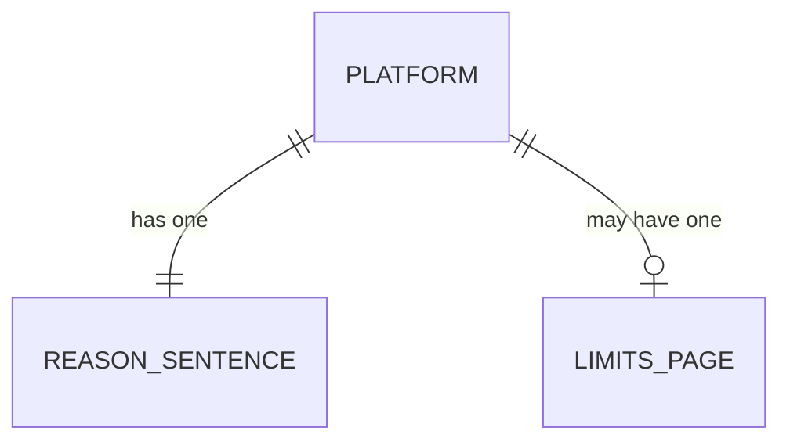

# Data Model: Limit Reasons

No stored data changes: no table, no column, no setting. The feature adds one value to the platform driver and rewords one. Both are constants in the code.

## Platform driver (`src/platforms/driver.ts`)

| Value | Type | Change | Rule |
| --- | --- | --- | --- |
| `words.limitReached` | text | Reworded | Exactly one per platform. One short sentence, names the platform, true for every cause of a stop at a limit, promises no reminder, no technical words (FR-002, FR-004). Shown in the popup and on Pick. |
| `limitsUrl` | text, optional | New | An `https` address from [contracts/limits-pages.md](contracts/limits-pages.md), and nothing else (FR-010). Missing means no info button and no "Learn more" link (FR-005, FR-014). |

## Limits page

One Markdown file per platform in `docs/limits/`, named by the platform ID. It holds no user data. Its required content is in the contract.

## State

No new store or app state. On Pick the existing `notice` line carries "Couldn't open the page.". On Home it is a local line of `HomeView`. The setting `reminderAsked` is unchanged: a user who answered before this feature sees no popup and reads the sentence on Pick.
