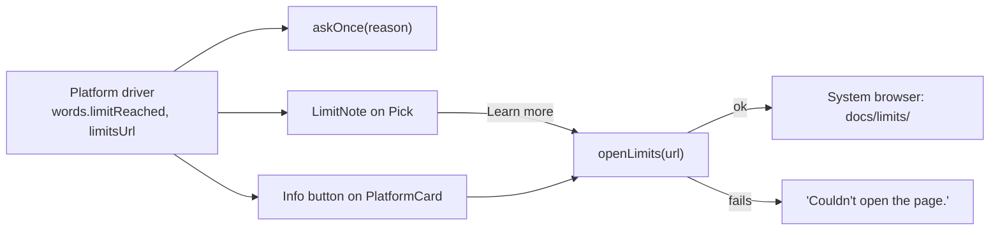

# Implementation Plan: Limit Reasons

**Branch**: `feature/limit-reasons` | **Date**: 2026-11-15 | **Spec**: [spec.md](spec.md)

**Input**: Feature specification from `specs/009-limit-reasons/spec.md`

## Summary

When a move stops at a platform limit, the user must see why. Each platform gets one reason sentence, shown in the reminder popup above the question and on Pick. Each platform also gets a limits page, served from this repository, that opens in the system browser from an info button on its Home card and from a "Learn more" link on Pick.

Technical approach:

- **Reason sentence**: the existing per-platform text `limitReached` is reworded. No new field. The popup function `askOnce` takes the sentence and shows it above the question ([research.md](research.md), R1).
- **Limits page address**: one new optional field on the platform driver, `limitsUrl`, next to the existing `removeAccessUrl` ([data-model.md](data-model.md)). A platform without it shows no info button and no link.
- **Opening the page**: one function opens the address with `Linking.openURL` and shows a short line if that fails (R3). Home and Pick both call it.
- **Home**: `PlatformCard` gets an info button as a third tap target. `HomeView` shows the "couldn't open" line.
- **Pick**: a small `LimitNote` component replaces the plain reason text. It shows the sentence and the "Learn more" link.
- **Pages**: two Markdown files under `docs/limits/`, served by GitHub Pages from the `docs/` folder of `main` ([contracts/limits-pages.md](contracts/limits-pages.md), R2).



## Technical Context

**Language/Version**: TypeScript (strict), React Native 0.88 via Expo SDK 58 (unchanged)

**Primary Dependencies**: None added. `Linking` and `Alert` from React Native, `Ionicons` from `@expo/vector-icons`, all in use today.

**Storage**: N/A. No schema change, no new setting.

**Testing**: Jest with `jest-expo` and React Native Testing Library. `Linking.openURL` and `Alert.alert` are spied on, as in the 008 tests.

**Target Platform**: Android 8.0+ first, iOS 16+. No platform-specific behavior (FR-013). No new permission, no deep link.

**Project Type**: Mobile app (single Expo project, no backend), plus two static pages in `docs/`.

**Performance Goals**: The page opens with one tap (SC-002). A page change is live within 10 minutes (SC-003): a GitHub Pages build takes about 1 minute and its cache lasts 10 minutes.

**Constraints**: The app opens only the addresses in [contracts/limits-pages.md](contracts/limits-pages.md) (FR-010). The app sends no request to the pages host and no user data with the link (FR-009). All text in `src/strings.ts`. No new screen.

**Scale/Scope**: 2 new source files, about 8 edited, 2 new pages, 2 new test files, 4 test files updated for the new texts.

## Constitution Check

*GATE: Must pass before Phase 0 research. Re-check after Phase 1 design.*

Checked against `.specify/memory/constitution.md` v1.5.1.

| Principle / rule | How the plan complies | Status |
| --- | --- | --- |
| I. New screen justified | No new screen. The reason shows in the existing popup and on Pick. The page opens in the system browser (FR-009). | Pass |
| I. Confirmations | No new dialog. The existing reminder popup gains one sentence. The "couldn't open" message is a line on the screen, not a dialog. | Pass |
| I. Icons and labels | Info button: `information-circle-outline`, icon only, as the spec asks (FR-005). "Learn more" link: `open-outline` with the text "Learn more". | Pass |
| I. Simple words | The sentences name the platform and use no "quota" or "rate limit" (FR-002). Texts are in "Texts" below. | Pass |
| I. Accessibility | Info button label "About YouTube limits". Link label "Learn more about YouTube limits". Both are 48 x 48 point targets (FR-007, FR-014). | Pass |
| II. Tests | Component tests for the popup text, the info button, the link, and the failure line. One unit test for the addresses. No real network. | Pass |
| II. Tests check behavior | Each test checks what the user sees or taps. The tests assert the mocked `Linking.openURL` call because opening the browser is the behavior itself. | Pass |
| III.5 Network | The app does not fetch the pages; the system browser does. So `dodo-tech-hub.github.io` is not added to the list of hosts the app talks to. It is listed here and in the contract as the only host the app opens for this feature. HTTPS only. Same case as the "remove access" page of spec 008. | Pass |
| III.6 Data | The link carries no user data and no identifier. The pages hold no user data. | Pass |
| III.7 Logging | Nothing new is logged. | Pass |
| III.8 Untrusted input | The addresses are constants in the code. Nothing from a platform answer or a deep link reaches `openURL`. | Pass |
| III.9 to III.11 | No permission, no backup change, no new dependency. | Pass |
| IV. One home per thing | Text in `src/strings.ts`. The address on the driver. The opener in `src/state/flows.ts`, where the other browser call lives. UI in `src/ui/`. No new folder in `src/`. `docs/limits/` is new and holds the pages, which are not app code. | Pass |
| IV. Extend, do not patch | Shared code reads `driver.limitsUrl` and `driver.words.limitReached`. No `if (platform === ...)` (FR-004, SC-004). | Pass |
| IV. Simplest solution first | Reuses `limitReached`, `Linking`, `Alert`, and the notice line. GitHub Pages renders the Markdown with no build step or config of ours. Known shortcut, marked `// ponytail:` at the addresses: they contain the repository name, so a repository rename needs an app release; a custom domain removes that. | Pass |
| V. Platform rules | The pages say Magpie is not made by or linked with the platform (FR-011). No platform logo on the pages. | Pass |

**Gate result (pre-research)**: Pass. **Gate result (post-design)**: Pass. No exceptions.

## Project Structure

### Documentation (this feature)

```text
specs/009-limit-reasons/
├── plan.md                  # This file
├── research.md              # Phase 0 decisions
├── data-model.md            # Phase 1: the two platform values
├── quickstart.md            # Phase 1: how to check the result
├── contracts/
│   └── limits-pages.md      # Addresses and required content of the pages
├── checklists/
│   └── requirements.md      # From the specify step
└── tasks.md                 # From /speckit-tasks, not created here
```

### Source Code (repository root)

```text
docs/
└── limits/
    ├── youtube.md               # new. YouTube limits page
    └── github.md                # new. GitHub limits page
src/
├── strings.ts                   # reword limitReached (both platforms), add aboutLimits, learnMore, learnMoreLabel, couldntOpenPage
├── platforms/
│   ├── driver.ts                # add limitsUrl?: string
│   ├── youtubeDriver.ts         # set limitsUrl
│   └── githubDriver.ts          # set limitsUrl
├── reminders/
│   └── reminder.ts              # askOnce(reason): reason, blank line, question
├── state/
│   ├── flows.ts                 # pass the reason to askOnce; new openLimits(dispatch, url)
│   └── AppState.tsx             # goHome clears the notice
└── ui/
    ├── PlatformCard.tsx         # info button, third tap target
    ├── HomeView.tsx             # onInfo, show the notice line
    ├── LimitNote.tsx            # new. Reason sentence and "Learn more" on Pick
    └── PickStep.tsx             # use LimitNote in place of the plain text
tests/
├── unit/
│   └── platforms.test.ts        # add: every limitsUrl is one of the contract's addresses
└── components/
    ├── limitReason.test.tsx     # new. Popup text, same sentence on Pick, Learn more, no link without a page
    ├── homeInfo.test.tsx        # new. Info button opens the page, not the flow; failure line; no button without a page
    ├── dailyLimit.test.tsx      # new sentence
    ├── githubPace.test.tsx      # new sentence
    ├── githubSignOut.test.tsx   # new sentence
    └── githubMove.test.tsx      # new sentence
```

**Structure Decision**: The single Expo project stays as it is. Pages go in `docs/` at the repository root because GitHub Pages can serve only the root or `docs/` of a branch, and `docs/` keeps pages apart from app code (R2).

## Design

### Texts

| Key | Text |
| --- | --- |
| `youtubeWords.limitReached` | "YouTube lets Magpie move only some channels each day. Today's limit is reached." |
| `githubWords.limitReached` | "GitHub lets Magpie move only some items each hour. Magpie must wait a little." |
| `aboutLimits(name)` | "About {name} limits" (accessibility label of the info button) |
| `strings.learnMore` | "Learn more" |
| `learnMoreLabel(name)` | "Learn more about {name} limits" |
| `strings.couldntOpenPage` | "Couldn't open the page." |

`limitReached` is also the line shown when reading a list hits a limit (`noticeFor` in `flows.ts`). The new sentences are true there too, so that code does not change.

### Popup (FR-001, FR-003)

`askOnce(reason)` shows `reason`, a blank line, then `strings.reminderAsk` as the message of the same native alert. Title, buttons, the "asked once" rule, and the permission request do not change. `flows.ts` passes `driver.words.limitReached`.

### Opening a limits page (FR-006, FR-008, FR-014)

`openLimits(dispatch, url)` in `flows.ts`: call `Linking.openURL(url)`; if it rejects, dispatch `setNotice` with `strings.couldntOpenPage`. It does not call `canOpenURL`, which needs extra app settings on Android 11 and later (R3). Pick shows the notice already. `HomeView` gains the same notice line. The `goHome` action does not clear the notice today, so it gains `notice: null`; without that, an old line from a flow (for example "No internet") would show on Home. Opening a platform from Home must clear it too; the tasks check the `openPlatform` action.

### Home card (FR-005, FR-007)

The info button is a sibling of the card body and the Continue note, placed in the top right corner of the card, 48 x 48 points, shown only when `platform.driver.limitsUrl` is set. The logo is 41 points high with 12 points of padding and the name sits under it, so the button does not cover the name at any font size, and the card is at least 160 points wide. `PlatformCard` gets an `onInfo` prop; `HomeView` calls `openLimits`.

### Pick (FR-004, FR-014)

`LimitNote` takes the driver and the platform name. It shows `words.limitReached`, and when `limitsUrl` is set, a "Learn more" button (same look as the button in `AccessNote`). `PickStep` renders it when the move state is `limit`.

## Tests

| Test | Checks | Covers |
| --- | --- | --- |
| `limitReason` (component) | YouTube stop: the alert message starts with the YouTube sentence and ends with the question. Pick shows the same sentence and no "We'll remind you". | US1.1, US1.3, FR-004 |
| `limitReason` | GitHub stop by GitHub's wait answer and by the hourly pace: the same GitHub sentence both times. | US1.2 |
| `limitReason` | Second stop: no alert, the sentence shows on Pick. | US1.4 |
| `limitReason` | Tap "Learn more": `openURL` is called with the platform's address; Pick still shows the paused rows and Continue. A driver without `limitsUrl` shows no link. | US1.5, US1.6 |
| `limitReason` | `openURL` rejects: Pick shows "Couldn't open the page." | FR-014 |
| `homeInfo` (component) | Each card has a button labelled "About {name} limits". Tapping it calls `openURL` with that platform's address and does not open the flow, also on a card with a Continue note. | US2.1, US2.2, US2.4, FR-006 |
| `homeInfo` | `openURL` rejects: Home stays and shows "Couldn't open the page." A platform without `limitsUrl` has no button. | FR-008, FR-005, US2.5 |
| `homeInfo` | A flow shows "No internet", then the user goes Home: Home shows no line. | Design, `goHome` |
| `platforms` (unit) | Every `limitsUrl` in the platform list is one of the addresses in the contract. | FR-010 |
| Existing tests | Pass with only the sentence changed. | SC-005 |

Not tested by Jest: the pages themselves, the 10-minute update (SC-003), the 5-tester check (SC-001), and the button's place at large font sizes. These are in [quickstart.md](quickstart.md).

## What the project owner needs to do

1. Before the public release: make the repository public, then in the repository's Settings, Pages, choose "Deploy from a branch", branch `main`, folder `/docs`.
2. Open both addresses in [contracts/limits-pages.md](contracts/limits-pages.md) on a phone and review the pages.
3. If the repository or organization is renamed later, tell the agent: the addresses change and need an app release.

## Complexity Tracking

No violations.
