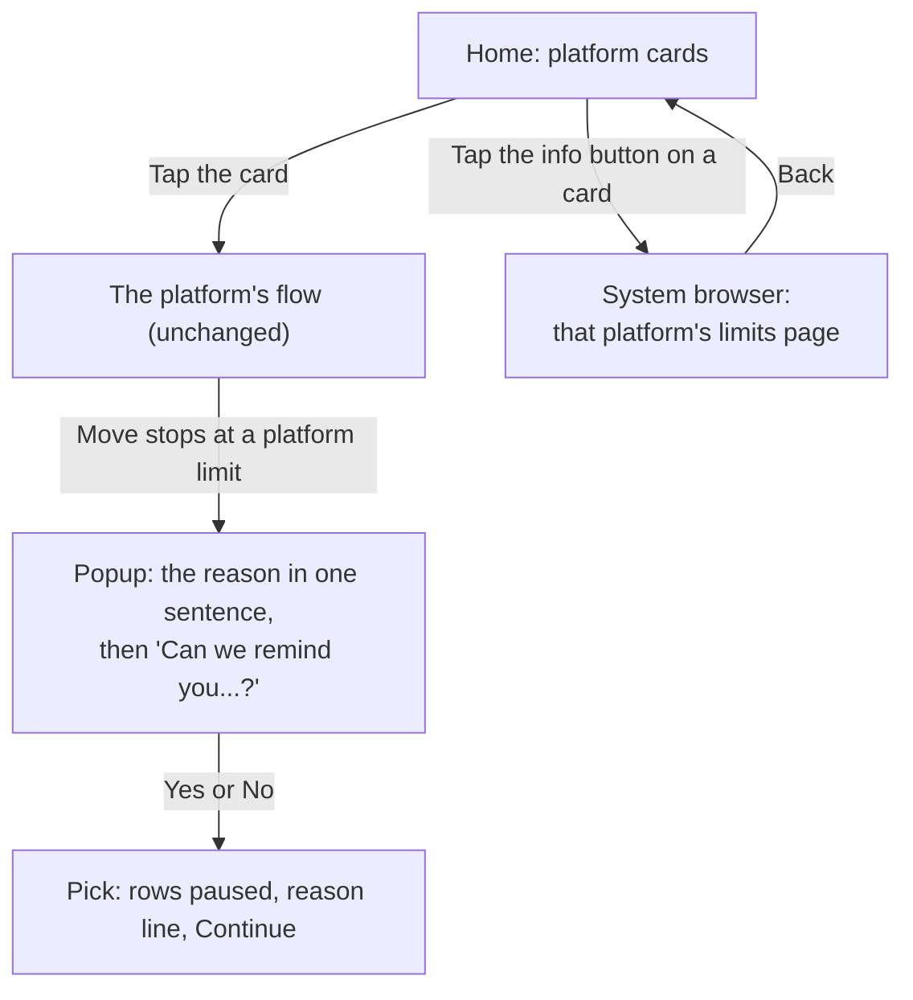

# Feature Specification: Limit Reasons

**Feature Branch**: `feature/limit-reasons`

**Created**: 2026-11-15

**Status**: Draft

**Input**: User description: "Limit reasons, for every platform. (1) When a move stops at a platform limit, the reminder popup only says 'Can we remind you when you can move the rest?' and users do not understand what happened. The popup must first say the reason in one short simple sentence, then ask about the reminder. (2) Each platform card on Home gets an info button. Tapping it opens, in the system browser, a web page that explains the reason for that platform's limits. The pages are Markdown files in the project's GitHub repo, one per platform, served through GitHub Pages, so content is fixed without an app release. No new in-app screen."

**Related**: [001 Subscription Migration](../001-subscription-migration/spec.md) defines the move, the daily limit, and the reminder. [004 Platform Picker](../004-multi-platform-picker/spec.md) defines the platform cards on Home. [008 GitHub Platform](../008-github-platform/spec.md) adds GitHub and its pace limits; this spec depends on it for GitHub's texts.

## Summary

A device test on 2026-11-15 showed two gaps. When a move stops at a platform limit, a popup asks "Can we remind you when you can move the rest?" before the user has seen any reason, so the user does not know what happened. And nowhere in the app can a user learn, before starting, why a platform can pause a move.

This feature adds two things, for every platform:

1. The reminder popup says the reason first, in one short sentence.
2. Each platform card on Home has an info button. It opens a web page about that platform's limits in the system browser. The pages live in the project's repository, so the owner can fix the text without an app release.

No new screen is added to the app.

## Clarifications

### Session 2026-11-15

- Q: Where must the limits pages be served from, given the project repository is private? → A: From the project's repository. The owner makes the repository public when satisfied with the state of the app, before the public release.
- Q: Must the popup and the reason line on Pick use the same sentence per platform, or two different texts? → A: The same sentence. Each platform has one reason sentence, shown in the popup and on Pick. The words "We'll remind you when you can move the rest" are removed from Pick.

## How it fits

## User Scenarios & Testing *(mandatory)*

### User Story 1 - Know why the move stopped (Priority: P1)

A user taps Move. After some items, the platform's limit is reached and the move stops. Today a popup asks about a reminder with no reason. With this feature, the popup first says what happened in one short sentence, in simple words, and then asks whether the app may send a reminder. The user understands that nothing is broken and that the rest can move later.

**Why this priority**: This is the moment of confusion found in the device test. A user who does not understand the stop may think the app failed and give up.

**Independent Test**: Start a move that stops at the limit on each platform. Confirm the popup shows the platform's reason sentence above the reminder question, and that Yes and No work as before.

**Acceptance Scenarios**:

1. **Given** a YouTube move stops at the daily limit, **When** the reminder popup shows, **Then** it first says the reason (for example "YouTube lets Magpie move only some channels each day. Today's limit is reached.") and then asks "Can we remind you when you can move the rest?".
2. **Given** a GitHub move stops because GitHub asked the app to wait or the hourly pace is reached, **When** the reminder popup shows, **Then** it first says the reason (for example "GitHub asked Magpie to slow down.") and then asks the same question.
3. **Given** the popup shows, **When** the user taps Yes or No, **Then** the reminder is set or not set exactly as today, and Pick shows the paused rows, Continue, and a reason line with the same sentence as the popup.
4. **Given** the user already answered the reminder question on an earlier stop, **When** a move stops at a limit again, **Then** no popup shows (as today) and the reason line on Pick says why the move stopped, with the platform's reason sentence.

---

### User Story 2 - Learn about a platform's limits before or after a move (Priority: P2)

A user on Home wants to know why a platform can pause a move, how many items move in a day or an hour, and when a paused move can go on. Each platform card has a small info button. Tapping it opens that platform's limits page in the system browser. The user reads it and returns to the app, which is where they left it.

**Why this priority**: It answers the "why" in full for users who want it, without adding text to the flow. The popup in User Story 1 already covers the urgent moment.

**Independent Test**: On Home, tap the info button on each card. Confirm the browser opens that platform's page, the card's flow does not open, and returning to the app shows Home unchanged.

**Acceptance Scenarios**:

1. **Given** Home shows the platform cards, **When** the user looks at a card, **Then** it shows an info button with an icon, apart from the card body and the Continue note.
2. **Given** the user taps the info button on a card, **When** the browser opens, **Then** it shows the limits page of that platform, and the platform's flow does not open.
3. **Given** the user returns from the browser, **When** the app shows, **Then** Home is as the user left it, and any unfinished progress and running move are unchanged.
4. **Given** a screen reader is on, **When** focus is on the info button, **Then** it reads a label that names the platform (for example "About YouTube limits").
5. **Given** a platform is added to the platform list later, **When** its card shows, **Then** it has the info button with no change to Home, as long as the platform has a limits page.

---

### User Story 3 - Fix the explanation without an app release (Priority: P3)

The project owner finds that a limits page is unclear, or a platform changes its limits. The owner edits that platform's page in the repository. Users who tap the info button after that see the new text, with no app update.

**Why this priority**: Platform limits change without notice (spec 008). Text that ships inside the app would be wrong until the next release.

**Independent Test**: Edit one sentence of a platform's page in the repository. Tap that card's info button on an installed app and confirm the new sentence shows.

**Acceptance Scenarios**:

1. **Given** the owner changes a limits page in the repository, **When** a user taps that card's info button afterwards, **Then** the page shows the changed text, with no app release.
2. **Given** each platform has its own page, **When** the owner edits one page, **Then** the other platforms' pages are unchanged.

---

### Edge Cases

- The phone has no internet when the user taps the info button: the browser opens and shows its own "no internet" page. The app shows nothing extra. This is accepted, because the page is optional reading.
- The phone has no browser, or the browser cannot open the link: the app stays on Home and shows a short line, for example "Couldn't open the page."
- A move is running in the background when the user taps the info button: the move goes on, as when the user leaves the app for any other reason.
- The user taps the info button on a card that has a Continue note: only the page opens. The progress does not open.
- A limits page is missing, was moved, or is not served yet because the repository is still private: the browser shows the site's "not found" page. The owner fixes the page; the app needs no change.
- The font size is large or the screen is narrow: the info button stays inside the card, does not cover the name or the Continue note, and keeps its tap size.
- A move stops for a reason that is not a platform limit (no internet, sign-in ran out, the platform paused the account): no reminder popup shows, as today, so this feature changes nothing there.

## Requirements *(mandatory)*

### Functional Requirements

**The reason in the reminder popup**

- **FR-001**: When a move stops at a platform limit and the app asks whether it may send a reminder, the popup MUST first show the reason for the stop in one short sentence, and then the reminder question. The reason MUST come from the platform of the move.
- **FR-002**: The reason sentence MUST use simple, everyday words, MUST name the platform, and MUST NOT show a raw error, a number code, or technical words such as "quota" or "rate limit".
- **FR-003**: The popup's choices, when it shows, and what each choice does MUST stay as they are today. This feature changes only the text of the popup and of the reason line on Pick.
- **FR-004**: Every platform in the platform list that can stop at a limit MUST have exactly one reason sentence, kept with the other app text. The popup and the reason line on Pick MUST show this same sentence. The reason line on Pick MUST NOT promise a reminder, because the user may have answered No. A new platform MUST supply its own sentence; shared code MUST NOT name a platform.

**The info button on a platform card**

- **FR-005**: Every platform card on Home that has a limits page MUST show an info button with an icon. A platform without a limits page MUST NOT show the button.
- **FR-006**: Tapping the info button MUST open that platform's limits page in the system browser. It MUST NOT open the platform's flow or a progress, and MUST NOT ask to save an unfinished progress.
- **FR-007**: The info button MUST be a separate tap target of at least 48 x 48 points from the card body and the Continue note, and MUST have an accessibility label that names the platform.
- **FR-008**: If the page cannot be opened, the app MUST stay on Home and show a short line in simple words. It MUST NOT crash or leave Home.
- **FR-009**: The app MUST NOT add a new in-app screen for this feature, and MUST NOT load the page inside the app. The app itself sends no request for the page and sends no user data or identifier with the link.

**The limits pages**

- **FR-010**: Each platform MUST have one limits page, at a fixed address that belongs to the project. The address of each page MUST be listed in the plan, and the app MUST open only those addresses.
- **FR-011**: Each page MUST say, in simple words: why the platform can pause a move, about how many items move in a day or an hour, when a paused move can go on, and that the items already moved stay moved. It MUST say that Magpie is not made by or linked with the platform.
- **FR-012**: The pages MUST be kept in the project's repository, one file per platform, so the owner can change the text without an app release.
- **FR-013**: The feature MUST work the same way on Android and iOS.

### Key Entities

- **Platform**: An entry in the existing platform list. Its reason sentence (today shown only on Pick) is reworded and also shown in the popup, and it gains the address of its limits page.
- **Limits page**: One page per platform, outside the app, that explains that platform's limits. It holds no user data.

### Platform texts *(platform-specific)*

The exact words are drafts. The plan may refine them, keeping the meaning.

| Platform | Reason sentence (popup and Pick) | What the limits page explains |
| --- | --- | --- |
| YouTube | "YouTube lets Magpie move only some channels each day. Today's limit is reached." | The daily limit is shared by everyone who uses Magpie, about 200 channels per day in total, and it starts again once a day (spec 001). |
| GitHub | "GitHub asked Magpie to slow down." | GitHub's rules forbid starring or following a lot in a short time, so Magpie moves at most 20 items per minute and 300 per hour, and waits when GitHub asks (spec 008, FR-GH-010 and FR-GH-012). |

## Success Criteria *(mandatory)*

### Measurable Outcomes

- **SC-001**: In a test with a move that stops at the limit, 5 out of 5 testers can say why the move stopped after reading only the popup.
- **SC-002**: From Home, a user reaches a platform's limits page with one tap, and returns to the app with Home unchanged.
- **SC-003**: A change to a limits page is visible to users within 10 minutes, with no app release.
- **SC-004**: Adding a platform needs no change to Home or to the popup beyond that platform's own reason sentence and page address.
- **SC-005**: All existing tests pass with no change to what they check, apart from the text of the popup and of the reason line on Pick.

## Assumptions

- The project's repository is private today. The owner makes it public before the public release, and its page hosting serves the limits pages from then on. Until then the info button opens an address that shows the site's "not found" page. This is accepted for test builds, and the in-app parts (the popup reason and the info button) can be built and tested before the repository is public.
- The pages are in English, like the app's text today.
- The page opens in the system browser, as the "remove access" page of spec 008 does. The app does not fetch the page, so the page's host is not added to the list of hosts the app talks to (constitution, Principle III, rule 5). The plan confirms this in its Constitution Check.
- The reminder question is still asked only once, as today. A later stop shows the reason on Pick, not in a popup.
- Spec 008 is merged (2026-11-15), so this feature covers YouTube and GitHub from its first release.
- Guided platforms (spec 005) get an info button only when they have limits worth explaining. That is decided when each one is added.

## What the project owner needs to do

1. Before the public release, make the repository public and turn on its page hosting, so the limits pages are served as plain web pages.
2. Review the two limits pages before release, because they speak for the project in public.
