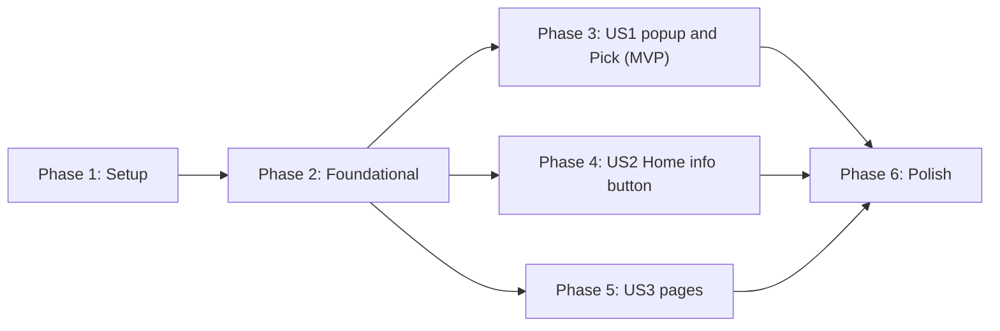

---

description: "Task list for limit reasons"
---

# Tasks: Limit Reasons

**Input**: Design documents from `specs/009-limit-reasons/` (plan.md, spec.md, research.md, data-model.md, contracts/limits-pages.md, quickstart.md)

**Prerequisites**: Spec 008 is merged and `main` is merged into `feature/limit-reasons`. No new dependency, no key, no owner step before the code. The pages go live only after the owner makes the repository public (T021).

**Tests**: Required by the constitution (Principle II). Test tasks come before the code they check and must fail first. Each test checks what the user sees or taps. A test asserts the mocked `Linking.openURL` call because opening the browser is the behavior itself. No test calls a real platform or loads a real page.

**Organization**: Phase 2 adds what every story needs (texts, the page address, the opener). Then one phase per user story, in the spec's priority order. US1 and US2 do not depend on each other. US3 is the two pages and can be done at any time after Phase 2.

## Format: `[ID] [P?] [Story] Description`

- **[P]**: Can run in parallel (different files, no dependency on an unfinished task)
- **[Story]**: US1 to US3. Setup, Foundational, and Polish tasks have no label
- Paths are from the repository root

## Phase 1: Setup

**Purpose**: Status and a known-good start

- [X] T001 Set the `**Status**:` line in `specs/009-limit-reasons/spec.md` to `In progress` (AGENTS.md: implementation has started).
- [X] T002 Run `npm test`, `npm run typecheck`, and `npm run lint` before any code change. All pass. Note the test count for T019.

---

## Phase 2: Foundational (texts, address, opener)

**Purpose**: The reason sentence, the limits page address, and the one function that opens a page. Every story needs these.

**CRITICAL**: Finish this phase before any user story.

- [X] T003 [P] Update the existing tests for the new reason sentences, with no other change to what they check (SC-005). In `tests/components/dailyLimit.test.tsx` replace `/Daily limit reached/` and "Daily limit reached. We'll remind you when you can move the rest." with "YouTube lets Magpie move only some channels each day. Today's limit is reached.". In `tests/components/githubPace.test.tsx`, `tests/components/githubSignOut.test.tsx`, and `tests/components/githubMove.test.tsx` replace "GitHub needs a break. We'll remind you when you can move the rest." with "GitHub lets Magpie move only some items each hour. Magpie must wait a little.". Run `grep -rn "needs a break\|Daily limit reached" tests` and confirm nothing is left. These tests fail until T005.
- [X] T004 [P] Add to `tests/unit/platforms.test.ts`, in the `drivers` block: `PLATFORMS.map((p) => p.driver.limitsUrl)` equals exactly `['https://dodo-tech-hub.github.io/magpie/limits/youtube', 'https://dodo-tech-hub.github.io/magpie/limits/github']` (the addresses of contracts/limits-pages.md, FR-010); and every platform's `driver.words.limitReached` contains the platform's `name` and contains none of "quota", "rate limit", "remind" in any letter case (FR-002, FR-004). Fails until T005 and T006.
- [X] T005 Edit `src/strings.ts`. Set `youtubeWords.limitReached` to "YouTube lets Magpie move only some channels each day. Today's limit is reached." and `githubWords.limitReached` to "GitHub lets Magpie move only some items each hour. Magpie must wait a little." (data-model.md: "Exactly one per platform. One short sentence, names the platform, true for every cause of a stop at a limit, promises no reminder, no technical words"). Add to `strings`: `learnMore: 'Learn more'` and `couldntOpenPage: "Couldn't open the page."`. Add next to `continueLabel`: `export const aboutLimits = (name: string) => \`About ${name} limits\`;` and `export const learnMoreLabel = (name: string) => \`Learn more about ${name} limits\`;`. Make T003 pass.
- [X] T006 Edit `src/platforms/driver.ts`: add `limitsUrl?: string;` to `Driver`, right after `removeAccessUrl`, with the comment `// Page that explains this platform's limits. Missing = no info button and no "Learn more".`. Set `limitsUrl: 'https://dodo-tech-hub.github.io/magpie/limits/youtube'` in `src/platforms/youtubeDriver.ts` and `limitsUrl: 'https://dodo-tech-hub.github.io/magpie/limits/github'` in `src/platforms/githubDriver.ts` (data-model.md: "An `https` address from contracts/limits-pages.md, and nothing else"). Above the line in `youtubeDriver.ts` add `// ponytail: the address holds the repository name, a rename needs an app release; a custom domain removes that`. Make T004 pass.
- [X] T007 Edit `src/state/flows.ts`: add `export async function openLimits(url: string): Promise<boolean>` that awaits `Linking.openURL(url)` inside `try` and returns `true`, and returns `false` in `catch`. It touches no state and imports no dispatch (research R6). Do not call `Linking.canOpenURL` (research R3). `Linking` is already imported in this file. No test of its own: T008 and T012 check it through the screens.

**Checkpoint**: `npm test` passes with the new sentences. Nothing new shows on screen yet.

---

## Phase 3: User Story 1 - Know why the move stopped (Priority: P1) MVP

**Goal**: The reminder popup says the platform's reason sentence first. Pick shows the same sentence with a "Learn more" link to the limits page.

**Independent Test**: Start a move that stops at the limit on YouTube and on GitHub. The popup shows the platform's sentence above the question, Yes and No work as before, and Pick shows the same sentence and "Learn more".

### Tests for User Story 1

- [ ] T008 [P] [US1] Write `tests/components/limitReason.test.tsx`. YouTube cases reuse the setup of `tests/components/dailyLimit.test.tsx` (mock `@/api/youtube`, `resetWorld`, `jest.spyOn(Alert, 'alert')`, `answerAlert`, sign in both accounts, move 3 channels with the second `subscribe` answering `{ kind: 'tomorrow' }`), and spy on `Linking.openURL` resolving. GitHub cases reuse `tests/components/githubWorld.tsx` (`resetGithub`, `renderGithub`, `signInBoth`, `answerReminder`) and the way `tests/components/githubPace.test.tsx` reaches a stop. Cases: (1) YouTube stop: `Alert.alert` is called once and its message (second argument) starts with "YouTube lets Magpie move only some channels each day. Today's limit is reached." and ends with "Can we remind you when you can move the rest?" (US1.1). (2) After the answer, Pick shows that same sentence, the paused rows, and Continue, and no text matching `/remind you/` (US1.3, FR-004). (3) Tap Continue and stop at the limit again: `Alert.alert` is still called once in total and the sentence shows on Pick (US1.4). (4) GitHub stop by the hourly pace and GitHub stop by GitHub's wait answer: both show "GitHub lets Magpie move only some items each hour. Magpie must wait a little." in the alert message and on Pick (US1.2). (5) Pick has a button with the label "Learn more about YouTube limits"; pressing it calls `Linking.openURL` with `https://dodo-tech-hub.github.io/magpie/limits/youtube`, and the paused rows and Continue are still there (US1.5). (6) With `Linking.openURL` rejecting, pressing it shows "Couldn't open the page." on Pick (FR-014). (7) With `youtubeDriver.limitsUrl` set to `undefined` for one test (restore it in `afterEach`), the sentence shows and no "Learn more" button exists (US1.6). All fail until T009 to T011.

### Implementation for User Story 1

- [ ] T009 [US1] Edit `src/reminders/reminder.ts`: `askOnce(reason: string)` passes `\`${reason}\n\n${strings.reminderAsk}\`` as the alert message. Title, buttons, the `reminderAsked` setting, and the permission request do not change (FR-003). Update the comment above it to say the reason comes first. Edit `src/state/flows.ts`: the call in `startMove` becomes `askOnce(driver.words.limitReached)`.
- [ ] T010 [P] [US1] Create `src/ui/LimitNote.tsx`, modelled on `src/ui/AccessNote.tsx`: `export function LimitNote({ driver, name, onLearnMore }: { driver: Driver; name: string; onLearnMore: (url: string) => void })`. It shows `driver.words.limitReached` in the warning color (the style of `note` in `src/ui/PickStep.tsx`: `fontSize: 13, color: c.warning`). When `driver.limitsUrl` is set it also shows a `Pressable` with `accessibilityRole="button"`, `accessibilityLabel={learnMoreLabel(name)}`, `minHeight: 48`, `minWidth: 48`, an `Ionicons` `open-outline` icon of size 18, and the text `strings.learnMore`; pressing it calls `onLearnMore(driver.limitsUrl)`. Without `limitsUrl` only the sentence shows. Colors come from `useTheme()`.
- [ ] T011 [US1] Edit `src/ui/PickStep.tsx`: replace the line `{moveState === 'limit' && <Text style={styles.note}>{words.limitReached}</Text>}` with `{moveState === 'limit' && <LimitNote driver={driver} name={platformName} onLearnMore={(url) => void openLimits(url).then((ok) => { if (!ok) dispatch({ type: 'setNotice', notice: strings.couldntOpenPage }); })} />}`, where `platformName` is the `name` of the entry in `PLATFORMS` whose `id` is `state.platform` (import `PLATFORMS` from `@/platforms/platforms` and `openLimits` from `@/state/flows`). Remove the `note` style if nothing else uses it. Make T008 pass.

**Checkpoint**: US1 works on its own: `npx jest tests/components/limitReason.test.tsx tests/components/dailyLimit.test.tsx tests/components/githubPace.test.tsx` passes.

---

## Phase 4: User Story 2 - Learn about a platform's limits from Home (Priority: P2)

**Goal**: Each platform card on Home has an info button that opens that platform's limits page in the system browser.

**Independent Test**: On Home, tap the info button on each card. The browser opens that platform's page, the flow does not open, and Home is unchanged on return.

### Tests for User Story 2

- [ ] T012 [P] [US2] Write `tests/components/homeInfo.test.tsx`, with the setup of `tests/components/home.test.tsx` (`resetWorld`, render `App`, the `seed` helper for a Continue note) and `jest.spyOn(Linking, 'openURL')` resolving. Cases: (1) Home has buttons with the labels "About YouTube limits" and "About GitHub limits" (US2.1, US2.4). (2) Pressing "About YouTube limits" calls `Linking.openURL` once with `https://dodo-tech-hub.github.io/magpie/limits/youtube`; the From step does not open (the label "YouTube" is still on screen and no "Sign in with Google: Old account" label exists); the same for GitHub with its address (US2.2, FR-006). (3) With a seeded unfinished YouTube progress, pressing the info button opens only the page: the Continue note is still there and the progress did not open (edge case). (4) With `Linking.openURL` rejecting, Home stays and shows "Couldn't open the page." (FR-008). (5) Render `HomeView` with a platform list whose driver has no `limitsUrl` (copy of a `PLATFORMS` entry with `driver: { ...driver, limitsUrl: undefined }`): no "About" button exists (FR-005, US2.5). (6) A notice set by a running flow (dispatch `setNotice` with "No internet. Try again when you're online." from inside the opened YouTube flow), then Home: Home does not show that line. All fail until T013 and T014.

### Implementation for User Story 2

- [ ] T013 [P] [US2] Edit `src/ui/PlatformCard.tsx`: add the prop `onInfo?: () => void`. When `onInfo` is given, render a third `Pressable` as a sibling of the body and the Continue note (not inside either), placed with `position: 'absolute', top: 0, right: 0`, `width: 48, height: 48`, centered content, `accessibilityRole="button"`, `accessibilityLabel={aboutLimits(platform.name)}`, `onPress={onInfo}`, holding `<Ionicons name="information-circle-outline" size={22} color={colors.muted} />`. Update the comment above the component: the card body, the Continue note, and the info button are three separate tap targets (FR-007).
- [ ] T014 [US2] Edit `src/ui/HomeView.tsx`: add `const [pageError, setPageError] = useState(false)` and pass `onInfo={item.driver.limitsUrl ? () => void openLimits(item.driver.limitsUrl!).then((ok) => setPageError(!ok)) : undefined}` to `PlatformCard` (import `openLimits` from `@/state/flows`). Under the sections, when `pageError` is true show `strings.couldntOpenPage` as a `Text` in the error color with `accessibilityLiveRegion="polite"`, styled like the `error` style of `src/ui/PickStep.tsx`. Do not use `state.notice` (research R6). Make T012 pass.

**Checkpoint**: US1 and US2 both work. `npx jest tests/components/homeInfo.test.tsx tests/components/home.test.tsx tests/components/homeLayout.test.tsx tests/components/homeNav.test.tsx` passes.

---

## Phase 5: User Story 3 - Fix the explanation without an app release (Priority: P3)

**Goal**: One limits page per platform in the repository, served as a web page, so a text change needs no app release.

**Independent Test**: After the pages are live (T021), change one sentence of one page on `main`. Within 10 minutes the address shows it, and the other page is unchanged.

- [ ] T015 [P] [US3] Create `docs/limits/youtube.md`. Plain Markdown, no front matter, no HTML, no images, no logo, each sentence on one line. Start with `# YouTube limits in Magpie`, then these parts in this order with a `##` heading each (contracts/limits-pages.md): why a move can pause (YouTube gives each app a fixed amount of work per day, and all people who use Magpie share it); how many items (about 200 channels per day, for everyone together); when the move can go on (the limit starts again once a day, the app shows "Tomorrow" on the rows and can send a reminder); what is safe (channels already moved stay moved, tap Continue to move the rest, nothing is lost); and a last line "Magpie is not made by or linked with YouTube or Google. YouTube is a trademark of Google LLC.". Simple words, short sentences, no "quota" and no "rate limit" (constitution I, FR-011).
- [ ] T016 [P] [US3] Create `docs/limits/github.md` with the same rules and order as T015. Title `# GitHub limits in Magpie`. Parts: why (GitHub's rules do not allow starring or following a lot in a short time, so Magpie goes slowly to keep your account safe); how many (at most 20 items per minute and 300 per hour, and Magpie also waits when GitHub asks); when (usually within the hour, the app shows "Later" on the rows and can send a reminder); what is safe (items already moved stay moved, tap Continue, nothing is lost); last line "Magpie is not made by or linked with GitHub. GitHub is a trademark of GitHub, Inc.".

**Checkpoint**: Both files exist and hold every part of the contract. The owner checks the content by reading the two Markdown files in the pull request. They are served only after T021, which is pending.

---

## Phase 6: Polish and checks

- [ ] T017 [P] Run `grep -rn "WebView\|expo-web-browser" src` and confirm nothing is found (FR-009: the page opens in the system browser, never inside the app). Run `grep -rn "limitsUrl\|github.io" src` and confirm the two addresses appear only in `src/platforms/youtubeDriver.ts` and `src/platforms/githubDriver.ts`, and that shared code (`src/state`, `src/ui`, `src/reminders`) names no platform (FR-004, SC-004).
- [ ] T018 [P] Update `specs/009-limit-reasons/checklists/requirements.md`: in Notes, replace the "Open points for `/speckit-clarify`" line with "Both open points were closed on 2026-11-15 (spec, Clarifications and Assumptions)."
- [ ] T019 Run `npm test`, `npm run typecheck`, and `npm run lint`. All pass. The test count is the count of T002 plus the new tests; no existing test was removed or skipped (SC-005).
- [ ] T020 Manual check on both platforms, quickstart.md Step 2, rows 1 to 12, once on Android (`npx expo run:android`) and once on iOS (`npx expo run:ios`, needs the owner's Mac) (FR-013). Needs the owner or a device. Before the repository is public, rows 2 and 9 show GitHub's "not found" page: that is expected.
- [ ] T021 **PENDING, owner, later**: does not block the code or the merge. When the owner makes the repository public (plan.md, "What the project owner needs to do"): Settings, Pages, "Deploy from a branch", branch `main`, folder `/docs`. Then run quickstart.md Step 1: both addresses show their page without `.html`, the pages fit a phone screen, and a changed sentence shows within 10 minutes (SC-003). If a page does not render or does not fit, report it; the fix is a small `docs/_config.yml` (research R2), and the addresses stay the same.
- [ ] T022 Owner step: quickstart.md Step 3, 5 testers read only the popup and say why the move stopped (SC-001).
- [ ] T023 After the pull request is merged, set the `**Status**:` line in `specs/009-limit-reasons/spec.md` to `Implemented`.

---

## Dependencies and order



- **Phase 2** blocks every story. Inside it: T003 and T004 (tests) first, then T005, T006, T007.
- **US1**: T008, then T009; T010 can run beside T009; T011 needs T007, T009, and T010.
- **US2**: T012 (test), then T013 and T014 (T013 is `PlatformCard.tsx`; T014 is `HomeView.tsx` and needs T007 and T013).
- **US3**: T015 and T016 need nothing but the contract. The app works without them (the browser shows "not found").
- US1 and US2 touch different files, except that both import `openLimits` from T007. They can be done in either order.
- T021 is pending until the owner makes the repository public. T021 and T022 need the owner and do not block the merge of the code.

## Parallel examples

```text
Phase 2:  T003 and T004 together (different test files)
US1:      T008 (test) and T010 (LimitNote.tsx) together
US2:      T012 (test) and T013 (PlatformCard.tsx) together
US3:      T015 and T016 together, at any time after Phase 2
Polish:   T017 and T018 together
```

## Implementation strategy

- **MVP**: Phases 1 to 3 (US1). This fixes the confusion found in the device test: the popup and Pick say why the move stopped. It can ship alone; "Learn more" then opens a "not found" page until the pages are live, so do T015 and T016 in the same pull request.
- **Then** US2 (the Home info button), then the owner steps T021 and T022 before the public release.
- **One pull request** for Phases 1 to 6 is fine: about 10 edited files and 4 new ones. Commit per task or per small group of tasks, one logical change each.
