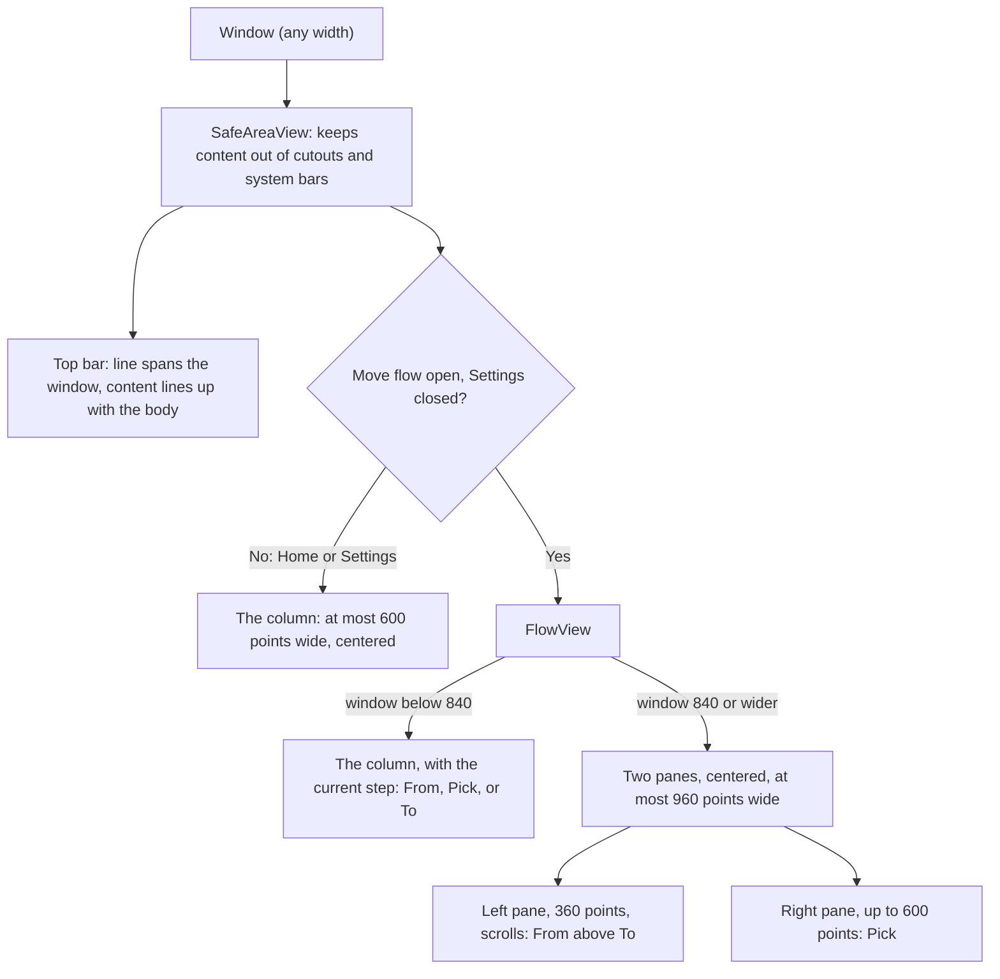

# Implementation Plan: Adaptive Layout

**Branch**: `feature/adaptive-layout` | **Date**: 2026-11-16 | **Spec**: [spec.md](spec.md)

**Input**: Feature specification from `specs/010-adaptive-layout/spec.md`

## Summary

Make every screen fit the window the app has, from a 320-point phone to an open foldable, in portrait, landscape, and split-screen, keep the user's place when the window changes, and show the move flow in two panes on windows 840 points wide or wider.

Most of the spec is met by small changes, because the app already survives window changes without a restart ([research.md](research.md), R4).

| Part | What | Stories | Ships as |
| --- | --- | --- | --- |
| A | Centered column, rotation unlocked, tests that a window change loses nothing. | 1, 2, 4 | One pull request |
| B | Two-pane move flow in Expanded windows. | 5, and 2 (scenarios 8 to 10) | One pull request, after A |
| C | Small screens and large text: scrolling on every screen, heights that grow with text, touch targets. | 3 | One pull request, after B |



Technical approach:

- **Column** (R1, [contracts/layout.md](contracts/layout.md)): one shared `column` style in a new `src/ui/layout.ts`, applied once in `App.tsx` around every screen and once inside each top bar. Under 600 points it changes nothing; from 600 up the content is centered. No screen reads the window width for this.
- **Rotation** (R3): `orientation: 'default'` in `app.config.ts`. The owner regenerates the Android project locally and rebuilds.
- **Keep my place** (R4): no new code. New tests change the window size during a flow and check that the step, Settings, picks, collapsed sections, search text, a waiting sign-in code, and a running move are kept, and that nothing runs twice.
- **Two panes** (R9): one new component, `src/ui/FlowView.tsx`, takes over the three step lines in `App.tsx`. It reads the window width through one shared hook, `useTwoPane()`. In two panes it shows From and To in a scrolling left pane and Pick in the right pane. In one pane it shows the current step in the column, as today. The current step is the existing `state.step`; no new state. Touching a pane sets it. `PickStep` keeps the same parent and key in both layouts, so its search text, collapsed sections, and scroll position survive the change. Each step shows the notice only when it is the current step, so the notice shows once.
- **Large text** (R5): list row heights multiply by the system font scale; buttons and inputs use `minHeight`; Settings scrolls (From and To already scroll after Part B); names and status tags end with an ellipsis.
- **Touch targets** (R6): one shared value, 48 points, for both platforms.
- **Home grid**: the number of card columns is counted from the column width, not the window width.

## Technical Context

**Language/Version**: TypeScript (strict), React Native 0.88 via Expo SDK 58 (unchanged)

**Primary Dependencies**: None added. `useWindowDimensions` and `StyleSheet` from React Native, `react-native-safe-area-context` (already installed).

**Storage**: None. This feature saves nothing.

**Testing**: Jest with `jest-expo` and React Native Testing Library. The window size and font scale are mocked. Real layout (overlap, cutouts, hinge) is checked on devices with [quickstart.md](quickstart.md). See research R8.

**Target Platform**: Android 8.0+ first, iOS 16+ (iPhone only). Platform differences are in the spec's "Platform-specific behavior" section; the code has none.

**Project Type**: Mobile app (single Expo project, no backend)

**Performance Goals**: Layout follows a window change within 0.5 seconds with no blank screen (SC-004). The Pick list stays as fast as today on 1,000 items (known row heights are kept).

**Constraints**: No new dependency, no new permission, no new screen, no stored data, no new app state. Builds are local: the orientation change needs a local prebuild and rebuild. All sizes in density-independent points.

**Scale/Scope**: Part A: 1 new file, 5 edited files, 2 new test files, 1 new test helper, 1 test file extended. Part B: 1 new file, 6 edited files, 1 new test file, 1 test file extended. Part C: about 8 edited files, 1 new test file, 2 test files extended. About 220 changed lines of app code in total.

## Constitution Check

*GATE: Must pass before Phase 0 research. Re-check after Phase 1 design.*

Checked against `.specify/memory/constitution.md` v1.6.0.

| Principle / rule | How the plan complies | Status |
| --- | --- | --- |
| I. New screen justified | No new screen, no new control, no new text. Two panes show the three existing steps together; the locked Pick message is the existing one. | Pass |
| I. Accessibility | Touch targets grow to 48 points. Largest system font size works on every screen. Labels and roles are unchanged. | Pass |
| II. Tests | Component tests for window changes on every screen, for the two-pane flow (Story 5 and the changes between one and two panes), and for scrolling on From, To, and Settings. Unit test for row height. Existing tests keep passing. | Pass |
| II. Tests check behavior | The window-change tests check what the user keeps (picks, search, sections, step, move totals). No test only asserts a style value where a behavior can be checked instead. | Pass |
| III. Security baseline | No new permission, network host, dependency, stored data, or log line. Sign-in flows are untouched. | Pass |
| IV. One home per thing | Shared layout values and the one width check (`useTwoPane`) live in one new file, `src/ui/layout.ts`. The two-pane layout lives in one new file, `src/ui/FlowView.tsx`. No new folder. | Pass |
| IV. Simplest solution first | A width limit instead of size class code for the column (R1, R2). One component and one hook for two panes, with the existing current step and no navigation library (R9). A config value instead of an orientation library (R3). No state saving code (R4). No hinge library (R7). | Pass |
| IV. Restructure instead of forcing it | The three step lines move from `App.tsx` into `FlowView`, so one place decides what the flow shows. Steps do not learn about panes. | Pass |
| V. Platform rules | Not affected. | Pass |
| VI. Size by window, not device | The column and the two-pane switch depend on the window width only. Nothing reads the device model. | Pass |
| VI. Readable width | `MAX_CONTENT_WIDTH` (600) is the one value, used by the shell, both bars, the Home grid, and as the limit of the right pane. The left pane is 360. | Pass |
| VI. New layouts per size class | The spec states the two-pane layout for the move flow in Expanded (Story 5, FR-015 to FR-020). The 840 value is shared, in `layout.ts`. | Pass |
| VI. Keep the user's place | Met by how the app already runs; guarded by new tests (R4). | Pass |
| VI. Both orientations | Portrait lock removed. No exception asked. | Pass |
| VI. Small screens and large text | Part C. The Move button is outside the scrolling list, so it stays visible, also in the right pane on a short window. | Pass |
| VI. Safe areas | The existing `SafeAreaView` wraps the whole app, including in landscape. Checked on devices. | Pass |
| VI. Touch targets | 48 points on both platforms (R6). | Pass |
| VI. Specs and tests | Tests cover one Compact and one Medium window for each screen, and one Expanded window for the flow, Home, and Settings. | Pass |
| Spec edge case "Half-folded" | The spec now puts a hinge that hides content out of scope (R7). | Pass |

**Gate result (pre-research)**: Pass. **Gate result (post-design)**: Pass.

### Resolved: hinges that hide content

The "Half-folded" edge case used to say the column must not cross a hinge that blocks content. Meeting it needs a native fold library, for devices outside the test matrix (R7). The owner approved the spec edit on 2026-11-16: "Devices whose hinge hides part of the screen are out of scope; the app reads the window size only." The dual-screen edge case follows the same rule.

## Project Structure

### Documentation (this feature)

```text
specs/010-adaptive-layout/
├── plan.md              # This file
├── research.md          # Phase 0 decisions R1 to R8
├── quickstart.md        # Phase 1: device checks and test commands
├── contracts/
│   └── layout.md        # The shared layout values and the rules every screen follows
├── checklists/
│   └── requirements.md  # From the specify step
└── tasks.md             # Next step (speckit-tasks)
```

No `data-model.md`: the feature stores no data and adds no state (spec, Key Entities).

### Source Code (repository root)

```text
app.config.ts                # A: orientation 'default'
App.tsx                      # A: the body view gets the column style. B: the three step lines become <FlowView />, which sets its own width
src/ui/
├── layout.ts                # A: new. MAX_CONTENT_WIDTH, TOUCH_TARGET, column style. B: EXPANDED_WIDTH, SIDE_PANE_WIDTH, panes style, useTwoPane()
├── FlowView.tsx             # B: new. One step in the column, or two panes
├── TopBar.tsx               # A: content in the column. B: content as wide as the panes when two panes show. C: one-line labels, 48-point targets
├── HomeBar.tsx              # A: content in the column
├── HomeView.tsx             # A: card columns counted from the column width
├── PickStep.tsx             # B: notice only when Pick is the current step. C: heights follow the font scale, minHeight on search and Move, All target
├── ItemRow.tsx              # C: row height follows the font scale, tag limited to 40% of the row
├── FromStep.tsx             # B: notice only when From is the current step, root no longer fills the height. C: delete icon target
├── ToStep.tsx               # B: notice only when To is the current step
├── SettingsView.tsx         # C: scrolls, minHeight on choices, Delete all target
├── AccountCard.tsx          # C: button targets, minHeight on sign-in
├── PlatformCard.tsx         # C: only if a target is under 48 points
├── LimitNote.tsx            # C: no change expected (targets are 48 already); covered by the large text test
└── AccessNote.tsx           # C: only if a target is under 48 points
tests/
├── components/
│   ├── window.ts               # A: new. Test helper: the mocked window size, and a function to change it
│   ├── windowChange.test.tsx   # A: new. The column, and keep my place across Compact and Medium (YouTube)
│   ├── githubWindowChange.test.tsx # A: new. Keep my place for the sign-in code and collapsed sections. B: extended. Own file, because the GitHub world cannot share a file with the Google mocks
│   ├── homeLayout.test.tsx     # A: extended. Columns in a wide window
│   ├── twoPane.test.tsx        # B: new. Story 5, and changes between one and two panes
│   └── largeText.test.tsx      # C: new. Scrolling screens, one-line names and tags
└── unit/
    └── itemRow.test.ts         # C: new. Row height at font scale 1 and 2
```

**Structure Decision**: Single Expo project, existing folders. Two new source files in `src/ui/`. No screen is added, moved, or renamed.

### FlowView in short

```tsx
// Shape only. Names and styles are settled in the tasks.
const two = useTwoPane();
const show = (s: Step) => two || state.step === s;
const use = (s: Step) => () => state.step !== s && dispatch({ type: 'setStep', step: s });
<View style={two ? panes : column}>
  {(show('from') || show('to')) && (
    <ScrollView key="side" style={two ? side : flex}>
      {show('from') && <View onTouchStart={use('from')}><FromStep /></View>}
      {show('to') && <View onTouchStart={use('to')}><ToStep /></View>}
    </ScrollView>
  )}
  {show('pick') && <View key="pick" style={flex} onTouchStart={use('pick')}><PickStep /></View>}
</View>
```

- In one pane, `onTouchStart` never changes anything, because the step on screen is the current step.
- `setStep` clears the notice, as a tap on a step in the top bar does today.
- The `key` on the Pick wrapper keeps `PickStep` mounted when the left pane appears or goes away.
- The side `ScrollView` also gives From and To their scrolling in one pane (FR-010), so Part C does not add it.

## Requirement coverage

| Requirement | Met by |
| --- | --- |
| FR-001, FR-002 | The column is a width limit, so layout follows the window on every change with no code path per device (R1). |
| FR-003, FR-004 | `column` style in `App.tsx`, `TopBar`, `HomeBar`, and `FlowView` in one pane. |
| FR-005, FR-007 | No restart on window changes; `PickStep` stays mounted between one and two panes; `windowChange.test.tsx`, `twoPane.test.tsx` (R4, R9). |
| FR-006 | The list is not unmounted and row heights do not depend on width (R4). |
| FR-008 | `orientation: 'default'` (R3). |
| FR-009 | Existing `SafeAreaView`; device check. |
| FR-010, FR-011 | Part C (R5). From and To scroll from Part B. |
| FR-012 | The action bar is already outside the list, in one pane and in the right pane; device check on a short window. |
| FR-013 | `TOUCH_TARGET` (R6). |
| FR-014 | All existing tests pass unchanged, apart from tests that assert a fixed row height. |
| FR-015, FR-016, FR-020 | `FlowView` and `useTwoPane()` (R9). `App.tsx` uses `FlowView` only for the flow with Settings closed. |
| FR-017, FR-018 | The existing `state.step`; `onTouchStart` on each pane (R9). |
| FR-019 | Each step shows the notice only when it is the current step (R9). |
| SC-001 to SC-006 | [quickstart.md](quickstart.md). |

## Complexity Tracking

No constitution violations and no spec deviations.
