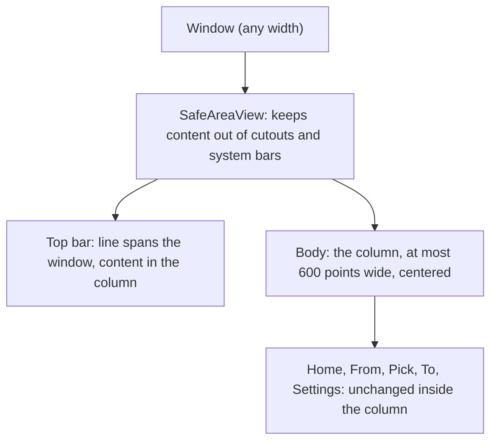

# Implementation Plan: Adaptive Layout

**Branch**: `feature/adaptive-layout` | **Date**: 2026-11-16 | **Spec**: [spec.md](spec.md)

**Input**: Feature specification from `specs/010-adaptive-layout/spec.md`

## Summary

Make every screen fit the window the app has, from a 320-point phone to an open foldable, in portrait, landscape, and split-screen, and keep the user's place when the window changes.

Most of the spec is met by three small changes, because the app already survives window changes without a restart ([research.md](research.md), R4).

| Part | What | Stories | Ships as |
| --- | --- | --- | --- |
| A | Centered column, rotation unlocked, tests that a window change loses nothing. | 1, 2, 4 | One pull request |
| B | Small screens and large text: scrolling on every screen, heights that grow with text, touch targets. | 3 | One pull request, after A |



Technical approach:

- **Column** (R1, [contracts/layout.md](contracts/layout.md)): one shared `column` style in a new `src/ui/layout.ts`, applied once in `App.tsx` around every screen and once inside each top bar. Under 600 points it changes nothing; from 600 up the content is centered. No screen reads the window width for this.
- **Rotation** (R3): `orientation: 'default'` in `app.config.ts`. The owner regenerates the Android project locally and rebuilds.
- **Keep my place** (R4): no new code. New tests change the window size during a flow and check that the step, Settings, picks, collapsed sections, search text, a waiting sign-in code, and a running move are kept, and that nothing runs twice.
- **Large text** (R5): list row heights multiply by the system font scale; buttons and inputs use `minHeight`; From, To, and Settings scroll; names and status tags end with an ellipsis.
- **Touch targets** (R6): one shared value, 48 points, for both platforms.
- **Home grid**: the number of card columns is counted from the column width, not the window width.

## Technical Context

**Language/Version**: TypeScript (strict), React Native 0.88 via Expo SDK 58 (unchanged)

**Primary Dependencies**: None added. `useWindowDimensions` and `StyleSheet` from React Native, `react-native-safe-area-context` (already installed).

**Storage**: None. This feature saves nothing.

**Testing**: Jest with `jest-expo` and React Native Testing Library. The window size and font scale are mocked. Real layout (overlap, cutouts, hinge) is checked on devices with [quickstart.md](quickstart.md). See research R8.

**Target Platform**: Android 8.0+ first, iOS 16+ (iPhone only). Platform differences are in the spec's "Platform-specific behavior" section; the code has none.

**Project Type**: Mobile app (single Expo project, no backend)

**Performance Goals**: Layout follows a window change within 0.5 seconds with no blank screen (SC-004). The Pick list stays as fast as today on 1,000 items (known row heights are kept).

**Constraints**: No new dependency, no new permission, no new screen, no stored data. Builds are local: the orientation change needs a local prebuild and rebuild. All sizes in density-independent points.

**Scale/Scope**: Part A: 1 new file, 5 edited files, 1 new test file, 1 test file extended. Part B: about 8 edited files, 1 new test file, 2 test files extended. About 150 changed lines of app code in total.

## Constitution Check

*GATE: Must pass before Phase 0 research. Re-check after Phase 1 design.*

Checked against `.specify/memory/constitution.md` v1.6.0.

| Principle / rule | How the plan complies | Status |
| --- | --- | --- |
| I. New screen justified | No new screen, no new control, no new text. | Pass |
| I. Accessibility | Touch targets grow to 48 points. Largest system font size works on every screen. Labels and roles are unchanged. | Pass |
| II. Tests | Component tests for window changes on every screen and for scrolling on From, To, and Settings. Unit test for row height. Existing tests keep passing. | Pass |
| II. Tests check behavior | The window-change tests check what the user keeps (picks, search, sections, step, move totals). No test only asserts a style value where a behavior can be checked instead. | Pass |
| III. Security baseline | No new permission, network host, dependency, stored data, or log line. Sign-in flows are untouched. | Pass |
| IV. One home per thing | Shared layout values live in one new file, `src/ui/layout.ts`. No new folder. | Pass |
| IV. Simplest solution first | A width limit instead of size class code (R1, R2). A config value instead of an orientation library (R3). No state saving code (R4). No hinge library (R7). | Pass |
| IV. Restructure instead of forcing it | Not needed. The column is applied in the app shell and the bars. | Pass |
| V. Platform rules | Not affected. | Pass |
| VI. Size by window, not device | The column depends on the window width only. Nothing reads the device model. | Pass |
| VI. Readable width | `MAX_CONTENT_WIDTH` (600) is the one value, used by the shell, both bars, and the Home grid. | Pass |
| VI. Keep the user's place | Met by how the app already runs; guarded by new tests (R4). | Pass |
| VI. Both orientations | Portrait lock removed. No exception asked. | Pass |
| VI. Small screens and large text | Part B. The Move button is outside the scrolling list, so it stays visible. | Pass |
| VI. Safe areas | The existing `SafeAreaView` wraps the whole app, including in landscape. Checked on devices. | Pass |
| VI. Touch targets | 48 points on both platforms (R6). | Pass |
| VI. Specs and tests | Tests cover one Compact and one Medium window for each screen. | Pass |
| Spec edge case "Half-folded" | The spec now puts a hinge that hides content out of scope (R7). | Pass |

**Gate result (pre-research)**: Pass. **Gate result (post-design)**: Pass.

### Resolved: hinges that hide content

The "Half-folded" edge case used to say the column must not cross a hinge that blocks content. Meeting it needs a native fold library, for devices outside the test matrix (R7). The owner approved the spec edit on 2026-11-16: "Devices whose hinge hides part of the screen are out of scope; the app reads the window size only." The dual-screen edge case follows the same rule.

## Project Structure

### Documentation (this feature)

```text
specs/010-adaptive-layout/
├── plan.md              # This file
├── research.md          # Phase 0 decisions R1 to R8
├── quickstart.md        # Phase 1: device checks and test commands
├── contracts/
│   └── layout.md        # The shared layout values and the rules every screen follows
├── checklists/
│   └── requirements.md  # From the specify step
└── tasks.md             # Next step (speckit-tasks)
```

No `data-model.md`: the feature stores no data and adds no state (spec, Key Entities).

### Source Code (repository root)

```text
app.config.ts                # A: orientation 'default'
App.tsx                      # A: the body view gets the column style
src/ui/
├── layout.ts                # A: new. MAX_CONTENT_WIDTH, TOUCH_TARGET, column style
├── TopBar.tsx               # A: content in the column. B: one-line labels, 48-point targets
├── HomeBar.tsx              # A: content in the column
├── HomeView.tsx             # A: card columns counted from the column width
├── PickStep.tsx             # B: heights follow the font scale, minHeight on search and Move, All target
├── ItemRow.tsx              # B: row height follows the font scale, tag limited to 40% of the row
├── FromStep.tsx             # B: scrolls, rows use minHeight, delete icon target
├── ToStep.tsx               # B: scrolls
├── SettingsView.tsx         # B: scrolls, minHeight on choices, Delete all target
├── AccountCard.tsx          # B: button targets, minHeight on sign-in
├── PlatformCard.tsx         # B: only if a target is under 48 points
└── AccessNote.tsx           # B: only if a target is under 48 points
tests/
├── components/
│   ├── windowChange.test.tsx   # A: new. Keep my place across Compact and Medium
│   ├── homeLayout.test.tsx     # A: extended. Columns in a wide window
│   └── largeText.test.tsx      # B: new. Scrolling screens, one-line names and tags
└── unit/
    └── itemRow.test.ts         # B: new. Row height at font scale 1 and 2
```

**Structure Decision**: Single Expo project, existing folders. One new source file in `src/ui/`. No screen is added, moved, or renamed.

## Requirement coverage

| Requirement | Met by |
| --- | --- |
| FR-001, FR-002 | The column is a width limit, so layout follows the window on every change with no code path per device (R1). |
| FR-003, FR-004 | `column` style in `App.tsx`, `TopBar`, `HomeBar`. |
| FR-005, FR-007 | No restart on window changes; `windowChange.test.tsx` (R4). |
| FR-006 | The list is not unmounted and row heights do not depend on width (R4). |
| FR-008 | `orientation: 'default'` (R3). |
| FR-009 | Existing `SafeAreaView`; device check. |
| FR-010, FR-011 | Part B (R5). |
| FR-012 | The action bar is already outside the list; device check on a short window. |
| FR-013 | `TOUCH_TARGET` (R6). |
| FR-014 | All existing tests pass unchanged, apart from tests that assert a fixed row height. |
| SC-001 to SC-005 | [quickstart.md](quickstart.md). |

## Complexity Tracking

No constitution violations and no spec deviations.
