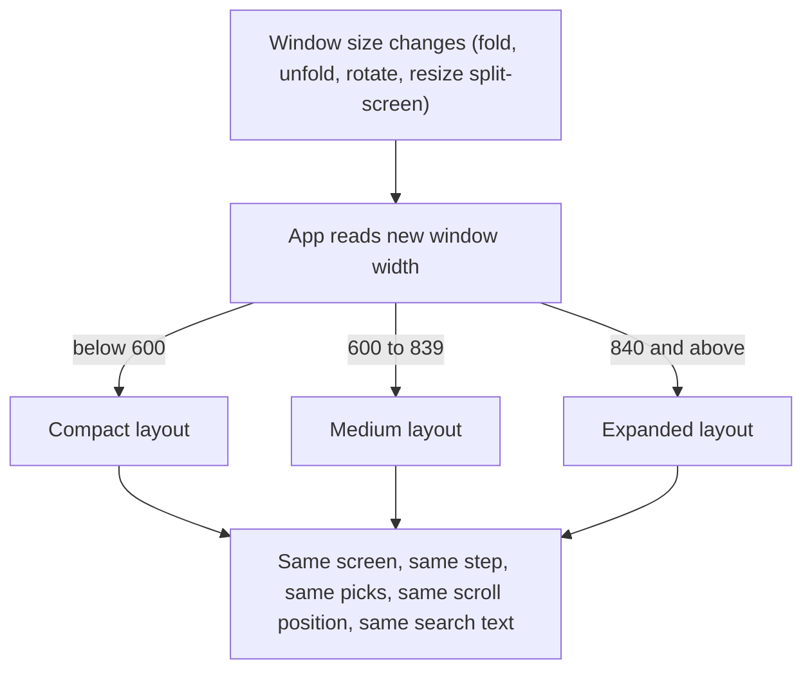
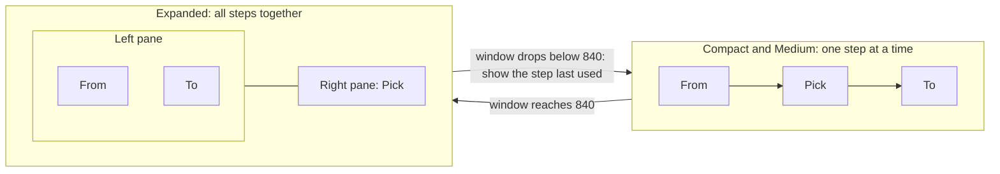

# Feature Specification: Adaptive Layout

**Feature Branch**: `feature/adaptive-layout`

**Created**: 2026-11-12

**Status**: Draft

**Input**: User description: "Optimise the UI for foldable phones and phones with different screen sizes"

## Context

Today the app is fixed to portrait and every screen is one column that stretches to the full window width. On a small phone, long names and the bottom action bar can crowd each other. On a foldable phone that is open, or a phone in split-screen, the same column becomes very wide: rows stretch, the search box and the Move button span the whole screen, and the text lines are too long to read comfortably. When the user folds or unfolds the phone during a move, the app must not lose what they were doing.

This feature makes every screen fit the window the app actually has, from a small phone to an open foldable, and keeps the user's place when that window changes size. On the widest windows, the three steps of a move show side by side, so the user sees both accounts and the list at once.

## Window size classes

The app sorts its current window into one of three size classes by its width. All sizes are in density-independent points (the unit both platforms use for layout), not physical pixels.

| Size class | Window width | Typical device | Layout |
| --- | --- | --- | --- |
| Compact | below 600 | Most phones in portrait, a closed foldable, a small split-screen window | One column, full width, as today. |
| Medium | 600 to 839 | An open book-style foldable, a phone in landscape, a large split-screen window | One column, centered, with a maximum content width. |
| Expanded | 840 and above | A large open foldable, a large phone in landscape, a tablet-sized window | The move flow shows two panes side by side: From and To on the left, Pick on the right (see [Two-pane flow](#two-pane-flow)). Home and Settings keep the centered column. |

The size class is worked out from the window, never from the device model, so the same rules cover foldables, split-screen, pop-up windows, and phones of any size.

### Two-pane flow

In an Expanded window, the three steps of a move are on screen together.

| Pane | Shows | Notes |
| --- | --- | --- |
| Left | The From step (old account, unfinished moves) above the To step (new account) | Scrolls as one pane when it does not fit. |
| Right | The Pick step (search, list, action bar with the Move button) | Shows "Sign in to your old account first" until the old account is signed in, as the locked Pick step does today. |

The app always knows one **current step**, as today. It is the step the user last used (touched, or was taken to by the app, for example to To when the Move button needs a new account). In two panes, the top bar marks it as it does today. When the window drops below Expanded, the app shows that step.

## User Scenarios & Testing *(mandatory)*

### User Story 1 - Use the app comfortably on an open foldable (Priority: P1)

A user opens the app on a foldable phone that is unfolded. Every screen (Home, sign-in steps, Pick list, Settings) shows its content in a readable centered column, or in two panes when the window is Expanded (Story 5). The item rows, search box, and Move button do not stretch edge to edge. Nothing is cut off, and nothing is hidden behind the hinge or the camera cutout.

**Why this priority**: Foldable owners see the stretched layout on every screen today. This is the main reason for the feature.

**Independent Test**: Run the app on an open foldable (or an emulator window 600 points wide or more). Visit every screen and confirm content is centered, within the maximum width, and fully visible.

**Acceptance Scenarios**:

1. **Given** the window is Medium, or it is Expanded and the screen is Home or Settings, **When** the screen shows, **Then** its content sits in a centered column no wider than the maximum content width, and the space on each side uses the screen background color.
2. **Given** the window is Medium, **When** the Pick list shows, **Then** each row, each section heading, the search box, the "All" row, and the bottom action bar line up to the same column width.
3. **Given** the window is Medium or Expanded, **When** the top bar shows, **Then** its background spans the full window width and its contents line up with the content below it (the centered column, or the two panes).
4. **Given** a device with a camera cutout, rounded corners, or a system navigation bar, **When** any screen shows in any orientation, **Then** no text or control is drawn under those areas.

---

### User Story 2 - Keep my place when I fold, unfold, or rotate (Priority: P1)

A user is picking items on the cover screen of a foldable. They unfold the phone to see more. The app shows the same step, the same picks, the same search text, and the list is near the same row. If a move is running, it keeps running and its progress stays on screen. The same holds when the user folds the phone again, rotates it, or resizes the app in split-screen.

**Why this priority**: Losing picks or a running move on unfold would be worse than a stretched layout. Without this, the layout work in Story 1 is not safe to ship.

**Independent Test**: On a foldable or a resizable emulator, sign in, pick some items, type a search, scroll down, start a move, then fold and unfold several times. Confirm nothing is lost and the move continues.

**Acceptance Scenarios**:

1. **Given** the user is on any step, **When** the window changes size class, **Then** the app stays on the same step and screen (including Settings, if open).
2. **Given** the user has picked items, collapsed a Pick section, and typed a search, **When** the window changes size, **Then** the picks, the collapsed sections, and the search text are unchanged.
3. **Given** the user has scrolled the Pick list, **When** the window changes size, **Then** the list shows at least one of the rows that were visible before the change.
4. **Given** a move is running, **When** the window changes size, **Then** the move is not stopped, restarted, or duplicated, and its progress and counts stay correct.
5. **Given** the keyboard is open in the search box, **When** the window changes size, **Then** the search box stays usable and the typed text is kept.
6. **Given** a sign-in screen from the platform is open, **When** the window changes size, **Then** returning from sign-in still completes the sign-in step.
7. **Given** a sign-in code is on screen and the app is waiting for the user to enter it in the browser, **When** the window changes size, **Then** the same code stays on screen and the wait continues without a new code.
8. **Given** the user is on Pick in one pane with picks, a collapsed section, search text, and a scrolled list, **When** the window becomes Expanded, **Then** Pick shows in the right pane with all of these unchanged, and From and To show in the left pane.
9. **Given** the window is Expanded and the user last used Pick, **When** the window drops below Expanded, **Then** the app shows Pick with the picks, collapsed sections, search text, and scroll position unchanged.
10. **Given** the window is Expanded and the user last used From or To, **When** the window drops below Expanded, **Then** the app shows that step, and the picks are kept. Search text and collapsed sections reset, as they do today when the user leaves Pick.

---

### User Story 3 - Fit small phones and large text settings (Priority: P2)

A user has a small phone, or has turned up the system font size or display size. Every screen still shows all its controls. Long item names shorten with an ellipsis rather than pushing the checkbox or status off screen. The Move button and messages in the bottom bar stay visible above the system navigation, and the user can still reach every control by scrolling where needed.

**Why this priority**: Small screens and large text are common and affect access, but the current layout mostly works on them, so this is a hardening pass rather than a fix for a broken screen.

**Independent Test**: Run on a window 320 points wide, then at the largest system font size and the largest display size. Visit every screen and confirm every control is visible or reachable by scrolling, and no text overlaps.

**Acceptance Scenarios**:

1. **Given** the window is 320 points wide, **When** any screen shows, **Then** no control is cut off and no text overlaps another element.
2. **Given** the largest system font size, **When** the Pick list shows, **Then** long names wrap or end with an ellipsis, and the checkbox and status for each row stay visible.
3. **Given** the largest system font size, **When** a screen has more content than fits, **Then** the user can scroll to reach every control.
4. **Given** the bottom action bar shows a summary, a notice, and the Move button at once on a short window, **When** the screen shows, **Then** the Move button is still visible without scrolling the Pick list.
5. **Given** any window size, **When** the user taps a control, **Then** its touch target is at least 44 by 44 points (iOS) and 48 by 48 points (Android).

---

### User Story 4 - Use the app in landscape and split-screen (Priority: P3)

A user turns their phone sideways, or puts the app next to another app in split-screen or a pop-up window. The app follows the window's orientation and size and stays usable in each.

**Why this priority**: Fewer users do this, and on large Android screens the system may already force rotation and resizing (see the platform section). The app must at least not break.

**Independent Test**: Rotate a phone to landscape, then open the app in split-screen at the smallest and largest split sizes. Confirm each screen is usable and Story 2 rules hold.

**Acceptance Scenarios**:

1. **Given** the user rotates the device, **When** the window becomes landscape, **Then** the app shows the screen for the new window size rather than staying sideways.
2. **Given** the app is in split-screen and the window is very short (for example, under 400 points tall), **When** the Pick list shows, **Then** the bottom action bar stays visible and the list scrolls in the remaining space.

---

### User Story 5 - See the whole move on a wide window (Priority: P2)

A user opens a move on a large open foldable or a tablet-sized window. Both accounts and the item list are on screen together: the old account and the new account on the left, the list on the right. The user signs in to either account, picks items, and presses Move without changing steps.

**Why this priority**: The centered column of Story 1 already makes a wide window readable. Two panes use the space that the column leaves empty and remove step changes, which is a clear gain but not a fix for something broken.

**Independent Test**: Run the app in a window 840 points wide or more. Open a platform and do a full move without tapping a step in the top bar. Then make the window narrower than 840 and confirm one step shows.

**Acceptance Scenarios**:

1. **Given** the window is Expanded and the user is in a move flow, **When** the flow shows, **Then** From and To are in the left pane, Pick is in the right pane, and the pair is centered with each pane no wider than the maximum content width.
2. **Given** the window is Expanded and the old account is not signed in, **When** the flow shows, **Then** the right pane shows the locked message "Sign in to your old account first" and the left pane is usable.
3. **Given** the window is Expanded, **When** the user signs in to the old account in the left pane, **Then** the list loads in the right pane and the left pane stays in place.
4. **Given** the window is Expanded and no new account is signed in, **When** the user presses Move, **Then** the app asks for the new account in the To part of the left pane, with the same message as today, and the list stays on screen.
5. **Given** the window is Expanded, **When** a notice shows, **Then** it shows once, in the pane of the current step, not in every pane.
6. **Given** the window is Expanded, **When** Home or Settings shows, **Then** it uses the centered column, not two panes.
7. **Given** the window is Expanded, **When** the user touches a pane, **Then** that pane's step becomes the current step in the top bar.
8. **Given** the window is Expanded and short (a large phone in landscape), **When** the flow shows, **Then** the Move button stays visible, the list scrolls in the space left, and the left pane scrolls.
9. **Given** the window is Medium or Compact, **When** the flow shows, **Then** one step shows at a time, as today.

### Edge Cases

- **Window crosses 840 points several times** (for example a split-screen divider dragged back and forth): the layout follows each time, and Story 2 rules hold.
- **Large phone in landscape**: many phones are wider than 840 points in landscape, so they get two panes. The rule is the window width, not the device (FR-001).
- **Move running when the layout changes between one and two panes**: the move goes on, and its progress shows in Pick wherever Pick is.

- **Half-folded (tabletop or book posture)**: the app treats the window as one flat screen of its current size. No special hinge layout in this feature. Devices whose hinge hides part of the screen are out of scope; the app reads the window size only.
- **Rapid fold and unfold**: several size changes in under a second must not stack duplicate actions, reset state, or flash an error.
- **Size change during a dialog or system prompt** (for example, notification permission): the prompt result is still handled when the user answers.
- **App restored after the system closed it in the background** on a new window size: behavior is the same as resume from feature 001 (saved progress reopens), shown in the new size class.
- **Dual-screen devices with a gap between two physical screens**: out of scope, as in the half-folded case above.
- **Very wide but short windows** (landscape phone): the column or pane limit keeps rows readable, and the action bar stays visible as in Story 4 and Story 5.
- **System display size set to its smallest value** on a closed foldable: the window may cross 600 points; the app uses the size class for the reported width and does not assume a device type.

## Requirements *(mandatory)*

### Functional Requirements

- **FR-001**: The app MUST pick its layout from the current window width using the three size classes in [Window size classes](#window-size-classes), and MUST NOT pick it from device model, device type, or screen size alone.
- **FR-002**: The app MUST re-check the size class whenever the window size changes (fold, unfold, rotate, split-screen resize, display size change) and update the layout without a restart.
- **FR-003**: In Medium windows, and on Home and Settings in Expanded windows, the screen's content MUST sit in one centered column no wider than the maximum content width (default 600 points, see Assumptions). Background colors and top bar backgrounds MUST still fill the full window.
- **FR-004**: In Compact windows, the layout MUST match today's full-width single column.
- **FR-005**: The app MUST keep, across any window size change: the current step, whether Settings is open, signed-in accounts, picked items, a sign-in code that is waiting for the user (spec 008, FR-GH-006), any running or paused move and its counts, and any notice on screen. It MUST also keep collapsed Pick sections and search text whenever Pick is on screen both before and after the change. When a change takes Pick off screen (FR-018, current step From or To), they reset as they do today when the user leaves Pick (spec 008, FR-GH-023).
- **FR-006**: The Pick list SHOULD keep the user's scroll position across a window size change, so at least one previously visible row stays visible.
- **FR-007**: A window size change MUST NOT start, stop, repeat, or cancel a move or a platform request.
- **FR-008**: The app MUST support portrait and landscape on all phones and foldables, following the device's rotation setting.
- **FR-009**: No text or control MUST be drawn under a camera cutout, rounded screen corner, status bar, or system navigation area, in any orientation.
- **FR-010**: Every screen MUST be fully usable at a window width of 320 points and at the largest system font and display size: all controls visible or reachable by scrolling, no overlapping text.
- **FR-011**: Item names and other single-line labels that do not fit MUST end with an ellipsis or wrap, and MUST NOT push row controls (checkbox, status) off screen.
- **FR-012**: The bottom action bar on the Pick list (summary, notices, Move button) MUST stay visible while the list scrolls, at every supported window size.
- **FR-013**: Touch targets MUST be at least 44 by 44 points on iOS and 48 by 48 points on Android, at every window size.
- **FR-014**: All existing behavior from features 001 to 005, 008, and 009 MUST work the same in every size class; this feature changes layout only.

- **FR-015**: In an Expanded window, the move flow MUST show two panes side by side: From above To in the left pane, Pick in the right pane. Each pane MUST be no wider than the maximum content width, and the pair MUST be centered. The left pane MUST scroll when its content does not fit.
- **FR-016**: In two panes, Pick MUST show its locked message until the old account is signed in. Every control of From, To, and Pick MUST work as it does in one pane.
- **FR-017**: The app MUST keep one current step in every layout. In two panes, touching a pane MUST make its step the current step, and the app MUST still change the current step where it does today (for example to To when Move needs a new account). The top bar MUST mark the current step as today.
- **FR-018**: When the window drops below Expanded during a flow, the app MUST show the current step. When the window becomes Expanded, the app MUST show all three steps without changing the current step.
- **FR-019**: A notice MUST show once on screen, in the pane of the current step.
- **FR-020**: Home and Settings MUST NOT use two panes. Medium and Compact windows MUST NOT use two panes.

### Platform-specific behavior

**Android**

- Android 16 and later ignore an app's portrait lock and resizing limits on windows 600 points wide or wider, for apps that target that version. FR-008 makes the app support rotation everywhere so behavior is the same on all Android versions, rather than locked on old versions and forced open on new ones.
- Foldables report a hinge and fold posture to apps. This feature reads only the window size; posture-aware layouts are out of scope (see Assumptions).
- The app MUST work in split-screen and pop-up (freeform) windows on Android.

**iOS**

- The app ships for iPhone only in this release (iPad support stays off), so iOS window sizes stay within iPhone sizes. Rotation and the large text rules (FR-008, FR-010, FR-011) still apply.
- iOS has no foldable devices today. If iPad support is turned on later, the same size classes apply with no new rules.

### Key Entities

This feature adds no stored data. It uses one value that is worked out at run time:

- **Window size class**: Compact, Medium, or Expanded, derived from the current window width. Not saved; recalculated on every window change.
- **Current step**: From, Pick, or To. It exists today. This feature adds one rule: in two panes it follows the pane the user last touched. Not saved.

## Success Criteria *(mandatory)*

### Measurable Outcomes

- **SC-001**: On a window 600 points wide or wider, no content column or pane is wider than the maximum content width, checked on every screen.
- **SC-002**: In 20 fold and unfold cycles during a running move, the move finishes with the same totals as without folding, and picks and search text are never lost.
- **SC-003**: On a 320-point-wide window and at the largest system font size, a tester can complete the full flow (sign in to both accounts, pick, move) with no control cut off or unreachable.
- **SC-004**: The layout updates to the new size class within 0.5 seconds of a fold, unfold, or rotation, with no blank screen and no restart.
- **SC-005**: No screen in any tested size, orientation, or font size has text or controls under a camera cutout or system bar.

- **SC-006**: In a window 840 points wide or wider, a tester completes a full move (sign in to both accounts, pick, move) without tapping a step in the top bar. In 20 changes between one and two panes during that move, no pick, account, or progress is lost.

## Assumptions

- Maximum content width is 600 points. It is a single value used by every screen and can be tuned during planning.
- Size class breakpoints (600 and 840) follow common industry guidance for window size classes. Only the move flow has a two-pane layout, and only in Expanded windows (owner decision, 2026-11-16). Medium keeps the centered single column, because two panes of 300 to 420 points each would be narrower than a phone.
- In two panes, the left pane is narrower than the right pane, because the account cards need less width than the list. The exact widths are set in planning.
- Posture-aware layouts (tabletop mode with controls on the lower half, content split around the hinge) are out of scope.
- iPad support stays off, so on iOS only the largest iPhones in landscape reach Expanded; tablets on Android get the same Medium or Expanded layout as an open foldable, because Android does not allow an app to exclude them cleanly.
- The test matrix for this feature is: one small phone (about 320 to 360 points wide), one standard phone, one book-style foldable (closed and open), one flip-style foldable, landscape on a phone, split-screen, and one window 840 points wide or wider (an open foldable in landscape or a tablet-sized emulator). Emulators with resizable windows are acceptable where real devices are not available.
- Notification layout, platform sign-in screens, and the system file picker are drawn by the platform and are not changed by this feature.
