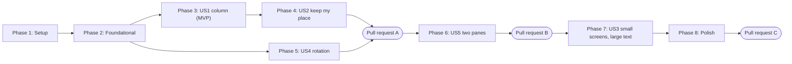

---

description: "Task list for adaptive layout"
---

# Tasks: Adaptive Layout

**Input**: Design documents from `specs/010-adaptive-layout/` (plan.md, spec.md, research.md, contracts/layout.md, quickstart.md)

**Prerequisites**: `main` (with specs 008 and 009) is merged into `feature/adaptive-layout`. No new dependency, no key, no stored data. One owner step: after T014 the Android project must be regenerated locally (T015).

**Tests**: Required by the constitution (Principle II). Test tasks come before the code they check and must fail first, except T012, which guards behavior the app already has (research R4). Each test checks what the user sees or keeps. Jest does not compute real layout, so overlap, cutouts, and real widths are checked on devices (T034).

**Organization**: One phase per user story. The phases follow the three parts of plan.md, not the plain priority order, because each part ships as one pull request and Part C builds on Part B (From and To get their scrolling from `FlowView`).

| Part (pull request) | Phases | Stories |
| --- | --- | --- |
| A | 1 to 5 | US1 (P1), US2 (P1), US4 (P3, one config line) |
| B | 6 | US5 (P2), and US2 scenarios 8 to 10 |
| C | 7 | US3 (P2) |

## Format: `[ID] [P?] [Story] Description`

- **[P]**: Can run in parallel (different files, no dependency on an unfinished task)
- **[Story]**: US1 to US5. Setup, Foundational, and Polish tasks have no label
- Paths are from the repository root

## Phase 1: Setup

**Purpose**: Status and a known-good start

- [ ] T001 Set the `**Status**:` line in `specs/010-adaptive-layout/spec.md` to `In progress` (AGENTS.md: implementation has started).
- [ ] T002 Run `npm test`, `npm run typecheck`, and `npm run lint` before any code change. All pass. Note the test count for T033.

---

## Phase 2: Foundational (shared values, window mock)

**Purpose**: The shared layout file and the one test helper that changes the window size. Every story needs these.

**CRITICAL**: Finish this phase before any user story.

- [ ] T003 [P] Create `src/ui/layout.ts` with exactly these exports (contracts/layout.md): `export const MAX_CONTENT_WIDTH = 600;`, `export const TOUCH_TARGET = 48;`, and `export const layout = StyleSheet.create({ column: { flex: 1, width: '100%', maxWidth: MAX_CONTENT_WIDTH, alignSelf: 'center' } });`. One comment line above `column`: `// The content column: fills the window under 600 points, centered above it (spec 010, FR-003).` Nothing else in this part. No test of its own: T005 and T006 check it through the screens.
- [ ] T004 [P] Create `tests/components/window.ts`: `export const mockWindow = { width: 400, height: 800, scale: 2, fontScale: 1 };` and `export function setWindow(width: number, height = 800, fontScale = 1) { Object.assign(mockWindow, { width, height, fontScale }); }`. A test file that uses it adds, at the top: `jest.mock('react-native/Libraries/Utilities/useWindowDimensions', () => ({ __esModule: true, default: () => require('./window').mockWindow }));` (the mock style of `tests/components/homeLayout.test.tsx`, research R8). To change the window during a test: call `setWindow(...)`, then `await screen.rerender(<App />)`. Each test file calls `setWindow(400)` in `beforeEach`.

**Checkpoint**: `npm test` and `npm run typecheck` pass. Nothing changes on screen.

---

## Phase 3: User Story 1 - Use the app comfortably on an open foldable (Priority: P1) MVP

**Goal**: Every screen sits in a centered column at most 600 points wide. The top bar line spans the window and its content lines up with the column.

**Independent Test**: In a window 600 to 839 points wide, visit Home, From, Pick, To, and Settings. Content is centered, within 600 points, and fully visible (quickstart.md, check 1).

### Tests for User Story 1

- [ ] T005 [P] [US1] Extend `tests/components/homeLayout.test.tsx`: replace its fixed `useWindowDimensions` mock with the mock of T004, and call `setWindow(320, 640, 2)` in the existing `beforeEach` so the three existing cases check the same thing as before. Add `describe('Home in a wide window')` with: (1) `setWindow(900, 800, 2)` and `PixelRatio.getFontScale` mocked to 2: `cell-youtube` has width `'100%'` (the columns are counted from the 600-point column, not the 900-point window: 600 / 320 gives 1; contracts/layout.md, rule 8). (2) `setWindow(900, 800, 1)` and font scale 1: `cell-youtube` has width `` `${100 / 3}%` ``. Case (1) fails until T010.
- [ ] T006 [P] [US1] Create `tests/components/windowChange.test.tsx` with the mock of T004, the YouTube mocks and `resetWorld`/`renderApp` of `tests/components/helpers.tsx`. First block, `describe('the column')`: (1) At `setWindow(700)` on Home, the view with `testID="body"` has a flattened style with `maxWidth: 600` and `alignSelf: 'center'`, and `testID="root"` has no `maxWidth` (the background fills the window, FR-003). (2) At `setWindow(700)` in the YouTube flow, `testID="bar-content"` has `maxWidth: 600`, and its parent (the bar) has no `maxWidth` (US1.3). (3) The same two checks pass at `setWindow(360)`: the style is the same, because a width limit does nothing under 600 points (FR-004). Use `StyleSheet.flatten`. These are the only tests in this feature that assert a style, because Jest has no real layout; say so in one comment. Fails until T007 to T009.

### Implementation for User Story 1

- [ ] T007 [US1] Edit `App.tsx`: the inner `<View style={styles.flex}>` that holds the five screen lines becomes `<View style={layout.column} testID="body">` (import `layout` from `@/ui/layout`). The outer `testID="root"` view keeps `flex: 1` and the background color. Change nothing else.
- [ ] T008 [P] [US1] Edit `src/ui/TopBar.tsx`: keep the outer `<View style={styles.bar}>` for the bottom line, but move `flexDirection: 'row'` off it. Wrap the three children (Home button, tabs, gear) in `<View style={[layout.column, styles.row]} testID="bar-content">` with `row: { flex: 0, flexDirection: 'row' }` (the `flex: 0` cancels the `flex: 1` of `column`, so the bar keeps its own height). Change nothing else.
- [ ] T009 [P] [US1] Edit `src/ui/HomeBar.tsx` the same way as T008: the outer view keeps the border, the title and the gear go into an inner `<View style={[layout.column, styles.row]} testID="bar-content">` with `row: { flex: 0, flexDirection: 'row', alignItems: 'center' }`.
- [ ] T010 [P] [US1] Edit `src/ui/HomeView.tsx`: the column count becomes `columnsFor(Math.min(useWindowDimensions().width, MAX_CONTENT_WIDTH), PixelRatio.getFontScale())` (import `MAX_CONTENT_WIDTH` from `@/ui/layout`). Do not change `src/ui/gridColumns.ts`.

**Checkpoint**: `npx jest tests/components/homeLayout.test.tsx tests/components/windowChange.test.tsx tests/components/topBar.test.tsx tests/components/home.test.tsx` passes.

---

## Phase 4: User Story 2 - Keep my place when I fold, unfold, or rotate (Priority: P1)

**Goal**: A window change keeps the step, Settings, picks, collapsed sections, search text, a waiting sign-in code, and a running move. Nothing runs twice.

**Independent Test**: quickstart.md, check 2.

### Tests for User Story 2

- [ ] T011 [US2] Add to `tests/components/windowChange.test.tsx` a block `describe('keep my place')`. A "window change" in every case is: `setWindow(700)`, `await screen.rerender(<App />)`, `setWindow(360)`, rerender again. Cases (YouTube world, setup as in `tests/components/pickList.test.tsx` and `tests/components/moveFlow.test.tsx`): (1) On From, on To, and with Settings open: after the change the same screen shows (US2.1). (2) On Pick with 3 channels, one unpicked and "b" typed in the search box: after the change the search box still holds "b", the same rows show, and the counter text is the same (US2.2, US2.5). (3) Start a move of 3 channels whose second `subscribe` waits on a promise the test controls; do 5 window changes; resolve the promise: the move finishes, the summary shows 3 moved, and `subMock` was called exactly 3 times (US2.4, FR-007). (4) With a notice on screen (make the sign-in fail as `tests/components/accounts.test.tsx` does): the notice text is still there after the change (FR-005).
- [ ] T012 [P] [US2] Create `tests/components/githubWindowChange.test.tsx` (its own file: the GitHub world hangs when it shares a file with the Google mocks, see `tests/components/githubLimitReason.test.tsx`). Use the mock of T004 and `tests/components/githubWorld.tsx`. Cases: (1) While the sign-in code shows on From (as in `tests/components/githubSignIn.test.tsx`), a window change keeps the same code on screen and asks for no new code (the device-code request mock is called once); then let the sign-in finish: the old account shows (US2.6, US2.7). (2) On Pick with two kinds, collapse one section, then a window change: that section is still collapsed and the other is open (US2.2).

### Implementation for User Story 2

- [ ] T013 [US2] Run T011 and T012. They are expected to pass with no code change (research R4). If one fails, find what unmounts or restarts on a width change and fix that cause in the file that does it; do not add code that saves and restores state. Then run `grep -rn "key={" src/ui App.tsx` and confirm that no `key` depends on the window width, except `key={columns}` on the Home card grid, which holds no user input (contracts/layout.md, rule 2).

**Checkpoint**: `npx jest tests/components/windowChange.test.tsx tests/components/githubWindowChange.test.tsx` passes.

---

## Phase 5: User Story 4 - Use the app in landscape and split-screen (Priority: P3)

**Goal**: The portrait lock is gone. The app follows rotation and split-screen sizes.

**Independent Test**: quickstart.md, check 4.

- [ ] T014 [US4] Edit `app.config.ts`: change `orientation: 'portrait'` to `orientation: 'default'` (research R3). Do not add `expo-screen-orientation` or any plugin. Leave `supportsTablet: false`.
- [ ] T015 [US4] **PENDING, owner, local build**: Run `npx expo prebuild --platform android`, then `npx expo run:android`. Open `android/app/src/main/AndroidManifest.xml` and confirm the main activity has no `android:screenOrientation="portrait"` and no `android:resizeableActivity="false"`. If either is there, stop and report it: the fix is a small config plugin entry (research R3). No EAS step.

**Checkpoint, Part A**: `npm test`, `npm run typecheck`, and `npm run lint` pass. Open the pull request for Part A (phases 1 to 5).

---

## Phase 6: User Story 5 - See the whole move on a wide window (Priority: P2)

**Goal**: From 840 points, the move flow shows From and To on the left and Pick on the right. Below 840 it shows the current step, as today. Changing between the two loses nothing.

**Independent Test**: quickstart.md, check 5.

### Tests for User Story 5

- [ ] T016 [P] [US5] Create `tests/components/twoPane.test.tsx` with the mock of T004 and the YouTube world of `tests/components/helpers.tsx`. Cases: (1) `setWindow(900)`, open YouTube: the sign-in buttons of the old account and of the new account are both on screen, and so is "Sign in to your old account first" (US5.1, US5.2). (2) `setWindow(839)`: only the old account's sign-in button is on screen (US5.9, FR-020). (3) At 900, sign in to the old account with 3 channels: the 3 rows show, and both account cards are still on screen (US5.3). (4) At 900 with the old account signed in and no new account, press the Move button: the same message as in one pane shows exactly once (`getAllByText` has length 1), the new account's sign-in button is on screen, the rows are still on screen, and the To tab has `accessibilityState.selected` true (US5.4, US5.5, FR-019). (5) At 900, `fireEvent(screen.getByTestId('pane-pick'), 'touchStart')`: the Pick tab is selected; the same with `pane-from` and `pane-to` (US5.7, FR-017). (6) At 900 on Home and with Settings open (from Home and from the flow): `testID="panes"` is not on screen and `testID="body"` is (US5.6). (7) At 900 in the flow, `bar-content` has `maxWidth: 960`; with Settings open it has `maxWidth: 600`. (8) Sign in both accounts and move 3 channels at 900 without pressing any tab: the summary shows 3 moved (SC-006). All fail until T017 to T021.
- [ ] T017 [P] [US5] Add to `tests/components/twoPane.test.tsx` a block `describe('between one and two panes')` (US2.8 to US2.10, FR-005, FR-018): (1) At 360 on Pick with one channel unpicked and "b" in the search box: `setWindow(900)` and rerender: the search box holds "b", the counter is the same, and both account cards show. Back to 360: Pick shows alone, with the same search text and counter. (2) At 900, touch `pane-to`, then `setWindow(360)` and rerender: the To step shows alone; press the Pick tab: the counter shows the same picks as before. (3) A move of 3 channels with a `subscribe` that waits; change between 360 and 900 five times; resolve: 3 moved, `subMock` called exactly 3 times. Add to `tests/components/githubWindowChange.test.tsx`: (4) on Pick with one section collapsed at 360, change to 900 and back: the section is still collapsed. Fail until T019.

### Implementation for User Story 5

- [ ] T018 [US5] Edit `src/ui/layout.ts` (contracts/layout.md): add `export const EXPANDED_WIDTH = 840;`, `export const SIDE_PANE_WIDTH = 360;`, the styles `panes: { flex: 1, width: '100%', maxWidth: SIDE_PANE_WIDTH + MAX_CONTENT_WIDTH, alignSelf: 'center', flexDirection: 'row' }` and `side: { width: SIDE_PANE_WIDTH, flexGrow: 0 }`, and `export const useTwoPane = () => useWindowDimensions().width >= EXPANDED_WIDTH;` with the comment `// The only size class check: the move flow shows two panes from 840 points (spec 010, FR-015).`
- [ ] T019 [US5] Create `src/ui/FlowView.tsx` after the shape in plan.md, "FlowView in short" (research R9). `export function FlowView()`: `const two = useTwoPane();`, `const show = (s: Step) => two || state.step === s;`, `const use = (s: Step) => () => { if (state.step !== s) dispatch({ type: 'setStep', step: s }); };`. Root: `<View style={two ? layout.panes : layout.column} testID={two ? 'panes' : 'body'}>`. First child, only when `show('from') || show('to')`: `<ScrollView key="side" style={two ? [layout.side, { borderRightWidth: StyleSheet.hairlineWidth, borderColor: colors.border }] : styles.flex} keyboardShouldPersistTaps="handled">` holding `{show('from') && <View testID="pane-from" onTouchStart={use('from')}><FromStep /></View>}` and the same for `to` with `ToStep`. Second child, only when `show('pick')`: `<View key="pick" style={styles.flex} testID="pane-pick" onTouchStart={use('pick')}><PickStep /></View>`. The two `key` values are required: they keep `PickStep` mounted when the side pane appears or goes away. Say that in one comment. Do not read the device type, and do not add state.
- [ ] T020 [US5] Edit `App.tsx`: replace the body of T007 with `{state.platform !== null && !state.settingsOpen ? <FlowView /> : (<View style={layout.column} testID="body">{state.settingsOpen ? <SettingsView /> : <HomeView />}</View>)}`. Remove the three step lines and the imports of `FromStep`, `PickStep`, and `ToStep`.
- [ ] T021 [P] [US5] Edit `src/ui/TopBar.tsx`: `const wide = useTwoPane() && !state.settingsOpen;` and the inner view of T008 uses `[wide ? layout.panes : layout.column, styles.row]` (keep `flex: 0` in `styles.row`). Nothing else changes: the tabs still mark and set `state.step`.
- [ ] T022 [P] [US5] Show the notice once (FR-019, contracts/layout.md, two-pane rule 4). In `src/ui/FromStep.tsx`: `{state.notice && state.step === 'from' && ...}`; also change the root style `flex: { flex: 1 }` to no `flex`, because the step now sits in a scroll view. In `src/ui/ToStep.tsx`: `{state.notice && state.step === 'to' && ...}`. In `src/ui/PickStep.tsx`: `{state.notice && state.step === 'pick' && ...}`. In one pane the step on screen is always the current step, so nothing changes there.
- [ ] T023 [US5] Run the whole suite. Fix only tests that break because From and To now sit inside a scroll view or because `body` moved; do not change what they check (FR-014).

**Checkpoint, Part B**: `npx jest tests/components/twoPane.test.tsx tests/components/windowChange.test.tsx tests/components/githubWindowChange.test.tsx tests/components/topBar.test.tsx` passes, then `npm test`, `npm run typecheck`, `npm run lint`. Open the pull request for Part B.

---

## Phase 7: User Story 3 - Fit small phones and large text settings (Priority: P2)

**Goal**: Every screen works at 320 points and at the largest system font size: everything is visible or reachable by scrolling, long labels end with an ellipsis, and every touch target is at least 48 points.

**Independent Test**: quickstart.md, check 3.

### Tests for User Story 3

- [ ] T024 [P] [US3] Create `tests/unit/itemRow.test.ts`: `rowHeight(1)` is 56, `rowHeight(2)` is 112, `rowHeight(0.85)` is 56 (never below the base height, research R5). Fails until T026.
- [ ] T025 [P] [US3] Create `tests/components/largeText.test.tsx` with the mock of T004, `setWindow(320, 640, 2)`, and the YouTube world. Cases: (1) Settings: the "Delete all" button has an ancestor of type `RCTScrollView` (walk `parent` as `tests/components/homeLayout.test.tsx` does) (US3.3). (2) From and To: the sign-in button has an `RCTScrollView` ancestor. (3) Pick with a channel named with 80 letters and a status tag (move it first): the name and the tag text both have `numberOfLines` 1, and the row's checkbox icon is on screen (US3.2, FR-011). (4) Pick at font scale 2: the Move button is on screen and is not inside the list (it has no `RCTScrollView` ancestor) (US3.4, FR-012). (5) The three step labels in the top bar have `numberOfLines` 1. Fails until T026 to T030.

### Implementation for User Story 3

- [ ] T026 [US3] Edit `src/ui/ItemRow.tsx`: add `export const rowHeight = (fontScale: number) => ROW_HEIGHT * Math.max(1, fontScale);`. Add the prop `height: number` to `Props` and use `style={[styles.row, { height }, greyed && styles.greyed]}`; remove `height: ROW_HEIGHT` from `styles.row`. Tag: `tag: { ..., maxWidth: '40%' }`, and the tag `Text` gets `numberOfLines={1}` and `flexShrink: 1`. The checkbox icon and the avatar get no `flexShrink`. Make T024 pass.
- [ ] T027 [US3] Edit `src/ui/PickStep.tsx` (research R5, R6): `const { fontScale } = useWindowDimensions(); const rowH = rowHeight(fontScale); const lockedH = LOCKED_HEIGHT * Math.max(1, fontScale);`. `heightOf` moves inside the component and uses `rowH` and `lockedH`; pass `height={rowH}` to `ItemRow`; `getItemLayout` falls back to `rowH`; `sectionBox` and `lockedSection` take their height from an inline style with the same values. Styles: `search` `height: 40` becomes `minHeight: TOUCH_TARGET`; `move` `height: 44` becomes `minHeight: TOUCH_TARGET` with `paddingVertical: 8`; `all` gets `minHeight: TOUCH_TARGET, minWidth: TOUCH_TARGET`; `allow` gets `minHeight: TOUCH_TARGET`. Import `TOUCH_TARGET` from `@/ui/layout`. The action bar stays outside the `FlatList`.
- [ ] T028 [P] [US3] Edit `src/ui/SettingsView.tsx`: the root `<View style={styles.flex}>` becomes a `ScrollView` (no `flex: 1` in its content style). `choice` `height: 44` becomes `minHeight: TOUCH_TARGET` with `paddingVertical: 8`; `deleteAll` gets `minHeight: TOUCH_TARGET`.
- [ ] T029 [P] [US3] Edit `src/ui/AccountCard.tsx`: `button` gets `minHeight: TOUCH_TARGET, minWidth: TOUCH_TARGET, justifyContent: 'center'`; `signIn` `height: 44` becomes `minHeight: TOUCH_TARGET` with `paddingVertical: 8`. Edit `src/ui/AccessNote.tsx`: `button` gets `minHeight: TOUCH_TARGET`.
- [ ] T030 [P] [US3] Edit `src/ui/TopBar.tsx`: each step label `Text` gets `numberOfLines={1}`; `step` gets `minHeight: TOUCH_TARGET`; `gear` gets `minHeight: TOUCH_TARGET`. Edit `src/ui/FromStep.tsx`: the delete `Pressable` gets `hitSlop={13}` (the icon is 22 points; 22 + 2 x 13 is 48) so the row height does not change.
- [ ] T031 [US3] Run `grep -rn "height: [0-9]" src/ui` and confirm every hit is an image, an avatar, or the 48-point info button of `src/ui/PlatformCard.tsx`, not something that holds text (contracts/layout.md, rule 4). Then run the whole suite; a test that asserted the fixed 56-point row height is updated to `rowHeight(1)`, with no other change (plan.md, FR-014 row).

**Checkpoint, Part C**: `npx jest tests/unit/itemRow.test.ts tests/components/largeText.test.tsx tests/components/pickList.test.tsx tests/components/githubPick.test.tsx tests/components/settings.test.tsx` passes. Open the pull request for Part C after T032 and T033.

---

## Phase 8: Polish and checks

- [ ] T032 [P] Run `grep -rn "Dimensions.get\|Platform.isPad\|expo-device\|isTablet" src App.tsx` and confirm nothing is found (FR-001: layout comes from the window width only). Run `grep -rn "useWindowDimensions\|EXPANDED_WIDTH\|840" src App.tsx` and confirm the width is read only in `src/ui/layout.ts` (`useTwoPane`), `src/ui/HomeView.tsx` (card columns), and `src/ui/PickStep.tsx` (font scale only), and that 840 appears only in `src/ui/layout.ts`.
- [ ] T033 Run `npm test`, `npm run typecheck`, and `npm run lint`. All pass. The test count is the count of T002 plus the new tests; no existing test was removed or skipped (FR-014). Write the two counts next to this task.
- [ ] T034 **PENDING, owner, device**: Manual checks of quickstart.md, checks 1 to 6, on Android (`npx expo run:android`). The owner has no foldable: use an Android Studio "Pixel Fold" or "Resizable" virtual device, or a real foldable in BitBar. A large phone in landscape is wide enough for check 5. Check 3 also once on iOS (`npx expo run:ios`, needs the owner's Mac).
- [ ] T035 **PENDING, after merge**: After the last pull request is merged, set the `**Status**:` line in `specs/010-adaptive-layout/spec.md` to `Implemented`.

---

## Dependencies and order



- **Phase 2** blocks every story. T003 and T004 are different files.
- **US1**: T005 and T006 (tests) first. T007 needs T003. T008, T009, and T010 are different files and need only T003.
- **US2**: T011 extends the file of T006, so it comes after T006. T012 is its own file. T013 needs T007 to T010, T011, and T012.
- **US4**: T014 is independent of the other stories. T015 needs the owner and does not block the merge of the code.
- **US5**: needs Part A. T016 and T017 are the same test file: write T016 first. T018 first, then T019, then T020. T021 and T022 need T018 and can run beside T019.
- **US3**: needs Part B, because `FlowView` gives From and To their scroll view (T025, case 2). T026 before T027. T028, T029, and T030 are different files; T030 touches `TopBar.tsx` and `FromStep.tsx`, which Part B also edits, so it comes after T021 and T022.
- T034 and T035 need the owner and do not block the code.

## Parallel examples

```text
Phase 2:  T003 and T004 together
US1:      T005 and T006 together (tests), then T008, T009, T010 together after T007
US2:      T012 beside T011
US5:      T021 and T022 together, beside T019
US3:      T024 and T025 together (tests), then T028, T029, T030 together after T027
Polish:   T032 beside T033
```

## Implementation strategy

- **MVP**: Phases 1 to 3 (US1). The app is readable on an open foldable. It is not safe to ship alone: US2 proves that a fold loses nothing, so Part A is the first thing to merge.
- **Then**: Part B (two panes), then Part C (small screens and large text). Each part is one pull request and leaves the app working.
- Commit after each task or each small group of tasks, one logical change per commit, with Conventional Commit messages (AGENTS.md).
- Stop at each checkpoint and run the listed tests before going on.
