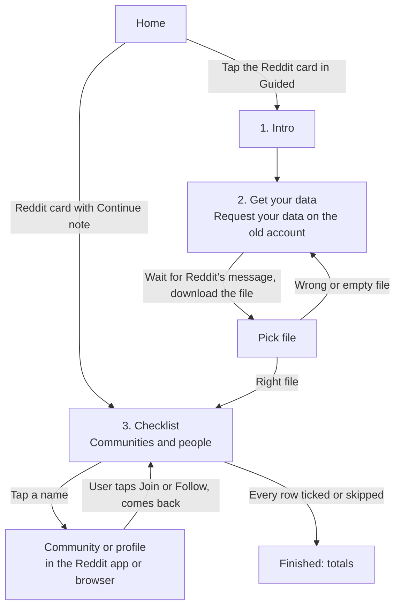
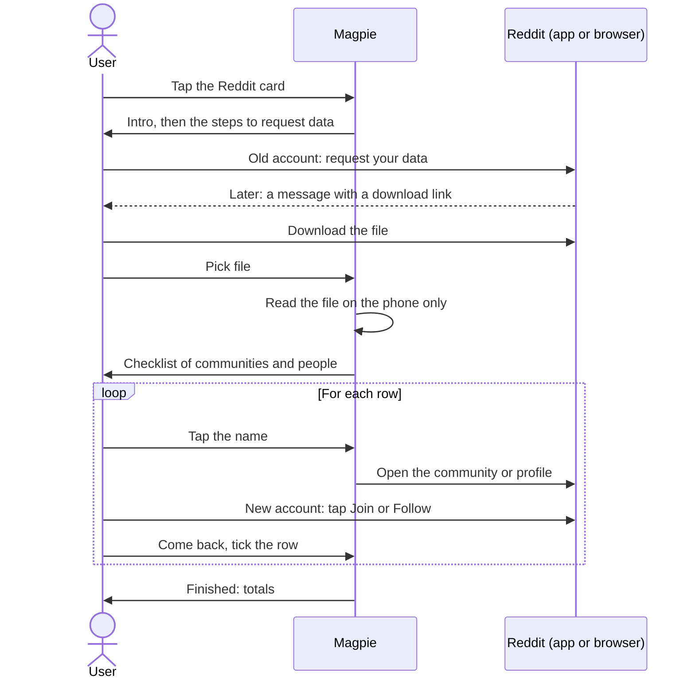

# Feature Specification: Reddit Platform

**Feature Branch**: `feature/reddit-platform`

**Created**: 2026-11-23

**Status**: Cancelled. Reddit closed its public API to new apps on 2026-10-31 and closes it for all apps in March 2027, so the app cannot join communities for the user.

**Input**: User description: "reddit platform"

**Related**: [004 Platform Picker](../004-multi-platform-picker/spec.md) planned Reddit as an Automatic platform. [005 Guided Migration](../005-guided-migration/spec.md) defines the Guided flow this spec reuses. [006 Paid API Credits](../006-paid-api-credits/spec.md) holds the earlier research on Reddit's API terms. [007 Spotify Platform](../007-spotify-platform/spec.md) was cancelled for access limits; this spec checks Reddit against the same risks. [008 GitHub Platform](../008-github-platform/spec.md) is the pattern for an Automatic platform.

## Summary

Spec 004 planned Reddit as an Automatic platform, where the app joins communities for the user through Reddit's API. That is no longer possible for a new app: Reddit stopped accepting new requests for API access on 2026-10-31 and closes its public API in March 2027 (see Feasibility). This spec therefore adds Reddit to the Guided section. The user requests their data from Reddit on the old account, picks the export file in the app, and works through a checklist of their communities and followed people. Each row opens the community or profile in the Reddit app or the browser, where the user taps Join or Follow on the new account. The app never signs in to Reddit and never calls Reddit's API.

## Why cancelled

The project owner cancelled this spec on 2026-11-23. Automatic Reddit is not possible (see Feasibility). The owner chose not to ship Reddit as a Guided platform either, and a partner agreement is unlikely because Reddit requires every third-party app to move to its Developer Platform. The spec is kept as a record of the research and of the Guided design, in case the owner revisits it.

## Clarifications

### Session 2026-11-23

- Q: Automatic Reddit is blocked. Should Reddit ship as a Guided platform, be cancelled like Spotify, or wait for a Reddit partner agreement? → A: Cancel.

## Feasibility

These facts come from Reddit's own admin posts on r/redditdev, checked on 2026-11-23: [Our Plans for the Future of Reddit's Public Data API and the Developer Platform](https://www.reddit.com/r/redditdev/comments/1vgbm9c/our_plans_for_the_future_of_reddits_public_data/), [Moving Data API Apps to the Developer Platform: migration dates and next steps](https://www.reddit.com/r/redditdev/comments/1wubcvf/moving_data_api_apps_to_the_developer_platform/) (2026-09-30), and [Data API migration reminder](https://www.reddit.com/r/redditdev/comments/1xulk8k/data_api_migration_reminder_register_your_apps/) (2026-11-12).

> **October 31, 2026**: New requests for public API access will no longer be accepted.
>
> **March 2027**: Public access will close for all remaining apps and users.
>
> [...] third-party apps will be required to port and operate through our Developer Platform.

| Question | Answer | Blocks Automatic? | Blocks Guided? |
| --- | --- | --- | --- |
| Can a new app get API access? | No. Since 2025-11-11 (Responsible Builder Policy) every new app needs Reddit's manual approval, and Reddit stopped accepting new requests on 2026-10-31. Magpie never registered. | Yes | No. Guided needs no API. |
| How long does the public API last for apps that have access? | Removals of unregistered apps start 2027-01-12. Public access closes for all remaining apps and users in March 2027. | Yes | No |
| What does Reddit offer instead? | Third-party apps must move to its Developer Platform (Devvit), which runs apps inside Reddit, not in a phone app. | Yes. Devvit cannot act for a user in an outside app. | No |
| Can the user get their own list without the API? | Yes. Reddit's "Request your data" page sends a file with the account's data, including the communities it joined. | n/a | No |
| Can the app join a community for the user? | Only through the API. | Yes | No. In Guided, the user taps Join. |
| Does the app need the user's password? | No. | n/a | No |

**Verdict**: Automatic Reddit is not feasible. Guided Reddit is feasible and needs no Reddit account, app registration, or approval.

## What Reddit's export supports

The rows below are what the owner expects from the export. The plan MUST check them against a real export from a test account (spec 005, FR-001).

| Item | In the export? | Can the user add it on the new account? | Verdict |
| --- | --- | --- | --- |
| Joined communities | Expected | Yes, tap Join | In scope |
| Followed people | Expected, as profile entries in the joined list or a separate file | Yes, tap Follow | In scope if the export lists them |
| Custom feeds | Expected | The user rebuilds them by hand | Out of scope |
| Saved posts and comments | Expected | Yes, tap Save on each | Out of scope. They are not follows. |
| Blocked people | Not checked | Yes | Out of scope. Not a follow. |
| Moderated communities, chats, posts, votes, karma | Expected | No | Not possible |

## How the screens connect

Reddit uses the shared Guided flow from spec 005 with no new screens.

## How a Reddit move works, from start to end

## User Scenarios & Testing *(mandatory)*

### User Story 1 - Get my Reddit list into the app (Priority: P1)

A user wants to move their communities from an old Reddit account to a new one. They tap the Reddit card in the Guided section. The intro says what will happen and that the app never signs in to Reddit or taps Join for them. The get-your-data screen shows numbered steps with pictures to request their data on the old account. When Reddit's file arrives, the user downloads it, taps Pick file, and the checklist opens with every community and followed person from the old account.

**Why this priority**: Without the list, there is nothing to move.

**Independent Test**: With a real export from a test account that joined 10 communities and follows 3 people, pick the file and confirm the checklist shows 13 rows with the right names. Pick an unrelated file and confirm the app says in plain words that this is not a Reddit export.

**Acceptance Scenarios**:

1. **Given** the Reddit card is ready, **When** Home shows, **Then** it is in the Guided section and not in Automatic.
2. **Given** the user opens the Reddit card, **When** the intro shows, **Then** it says the app never asks for the Reddit password, never signs in to Reddit, and never taps Join or Follow.
3. **Given** the user is on get-your-data, **When** they read the steps, **Then** the steps match Reddit's current wording, each with a picture and a text alternative, and they say the file can take some time to arrive.
4. **Given** the user picks the Reddit export, **When** the app reads it, **Then** the checklist lists each joined community and followed person once, with no duplicates.
5. **Given** the user picks a file that is not a Reddit export or lists nothing, **When** the app reads it, **Then** the app says so in plain words and the user stays on get-your-data.

---

### User Story 2 - Join communities on the new account (Priority: P1)

The user works through the checklist. Tapping a community opens it in the Reddit app, or in the browser when the app is not installed. The user checks that the new account is the one signed in, taps Join, comes back, and ticks the row.

**Why this priority**: This is the move itself.

**Independent Test**: With the Reddit app installed and signed in to the new account, tap 3 community rows and 1 person row, join or follow each, tick them, and confirm the new account now has them. Uninstall the Reddit app and confirm a row opens in the browser.

**Acceptance Scenarios**:

1. **Given** the checklist shows, **When** the user taps a community name, **Then** the community opens in the Reddit app, or the browser when the app is not installed.
2. **Given** the checklist shows, **When** the user taps a person's name, **Then** that person's profile opens in the same way.
3. **Given** the checklist shows, **When** the user reads its note, **Then** it reminds them to switch to the new account in the Reddit app before joining.
4. **Given** the user ticks or skips rows, **When** they look at the progress bar, **Then** it shows the count of ticked and skipped rows against the total.
5. **Given** a move ran, **When** the user checks the old account, **Then** nothing on it has changed.

---

### User Story 3 - Stop and continue later (Priority: P2)

A user with hundreds of communities stops halfway, closes the app, and comes back days later. The Reddit card shows a Continue note with the count left, and tapping it opens the checklist where they left it.

**Why this priority**: Long lists take more than one sitting. Spec 005 already provides this, so Reddit only needs to use it.

**Independent Test**: Tick 5 of 20 rows, close the app, open it, and confirm the Reddit card shows 15 left and the 5 ticks are kept.

**Acceptance Scenarios**:

1. **Given** the user ticked some rows, **When** they close and open the app, **Then** every tick and skip is still there.
2. **Given** Reddit has an unfinished checklist, **When** Home shows, **Then** the Reddit card shows a Continue note with the count of open rows.

---

### Edge Cases

- A community was banned, made private, or deleted after the export: the link opens Reddit's own page for it. The user taps Skip. The app does not check this, because it does not call Reddit.
- A followed person deleted their account or was suspended: the same as above.
- The export joins communities and people in one list, using a profile prefix for people: the app shows people as person rows with a profile link, not as communities.
- The old account joined nothing: the app says the file has no communities or people and the user stays on get-your-data.
- The user picks the export of the new account by mistake: the app cannot tell which account a file came from. The checklist shows what that file lists. The guide tells the user to request data on the old account.
- The Reddit app is signed in to the old account: the user may join on the wrong account. The app cannot check this and only reminds the user (spec 005, FR-014).
- The export is a zip: the app reads it as spec 005 says for zip exports, or the guide tells the user how to unzip it.
- Reddit changes its export layout: the app says the file is not the expected export, and the owner updates the reader. The guide can be updated without an app release (spec 005, FR-021).
- Reddit later gives Magpie API access through a partner agreement: Reddit moves to the Automatic section by changing its section in the list of platforms (spec 004), and a new spec covers the Automatic flow.

## Requirements *(mandatory)*

### Functional Requirements

- **FR-RD-001**: The Reddit card MUST appear in the Guided section of Home through the one list of platforms (spec 004, FR-001), only once its guide and file reader are ready and checked against a real export (spec 005, FR-001). It MUST NOT appear in the Automatic section.
- **FR-RD-002**: Tapping the Reddit card MUST open the shared Guided flow (spec 005, FR-002) with Reddit's guide text, pictures, file reader, and link rules. Reddit MUST NOT get Reddit-only screens.
- **FR-RD-003**: The get-your-data screen MUST show numbered steps to request data on the old account from Reddit's "Request your data" page, MUST say that Reddit can take some time to send the file, and MUST offer Pick file.
- **FR-RD-004**: The file reader MUST read joined communities and, where the export lists them, followed people. It MUST list each once, MUST tell people apart from communities, and MUST ignore every other part of the export.
- **FR-RD-005**: Each community row MUST link to that community's page, and each person row MUST link to that person's profile, as normal web links on Reddit's site, so the phone opens the Reddit app when it is installed and the browser when it is not (spec 005, FR-010).
- **FR-RD-006**: Community rows MUST show the community name with its "r/" prefix, and person rows MUST show the name with its "u/" prefix, so the two kinds look different without a picture.
- **FR-RD-007**: The checklist note MUST remind the user to switch to the new account in the Reddit app before tapping Join or Follow.
- **FR-RD-008**: The app MUST NOT sign in to Reddit, call Reddit's API, ask for or keep the Reddit password, or tap Join or Follow for the user (spec 005, FR-012 and FR-013).
- **FR-RD-009**: The export MUST be read on the phone only and MUST NOT be uploaded (spec 005, FR-006). The app MUST keep only the names and links of the listed items and their tick state, and MUST NOT keep other parts of the export (messages, posts, votes, IP logs).
- **FR-RD-010**: Settings MUST say that Magpie is not made by or linked with Reddit. The Reddit logo MUST be the official mark, unmodified, used only to name the platform.
- **FR-RD-011**: The feature MUST work the same way on Android and iOS, following spec 005's Platform differences table.

### Key Entities *(include if feature involves data)*

Reddit adds no new entity. It uses spec 005's entities.

- **Platform**: Reddit is a new entry in the list of platforms, in the Guided section.
- **Follow Item**: One joined community or followed person from the export, with its name, its kind (community or person), and its link.

## Reddit section *(platform-specific)*

- **Data request page**: Reddit's account settings, "Request your data". The user must be signed in to the old account in the browser. The guide gives the exact steps and current wording.
- **Delivery**: Reddit sends a message with a download link when the file is ready. The time is not fixed; the guide says to come back when the message arrives.
- **Format**: a zip of CSV files. The plan names the files the reader uses after checking a real export.
- **Links**: communities at `https://www.reddit.com/r/<name>`, people at `https://www.reddit.com/user/<name>`.
- **No network use**: Reddit adds no host to the app's network use. Only the guide fetch from spec 005 (FR-021) applies.

## Success Criteria *(mandatory)*

### Measurable Outcomes

- **SC-001**: A first-time user goes from tapping the Reddit card to the first ticked row in under 5 minutes, not counting the time Reddit takes to send the file.
- **SC-002**: For a test export, the checklist shows 100% of the joined communities and followed people, with no duplicates and no other items.
- **SC-003**: In a check of the app's network use during the Reddit flow, no request goes to a Reddit host and no request carries the list or export contents.
- **SC-004**: Adding Reddit needs no change to Home or the Guided flow beyond the new entry in the list of platforms, its guide, and its file reader.
- **SC-005**: 100% of rows open the right community or profile, in the Reddit app when installed and in the browser when not.

## Assumptions

- Spec 005 (Guided flow) is planned and built before Reddit ships. Reddit is one more Guided platform within it.
- Reddit's export lists joined communities by name, so a link can be built from it. If it does not, Reddit needs a different approach and this spec is revised.
- Reddit's "Request your data" page stays available to users in every region. Reports describe it as available to all users.
- The user knows how to switch accounts in the Reddit app. The guide shows how in one picture.
- Custom feeds, saved posts and comments, and blocked people are out of scope.

## What the project owner needs to do

These steps need your Reddit account and cannot be done by an agent.

1. **Request a test export**: on a test Reddit account that joined some communities and follows some people, request your data and share the file layout (file names and column names, no real data) for the plan.
2. **Test accounts**: have two Reddit accounts ready, the old one with the test export and one new.
