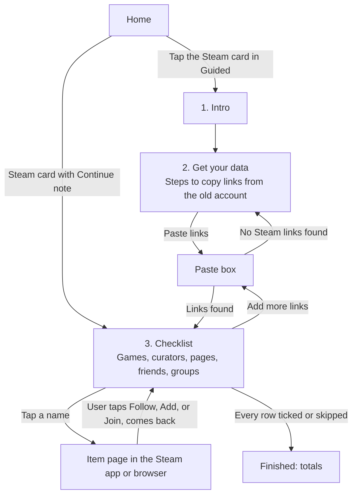
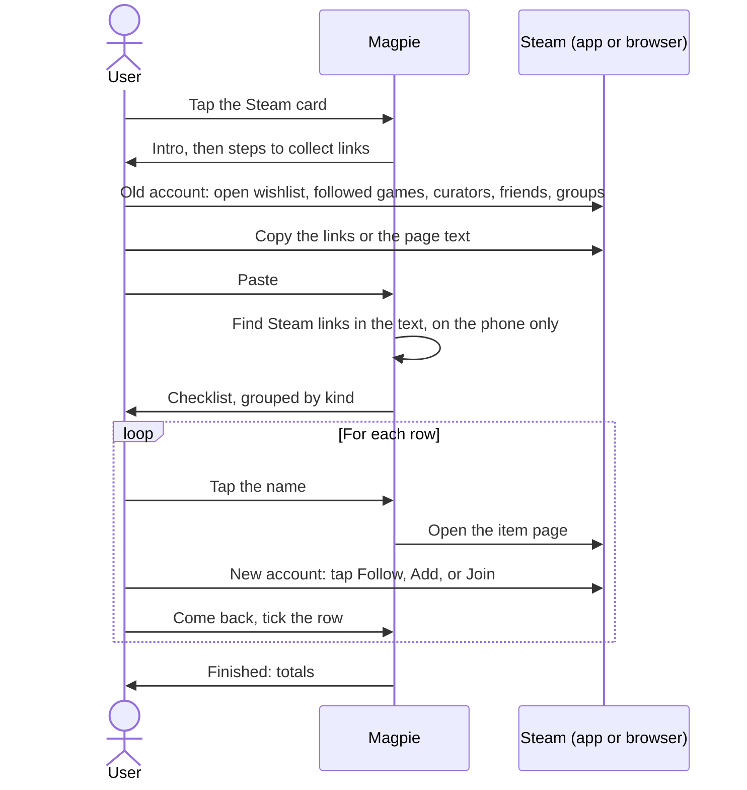

# Feature Specification: Steam Platform (Guided)

**Feature Branch**: `feature/steam-platform`

**Created**: 2026-11-23

**Status**: Cancelled. Steam users keep one account because they have invested heavy money and time in it, so there is no real need to move follows between accounts.

**Input**: User description: "Steam assisted manual migration (second platform). Steam has no third-party write API and no OAuth write scope; third-party sign-in is OpenID identity only. So the app cannot move items automatically. Feature: the user identifies the source Steam account (OpenID sign-in or public profile ID/URL), the app reads public data via official Steam Web API (wishlist via IWishlistService/GetWishlist, friends via ISteamUser/GetFriendList, groups via ISteamUser/GetUserGroupList) — only if that data is public. Followed games, followed curators, and developer/publisher follows have no official read API: let user add them manually (paste store URLs/app IDs) or skip. The app then shows a checklist; each item opens a deep link (Steam app if installed, else web) on the target account, where the user taps Follow/Add to wishlist/Add friend/Join group by hand, then marks the item done. Progress persists locally and resumes. No cookie scraping, no unofficial endpoints, no automated writes. Owned games are out of scope (licenses not transferable). Keep spec platform-neutral where possible with a clearly marked Steam-specific section; cover Android and iOS."

**Depends on**: [005 Guided Migration](../005-guided-migration/spec.md). Steam is one more platform in the shared Guided flow. [004 Platform Picker](../004-multi-platform-picker/spec.md) lists it in the Guided section.

**Related**: [011 Reddit Platform](../011-reddit-platform/spec.md) is the pattern for a Guided platform spec. [007 Spotify Platform](../007-spotify-platform/spec.md) and [011](../011-reddit-platform/spec.md) were cancelled for API access limits; this spec checks Steam against the same risks.

## Summary

Steam has no API that lets an outside app follow a game, add to a wishlist, follow a curator, add a friend, or join a group for a user. Steam sign-in for outside apps (OpenID) proves who the user is and grants no access. So Steam cannot be an Automatic platform. This spec adds Steam to the Guided section. The app builds a list of what the old account follows, the user works through a checklist, and each row opens the item on Steam, where the user taps Follow, Add to wishlist, Add friend, or Join group on the new account. The app never signs in to Steam on the user's behalf, never uses Steam web session cookies, and never taps for the user.

Unlike Reddit, Steam gives no export file of follows. The list comes from two sources: the user's own pasted links (always available), and, depending on the open question below, an official read of the old account's public data.

## Why cancelled

The project owner cancelled this spec on 2026-11-23. Steam users rarely move to a new account, because their library, wishlist, friends, and years of play are tied to the one they have, and licenses cannot move. A migration tool has no real demand there. The spec is kept as a record of the feasibility research and the Guided design, in case the owner revisits it. The open question in FR-ST-013 was never answered and is now moot.

## Feasibility

Checked on 2026-11-23 against Valve's Steamworks Web API docs and the Steam Web API Terms of Use. The plan MUST check each row again against a real test account.

| Question | Answer | Blocks Automatic? | Blocks Guided? |
| --- | --- | --- | --- |
| Can an outside app follow, wishlist, add friends, or join groups for a user? | No. The public Web API has no such write method, and there is no OAuth with write scopes for outside apps. The website buttons use the user's web session, which the constitution forbids the app to use (Principle V). | Yes | No. The user taps the button. |
| What does Steam sign-in give an outside app? | OpenID 2.0: the user's 64-bit Steam ID only. No token, no scopes. | Yes | No |
| Can the app read the old account's wishlist, friends, and groups? | Only if the data is public on the profile, and the documented read methods need a Steam Web API key. The terms say the key holder must keep the key confidential and not share it, so it cannot ship inside the app. The constitution forbids an own backend. See the open question. | n/a | Partly. Pasted links always work. |
| Can the app read followed games, followed curators, or followed developer and publisher pages? | No official read method found. | n/a | No. The user pastes links. |
| Does Steam offer a data export file with follows? | No export file of follows was found. | n/a | No |
| Can owned games move? | No. Steam licenses cannot move between accounts. Family Sharing is Valve's own feature and is out of scope. | Yes | Yes. Out of scope. |

**Verdict**: Automatic Steam is not feasible. Guided Steam is feasible with pasted links alone, and needs no Steam account registration by the owner for that path.

## What Steam items this feature covers

| Item | How the app gets it | What the user taps on the new account | Verdict |
| --- | --- | --- | --- |
| Wishlist games | Official read when public (open question), or pasted store links | Add to your wishlist | In scope |
| Followed games | Pasted store links | Follow | In scope |
| Followed curators | Pasted curator links | Follow | In scope |
| Followed developer, publisher, and franchise pages | Pasted page links | Follow | In scope |
| Friends | Official read when public (open question), or pasted profile links | Add Friend (sends a friend request) | In scope |
| Groups | Official read when public (open question), or pasted group links | Join Group, or Request to Join for closed groups | In scope |
| Workshop subscriptions | n/a | Subscribe, per item | Out of scope. They belong to games, not to the account's follows. |
| Owned games, playtime, achievements, inventory, reviews | n/a | n/a | Not possible |

## How the screens connect

Steam uses the shared Guided flow from spec 005. The get-your-data step offers Paste links in place of Pick file.

## How a Steam move works, from start to end

## User Scenarios & Testing *(mandatory)*

### User Story 1 - Get my Steam list into the app (Priority: P1)

A user wants to move their Steam follows from an old account to a new one. They tap the Steam card in the Guided section. The intro says the app never asks for the Steam password, never signs in to Steam for them, and never taps Follow or Add for them. The get-your-data screen shows numbered steps with pictures: open each list on the old account (wishlist, followed games, curators, followed pages, friends, groups), copy the links or the whole page text, and paste it into the app. The app finds every Steam link in the pasted text and opens the checklist.

**Why this priority**: Without a list, there is nothing to move.

**Independent Test**: Paste a text with 5 store game links, 2 curator links, 1 developer page link, 3 profile links, 1 group link, and some unrelated text and links. Confirm the checklist shows 12 rows of the right kinds and ignores the rest.

**Acceptance Scenarios**:

1. **Given** the Steam card is ready, **When** Home shows, **Then** it is in the Guided section and not in Automatic.
2. **Given** the user opens the Steam card, **When** the intro shows, **Then** it says the app never asks for the Steam password, never signs in to Steam for them, and never taps for them, and that owned games cannot move.
3. **Given** the user is on get-your-data, **When** they read the steps, **Then** each step names one Steam list, shows where to find it on the old account, and has a picture with a text alternative.
4. **Given** the user pastes text with Steam links, **When** the app reads it, **Then** the checklist lists each linked item once, with its kind, and ignores everything that is not a Steam link of a supported kind.
5. **Given** the user pastes text with no supported Steam links, **When** the app reads it, **Then** it says so in plain words and the user stays on the paste box.
6. **Given** a checklist already exists, **When** the user taps Add more links and pastes again, **Then** new items are added, items already in the list are not added twice, and existing ticks and skips are kept.

---

### User Story 2 - Add the items on the new account (Priority: P1)

The user works through the checklist. Rows are grouped by kind. Tapping a row opens the item page in the Steam app, or in the browser when the Steam app does not open that kind of link. The user checks that the new account is the one signed in, taps the button the row names, comes back, and ticks the row.

**Why this priority**: This is the move itself.

**Independent Test**: With the Steam app installed and signed in to the new account, tap one row of each kind, tap the named button, tick each row, and confirm the new account now has each item. Repeat with the Steam app removed and confirm each row opens in the browser.

**Acceptance Scenarios**:

1. **Given** the checklist shows, **When** the user taps a row's name, **Then** the item's page opens in the Steam app, or in the browser when the app does not handle that link.
2. **Given** a row shows, **When** the user reads it, **Then** it names the button to tap: Follow, Add to your wishlist, Add Friend, or Join Group.
3. **Given** the checklist shows, **When** the user reads its note, **Then** it reminds them to sign in to the new account in the Steam app and the browser before tapping, and that friend rows send a friend request the other person must accept.
4. **Given** the user ticks or skips rows, **When** they look at the progress bar, **Then** it shows ticked and skipped rows against the total.
5. **Given** a move ran, **When** the user checks the old account, **Then** nothing on it has changed.

---

### User Story 3 - Read my public lists without pasting (Priority: P2)

*Depends on the answer to the open question.* On get-your-data, the user can also enter the old account's profile link. If the account's wishlist, friends list, or groups are public, the app reads them with Steam's official read methods and adds them to the checklist. If a list is private, the app says which list and shows how to make it public for a moment, or to paste links instead.

**Why this priority**: It saves the most copying for long friend lists and wishlists, but the paste path already works without it.

**Independent Test**: With a test old account whose wishlist and friends are public and groups private, enter its profile link. Confirm wishlist and friend rows appear, and a plain note says the groups list is private.

**Acceptance Scenarios**:

1. **Given** the user enters a profile link of a public account, **When** the app reads it, **Then** the wishlist, friends, and groups that are public are added to the checklist, with no duplicates of pasted items.
2. **Given** a list is private, **When** the app reads it, **Then** it names the private list and offers the steps to make it public or to paste links.
3. **Given** the user enters something that is not a Steam profile link, **When** the app reads it, **Then** it says so in plain words.
4. **Given** the read finishes, **When** the user looks at the app's saved data, **Then** only item names, links, kinds, and tick state are kept, and no Steam ID of a friend is shown beyond the friend's profile link and name.

---

### User Story 4 - Stop and continue later (Priority: P2)

A user with hundreds of wishlist games stops halfway, closes the app, and comes back days later. The Steam card shows a Continue note with the count left, and tapping it opens the checklist where they left it. Spec 005 provides this.

**Independent Test**: Tick 5 of 20 rows, close the app, open it, and confirm the Steam card shows 15 left and the 5 ticks are kept.

**Acceptance Scenarios**:

1. **Given** the user ticked some rows, **When** they close and open the app, **Then** every tick and skip is still there.
2. **Given** Steam has an unfinished checklist, **When** Home shows, **Then** the Steam card shows a Continue note with the count of open rows.

---

### Edge Cases

- A game was removed from the store or is not sold in the user's region: the page may not open or shows no button. The user taps Skip.
- A game is not released yet: the page shows Follow and Add to your wishlist. The row still names the right button.
- A curator, developer page, or group was deleted or renamed: the link opens Steam's own error page. The user taps Skip.
- A friend's profile is private or the friend blocked friend requests: Steam shows no Add Friend button. The user taps Skip.
- A group is closed: the page shows Request to Join. The row note says a request may be needed.
- The new account is limited (has not spent the minimum Steam requires): Steam blocks friend requests and some community actions. The checklist note says so in one line, and the user can skip friend rows.
- The same item appears in two lists (for example a wishlist game the user also follows): it shows as two rows, one per kind, because each needs its own tap.
- The pasted text has the same link many times, or links with tracking parts or a language suffix: each item shows once.
- The pasted text holds a link to the user's own old profile: it shows as a friend row only if the user chose to paste it; the guide says not to.
- The Steam app is signed in to the old account: the user may add items to the wrong account. The app cannot check this and only reminds the user (spec 005, FR-014).
- Steam changes its link formats: links the app does not know are ignored, and the owner updates the reader. The guide can be updated without an app release (spec 005, FR-021).

## Requirements *(mandatory)*

### Functional Requirements

- **FR-ST-001**: The Steam card MUST appear in the Guided section of Home through the one list of platforms (spec 004, FR-001), only once its guide and link reader are ready and checked against a real test account (spec 005, FR-001). It MUST NOT appear in the Automatic section.
- **FR-ST-002**: Tapping the Steam card MUST open the shared Guided flow (spec 005, FR-002) with Steam's guide text, pictures, link reader, and link rules. Steam MUST NOT get Steam-only screens, except the paste box in place of Pick file.
- **FR-ST-003**: The get-your-data screen MUST show numbered steps, one per Steam list in scope, telling the user where to find it on the old account and how to copy its links or page text. It MUST offer Paste links.
- **FR-ST-004**: The paste box MUST accept free text up to at least 1 MB, MUST find every supported Steam link in it on the phone only, and MUST ignore all other text and links. The supported kinds and their link shapes are in the Steam section.
- **FR-ST-005**: The app MUST list each item once per kind, treating links to the same item as one even when they differ in tracking parts, trailing slashes, or language suffixes.
- **FR-ST-006**: After a checklist exists, the checklist header MUST offer Add more links, which adds new items without duplicates and keeps existing ticks and skips. This extends spec 005, FR-017, which allows a list to be loaded only once, because Steam lists come from several pastes.
- **FR-ST-007**: Rows MUST be grouped by kind in this order: wishlist, followed games, curators, developer and publisher pages, friends, groups. Within a group, rows MUST follow spec 005, FR-009 (newest first where a date is known, then paste order).
- **FR-ST-008**: Each row MUST show the item name, or the link's ID when no name is known, and MUST name the button to tap on Steam: Add to your wishlist, Follow, Add Friend, or Join Group.
- **FR-ST-009**: Each row MUST link to the item's page as a normal web link on Steam's site, so the phone opens the Steam app when it handles that link and the browser when it does not (spec 005, FR-010).
- **FR-ST-010**: The checklist note MUST remind the user to sign in to the new account in the Steam app and the browser before tapping, and MUST say that friend rows send a request the other person must accept.
- **FR-ST-011**: The app MUST NOT ask for or keep the Steam password, use Steam web session cookies, open a hidden browser, call any Steam endpoint that changes data, or tap any Steam button for the user (spec 005, FR-012 and FR-013; constitution Principle V).
- **FR-ST-012**: Pasted text MUST be read on the phone only and MUST NOT be uploaded or logged. The app MUST keep only each item's name, kind, link, and tick state, and MUST NOT keep the rest of the pasted text.
- **FR-ST-013**: Reading the old account's public lists (User Story 3) MUST use only Steam's official, documented read methods, MUST NOT parse Steam web pages, and MUST follow the answer to this question (never answered, spec cancelled): Steam's documented read methods for wishlist, friends, and groups need a Steam Web API key, which the terms say must stay confidential, so it cannot ship in the app, and the constitution forbids an own backend. How should the app read public lists? A: no automatic read; paste links only. B: the user enters their own Steam Web API key, kept in secure storage on the phone. C: amend the constitution to allow a small owner-run server that holds the owner's key.
- **FR-ST-014**: Settings MUST say that Magpie is not made by or linked with Valve or Steam. The Steam logo MUST be the official mark, unmodified, used only to name the platform.
- **FR-ST-015**: The feature MUST work the same way on Android and iOS, following spec 005's Platform differences table and the rows added below.

### Platform differences (Android and iOS)

These rows add to spec 005's table.

| Area | Android | iOS |
| --- | --- | --- |
| Paste links | The paste box takes text from the clipboard by the system paste action. The app MUST NOT read the clipboard on its own. | Same. iOS shows its own paste permission prompt when the user pastes; the app MUST NOT read the clipboard on its own. |
| Open a Steam link | The phone opens the Steam app for the links it claims, and the browser for the rest. Which links the Steam app claims is checked in the plan. | Same, through universal links. Which links the Steam app claims is checked in the plan. |

### Key Entities *(include if feature involves data)*

Steam adds no new entity. It uses spec 005's entities.

- **Platform**: Steam is a new entry in the list of platforms, in the Guided section.
- **Follow Item**: One Steam item with its name (when known), its kind (wishlist game, followed game, curator, developer or publisher page, friend, group), its link, the date added when known, and its state.

## Steam section *(platform-specific)*

- **Sign-in**: none on the paste path. Steam's OpenID sign-in is not used, because it proves identity only and the app does not need it to read public data.
- **Where the user finds each list on the old account**: wishlist, followed games, followed curators, followed developer and publisher pages, friends list, and groups list, from the account menu on the Steam store and Community. The guide gives the exact current steps and wording.
- **Supported link shapes** (on `store.steampowered.com` and `steamcommunity.com`):

| Kind | Link shape | Button on the new account |
| --- | --- | --- |
| Game (wishlist or followed) | `https://store.steampowered.com/app/<app id>` | Add to your wishlist, or Follow |
| Curator | `https://store.steampowered.com/curator/<curator id>` | Follow |
| Developer, publisher, or franchise page | `https://store.steampowered.com/developer/<name>`, `/publisher/<name>`, `/franchise/<name>` | Follow |
| Friend | `https://steamcommunity.com/profiles/<64-bit Steam ID>` or `https://steamcommunity.com/id/<custom name>` | Add Friend |
| Group | `https://steamcommunity.com/groups/<group name>` | Join Group, or Request to Join |

- **Wishlist or followed game**: a pasted game link gives no hint which list it came from. The paste box MUST let the user choose, for each paste, whether the game links are wishlist games or followed games, with wishlist as the default.
- **Steam Web API** (only if FR-ST-013 is answered B or C): host `api.steampowered.com`, read methods for the wishlist, friends list, and group list, public data only. This host MUST be added to the app's host allowlist in the plan.
- **No network use on the paste path**: the paste path adds no host. Only the guide fetch from spec 005 (FR-021) applies.

## Success Criteria *(mandatory)*

### Measurable Outcomes

- **SC-001**: A first-time user goes from tapping the Steam card to the first ticked row in under 5 minutes.
- **SC-002**: For a test paste with links of every supported kind mixed with other text, the checklist shows 100% of the supported items with the right kind, no duplicates, and no other items.
- **SC-003**: In a check of the app's network use during the paste path, no request goes to a Steam host and no request carries pasted text or list contents.
- **SC-004**: 100% of rows open the right Steam page, in the Steam app when it handles the link and in the browser when not.
- **SC-005**: Adding Steam needs no change to Home or the Guided flow beyond the new platform entry, its guide, its link reader, the paste box, and Add more links.
- **SC-006**: In testing, at least 9 of 10 new users paste at least one list on the first try without a "no Steam links found" message.

## Assumptions

- Spec 005 (Guided flow) is planned and built before Steam ships. Steam is one more Guided platform in it.
- The user can open each list on the old account in the Steam app or a browser and copy links or page text from it. If a list cannot be copied on a phone, the guide tells the user to do that step on a computer and send the text to the phone.
- The Steam app on Android and iOS may not open every link kind. The browser is the fallback, and the user signs in to the new account there too.
- Steam's limited-account rules apply to the new account. The app does not check them.
- Workshop subscriptions, owned games, and Family Sharing are out of scope.
- A future Steam API with write access would move Steam to the Automatic section through a new spec.

## What the project owner needs to do

None while the spec is cancelled. If you revisit it, these steps need your Steam accounts and cannot be done by an agent.

1. **Answer the open question** in FR-ST-013 (run `/speckit-clarify`).
2. **Test accounts**: have two Steam accounts. The old one should have a few wishlist games, followed games, followed curators, a followed developer page, a few friends, and a group. Check whether the new one is a limited account.
3. **Check the Steam app links**: on an Android phone and an iPhone with the Steam app installed, tap one link of each kind from the table above and note which open in the Steam app and which open the browser.
4. **Copy test**: on a phone, try to copy the links or page text from each list on the old account, and note which lists cannot be copied.
5. **If answer B or C**: read the [Steam Web API Terms of Use](https://steamcommunity.com/dev/apiterms) and confirm the chosen key use is allowed.
