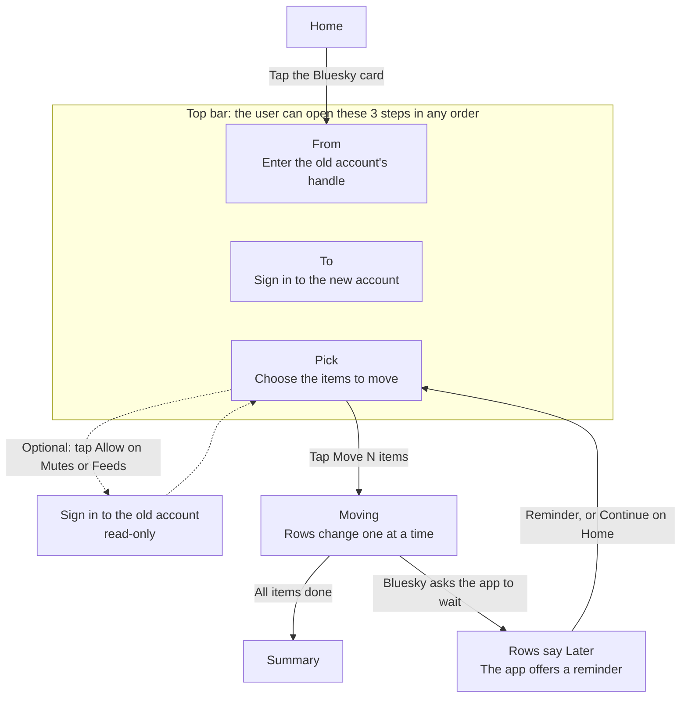
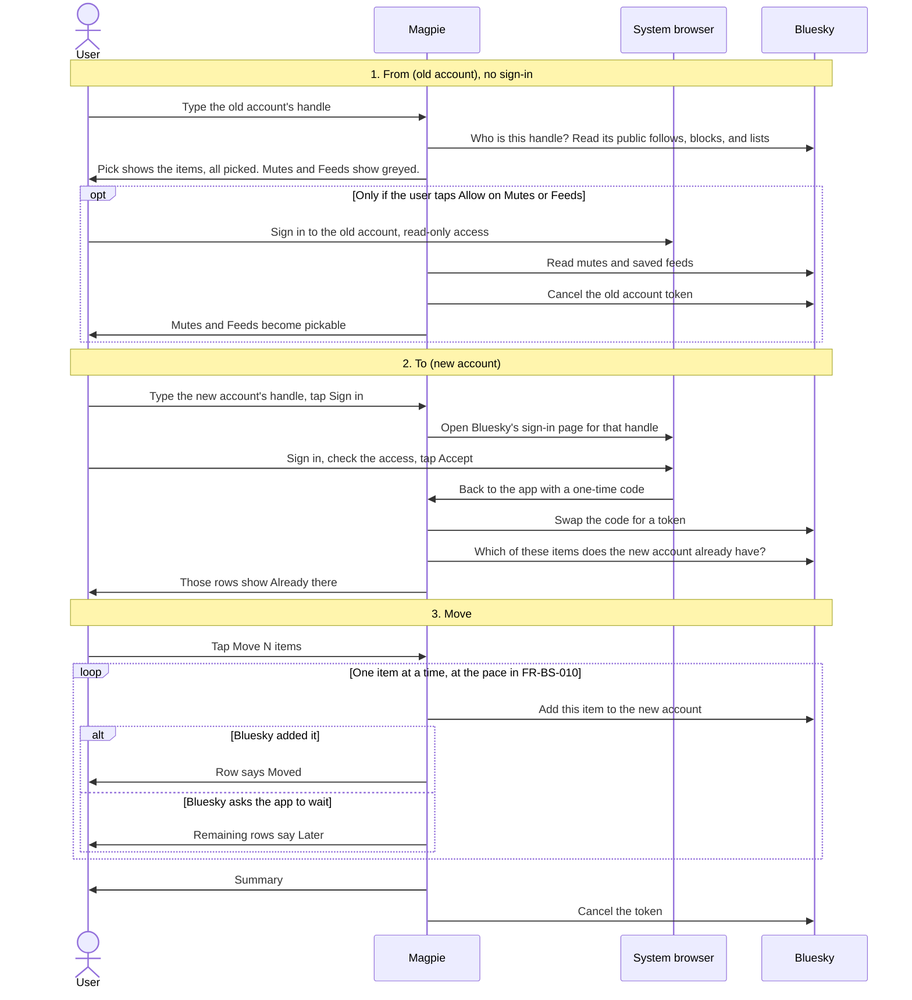

# Feature Specification: Bluesky Platform

**Feature Branch**: `feature/bluesky-platform`

**Created**: 2026-11-23

**Status**: In progress

**Input**: User description: "Bluesky platform"

**Related**: [004 Platform Picker](../004-multi-platform-picker/spec.md) planned Bluesky as an Automatic platform. [001 Subscription Migration](../001-subscription-migration/spec.md) defines the Automatic flow that Bluesky reuses. [008 GitHub Platform](../008-github-platform/spec.md) is the pattern for a second Automatic platform; its shared rules (FR-GH-003, FR-GH-021 to FR-GH-024) apply to Bluesky too. [009 Limit Reasons](../009-limit-reasons/spec.md) adds a limits page per platform. [006 Paid API Credits](../006-paid-api-credits/spec.md) lists Bluesky as a free platform.

## Summary

Bluesky becomes the third Automatic platform. The user taps the Bluesky card on Home, enters the old account's handle (for example `alice.bsky.social`), signs in to the new Bluesky account, picks what to move, and taps Move. The app adds the picked items to the new account through Bluesky's official API. The screens, steps, row states, saved progress, and Settings work the same way as for YouTube and GitHub. Only the platform-specific parts differ: sign-in, what can be moved, the limits, and the words for the items.

Bluesky is a good fit for Automatic: its data is open, it has a modern sign-in for phone apps with fine-grained access, no test-user cap, no app review, and no paid tier. Unlike YouTube and GitHub, the old account's follows, blocks, and lists are public, so the app can read them from the handle alone, with no sign-in to the old account.

## Clarifications

### Session 2026-11-23

- Q: Which kinds should a Bluesky move cover? → A: Follows, blocks, lists, mutes, and saved feeds. Mutes and saved feeds are private, so they are opt-in: Pick shows them greyed with an "Allow" button that signs in to the old account with read-only access (FR-BS-020).
- Q: Should the app support accounts on self-hosted servers? → A: Not in the first release. Only Bluesky-hosted accounts, so the app keeps a fixed host list (Principle III, rule 5) with no constitution exception. A self-hosted account gets a plain "not supported yet" message (FR-BS-022). Self-hosted support can come later with its own amendment. The owner asked for a recommendation; this was it.
- Q: If Bluesky does not let a phone app cancel its access on sign-out, should Bluesky still ship? → A: Decide after the plan tests it. The plan MUST test token revocation with a real account first and, if it fails, stop and ask the owner before any sign-in work (FR-BS-013).
- Q: On Pick, should blocked people start picked, like every other item, or unpicked? → A: Picked, like every other kind (FR-BS-003).
- Q: In what order should the move add follows to the new account? → A: Oldest first, so the new account's lists keep the old order (FR-BS-010).

### Session 2026-11-24

- Q: Bluesky publishes no per-minute limit. How fast should the move be? → A: Fast: 500 per minute, capped at 1,500 per hour and 10,000 per day, under Bluesky's hourly and daily limits (FR-BS-010).
- Q: From has no sign-in. What does its account button say? → A: "Change". It brings the handle box back; To keeps "Sign out" (FR-BS-005).

Bluesky's own "account migration" (moving one account to another server and keeping the same handle and followers) is a different job. It is out of scope. Magpie moves what one account follows to a second, separate account.

## Feasibility

Checked on 2026-11-23 against the AT Protocol (atproto) docs and Bluesky's developer docs. The plan MUST check each row again against real test accounts.

| Question | Answer | Blocks the feature? |
| --- | --- | --- |
| Can anyone sign in, or only test users? | Anyone. An atproto app needs no registration, review, or user cap. The app publishes a small public file that describes it (client metadata), and Bluesky reads it at sign-in. | No |
| Does the API cost money? | No. | No |
| Can the app read the old account's items? | Yes. Follows, blocks, and lists are public records and can be read with no sign-in. Mutes and saved feeds are private and need a sign-in to the old account. | No |
| Can the app add items to the new account? | Yes. Follows, blocks, lists, and list members are records the app creates in the new account. Mutes and saved feeds have their own write calls. | No |
| Can the app ask only for the access it needs? | Yes. Bluesky's sign-in supports fine-grained access per kind of record and per action (for example "create follows" only). It is live on Bluesky's own servers. | No |
| Can a phone app sign in without a secret? | Yes. Bluesky's sign-in treats phone apps as public apps, with PKCE and a key that stays on the phone (DPoP). | No |
| Can the app cancel its access on sign-out? | Expected yes: the sign-in server offers token revocation for public apps. The plan MUST confirm it. | No, if confirmed. Otherwise the same exception and safeguards as GitHub (FR-GH-019) need owner approval. |
| Are there speed limits? | Yes. About 5,000 write points per hour and 35,000 per day per account. One add costs 3 points, so about 1,666 adds per hour and 11,666 per day. | No. A few thousand items fit in one or two sessions. |
| Do Bluesky's rules allow automated following? | Bluesky's Community Guidelines forbid spam and mass, unwanted follows. Moving one's own follows once is not that, but a fast burst of follows could still get the new account flagged. | Risk, not a blocker. FR-BS-010 stays under Bluesky's hourly and daily limits; the owner chose speed over a slow pace (Clarifications, 2026-11-24). |
| Is the old account's handle enough to find it? | Yes. A handle points to one account ID (DID), which points to the server that holds its data. | No |
| Can the app talk to a fixed list of hosts? | Only for accounts hosted by Bluesky. An account on its own server (self-hosted) lives on a host the app cannot know in advance. | No. The first release supports Bluesky-hosted accounts only (Clarifications, 2026-11-23). |

**Verdict**: Automatic Bluesky is feasible.

## What Bluesky supports

| Item | Read from old account | Add to new account | Access needed on the new account | Verdict |
| --- | --- | --- | --- | --- |
| Followed people | Yes, public | Yes | Create follows | In scope |
| Blocked people | Yes, public | Yes | Create blocks | In scope |
| Lists the old account made (people lists and moderation lists) | Yes, public, with their members | Yes: create the list, then add each member | Create lists and list members | In scope |
| Muted people | Only with old account sign-in | Yes | Read mutes, mute call | In scope, opt-in (FR-BS-020) |
| Saved and pinned feeds | Only with old account sign-in | Yes | Read and write preferences | In scope, opt-in (FR-BS-020, FR-BS-021) |
| Subscriptions to other people's moderation lists | Partly (block lists are public, mute lists are private) | Yes | Create list blocks, or mute call | Out of scope. Rare, and the user can re-subscribe by hand. |
| Muted words, content filters, other settings | Only with sign-in | Yes, but they share one settings record with the user's other choices | Write preferences | Out of scope. Not a follow. |
| Starter packs, posts, likes, reposts | Yes | Posts would be copies with new dates | Broad | Out of scope. Not a follow. |
| Followers (people who follow the old account) | Yes | No. Only they can follow the new account. | None | Not possible |

## How the screens connect

## How a move works, from start to end

## User Scenarios & Testing *(mandatory)*

### User Story 1 - Move follows to a new Bluesky account (Priority: P1)

A user has an old Bluesky account and a new one. They tap the Bluesky card, type the old account's handle on From, sign in to the new account on To, and see the old account's items on Pick, all picked. Items the new account already has show "Already there". They tap Move, watch each row change in place, and see a summary at the end.

**Why this priority**: This is the whole value of the feature.

**Independent Test**: With two test accounts, where the old account follows 10 people and the new account already follows 2 of them, run a full move. Confirm the new account follows all 10, the 2 show "Already there", and the old account is unchanged.

**Acceptance Scenarios**:

1. **Given** the Bluesky card is on Home, **When** the user taps it, **Then** the top bar shows From, Pick, and To, and the steps work in any order, as for YouTube and GitHub.
2. **Given** the user types an old account's handle on From, **When** the handle is found, **Then** From shows the account's picture, display name, and handle, and Pick lists its items grouped by kind, each with a picture and a name, all picked.
3. **Given** the handle does not exist or is mistyped, **When** the user taps Next, **Then** From says "We can't find that account. Check the name." and stays open.
4. **Given** the new account already has some of those items, **When** both accounts are set, **Then** those rows show "Already there" and cannot be picked.
5. **Given** items are picked and the new account is signed in, **When** the user taps "Move N items", **Then** each row changes in place to Moving, then Moved or Couldn't move, and a summary shows at the end.
6. **Given** a move ran, **When** the user checks the old account, **Then** nothing on it has changed.

---

### User Story 2 - Sign in to the new account (Priority: P1)

The user types the new account's handle and taps Sign in. The app opens Bluesky's sign-in page in the system browser, already set to that account. The page lists exactly what Magpie may do (for example "Create follows"). The user signs in and taps Accept, and the browser returns to the app.

**Why this priority**: The move needs write access to the new account.

**Independent Test**: Sign in on To with account B. Confirm the browser page names account B and lists only the access in FR-BS-008. Try the old account's handle on To and confirm the app refuses it.

**Acceptance Scenarios**:

1. **Given** the user types a handle on To and taps Sign in, **When** the browser opens, **Then** Bluesky's page asks for that account and lists only the access of the kinds picked at that moment.
2. **Given** the user taps Accept, **When** the browser returns, **Then** To shows the account's picture, display name, and handle, with no extra tap.
3. **Given** the user signs in as a different account than the handle they typed, **When** sign-in ends, **Then** the app uses the account that actually signed in and shows it.
4. **Given** the new account is the same as the old account, **When** sign-in ends, **Then** the app refuses it with "Use a different account here." and signs it out.
5. **Given** the user taps Cancel on Bluesky's page or closes the browser, **When** they return, **Then** To stays signed out with no error line.

---

### User Story 3 - Pace, wait, and continue later (Priority: P2)

The app adds items one at a time, as fast as FR-BS-010 allows. When Bluesky asks the app to wait, or the app's own hourly or daily pace is reached, the app stops, marks the rest "Later", saves the progress, and offers a reminder, as YouTube and GitHub do.

**Why this priority**: Most users finish in one session. Users with more than about 1,500 items hit Bluesky's hourly limit and need it to finish at all.

**Independent Test**: Start a move of 30 items and confirm the pace stays at or under FR-BS-010. Simulate a wait answer after 6 items, confirm the message and "Later" rows, close the app, tap the reminder, and confirm Continue moves only the rest.

**Acceptance Scenarios**:

1. **Given** a move runs, **When** the user watches the rows, **Then** items are added one at a time at the pace in FR-BS-010, and Pick shows the expected time left before Move.
2. **Given** Bluesky asks the app to wait for 60 seconds or less, **When** the move runs, **Then** the app waits and goes on, and rows keep showing Moving.
3. **Given** Bluesky asks for a longer wait or the app's pace limit is reached, **When** the move runs, **Then** the app stops, marks the rest "Later", and shows the limit reason (spec 009) and the reminder offer.
4. **Given** there is an unfinished Bluesky progress, **When** Home shows, **Then** the Bluesky card shows a Continue note with the count left (spec 004).

---

### User Story 4 - Sign out and remove access (Priority: P2)

The user signs out of the new account, a move ends, or the user uses Delete all. The app cancels its Bluesky access on Bluesky's side and deletes its tokens and keys from the phone.

**Why this priority**: The constitution requires sign-out to remove access (Principle III, rule 3).

**Independent Test**: Sign in on To, run a move, and confirm the token no longer works on Bluesky once the summary shows. Sign in again, sign out, and confirm the same. Use Delete all and confirm no Bluesky account, token, key, list, or progress is left on the phone.

**Acceptance Scenarios**:

1. **Given** the new account is signed in, **When** the user taps Sign out on To, **Then** the app cancels the token on Bluesky, deletes it from the phone, and To shows signed out.
2. **Given** a move ends, **When** the summary shows, **Then** the app has cancelled and deleted the new account's token. Continue after a pause uses the saved token only while the move is unfinished.
3. **Given** the phone is offline at sign-out, **When** the cancel call fails, **Then** the app still deletes the token from the phone and tells the user in one line that access ends on its own when the token runs out.
4. **Given** the user uses Delete all, **When** it ends, **Then** every Bluesky account, token, key, list, and progress is gone from the phone.

---

### User Story 5 - Move mutes and saved feeds (Priority: P3)

Mutes and saved feeds are private, so the handle is not enough to read them. On Pick, the Mutes and Feeds sections show greyed out with one line, "Sign in to your old account to move these.", and an "Allow" button. Tapping it signs in to the old account with read-only access. The app reads the mutes and saved feeds, cancels the old account's access at once, and the sections become pickable. Moving them needs matching access on the new account, which To asks for only when those kinds are picked.

**Why this priority**: Most users care about follows first. Mutes and feeds save time for heavy users, but need an extra sign-in.

**Independent Test**: With an old account that mutes 3 people and saves 2 feeds (1 pinned), tap "Allow", sign in, and confirm the 5 rows appear and the old token no longer works. Move them, and confirm the new account mutes the 3 people, saves both feeds with the same one pinned, and its other settings are unchanged.

**Acceptance Scenarios**:

1. **Given** the old account is entered by handle, **When** Pick shows, **Then** Mutes and Feeds show greyed with an "Allow" button, and the other kinds work without them.
2. **Given** the user taps "Allow", **When** Bluesky's page opens, **Then** it is set to the old account's handle and lists only read access to mutes and settings.
3. **Given** the user signs in as a different account than the old one, **When** sign-in ends, **Then** the app refuses it with "Use your old account here." and reads nothing.
4. **Given** the mutes and feeds are read, **When** Pick shows them, **Then** the app holds no token for the old account.
5. **Given** saved feeds are moved, **When** the user checks the new account, **Then** each feed is saved, feeds pinned on the old account are pinned, feeds the new account already had are unchanged, and no other setting changed.
6. **Given** the user never taps "Allow", **When** the move ends, **Then** the summary does not count Mutes and Feeds as failed.

---

### Edge Cases

- The old account follows nothing: Pick says "This account doesn't follow anything yet" and Move is not offered.
- The old account is private to logged-out viewers (it chose "Discourage apps from showing my account to logged-out users"): this setting asks apps not to show the account to people who are not signed in. The app still reads its public records, because the user is moving their own account. [The plan MUST confirm the records stay readable.]
- The old account is deactivated, suspended, or deleted: From says "This account can't be read right now." and stays open.
- A followed person deleted or deactivated their account, or blocked the new account: the add may fail or succeed with no effect. A failed row shows "Couldn't move" with the reason in simple words (FR-BS-017).
- The old account follows the new account: after the To sign-in, that row shows "Already there" and cannot be picked, because an account cannot follow itself.
- The old account blocks the new account: after the To sign-in, that block row shows "Already there" and cannot be picked, as for a follow of the new account (plan, research R9).
- A list the old account made has the same name as a list on the new account: the app reuses that list and adds only missing members.
- A list member deleted their account: that member is left out, and the list row says how many were left out.
- The old account has 10,000 follows: the list loads in parts with a loading line and stays searchable. The time-left line shows that the move takes more than one session.
- The new account's sign-in runs out or the user removes Magpie's access on Bluesky during a move: the next add fails with a sign-in error, To shows signed out, the progress is saved, and the user signs in again to continue.
- Bluesky flags the new account (for example as spam or for unusual activity): the next add fails, the app stops, saves the progress, and shows "Bluesky paused your account's activity. Try again later." It does not retry in a loop.
- The handle changed after the progress started: the app keys the progress by account ID (DID), not by handle, and shows the new handle.
- The user types a handle with a leading `@`, extra spaces, or capital letters: the app accepts it.
- The old or new handle belongs to a self-hosted account: the step says "Magpie works only with accounts hosted by Bluesky for now." and stays open (FR-BS-022). A Bluesky-hosted account with a personal domain handle (for example `alice.com`) works.
- A saved feed was deleted by its maker: it is still saved on the new account, as Bluesky allows, and Bluesky shows it as unavailable. The row shows Moved.
- The new account saves settings in Bluesky's app while the move writes saved feeds: the app reads the settings right before each write, so the newer change is kept.
- The user types only a name (for example `alice`): the app tries `alice.bsky.social`.
- The internet drops during a move: the move pauses, unfinished rows go back to waiting, and the user sees "No internet. Try again when you're online."
- The user taps another platform's card with an unfinished Bluesky progress: the app asks "Save your Bluesky progress?" (FR-GH-022).

## Requirements *(mandatory)*

### Functional Requirements

**Picker and flow**

- **FR-BS-001**: The Bluesky card MUST appear in the Automatic section of Home, after GitHub, through the one list of platforms (spec 004, FR-003). The app MUST move the kinds in scope in "What Bluesky supports".
- **FR-BS-002**: Tapping the Bluesky card MUST open the same From, Pick, To flow as YouTube and GitHub, with the same steps, row states, summary, saved progress, unfinished progress list, Home button, Settings, and switching rules (FR-GH-021, FR-GH-022). The flow MUST NOT get Bluesky-only screens. The handle box shows in place on the From and To steps.
- **FR-BS-003**: Pick MUST split the list into one section per kind ("People", "Blocked", "Lists", "Mutes", "Feeds"), following FR-GH-003, FR-GH-023, and FR-GH-024. Blocked people MUST be in their own section and MUST NOT be mixed with follows. Every kind, blocked people included, MUST start picked.
- **FR-BS-004**: All user-facing text MUST say "items" or the kind name instead of "channels" in the Bluesky flow, and MUST live with the other app text.
- **FR-BS-018**: Moving a list MUST create a list with the same name, description, and type (people list or moderation list) on the new account, or reuse one with the same name and type, and add every member of the old list who still exists. Picking a list MUST NOT pick its members as follows. Moving a list MUST NOT remove members from a list on the new account. The list's picture is not copied.
- **FR-BS-017**: When an item fails during the move, its "Couldn't move" row MUST show the reason in simple words (for example "Account was deleted"), never a raw error.

**Accounts and sign-in**

- **FR-BS-005**: From MUST take the old account's handle, with no sign-in (the opt-in sign-in in FR-BS-020 is the only exception). It MUST accept a leading `@`, spaces, and capital letters, and MUST add `.bsky.social` to a bare name. It MUST show the found account's picture, display name, and handle, and a Change button.
- **FR-BS-006**: To MUST take the new account's handle and sign in through Bluesky's sign-in page in the system browser, set to that handle. The app MUST check the account that actually signed in, and MUST refuse the same account on From and To with a simple message. Each signed-in step MUST show a Sign out button.
- **FR-BS-007**: The app MUST compare accounts by their account ID (DID), never by handle.
- **FR-BS-008**: The app MUST ask the new account only for the access of the kinds picked at that moment (follows, blocks, and lists when the old list is not read yet; mutes and feeds only once read and picked), using Bluesky's fine-grained access, never Bluesky's full-account access. The exact access per kind is in the Bluesky section. If a kind is picked after sign-in and its access is missing, that kind MUST show greyed out with an "Allow" button, as in FR-GH-020.
- **FR-BS-009**: The move MUST only add items to the new account. It MUST NOT change or remove anything on the old account, and MUST NOT remove anything on the new account.

- **FR-BS-020**: Mutes and Feeds MUST show greyed on Pick with an "Allow" button until the old account signs in. "Allow" MUST open Bluesky's sign-in for the old account's handle, asking only for the read access in the Bluesky section. The app MUST refuse any account other than the old one, read the mutes and saved feeds, then cancel and delete the old token at once. Re-reading them later MUST need a new "Allow" sign-in.
- **FR-BS-021**: Moving saved feeds MUST add each picked feed to the new account's saved feeds, keep it pinned when it was pinned on the old account, keep the old account's pin order after the new account's own pinned feeds, and leave feeds the new account already saves unchanged. It MUST read the new account's settings right before each write and change only the saved feeds part.
- **FR-BS-022**: The app MUST support only accounts hosted by Bluesky. When a handle on From, To, or "Allow" belongs to an account on another server, the step MUST say "Magpie works only with accounts hosted by Bluesky for now." and MUST NOT call that server.

**Pace and progress**

- **FR-BS-010**: The app MUST add items one at a time, at no more than 500 per minute, 1,500 per hour, and 10,000 per day per new account. These stay under Bluesky's limits of about 1,666 adds per hour and 11,666 per day, and leave room for the user's own posts. Each list and each list member counts as one add. Within each kind, the app MUST add items in the order the old account made them, oldest first, so the new account shows them in the same order. Rows on Pick still change in place. The plan MAY tune these numbers after testing, but MUST keep them under Bluesky's published limits with a margin.
- **FR-BS-011**: Pick MUST show the expected time left for the picked items at that pace before the user taps Move.
- **FR-BS-012**: When Bluesky asks the app to wait for 60 seconds or less, the app MUST wait and try the same item again without a message. When Bluesky asks for a longer wait, asks again for the same item, or the app's pace in FR-BS-010 is reached, the app MUST stop, mark the rest "Later", save the progress, show the limit reason (spec 009), and ask for reminders. The reminder MUST be set for the time Bluesky gave, or the time the app's pace allows the next add, or 1 hour later when Bluesky gave no time, whichever is latest.

**Data, security, and both phone types**

- **FR-BS-013**: Bluesky tokens and the sign-in key MUST be stored only in the phone's secure storage. On Sign out, at the summary, and on Delete all, the app MUST cancel the token on Bluesky and delete the token and key from the phone. If the cancel call fails, the app MUST still delete them and say in one line that access ends on its own when the token runs out. The plan MUST test cancelling with a real account before any sign-in work. If Bluesky does not allow it, the plan MUST stop and ask the owner (Clarifications, 2026-11-23).
- **FR-BS-014**: The app MUST keep only what the move needs: account ID, handle, display name, picture, item IDs, item names and pictures, list names, descriptions, and members, progress, and the times of recent adds for the pace (deleted after 1 day). It MUST NOT log tokens, codes, handles, or item lists.
- **FR-BS-015**: The app MUST talk to Bluesky only on the hosts in the Bluesky section, over HTTPS (FR-BS-022). The Bluesky logo MUST be the official butterfly, unmodified, used only to name the platform. Settings MUST say that Magpie is not made by or linked with Bluesky. The feature MUST work the same way on Android and iOS.
- **FR-BS-016**: The app MUST treat every Bluesky answer as untrusted, check its shape before use, and check the sign-in return (state, issuer, and redirect) before using the code.
- **FR-BS-019**: Bluesky MUST have a limits page (spec 009) that explains Bluesky's hourly and daily limits and why a large move takes more than one session.

### Key Entities *(include if feature involves data)*

- **Platform**: Bluesky is a new entry in the existing list of platforms, in the Automatic section.
- **Account**: A Bluesky account on From or To, with an account ID (DID), a handle, a display name, and a picture. The old account has no token, except for the short read in FR-BS-020.
- **Item**: Something the old account follows, blocks, or made that can be moved. It has a kind (person, blocked person, list, muted person, or feed), a name, and a picture. A list item also has its type, description, and members.
- **Progress**: As in FR-GH-021, keyed by the old and new account IDs.

### Row states

| State | Bluesky text | Same as GitHub? |
| --- | --- | --- |
| Waiting | (no label) | Yes |
| Already there | Already there | Yes |
| Moving | Moving… | Yes |
| Moved | Moved | Yes |
| Paused by limit | Later | Yes |
| Failed | Couldn't move, with the reason | Yes |

### Screen sizes

No new screens. The From and To handle boxes sit in the existing steps, so the default centered column applies in every size class and orientation (Principle VI).

### Platform differences (Android and iOS)

| Topic | Android | iOS |
| --- | --- | --- |
| Return from the browser after sign-in | The browser hands the app link back to Magpie. | The sign-in browser sheet returns to Magpie. |
| Sign-in key storage | Android Keystore, through secure storage. | iOS Keychain, through secure storage. |

Everything else is the same on both.

## Bluesky section *(platform-specific)*

These details come from the atproto docs ([OAuth for AT Protocol](https://atproto.com/guides/oauth), [OAuth scopes](https://atproto.com/guides/scopes), [OAuth client guide](https://docs.bsky.app/docs/advanced-guides/oauth-client)) and Bluesky's [rate limits](https://docs.bsky.app/docs/advanced-guides/rate-limits), checked 2026-11-23.

**Sign-in flow (Principle III, rule 2)**: atproto OAuth, which is OAuth 2.0 Authorization Code with PKCE, plus pushed authorization requests (PAR) and DPoP-bound tokens, in the system browser. Bluesky has no native sign-in SDK, so this is the highest flow in the constitution's list. The app is a public client with `application_type: native`. Its `client_id` is the HTTPS URL of a public client metadata file, and its redirect uses a custom scheme that is the reverse of that URL's host (for example `io.github.dodo-tech-hub:/oauth/bluesky`). App passwords MUST NOT be used: they give full account access and are typed into the app.

**Access per account (Principle III, rule 1)**: every sign-in includes the base `atproto` scope. Full-account scopes (`transition:generic`) MUST NOT be asked for.

| Sign-in | Scopes | Why | Broader than needed? |
| --- | --- | --- | --- |
| Old (From) | None. No sign-in. | Follows, blocks, and lists are public records. | No |
| Old, after "Allow" (FR-BS-020) | `rpc:app.bsky.graph.getMutes?aud=*`, `rpc:app.bsky.actor.getPreferences?aud=*` | Read private mutes and saved feeds. Read-only. The token is cancelled right after. | `getPreferences` returns all settings, not only feeds. The app keeps only the saved feeds and drops the rest at once. |
| New (To), People | `repo:app.bsky.graph.follow?action=create` | Follow people. | No |
| New (To), Blocked | `repo:app.bsky.graph.block?action=create` | Block people. | No |
| New (To), Lists | `repo:app.bsky.graph.list?action=create`, `repo:app.bsky.graph.listitem?action=create` | Create lists and add members. | No |
| New (To), Mutes | `rpc:app.bsky.graph.muteActor?aud=*`, `rpc:app.bsky.graph.getMutes?aud=*` | Mute people, and check who is already muted. | No |
| New (To), Feeds | `rpc:app.bsky.actor.getPreferences?aud=*`, `rpc:app.bsky.actor.putPreferences?aud=*` | Bluesky stores feeds in one settings record, so the app reads it, adds the feeds, and writes it back. | Yes. Writing settings can change other settings. The app MUST change only the saved feeds part. |

The plan MUST replace `aud=*` with Bluesky's app service ID where Bluesky accepts it.

**Reading the old account**: follows, blocks, and lists through Bluesky's public read API. Blocks can also be read as public records from the account's own server. No token is sent.

**Checking the new account**: before Move, the app reads which items the new account already has, with the public read API, so it needs no extra scope.

**Cancelling access (Principle III, rule 3)**: the sign-in server is expected to offer token revocation for public apps. The plan MUST confirm it with a real account. If it does not, the plan MUST stop and ask the owner for an exception like FR-GH-019.

**Hosts (Principle III, rule 5)**: Bluesky-hosted accounts only (FR-BS-022). An account is Bluesky-hosted when its account ID is a `did:plc` and its server is under `host.bsky.network`. The app checks this before any sign-in or write.

| Host | Used for |
| --- | --- |
| `public.api.bsky.app` | Find a handle, read public follows, blocks, lists, and profiles |
| `plc.directory` | Find which server holds an account |
| `bsky.social` | Sign-in server for Bluesky-hosted accounts |
| `*.host.bsky.network` | The servers that hold Bluesky-hosted accounts (writes go here) |
| `api.bsky.app` | Not called directly. Named as the service that the account's server passes mutes calls on to. |
| `cdn.bsky.app` | Pictures |

The client metadata file lives on the project's public site. The app never calls that host; Bluesky's sign-in server reads it.

**Limits**:

- About 5,000 write points per hour and 35,000 per day per account. A create costs 3 points: about 1,666 adds per hour and 11,666 per day. Bluesky says these limits may change. When hit, Bluesky answers 429, usually with a reset time.
- Per-IP limits also apply (about 3,000 requests per 5 minutes), which one user's move does not reach.
- Bluesky's Community Guidelines forbid spam and mass, unwanted following. Bluesky publishes no per-minute limit. FR-BS-010 caps each hour and day below Bluesky's own limits; a fast burst may still get a new account flagged (edge case "Bluesky flags the new account").

**Redirect back to the app**: the custom scheme above. The app MUST accept only that route and MUST check `state` and `iss` before use.

## Success Criteria *(mandatory)*

### Measurable Outcomes

- **SC-001**: A user can move 100 follows from one Bluesky account to another in under 2 minutes, from tapping the Bluesky card to seeing the summary.
- **SC-002**: After a move, the new account has 100% of the picked items that did not show "Couldn't move", and the old account is unchanged.
- **SC-003**: The YouTube and GitHub flows pass all their existing tests with no change to what they check.
- **SC-004**: Adding Bluesky needs no change to Home beyond the new entry in the list of platforms (spec 004, SC-003).
- **SC-005**: Bluesky's sign-in page lists only the access in FR-BS-008 for the picked kinds, in 10 out of 10 tries.
- **SC-006**: After sign-out or the summary, the new account's token no longer works on Bluesky, in 10 out of 10 tries while online.
- **SC-007**: A move of 5,000 items finishes, across one or more pauses, with no item moved twice and none lost, and no test account is flagged by Bluesky.

## Assumptions

- Bluesky reuses the Automatic flow from specs 001, 004, and 008. Parts still tied to one platform are made platform-neutral in the plan without changing YouTube or GitHub behavior.
- The app has no server. The client metadata file is a static file on the project's public site.
- Fine-grained access is live on Bluesky's servers and stays supported. Self-hosted accounts are not supported in this release (FR-BS-022).
- Bluesky's own account migration (same handle, new server) is out of scope.
- Followers cannot be moved. The summary does not promise it.
- The old account's handle is enough, because its follows, blocks, and lists are public.

## What the project owner needs to do

These steps need your accounts and cannot be done by an agent. They block the plan's sign-in work, not this spec.

1. **Client metadata file**: confirm the project's public site URL (for example the GitHub Pages site for this repository). The plan adds the metadata file there; you check that it is served over HTTPS at a stable URL that will not change, because the URL is the app's ID.
2. **Test accounts**: have two Bluesky-hosted accounts ready, one that follows, blocks, mutes, saves feeds (one pinned), and has a list, and one new.
3. **No secrets**: Bluesky needs no client secret, API key, or developer account. Nothing goes in `.env` for Bluesky, except the client metadata URL if the plan chooses to keep it there.
