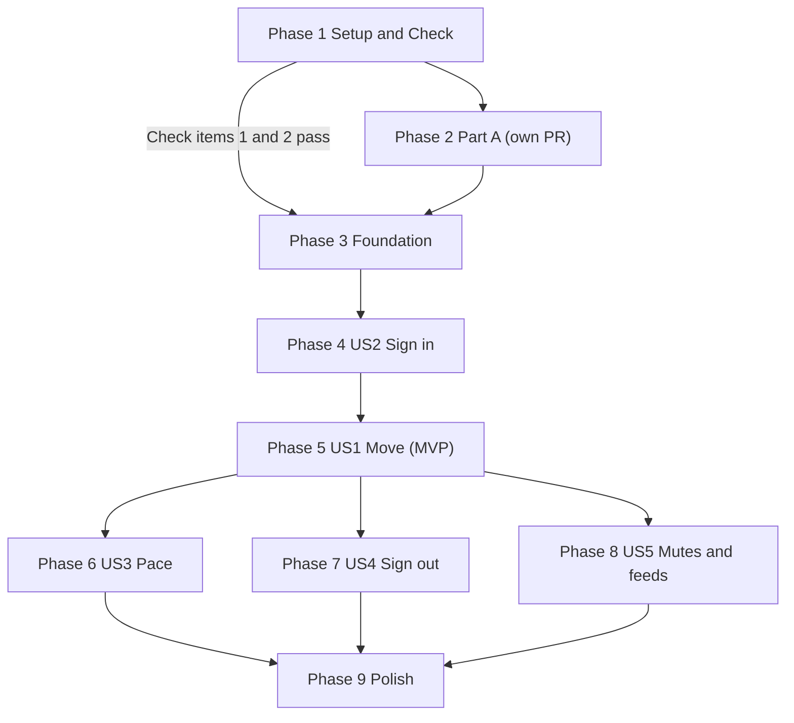

---

description: "Task list for the Bluesky platform"
---

# Tasks: Bluesky Platform

**Input**: Design documents from `specs/013-bluesky-platform/` (plan.md, spec.md, research.md, data-model.md, contracts/platform-driver.md, contracts/bluesky-api.md, quickstart.md)

**Prerequisites**: Spec 008's platform driver and store version 2 are merged (they are on `main`). Part B needs two Bluesky-hosted test accounts for the Check (T005), the official butterfly at `assets/platforms/bluesky.png` (owner, before Phase 3; the platform entry in T034 loads it), and GitHub Pages serving `https://dodo-tech-hub.github.io/magpie/` from `docs/` (owner, plan "What the project owner needs to do"). Bluesky needs no `.env` value. Part A needs none of these.

**Tests**: Required by the constitution (Principle II). Test tasks come before the code they check and must fail first. Each test checks what the user sees or a business rule. A test asserts a mocked call only where that call is the behavior (the browser opens, the revoke call goes out, a session is saved or deleted, no write goes out with the old session). No test calls Bluesky.

**Organization**: Part A (Phase 2) adds the shared parts the driver needs. It ships as its own pull request, with YouTube and GitHub behaving the same, before Part B starts. Part B (Phases 3 to 8) adds Bluesky. Within Part B, US1 needs US2 (it cannot move anything without a sign-in), so US2 comes first. **Stop point**: if the Check shows that Bluesky does not cancel access on sign-out (T005, item 2), stop before Phase 3 and ask the owner (spec Clarifications, FR-BS-013).

## Format: `[ID] [P?] [Story] Description`

- **[P]**: Can run in parallel (different files, no dependency on an unfinished task)
- **[Story]**: US1 to US5. Setup, Foundational, and Polish tasks have no label
- Paths are from the repository root

## Phase 1: Setup

**Purpose**: Status, dependencies, test mocks, a known-good start, and the Check

- [X] T001 Set the `**Status**:` line in `specs/013-bluesky-platform/spec.md` to `In progress` (AGENTS.md: implementation has started).
- [X] T002 Install the dependencies. Expo modules: `npx expo install expo-web-browser expo-crypto`. Packages: `npm install @atproto/oauth-client @noble/curves @noble/hashes react-native-url-polyfill`. Check each Expo module's docs and add a config plugin entry to `app.config.ts` only if the docs say one is needed on Android or iOS. Commit `package.json` and `package-lock.json`. Run `npm audit` and note any high or critical issue (constitution III.11). **Result (2026-11-24)**: `expo install` could not reach `api.expo.dev` from the build sandbox, so the two Expo modules were installed with `npm install` at the SDK 58 versions in `node_modules/expo/bundledNativeModules.json` (`expo-web-browser ~58.0.7`, `expo-crypto ~58.0.7`). `@atproto/oauth-client` adds 12 high audit findings, all from `zod` below 4.6.6 (GHSA-mrhx-c7xc-m3w5, memory use when checking very large lists); the atproto packages pin zod 3, which has no fixed release. Before the first release the owner decides: wait for a fixed atproto release, or override zod to 4 and test sign-in (III.11 allows no high or critical at release).
- [X] T003 [P] Create `tests/mocks/expoWebBrowser.ts` (`openAuthSessionAsync` as a `jest.fn` that returns `{ type: 'success', url }` from a test-set value, or `{ type: 'cancel' }`; `__set(result)` and `__calls()` for tests) and `tests/mocks/expoCrypto.ts` (`getRandomValues` filled from Node's `crypto.randomFillSync`; `digest` is not needed). Register both in `jest.setup.ts` with `jest.mock(..., () => jest.requireActual(...))`, the way the other mocks are.
- [X] T004 Run `npm test`, `npm run typecheck`, and `npm run lint` before any code change. All pass: 44 suites, 472 tests. Write the test count in the commit message of T008.
- [X] T005 Write `specs/013-bluesky-platform/check-access.mjs` (research R11): a Node script using `@atproto/oauth-client-node` as a loopback development client (`client_id` on `http://localhost`, no hosted metadata) that prints one PASS or FAIL line per question: (1) sign in with only `atproto repo:app.bsky.graph.follow?action=create`, a follow works and a block is refused; (2) after `session.signOut()`, both the access token and the refresh token are refused; (3) which `aud` the account's server accepts for `getPreferences` and `putPreferences` (`did:web:api.bsky.app#bsky_appview`, else `*`); (4) `getFollows` and `getLists` answer for an account with "Discourage apps from showing my account to logged-out users" on; (5) the byte length of the stored session JSON. Install `@atproto/oauth-client-node` only under `specs/013-bluesky-platform/` with `npm install --prefix` or run it with `npx -p`, never in the app's `package.json`. Commit the script. **The owner runs it** with two Bluesky-hosted test accounts and the results go in research R11 (T006).
- [ ] T006 Record the Check results in `specs/013-bluesky-platform/research.md` under a new "R11 results" heading (date, one line per question). If item 1 or 2 FAILS, stop and ask the owner. If item 3 changes the `aud`, update the scope table in research R6 and `contracts/bluesky-api.md`. If item 4 FAILS, update research R7 and the spec's logged-out edge case. If item 5 is over 2,000 bytes, keep the split rule in research R3.

---

## Phase 2: Part A - shared parts (Foundational, own pull request)

**Purpose**: Let the driver and the flow carry what Bluesky needs, with no change to what a YouTube or GitHub user sees. Done when every existing test passes with the `perMinute` rename and setup changes only (SC-003).

**CRITICAL**: Open the Part A pull request after T020 and merge it before Phase 3.

- [X] T007 [P] Write `tests/unit/migrate.test.ts` additions for store version 3 in `src/store/migrate.ts`, using the `expoSqlite` mock database. Seed a version 2 database with 3 `add_log` rows. After `migrate`: `PRAGMA user_version` is 3; `add_log` has `keep_until INTEGER NOT NULL DEFAULT 0`; every seeded row has `keep_until` equal to its `at` plus 3,600,000; a version 0 and a version 1 database still reach version 3 with their data; running `migrate` twice changes nothing; an empty database goes straight to version 3.
- [X] T008 Edit `src/store/migrate.ts` per data-model.md "Store version 3". "Migration 2 to 3, in one transaction: `ALTER TABLE add_log ADD COLUMN keep_until ...`, then `UPDATE add_log SET keep_until = at + 3600000` (every existing row is GitHub's), then `PRAGMA user_version = 3`. A fresh install creates version 3." Versions 0 and 1 go through 2 first. Make T007 pass.
- [X] T009 [P] Write `tests/unit/pacer.test.ts` additions for `createPacer(accountKey, pace, deps)` in `src/move/pacer.ts` with a fake clock and fake store: with `{ gapMs: 3000, perHour: 300 }` the answers equal today's (3 seconds apart, `later` after 300 in an hour); with `{ gapMs: 120, perHour: 1500, perDay: 10000 }` adds are 120 ms apart, the 1,501st add in an hour answers `later` at the oldest hour entry plus 1 hour, the 10,001st add in a day answers `later` at the oldest day entry plus 1 day, and when both limits bite the later time wins; `nextAt()` gives the same time `beforeAdd()` would; `recordAdd` is called with `keepMs` of 1 day when `perDay` is set and 1 hour when it is not; `timeLeft(adds, pace)` is `adds * gapMs / 1000` seconds. Update the existing pacer assertions only for the new call shape.
- [X] T010 Edit `src/store/progressStore.ts`: `recordAdd(accountKey, at, keepMs)` stores `keep_until = at + keepMs`; the prune is `DELETE FROM add_log WHERE keep_until < now`; `addsSince` is unchanged. Edit `src/move/pacer.ts` per contracts/platform-driver.md: `createPacer(accountKey, pace, deps)` reads `gapMs`, `perHour`, and `perDay`; `later` is the latest of the hourly and daily times; `timeLeft(adds, pace)` takes the pace; remove the `GAP_MS` and `PER_HOUR` constants and keep the `// ponytail:` comment on the numbers where they now live (the drivers). Make T009 pass.
- [X] T011 [P] Write `tests/unit/mover.test.ts` additions for `itemOrder` in `src/move/mover.ts`: with `kindOrder: ['person', 'block']` and an `itemOrder` that sorts by `JSON.parse(data).seq`, items of one kind move in `seq` order (0 first) and kinds keep `kindOrder`; with no `itemOrder` the order is as today.
- [X] T012 Edit `src/move/mover.ts`: `MoveOptions` gains `itemOrder?: (a: StoredItem, b: StoredItem) => number`. After the kind sort, sort `todo` within each kind with it (stable). Make T011 pass.
- [X] T013 Edit `src/platforms/driver.ts` per contracts/platform-driver.md: `Kind.needsOld?`, `Driver.handleInput?`, `signIn(..., handle?)`, `signOut` and `endMove` returning `Promise<void | false>`, `itemOrder?`, `pace` as `{ gapMs, perHour, perDay?, adds }`, and the `SignInResult` reasons `not_found`, `not_supported`, `unavailable`. Edit `src/platforms/githubDriver.ts`: `pace: { gapMs: 3000, perHour: 300, adds }` with the `// ponytail:` comment ("fixed numbers, tune them from real runs if GitHub's limits change"). Edit `src/state/flows.ts` to pass `driver.pace` to `createPacer`. Types and wiring only; the tests of T009 to T012 and the existing GitHub pace tests cover it.
- [X] T014 [P] Write `tests/components/handleBox.test.tsx` with a fake driver that has `handleInput: true` (`signIn` records its arguments and returns an account): From and To show a text box labelled "Bluesky handle" in place of the plain Sign in button; typing text and tapping the sign-in button (or the keyboard's Go key) calls `signIn(role, kinds, onCode, signal, 'typed text')`; the text stays after rotating or resizing the window (Compact and Medium widths, Principle VI); the text box keeps what the user typed when the account card shows a notice; the reasons `not_found`, `not_supported`, and `unavailable` show the texts of FR-BS-005 and FR-BS-022 under the box and keep the step open; a driver without `handleInput` shows today's button.
- [X] T015 Edit `src/ui/AccountCard.tsx` and `src/state/flows.ts`: `AccountCard` takes `handleInput` and `onSignIn(handle?)`; with `handleInput` and no account it shows a `TextInput` (accessibility label from `words.handleLabel`, `autoCapitalize="none"`, `autoCorrect={false}`, `returnKeyType="go"`, 48-point touch targets, wraps at large text) and the sign-in button; the typed text lives in local state so a window change keeps it. `signInOld` and `signInNew` pass the handle to `driver.signIn`. Add to `Words` (in `src/platforms/driver.ts`) the optional `handleLabel`, `handlePlaceholder`, and `changeOld` (the From account button label when there is no old sign-in to end; with it the button shows that label and the `create-outline` icon in place of "Sign out", and does the same thing: clears the old account and shows the handle box again); add the reason texts as `strings.notFound`, `strings.notSupported`, `strings.unavailable` in `src/strings.ts` with the exact texts "We can't find that account. Check the name.", "Magpie works only with accounts hosted by Bluesky for now.", "This account can't be read right now." `signInOld` and `signInNew` map each failed reason to its notice. Make T014 pass.
- [X] T016 [P] Write `tests/components/accessNote.test.tsx` additions: when a fake driver's `signOut('new')` returns `false`, To shows the driver's `words.accessNote` line with no button when the driver has no `removeAccessUrl`, and with the button (`words.accessButton`) when it has one; when `signOut` returns nothing, no line shows. **Design note (done in T017)**: GitHub's driver now returns `false` from `signOut('new')` and `endMove()`, because it cannot cancel a token, so its note and button show exactly as before; the same for the move's `endMove` returning `false`; render at a Compact and a Medium window width (Principle VI).
- [X] T017 Edit `src/state/flows.ts` and `src/ui/AccessNote.tsx`: `switchAccount`, `endMove`, and Sign out read the `false` from `driver.signOut` and `driver.endMove` and set `accessEnded` (the existing flag) so the note shows; `AccessNote` shows the text alone when `removeAccessUrl` is missing. Make T016 pass.
- [X] T018 [P] Write `tests/components/needsOld.test.tsx` with a fake driver whose kinds are `person` and `mute` (`needsOld: true`) and whose `signIn('old', ['mute'], ..., handle)` and `listOld()` are fakes: with no `mute` rows and `mute` not in `oldRead`, Pick shows a greyed Mutes section with the line "Sign in to your old account to move these." and an "Allow" button; tapping "Allow" calls `signIn('old', ['mute'], ..., oldHandle)`, and when the signed-in account is not the old one shows "Use your old account here." and reads nothing; on success it calls `listOld()` again, the Mutes rows appear all picked, existing picks of other kinds are kept, new rows come in picked (FR-GH-021), and the section no longer shows the old-account "Allow"; a read that finds no mutes shows no section and no "Allow"; Move, All, and the counter count the new rows; with the new account signed in and the kind not granted, the section shows the new-account "Allow" of FR-GH-020 instead; render at a Compact and a Medium window width, and the "Allow" button stays visible at the largest font (Principle VI).
- [X] T019 Edit `src/state/AppState.tsx`: add `oldRead: string[]` and the action `setOldRead`. Edit `src/state/flows.ts`: new `allowOld(state, dispatch, kind)`; it calls `signInAs(..., 'old', [kind], handle)`, refuses another account with `strings.allowOldOther` ("Use your old account here."), calls `driver.listOld()`, merges the rows with `saveItems` and `getItems` (picks kept, new rows picked), and adds the kinds that were read to `oldRead`. `signInOld` sets `oldRead` to `[]`. Edit `src/ui/PickStep.tsx`: a `needsOld` kind with no rows and not in `oldRead` shows as a locked section whose "Allow" calls `allowOld`; once read, a kind the new account has no access for uses `allowKind` as today; the time left reads `driver.pace` with `timeLeft(adds, driver.pace)`, and `timeLeftText` in `src/strings.ts` says "More than one session" when the adds are over `pace.perHour` instead of the fixed 300 (GitHub's text stays the same). Add `strings.needsOldLine` ("Sign in to your old account to move these."). Add `// ponytail: oldRead is not saved, so after a restart an empty Mutes or Feeds section asks for "Allow" again; save it on the progress if users notice.` Make T018 pass.
- [X] T020 Run `npm test`, `npm run typecheck`, and `npm run lint`. All pass, with the same number of existing tests as T004 plus the new ones (48 suites, 518 tests on 2026-11-24). Open the Part A pull request.

---

## Phase 3: Part B foundation (Bluesky building blocks)

**Purpose**: The small shared pieces every story uses: the key, the session store, the account lookup, and the scope table. No user story ships here.

**Blocked until**: Part A is merged, T006 shows Check items 1 and 2 passing, and the owner has added `assets/platforms/bluesky.png`.

- [X] T021 [P] Write `tests/unit/blueskyKey.test.ts` for `src/auth/blueskyKey.ts`: `NobleKey.generate(['ES256'])` returns a key with a public JWK (`kty` `EC`, `crv` `P-256`) and a private part; `createJwt(header, payload)` returns three base64url parts whose signature verifies with `@noble/curves` against the public JWK (test-only check); `generate(['RS256'])` throws a `TypeError`; the runtime's `createKey`, `getRandomValues` (length as asked, not all zero), and `digest` for `sha256` of a known text equal the known hash.
- [X] T022 Create `src/auth/blueskyKey.ts` per research R2: `NobleKey extends Key` from `@atproto/oauth-client` (`createJwt` signs ES256 with `@noble/curves/p256`; `verifyJwt` throws "not needed by a public client"); `runtimeImplementation` with `createKey`, `getRandomValues` from `expo-crypto`, and `digest` with `@noble/hashes/sha2`. Import `react-native-url-polyfill/auto` and `core-js/proposals/explicit-resource-management` here once, as the Expo client's polyfill file does (research R2). Make T021 pass.
- [X] T023 [P] Write `tests/unit/blueskySession.test.ts` for `src/auth/blueskySession.ts` with the `expoSecureStore` mock: the new account's session is saved under `bluesky.session.<did>`; the old account's session (the DID the store was told is old) goes to memory only and `__dump()` of the secure store never holds it; a value over 2,000 bytes is split into `bluesky.session.<did>` and `bluesky.session.<did>.2` and read back whole; `get` returns null for a value that is not what was written (Principle III.8); `del(did)` removes both keys; the state store keeps its value in memory and drops it after 10 minutes (fake clock); the caches are memory only and expire.
- [X] T024 Create `src/auth/blueskySession.ts` per research R3 and data-model.md "Sessions": `SessionStore`, `StateStore`, and caches that fit `@atproto/oauth-client`'s `sessionStore`, `stateStore`, `didCache`, `handleCache`, `dpopNonceCache`, `authorizationServerMetadataCache`, and `protectedResourceMetadataCache` options (`@atproto-labs/simple-store-memory` comes with the client); `markOld(did)` and `markNew(did)` route a session; "the session JSON: DPoP private key, token set, granted scopes" is saved with `expo-secure-store`. Make T023 pass. **Built differently (2026-11-24)**: the sign-in client's own caches are memory only by default, so only the session and state stores are written; a long session is split in as many parts of at most 2,000 characters as it needs (`key`, `key.2`, `key.3`), and the key is the DID with every character other than letters, digits, dots, dashes, and underscores changed to `_`, because secure storage refuses a colon.
- [X] T025 [P] Write `tests/unit/blueskyAuth.test.ts` (lookup and scopes) for `src/auth/bluesky.ts` with a fake `fetch` that allows only the five hosts: `cleanHandle` trims, drops a leading `@`, lower-cases, and adds `.bsky.social` to a name with no dot, and keeps `alice.com`; `lookup(handle)` returns `{ did, handle, name, photoUrl, server }` for a Bluesky-hosted account; an unknown handle (400 from `resolveHandle`) gives `not_found`; a `did:web` account gives `not_supported`; a `did:plc` account whose server host does not end in `.host.bsky.network` gives `not_supported` and makes no call to that host; a deactivated or taken-down profile gives `unavailable`; a picture URL not on `cdn.bsky.app` becomes null; every bad answer shape gives `unavailable`, not a crash; `scopesFor(role, kinds)` returns, for the new account, `atproto` plus exactly the scopes of the picked kinds in research R6, never `transition:generic`; for the old account after "Allow", only the read scopes of research R6; for no kinds, just `atproto`; `kindsOf(scopeString)` maps a granted scope string back to kinds, and a scope the user unticked is missing.
- [X] T026 Create `src/auth/bluesky.ts` (lookup and scopes part) per research R5 and R6: `cleanHandle`, `lookup`, the `SCOPES` table, `scopesFor`, `kindsOf`. Hosts: `public.api.bsky.app`, `plc.directory`, the account's server (checked), `cdn.bsky.app`. Every answer is shape-checked; "Every DID in `data` matches `^did:plc:[a-z2-7]{24}$`. Every at-uri starts with `at://did:plc:`." Make T025 pass. **Built differently (2026-11-24)**: lookup lives in `src/auth/blueskyLookup.ts` with its own `tests/unit/blueskyLookup.test.ts`, and scopes in `src/auth/bluesky.ts` with `tests/unit/blueskyAuth.test.ts` (analysis finding D3, one job per file). `jest` also needed `@noble`, `@atproto`, `@atproto-labs`, and `multiformats` transformed, and a `multiformats` subpath mapping, in `package.json`.
- [X] T027 [P] Create `docs/oauth/bluesky-client-metadata.json` with the JSON of research R12 (`scope` is `atproto` plus every scope in the research R6 table, once each) and write `tests/unit/blueskyMetadata.test.ts`: the file parses; its `client_id` is `https://dodo-tech-hub.github.io/magpie/oauth/bluesky-client-metadata.json`; `application_type` is `native`; `token_endpoint_auth_method` is `none`; `dpop_bound_access_tokens` is `true`; its `redirect_uris` contain the redirect the code uses; its `scope` equals the union of `SCOPES` from `src/auth/bluesky.ts`, so the file and the code cannot drift.
- [X] T028 [P] Add the scheme to `app.config.ts`: `scheme: 'io.github.dodo-tech-hub'`. Run `npx expo config --type public` and confirm the scheme shows for both platforms. No permission is added.
- [X] T029 [P] Write `tests/mocks/blueskyFetch.ts`: a fake `fetch` like `tests/mocks/githubFetch.ts`, with routes `"METHOD url"`, `"METHOD url?query"`, and `"METHOD url*"`; answers `{ status, headers, json }`, a function of the request, or a list used one by one; any host outside `public.api.bsky.app`, `plc.directory`, `bsky.social`, `cdn.bsky.app`, and `*.host.bsky.network` throws "Test tried to reach <host>". Helpers: `profile(did, handle)`, `didDoc(did, host)`, `rateLimited(resetSeconds)`.
- [X] T030 Write `tests/components/blueskyWorld.tsx`: like `githubWorld.tsx`, a fake world with an old and a new account (DIDs, handles, follows, blocks, lists), the T029 fetch, a fake `OAuthClient` whose `authorize` and `callback` return a session for the account of the handle, the `expoWebBrowser` mock, and helpers `signInOldByHandle(handle)`, `signInNewByHandle(handle)`, `rows()`. It records every write the new account receives (`writes`) so tests can assert the final state.

**Checkpoint**: key, stores, lookup, scopes, and metadata exist and pass their tests. No screen has changed yet.

---

## Phase 4: User Story 2 - Sign in to the new account (Priority: P1)

**Goal**: The user types the new account's handle, signs in in the browser, and To shows the account. Only the access of the picked kinds is asked.

**Independent Test**: With a fake OAuth client, sign in on To for a handle; confirm the browser opens, the account shows, only the right scopes were asked, the same account on both steps is refused, and Cancel leaves To signed out with no error.

- [X] T031 [P] [US2] Extend `tests/unit/blueskyAuth.test.ts` for sign-in with a fake `OAuthClient` (`authorize`, `callback`) and the `expoWebBrowser` mock: `signIn('new', kinds, onCode, signal, handle)` looks the handle up first and refuses an unsupported or unknown one before any browser opens; it calls `authorize(did, { scope, login_hint: handle, redirect_uri })` with the `scopesFor` result; the browser result `cancel` or `dismiss` returns `{ ok: false, reason: 'cancelled' }` with no error line; a session whose DID is not `did:plc`, or whose issuer is not `https://bsky.social`, is revoked and refused; a callback that throws (bad `state`, bad `iss`) returns `failed`; the returned account is read from `getProfile` of `session.did` (not from the typed handle), so a different account that signed in is shown as itself; `onCode` is never called; no token or key is in the result (Principle III.3); the session is saved for the new account with the granted scopes and `granted()` maps them to kinds; the old role with no kinds only looks up and never opens a browser.
- [X] T032 [US2] Extend `src/auth/bluesky.ts` with the client and sign-in per research R1, R4, R12 and contracts/bluesky-api.md "Sign-in": `getClient()` builds `OAuthClient` from `@atproto/oauth-client` with the metadata of `docs/oauth/bluesky-client-metadata.json` (copied into code), `handleResolver: 'https://public.api.bsky.app'`, `plcDirectoryUrl: 'https://plc.directory'`, `runtimeImplementation` from T022, and the stores from T024; `signIn(role, kinds, handle)` does the lookup, `authorize`, `openAuthSessionAsync(url, redirect, { preferEphemeralSession: true })`, `callback`, then the checks above. Handle only the one redirect route; ignore any link outside a sign-in (III.8). Make T031 pass.
- [X] T033 [P] [US2] Write `tests/unit/blueskyDriver.test.ts` (sign-in part) for `src/platforms/blueskyDriver.ts` with `@/auth/bluesky` mocked: `id` is `bluesky`; `handleInput` is true; `kinds` are `person` "People", `block` "Blocked", `list` "Lists", `mute` "Mutes" (`needsOld`), `feed` "Feeds" (`needsOld`); no kind is `optional`, so the To sign-in asks for mutes and feeds once they are read and picked (FR-BS-008); `signIn('new', ...)` passes the handle and the picked kinds and returns the account with `handle` equal to the handle; `granted()` is `kindsOf` of the saved session's scopes; `canAct('new', did)` is true only when a saved session for that DID exists; `signIn('new')` with a different account than a saved one does not replace the saved session (the flow refuses it); `resumesNew` is true; `switchSignsOut` is true.
- [X] T034 [US2] Create `src/platforms/blueskyDriver.ts` with the sign-in part only (`id`, `words`, `kinds`, `handleInput`, `switchSignsOut`, `resumesNew`, `signIn`, `granted`, `canAct`). Leave `listOld`, `checkNew`, and `add` for Phase 5. **Not done in T034 (2026-11-24)**: the entry needs `assets/platforms/bluesky.png`, which the owner has not added, so it moves to T041. Original text: add the Bluesky entry after GitHub in `src/platforms/platforms.ts` now, with `ready: false` so Home does not show the card yet (spec 004, FR-001): `id: 'bluesky'`, `logo: require('../../assets/platforms/bluesky.png')`, `section: 'automatic'`, `open` with `openPlatform`, `unfinished` with `listUnfinished('bluesky')`; widen `PlatformId` and `blueskyWords` in `src/strings.ts`: `signIn` "Sign in with Bluesky" with icon `logo-bluesky` if the installed `@expo/vector-icons` has it, else `log-in-outline` (research R14); `handleLabel` "Bluesky handle"; `handlePlaceholder` "name.bsky.social"; `oldHint` "Where your follows are now"; `newHint` "Where your follows should go"; `searchPlaceholder` "Search"; `noItems` "This account doesn't follow anything yet"; `needPick` "Pick at least 1 item"; `later` "Later"; `limitReached` "Bluesky lets Magpie move only some items each hour and each day. Magpie must wait a little."; `reminderBody` "You can move the rest now."; `moveButton` as GitHub's; `notAffiliated` "Magpie is not made by or linked with Bluesky. Bluesky and the butterfly logo belong to Bluesky Social PBC."; `accessNote` "Magpie's access ends on its own soon."; `changeOld` "Change" (FR-BS-005) Make T033 pass.
- [X] T035 [P] [US2] Write `tests/components/blueskySignIn.test.tsx` using `tests/components/blueskyWorld.tsx`. The card is hidden until T041, so open the flow with `openPlatform`; on To, typing the handle and tapping the sign-in button opens the browser for that handle (the `expoWebBrowser` mock sees a URL), and the step then shows the account's picture and name with no extra tap; the scope asked is only for the picked kinds; signing in with the old account's handle shows "Use a different account here." and the session is deleted; Cancel (browser result `cancel`) leaves To signed out with no error line; a second sign-in with the other step already signed in sets `prompt` so the browser asks for the account (research R12); the page asked for follow, block, and list access and nothing else (SC-005).
- [X] T036 [US2] Make T035 pass. **Done 2026-11-24**: `kindsToAsk` now leaves out kinds with `needsOld` until they were read and picked (FR-BS-008), and the platform entry could not be added to `src/platforms/platforms.ts` yet because the logo file does not exist, so `PlatformId` has `bluesky` and tests add the entry with `registerBluesky()` in `tests/components/blueskyWorld.tsx`; T041 adds the real entry. Original text: in `src/state/flows.ts`, `kindsToAsk` and the same-account refusal already exist from GitHub; pass the DID comparison through `res.account.id` (it is the DID). Add `strings.sameAsOld` for Bluesky if the existing text does not read "Use a different account here." Do not branch on the platform; if a text differs, move it into `Words` (`sameAccount`).

**Checkpoint**: sign-in on To works with a fake client. The driver is still not in the platform list.

---

## Phase 5: User Story 1 - Move follows to a new Bluesky account (Priority: P1) 🎯 MVP

**Goal**: From takes the old handle with no sign-in, Pick lists People, Blocked, and Lists, and Move adds them to the new account oldest first, with "Already there" and a summary.

**Independent Test**: With a fake world (two accounts), run a full move from the Bluesky card; confirm the new account has every picked item, the shared ones show "Already there", the old account is unchanged, and the order is oldest first.

- [X] T037 [P] [US1] Write `tests/unit/blueskyApi.test.ts` (reads and "Already there") for `src/api/bluesky.ts` with the T029 mock: `readFollows(did)` pages `getFollows` with `limit=100` until no `cursor`, returns `person` items with `itemId` `person:<did>`, title display name or handle, and `data` `{ did, handle, seq }` where the oldest follow has `seq` 0; `readBlocks(did, server)` pages `listRecords` with `collection=app.bsky.graph.block&reverse=true`, names the DIDs through `getProfiles` 25 at a time, and returns `block` items with `seq` oldest first; `readLists(did)` reads curate and mod lists and their members through `getLists` and `getList`, paged, returns `list` items whose `data` is `{ purpose, description, members, seq }`; an account the app view no longer knows is left out of follows, blocks, and members; a picture URL not on `cdn.bsky.app` becomes null; a bad page shape fails that kind only (the function rejects, the driver puts it in `missing`); a DID not matching `^did:plc:[a-z2-7]{24}$` and an at-uri not starting `at://did:plc:` are dropped; `checkNew` returns the item IDs the new account already has (follows and blocks from public reads, the new account's own DID counts as there for `person` and `block`), and does not call any write route.
- [X] T038 [US1] Create `src/api/bluesky.ts` (reads and `checkNew`) per contracts/bluesky-api.md "Read the old account" and research R7, R9. Public reads use plain `fetch`; the account's server host is checked before use (`.host.bsky.network`). Make T037 pass.
- [X] T039 [P] [US1] Write `tests/unit/blueskyApi.test.ts` additions (writes and answers) with the T029 mock and a fake session `fetchHandler`: `followPerson` posts `com.atproto.repo.createRecord` with `{ repo, collection: 'app.bsky.graph.follow', record: { $type, subject, createdAt } }`; `blockPerson` the same with `app.bsky.graph.block`; `addList` creates a list `{ $type, purpose, name, description, createdAt }` unless a list with the same name and purpose exists on the new account, then posts one `app.bsky.graph.listitem` per member that is not already in it, calling `pacer.beforeAdd()` before each (a `later` answer returns `later`), and returns `moved` with `reason` "N left out" when a member could not be added; it never deletes a record or a list member; each row of the "Answer to outcome" table in contracts/bluesky-api.md maps as written (200 `moved`; no answer `retry`; 401 and the three token errors `auth`; 429 with reset up to 60 seconds `wait`; 429 later or with no reset `later` at reset or one hour; the four account-state errors `stop` with "Bluesky paused your account's activity. Try again later."; `InvalidRecord` and `InvalidRequest` `couldnt_move` "Bluesky didn't allow this one."; 403 `couldnt_move` "Magpie doesn't have access for this."; 5xx `retry`); a second 429 for the same item gives `later`; no reason is ever raw Bluesky text (FR-BS-017); a write never goes out with the old session.
- [X] T040 [US1] Extend `src/api/bluesky.ts` with the writes and the answer mapping per contracts/bluesky-api.md "Writes" and "Answer to outcome", for `person`, `block`, and `list` (mutes and feeds come in Phase 8). Make T039 pass.
- [X] T041 [US1] **Done 2026-11-25**: the owner supplied the butterfly (the plain mark on a transparent background, scaled to 512 pixels wide and saved as `assets/platforms/bluesky.png`, no other change), the entry is in `src/platforms/platforms.ts` after GitHub with no `logoDark` because the blue reads on both looks, and the Home card test is in `tests/components/blueskyPick.test.tsx`. Extend `src/platforms/blueskyDriver.ts` with `listOld`, `checkNew`, `add`, `itemOrder`, `moveOrder`, and `pace`: `listOld()` reads public kinds with `Promise.allSettled` (a failed kind goes to `missing`, every failed shows the reason, as GitHub's driver does) and returns `needsOld` kinds only when an old session exists; `checkNew(items, granted)` calls the API; `add` dispatches on `item.kind` and returns `couldnt_move` "Bluesky didn't allow this one." for a bad `data`; `moveOrder: ['person', 'block', 'list', 'mute', 'feed']` (a list moves after the people it contains); `itemOrder` sorts by `data.seq`; `pace: { gapMs: 120, perHour: 1500, perDay: 10000, adds }` where `adds` is one per item plus one per member of each list, with the comment `// ponytail: fixed numbers, tune them from real runs if Bluesky's limits change`. Set the Bluesky entry in `src/platforms/platforms.ts` to `ready: true`, and add `logoDark` (`bluesky-white.png`) only if the dark look needs it, as for GitHub.
- [X] T042 [P] [US1] Extend `tests/unit/blueskyDriver.test.ts` for `listOld`, `checkNew`, and `add` with `@/api/bluesky` mocked: `listOld` returns public kinds and no `mute` or `feed` rows without an old session; one failed kind is in `missing` and the others still load; `pace.adds` counts one per item and one per list member; `itemOrder` puts `seq` 0 first; `moveOrder` puts `list` after `person` and `block`; `add` of a `person` row with broken `data` gives `couldnt_move` and makes no call; the driver never calls a write with the old session.
- [X] T043 [P] [US1] Write `tests/components/blueskyPick.test.tsx` with `blueskyWorld`: Home shows the Bluesky card in Automatic after GitHub with its logo; typing the old handle on From (as `@Old.bsky.social `) shows the account's picture and name and no browser opens; Pick lists "People", "Blocked", and "Lists" with counts, all picked, and a greyed "Mutes" and "Feeds" with the line "Sign in to your old account to move these." and "Allow"; blocked people are in their own section and start picked (FR-BS-003); a handle that does not exist shows "We can't find that account. Check the name."; a self-hosted handle shows "Magpie works only with accounts hosted by Bluesky for now." and makes no call to that server; after the To sign-in, a follow the new account already has shows "Already there" and cannot be picked, and so does a follow of the new account itself and a block of it (FR-BS-017 spec edge cases); an old account with no follows and no blocks shows "This account doesn't follow anything yet" and Move is not offered; All and the section All boxes work across kinds (FR-GH-024); Compact and Medium window widths both render.
- [X] T044 [P] [US1] Write `tests/components/blueskyMove.test.tsx` with `blueskyWorld`: tapping "Move N items" changes each row in place to Moving, then Moved or "Couldn't move" with the plain reason; adds go oldest first within each kind (assert the order of `writes`); a list is created with the same name, description, and purpose and gets every member that exists, and a member whose account was deleted is left out with "1 left out" on the list row; a list with the same name on the new account is reused and gets only the missing members; picking a list does not pick its members as follows (FR-BS-018); the new account ends with every picked item and the old account is unchanged (SC-002); nothing is removed on the new account; the summary shows after the last item.
- [X] T045 [US1] Make T042 to T044 pass: wire any missing piece in `src/ui/*` and `src/state/flows.ts` through the driver (no `if (platform === 'bluesky')`). Add the texts "Blocked" and "Lists" headings and the kind headings in the driver's `kinds`. Add the "Bluesky" line to Settings' not-affiliated list through `words.notAffiliated` (the existing loop from spec 008). If a test needs a shared change, make it a generic capability and say so in the commit message.

**Checkpoint**: a full follow, block, and list move works end to end with fakes. This is the MVP.

---

## Phase 6: User Story 3 - Pace, wait, and continue later (Priority: P2)

**Goal**: Adds are up to 500 per minute, with an hourly and a daily limit, short waits are silent, long waits stop with "Later", a reminder, and Continue.

**Independent Test**: Start a move of 30 items; confirm the pace; simulate a short wait and a long wait; confirm the message, "Later" rows, the reminder, and that Continue moves only the rest.

- [X] T046 [P] [US3] Write `tests/components/blueskyPace.test.tsx` with `blueskyWorld` and a fake clock: 30 items are added at least 120 ms apart and Pick shows the time left before Move ("Less than a minute" for 30 items) and, for 5,000 items, a line that says it takes more than one session (FR-BS-011); a 429 with a reset 30 seconds away makes the app wait and go on with rows still Moving and no message; a 429 with a reset 20 minutes away stops the move, marks the rest "Later", shows the limit reason of spec 009 and the reminder offer, and the reminder is set for the reset time (FR-BS-012); with 1,500 adds in the last hour the next item stops as "Later" with the reminder at the time the hourly pace allows; with 10,000 adds in the last day it stops with the reminder at the time the daily pace allows; with no reset time the reminder is 1 hour later; closing and reopening the app and tapping the reminder opens the progress with Continue, and Continue moves only the rest, each item once; the Bluesky card on Home shows the Continue note with the count left.
- [X] T047 [P] [US3] Write `tests/unit/blueskyDriver.test.ts` additions for a move of 5,000 items across 3 stops with a fake clock and `blueskyWorld`'s writes: no item is written twice and none is lost (SC-007); the pacer log keeps entries for 1 day (`keep_until`), and GitHub's for 1 hour.
- [X] T048 [US3] Make T046 and T047 pass. Wire `limitsUrl: 'https://dodo-tech-hub.github.io/magpie/limits/bluesky'` in `blueskyDriver.ts` and create `docs/limits/bluesky.md` in the style of `docs/limits/github.md` (spec 009, FR-BS-019): Bluesky's hourly and daily limits (5,000 and 35,000 points, 3 per add), Magpie's numbers (500 per minute, 1,500 per hour, 10,000 per day), why a large move takes more than one session, and what to do after "Later". Fix any gap in `src/move/pacer.ts` or `src/platforms/blueskyDriver.ts` the tests find; keep shared code free of Bluesky names.

---

## Phase 7: User Story 4 - Sign out and remove access (Priority: P2)

**Goal**: Sign out, the summary, "Don't save", and Delete all revoke the new session on Bluesky and delete it from the phone, even when offline.

**Independent Test**: Sign in on To, run a move, and confirm the revoke call goes out and the session is gone at the summary. Sign out offline and confirm the session is still deleted and the access line shows. Delete all and confirm nothing is left.

- [X] T049 [P] [US4] Extend `tests/unit/blueskyAuth.test.ts` for `signOut(role)`: the new role calls `session.signOut()` (the revoke call) and then deletes `bluesky.session.<did>` and its `.2` part from the secure store; when the revoke call throws, the keys are still deleted and the result is `false`; with no saved session it returns without a call; the old role drops the memory session and revokes it; `signOut()` with no role does both; no token, key, DID, or handle is logged (spy on `console`, Principle III.7).
- [X] T050 [US4] Extend `src/auth/bluesky.ts` and `src/platforms/blueskyDriver.ts` with `signOut(role)` and `endMove()` per research R4: revoke, then delete in `finally`, return `false` when the revoke failed. The driver's `signOut` and `endMove` return that value. Make T049 pass.
- [X] T051 [P] [US4] Write `tests/components/blueskySignOut.test.tsx` with `blueskyWorld`: Sign out on To revokes (the fake client records `signOut`), deletes the session (`__dump()` of the secure store has no `bluesky.session` key), and To shows signed out; when the move ends, the summary shows and the session is revoked and deleted, and a Continue after a pause (move unfinished) works with the saved session and no new sign-in; with the fake revoke failing (offline), the session is still deleted and To shows "Magpie's access ends on its own soon." and no remove-access button; Delete all in Settings leaves no Bluesky account, session, list, or progress (FR-BS-013, III.6); "Don't save" on switching platforms deletes the progress and the session and signs out; the old account's session never appears in the secure store at any point (assert after each step).
- [X] T052 [US4] Make T051 pass. Any gap is in `src/state/flows.ts` (`discardFlow`, `endMove`, `switchAccount`) or `src/ui/SettingsView.tsx`; fix it generically through the driver.

---

## Phase 8: User Story 5 - Move mutes and saved feeds (Priority: P3)

**Goal**: "Allow" on Mutes or Feeds signs in to the old account read-only, reads them, revokes at once, and the new account gets them with matching access.

**Independent Test**: With an old account that mutes 3 and saves 2 feeds (1 pinned), tap "Allow", sign in, and see 5 rows and no old session. Move them and confirm the new account mutes 3, saves both feeds with the same one pinned, and its other settings are unchanged.

- [X] T053 [P] [US5] Write `tests/unit/blueskyApi.test.ts` additions (mutes and feeds) with the T029 mock and a fake session: `readMutes(session)` pages `getMutes` and returns `mute` items with `seq`; `readFeeds(session)` reads `getPreferences`, takes only the `savedFeedsPrefV2` item, skips `timeline` entries, names feeds through `getFeedGenerators` and lists through `getList`, returns `feed` items with `data` `{ type, value, pinned, seq }` in the saved order, and drops every other preference at once (assert the returned items hold nothing else); `muteActor` posts `app.bsky.graph.muteActor` `{ actor }` with the header `atproto-proxy: did:web:api.bsky.app#bsky_appview`; `addFeed` reads `getPreferences` right before the write, adds the feed to `savedFeedsPrefV2.items` with the same `type`, `value`, and `pinned` and a new `id`, keeps every other preference byte for byte, leaves a feed the new account already saves unchanged, and puts a pinned feed after the new account's own pinned feeds in the old account's pin order (FR-BS-021); `putPreferences` is called once per feed, never with a smaller list than it read; a failed `getPreferences` gives `retry` and no write; `checkNew` also returns muted people and saved feeds the new account already has when it is granted those kinds.
- [X] T054 [US5] Extend `src/api/bluesky.ts` and `src/platforms/blueskyDriver.ts`: add the mute and feed reads and writes of research R7 and R8 and the `signIn('old', kinds)` path of FR-BS-020 (a session for the old DID, kept in memory only, scopes from research R6); `listOld()` reads mutes and feeds when the old session exists, then revokes and drops it in `finally` ("The old account is read once. Its token goes as soon as the list is read", as GitHub does); the driver refuses an old session whose DID is not the old DID. Make T053 pass.
- [X] T055 [P] [US5] Write `tests/components/blueskyMutesFeeds.test.tsx` with `blueskyWorld` extended with 3 mutes and 2 saved feeds (1 pinned) and the new account's own preferences (another setting, one pinned feed): on Pick the Mutes and Feeds sections are greyed with "Allow"; tapping it opens the browser for the old handle with only the read scopes; a different account that signs in shows "Use your old account here." and nothing is read; on success 5 rows appear all picked, existing picks and other sections are kept, and the old session is gone (assert the fake client's `signOut` ran and the secure store holds no session for the old DID); after the To sign-in the two sections are greyed again with "Allow" for the new account, which signs in again with the earlier scopes plus that kind (FR-GH-020); after Move, the new account mutes the 3 people, has both feeds saved, the pinned one is pinned after its own pinned feed, its other setting is unchanged, and the summary does not count Mutes and Feeds as failed when the user never tapped "Allow" (acceptance scenario 6); a muted person who deleted their account is left out.
- [X] T056 [US5] Make T055 pass. **Found by the test (2026-11-24)**: "Allow" for the new account did not pass its handle to the sign-in, so a platform where the user types the handle failed; `allowKind` in `src/state/flows.ts` now passes it. Gaps belong in `src/state/flows.ts` (`allowOld`, `allowKind`) or `src/ui/PickStep.tsx`; keep them generic. Check that the sign-in asks the new account for `getMutes` with `muteActor` (research R6) and `getPreferences` with `putPreferences`, using the `aud` recorded in R11 results.

---

## Phase 9: Polish and cross-cutting

**Purpose**: Docs, the real phone check, and release checks.

- [ ] T057 [P] **Waits for the release (2026-11-24)**: the landing page describes release 0.1.0, which has no Bluesky, so the sentence changes when a release with Bluesky is made. Update `docs/index.md` (the landing page that `README.md` links to): add Bluesky to the sentence about supported platforms ("follows, blocks, lists, mutes, and saved feeds") and to any platform list or screenshot caption; keep it one line per sentence (AGENTS.md: never hard-wrap).
- [X] T058 [P] **No change needed (2026-11-24)**: spec 004 says Bluesky appears in Automatic "later" for the launch, which is still true. Update `specs/004-multi-platform-picker/spec.md` only if it still says Bluesky is planned or "later" in a way the new spec makes wrong: replace that wording with a link to spec 013 and nothing else. Do not edit other lines (AGENTS.md: no tidy-up outside the task).
- [X] T059 **Result (2026-11-24)**: tests, typecheck, and lint pass (62 suites, 746 tests); `grep` finds `'bluesky'` only in the Bluesky files and the platform type, and no `console.` in the Bluesky files; `npm audit` still reports the 12 high findings from `zod` (T002). A scratch install of `@atproto/oauth-client` with `"overrides": { "zod": "4.6.7" }` reports 0 findings and still builds the client and parses key, token, and server-metadata schemas, so the override is the likely fix. It needs the phone sign-in (T060) to prove it, so it is not applied yet. Run `npm test`, `npm run typecheck`, `npm run lint`, and `npm audit`. All tests pass, no high or critical audit issue (III.11). Run `grep -rn "'bluesky'" src --include=*.ts --include=*.tsx` and confirm it appears only in `src/platforms/`, `src/auth/bluesky*.ts`, `src/api/bluesky.ts`, `src/strings.ts`, and the platform list (no `if (platform === 'bluesky')` in shared code, Principle IV). Run `grep -rn "console\." src/auth/bluesky*.ts src/api/bluesky.ts src/platforms/blueskyDriver.ts` and confirm it finds nothing (III.7).
- [ ] T060 Run the quickstart on an Android phone with the two test accounts: rows 1 to 14 of `specs/013-bluesky-platform/quickstart.md`. Confirm rows 5 and 11 against the real sign-in page and a refused old token. Run row 14 (rotate, split screen) at Compact and Medium widths (Principle VI). Record any failure as a new task here, with its test.
- [ ] T061 Run quickstart rows 1 to 14 on an iPhone (iOS) and confirm the sign-in browser sheet returns to Magpie and the ephemeral session shows the account chooser each time (research R12). Android first is the release order; this task may follow the Android release.
- [ ] T062 When the pull request is merged, set the `**Status**:` line in `specs/013-bluesky-platform/spec.md` to `Implemented` (AGENTS.md).

---

## Dependencies and order

- Phases 6, 7, and 8 do not depend on each other and can be done in any order after Phase 5.
- US3's pace code already runs in Phase 5 (the driver sets `pace`); Phase 6 checks and finishes it.
- US4's `signOut` is needed by Phase 4's refusal paths. T031 uses a fake `signOut`; T050 makes it real.

## Parallel examples

- Phase 2: T007, T009, T011, T014, T016, and T018 are test files that touch different files and can be written together; the code tasks after each follow in order.
- Phase 3: T021, T023, T025, T027, T028, and T029 are independent; T030 follows T029.
- Phase 5: T037, T039, and T042 to T044 are independent test files.

## Implementation strategy

1. **Check first**: T005 and T006 settle revocation and the scopes before any sign-in code exists. A failure stops the work.
2. **Part A as its own pull request**: T001 to T020, YouTube and GitHub unchanged.
3. **MVP**: Phases 3, 4, and 5 give a working follows, blocks, and lists move. Ship the pull request here if the owner wants a smaller first release.
4. **Then** Phases 6, 7, and 8 in the owner's order, and Phase 9 before release.
