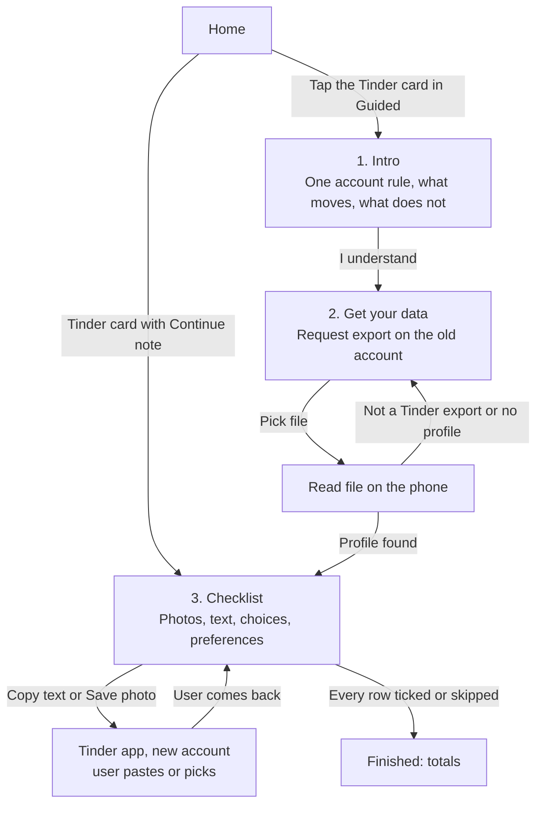
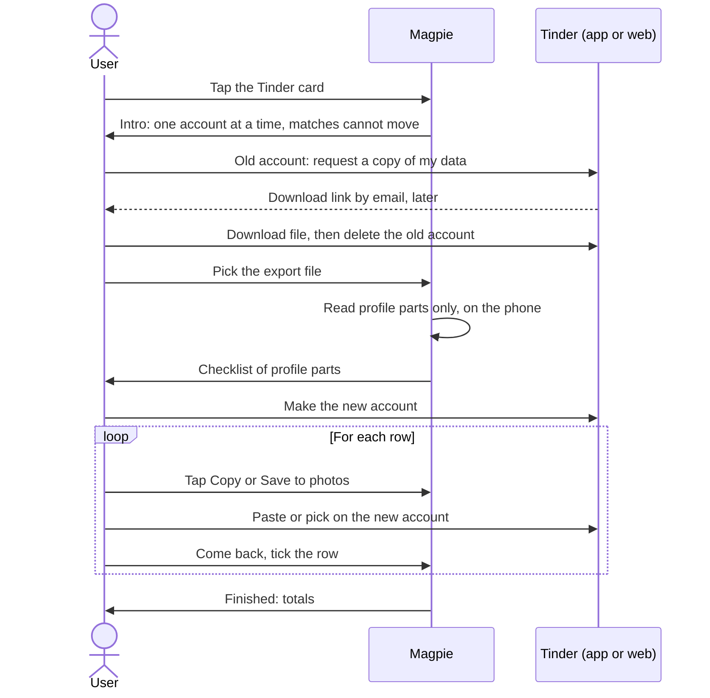
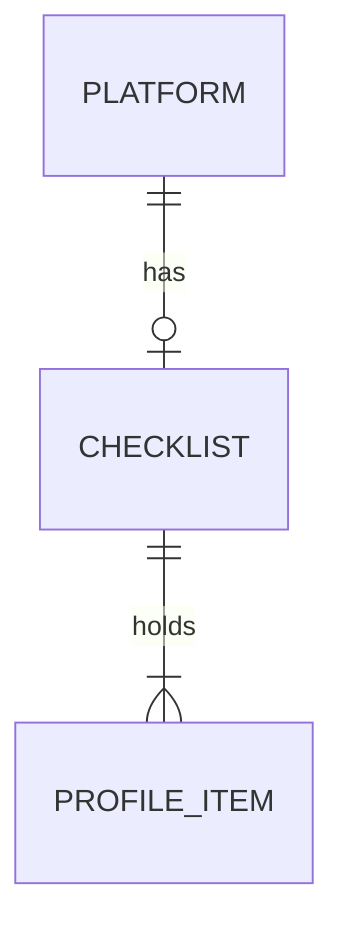

# Feature Specification: Tinder Platform (Guided Profile Move)

**Feature Branch**: `feature/tinder-platform`

**Created**: 2026-11-23

**Status**: Draft

**Input**: User description: "Tinder platform. Spec number should be 14"

**Depends on**: [005 Guided Migration](../005-guided-migration/spec.md). Tinder is one more platform in the shared Guided flow. [004 Platform Picker](../004-multi-platform-picker/spec.md) lists it in the Guided section.

**Related**: [011 Reddit Platform](../011-reddit-platform/spec.md) and [012 Steam Platform](../012-steam-platform/spec.md) are the pattern for a Guided platform spec. Both were cancelled; this spec checks Tinder against the same risks.

## Summary

Tinder has no public API, and its terms forbid any outside app that talks to Tinder without Tinder's written consent. So Tinder cannot be an Automatic platform. Tinder also has nothing to "follow": a match needs both people to like each other, so matches cannot move to a new account by any means.

What a user can move is their own profile: photos, bio, job and school, interests, prompt answers, and discovery preferences. This spec adds Tinder to the Guided section as a profile move. The user requests their data from Tinder on the old account, picks the export file in the app, and works through a checklist of their own profile parts. Each row offers Copy (for text) or Save to photos (for pictures), and the user pastes or picks the item in Tinder on the new account. The app never signs in to Tinder, never calls Tinder, and never reads, shows, or keeps matches or messages.

Tinder allows one account per person at a time. The app MUST tell the user this before they start, and MUST NOT help a banned user make a new account.

## Feasibility

Checked on 2026-11-23 against Tinder's Terms of Use, Community Guidelines, and help center. The plan MUST check each row again against a real export from a test account.

| Question | Answer | Blocks Automatic? | Blocks Guided? |
| --- | --- | --- | --- |
| Does Tinder offer a public API or OAuth for outside apps? | No. The terms forbid using Tinder's API, and building any app that interacts with Tinder or member content, without Tinder's written consent. Unofficial reverse-engineered APIs exist; the constitution forbids them (Principle V). | Yes | No. The app never talks to Tinder. |
| Can matches move to a new account? | No. A match needs both people to swipe right. No tool can create one, and the other person's data is not the user's to move. | Yes | Yes. Out of scope. |
| Does Tinder give an export file? | Yes. Tinder's "request a copy of my personal data" gives a file with account and profile information, preferences, photos, messages, swipes, matches, and purchases. The exact contents vary and were found incomplete by an EU regulator in November 2026. | n/a | No. Only profile parts are read. |
| May one person have two Tinder accounts? | No. The Community Guidelines allow one account per person at a time. Making a new account after a ban breaks the terms. | n/a | Partly. The user must delete or close the old account before making the new one, and banned users are out of scope. |
| Can paid subscriptions (Plus, Gold, Platinum) or Super Likes move? | No. Purchases are tied to the account and the store. | Yes | Yes. Out of scope. |

**Verdict**: Automatic Tinder is not feasible and never will be under the current terms. Guided Tinder is feasible only as a profile move, which is smaller than every other platform's Guided flow. See the open question in FR-TN-001.

## What Tinder items this feature covers

| Item | How the app gets it | What the user does on the new account | Verdict |
| --- | --- | --- | --- |
| Profile photos | Export file | Save to photos, then add in Tinder's photo picker | In scope |
| Bio (About me) | Export file | Copy, then paste | In scope |
| Job title, company, school | Export file | Copy, then paste or pick | In scope |
| Interests, lifestyle, basics (for example height, pets, drinking) | Export file | Pick the same values; the row lists them | In scope |
| Prompt answers | Export file, if present | Copy the answer, pick the same prompt | In scope |
| Discovery preferences (age range, distance, show me) | Export file | Set the same values; the row lists them | In scope |
| Matches, messages, swipes, likes received | n/a | n/a | Not possible, and never read |
| Plus, Gold, Platinum, Super Likes, Boosts | n/a | n/a | Not possible |
| Verified badge | n/a | Verify again in Tinder | Out of scope |

## How the screens connect

Tinder uses the shared Guided flow from spec 005. The intro adds a one-account step. Checklist rows offer Copy or Save to photos in place of opening a profile.

## How a Tinder profile move works, from start to end

## User Scenarios & Testing *(mandatory)*

### User Story 1 - Get my Tinder profile into the app (Priority: P1)

A user wants to start over on a new Tinder account with the same profile. They tap the Tinder card in the Guided section. The intro says, in plain words: Tinder allows one account per person, so delete the old account before making the new one; matches, messages, and paid plans cannot move; the app never asks for the Tinder password, never signs in to Tinder, and never reads matches or messages. The get-your-data screen shows numbered steps with pictures to request a copy of the data on the old account, wait for the download link, and pick the file. The app reads only the profile parts and opens the checklist.

**Why this priority**: Without the profile parts, there is nothing to move.

**Independent Test**: Pick a real export from a test account with 6 photos, a bio, a job, a school, 5 interests, 2 prompt answers, and set preferences. Confirm the checklist shows each part once and shows no match, message, or swipe data.

**Acceptance Scenarios**:

1. **Given** the Tinder card is ready, **When** Home shows, **Then** it is in the Guided section and not in Automatic.
2. **Given** the user opens the Tinder card, **When** the intro shows, **Then** it states the one-account rule, that matches, messages, and paid plans cannot move, and that the app never asks for the password or signs in to Tinder.
3. **Given** the intro shows, **When** the user reads it, **Then** it says a banned account cannot be replaced with a new one, and the user must tap I understand to go on.
4. **Given** the user is on get-your-data, **When** they read the steps, **Then** the steps tell them to download the file before deleting the old account, and each step has a picture with a text alternative.
5. **Given** the user picks a Tinder export, **When** the app reads it, **Then** the checklist lists each profile part, and the app does not read, show, or keep any match, message, swipe, or other person's data.
6. **Given** the user picks a file that is not a Tinder export, or has no profile parts, **When** the app reads it, **Then** it says so in plain words and the user stays on get-your-data.

---

### User Story 2 - Fill in the new profile (Priority: P1)

The user has made the new account. They work through the checklist. Photo rows have Save to photos, which saves the photo to the phone's gallery. Text rows have Copy. Choice rows (interests, basics, preferences) list the values to pick. The user switches to Tinder, adds or pastes the item, comes back, and ticks the row.

**Why this priority**: This is the move itself.

**Independent Test**: With the checklist from Story 1, save all photos, copy the bio and one prompt answer, and confirm each lands unchanged in the gallery or the clipboard. Fill in a test new account and confirm it matches the old profile.

**Acceptance Scenarios**:

1. **Given** a photo row, **When** the user taps Save to photos, **Then** the photo is saved to the gallery in its original quality and a short note confirms it.
2. **Given** the photo rows, **When** the user taps Save all photos, **Then** every photo is saved in profile order.
3. **Given** a text row, **When** the user taps Copy, **Then** the exact text is on the clipboard and a short note confirms it.
4. **Given** a choice row, **When** the user reads it, **Then** it lists each value in Tinder's own words.
5. **Given** the user ticks or skips rows, **When** they look at the progress bar, **Then** it shows ticked and skipped rows against the total.
6. **Given** the checklist shows, **When** the user reads its note, **Then** it reminds them to make sure the old account is deleted before they make the new one.

---

### User Story 3 - Stop and continue later (Priority: P2)

The export link can take a while to arrive, and the user may fill in the profile over several days. The Tinder card shows a Continue note with the count left, and tapping it opens the checklist where they left it. Spec 005 provides this.

**Independent Test**: Tick 4 of 15 rows, close the app, open it, and confirm the Tinder card shows 11 left and the 4 ticks are kept.

**Acceptance Scenarios**:

1. **Given** the user ticked some rows, **When** they close and open the app, **Then** every tick and skip is still there.
2. **Given** Tinder has an unfinished checklist, **When** Home shows, **Then** the Tinder card shows a Continue note with the count of open rows.
3. **Given** the user finishes and taps Clear list, **When** the app clears it, **Then** every saved Tinder photo and text kept by the app is removed. Photos the user saved to the gallery stay there.

---

### Edge Cases

- The export has no photos, or photos are links that expired: photo rows say the photo is missing and the user taps Skip.
- The export has a field Tinder no longer offers (for example an old prompt): the row says Tinder may not offer it any more, and the user can copy the text or skip.
- The export is in another language than the new account: choice values show as in the file. The guide says Tinder may name them differently.
- The export holds more than 9 photos (old photos): the app shows only the photos marked as current profile photos when the file says which; otherwise all, in file order, and the note says Tinder allows a limited number.
- The user picks the export of someone else: the app cannot tell and treats it as the user's own. The intro says to use only one's own export.
- The user has not deleted the old account yet: the app cannot check this and only reminds the user.
- The user was banned: the intro says the app cannot help. The app has no way to check and does not try.
- The gallery permission is denied: Save to photos says so in plain words and offers the settings link. Copy still works.
- Tinder changes the export format: the file check fails, the app says so, and the owner updates the reader.

## Requirements *(mandatory)*

### Functional Requirements

- **FR-TN-001**: Scope of Tinder support MUST follow the answer to this question: [NEEDS CLARIFICATION: Tinder cannot move matches, and its one-account rule means a "move" is really a profile rebuild after deleting the old account. Should Tinder ship as a Guided profile move (this spec), or be cancelled like 011 and 012? A: ship the Guided profile move. B: cancel; record the research. C: ship only a short guide card (how to request the export and the one-account rule) with no file reading.]
- **FR-TN-002**: The Tinder card MUST appear in the Guided section of Home through the one list of platforms (spec 004, FR-001), only once its guide and file reader are checked against a real export from a test account (spec 005, FR-001). It MUST NOT appear in the Automatic section.
- **FR-TN-003**: Tapping the Tinder card MUST open the shared Guided flow (spec 005, FR-002) with Tinder's guide text, pictures, and file reader. Tinder MUST NOT get Tinder-only screens, except the row actions in FR-TN-008.
- **FR-TN-004**: The intro MUST state: Tinder allows one account per person at a time; delete the old account before making the new one; download the data first; matches, messages, swipes, and paid plans cannot move; a banned account cannot be replaced; and the app never asks for the Tinder password or signs in to Tinder. The user MUST tap I understand to go on.
- **FR-TN-005**: The get-your-data screen MUST show numbered steps to request the data copy on the old account, download it, and pick it, and MUST say to download it before deleting the old account. It MUST offer Pick file.
- **FR-TN-006**: The app MUST read the export on the phone only and MUST read only the user's own profile parts listed in the Tinder section. It MUST NOT read, show, keep, or log matches, messages, swipes, likes, other people's names or photos, purchases, or usage data.
- **FR-TN-007**: The checklist MUST group rows in this order: photos (in profile order), text (bio, job, company, school, prompt answers), choices (interests, basics, lifestyle), discovery preferences.
- **FR-TN-008**: Photo rows MUST offer Save to photos, and the photo group MUST offer Save all photos. Text rows MUST offer Copy. Choice and preference rows MUST list the values. These replace spec 005's "open in the other app" row action for Tinder. Every action MUST have an icon, a label, and an accessibility label (spec 005, FR-024).
- **FR-TN-009**: Save to photos MUST save the photo unchanged. Copy MUST put the exact text on the clipboard and nothing else. Both MUST show a short confirmation.
- **FR-TN-010**: The checklist note MUST remind the user that the old account must be deleted before they make the new one.
- **FR-TN-011**: The app MUST NOT ask for or keep the Tinder password, sign in to Tinder, call any Tinder endpoint, open a hidden browser, or tap anything in Tinder for the user (spec 005, FR-012 and FR-013; constitution Principle V).
- **FR-TN-012**: The app MUST keep only the profile parts it shows, on the phone only (spec 005, FR-018). Clear list, Start again, and Delete all in Settings MUST remove the kept photos and text.
- **FR-TN-013**: Settings MUST say that Magpie is not made by or linked with Tinder or Match Group. The Tinder logo MUST be the official mark, unmodified, used only to name the platform.
- **FR-TN-014**: The feature MUST work the same way on Android and iOS, following spec 005's Platform differences table and the rows added below.

### Platform differences (Android and iOS)

These rows add to spec 005's table.

| Area | Android | iOS |
| --- | --- | --- |
| Save to photos | Saves to the gallery. Newer Android versions need no permission to add a photo; older ones ask. The plan checks which. | Asks for add-only photo access the first time. The app MUST NOT ask for full photo library access. |
| Copy | System clipboard. Newer Android versions show their own copied note; the app's note MUST NOT repeat it twice. | System clipboard. |
| Pick the export file | Same as spec 005. | Same as spec 005. |

### Key Entities *(include if feature involves data)*

Tinder adds one row kind to spec 005's entities.

- **Platform**: Tinder is a new entry in the list of platforms, in the Guided section.
- **Profile Item**: One part of the user's own profile, with its group (photo, text, choice, preference), its label, its value (text, list of values, or photo), its order, and its state (open, ticked, skipped). It takes the place of spec 005's Follow Item for Tinder.

## Tinder section *(platform-specific)*

- **Sign-in**: none. Tinder offers no sign-in for outside apps.
- **Export**: Tinder app, Settings, request a copy of personal data (wording varies by region). Tinder emails a download link. The guide gives the current steps and the usual wait.
- **Parts read from the export**: profile photos, bio, job title, company, school, interests, basics and lifestyle values, prompt answers when present, and discovery preferences (age range, distance, show me). Everything else in the file is skipped without being read into the app's saved data.
- **One account rule**: from Tinder's Community Guidelines, one person may have one account at a time. Making a new account after a ban breaks the terms.
- **No network use**: this feature adds no host. Only the guide fetch from spec 005 (FR-021) applies.

## Success Criteria *(mandatory)*

### Measurable Outcomes

- **SC-001**: A user with the export file in hand goes from tapping the Tinder card to the first ticked row in under 3 minutes.
- **SC-002**: For a real test export, the checklist shows 100% of the profile parts listed in the Tinder section, and 0 items of match, message, swipe, or other people's data.
- **SC-003**: In a check of the app's network use during the whole Tinder flow, no request goes to a Tinder host and no request carries export contents.
- **SC-004**: 100% of saved photos are identical to the photos in the export, and 100% of copied texts match the export exactly.
- **SC-005**: In testing, at least 9 of 10 users can say, after the intro, that they must delete the old account first and that matches do not move.
- **SC-006**: Adding Tinder needs no change to Home or the Guided flow beyond the new platform entry, its guide, its file reader, and the Copy and Save row actions.

## Assumptions

- Spec 005 (Guided flow) is planned and built before Tinder ships.
- The user can get Tinder's export on a phone, or on a computer and send it to the phone.
- The export holds the profile parts listed above. The plan confirms this against a real export; fields that are missing are dropped from scope, not guessed.
- The user is not banned and follows the one-account rule. The app cannot check either.
- Copy and Save to photos are enough; the app does not add photos to Tinder or paste into it.
- A future Tinder partner program with written consent would need a new spec.

## What the project owner needs to do

1. **Answer the open question** in FR-TN-001 (run `/speckit-clarify`).
2. **Test export**: on a test Tinder account with a full profile, request a copy of the data and keep the file for the plan. Do not commit it; it holds personal data.
3. **Read the terms**: read Tinder's current [Terms of Use](https://policies.tinder.com/terms) and [Community Guidelines](https://policies.tinder.com/community-guidelines) and confirm that a tool which only reads the user's own export file, and never talks to Tinder, does not need Tinder's written consent. If unsure, ask a lawyer before shipping.
