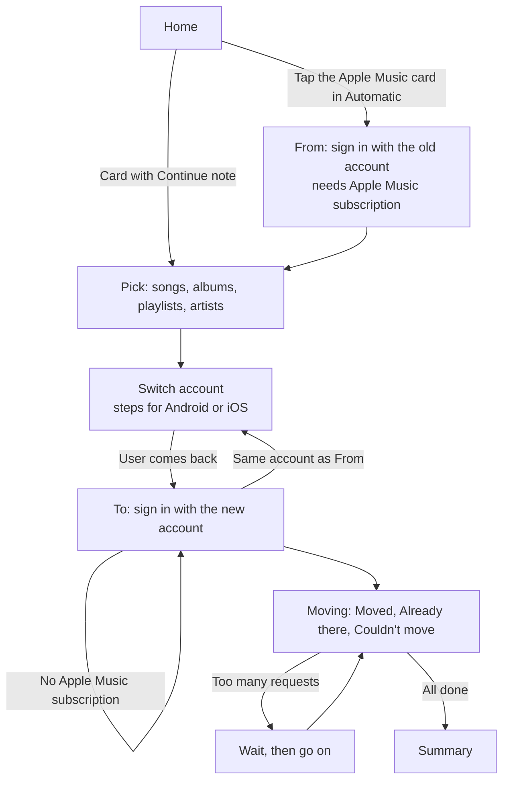
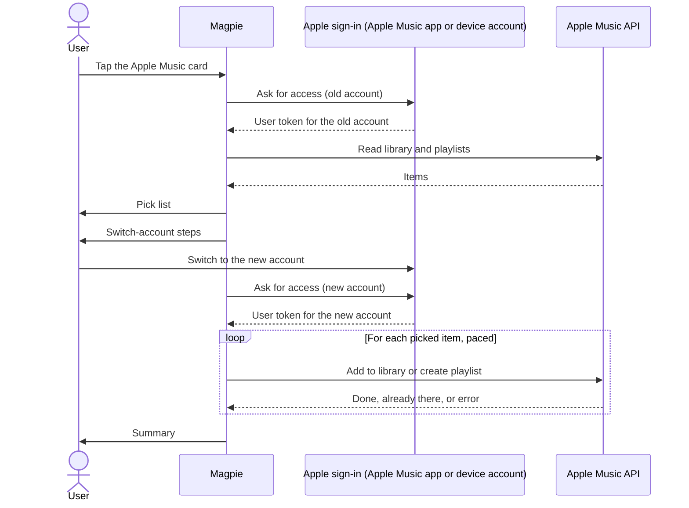
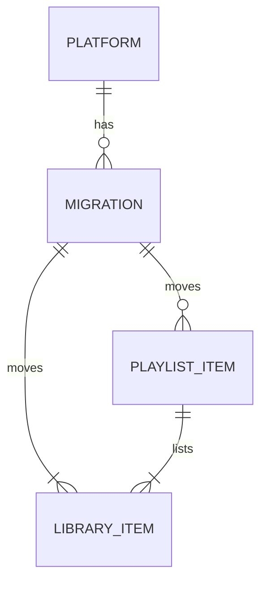

# Feature Specification: Apple Music Platform

**Feature Branch**: `feature/apple-music-platform`

**Created**: 2026-11-23

**Status**: Draft

**Input**: User description: "Apple Music"

**Related**: [004 Platform Picker](../004-multi-platform-picker/spec.md) adds the card to Home. [001 Subscription Migration](../001-subscription-migration/spec.md) defines the Automatic flow that Apple Music reuses. [008 GitHub Platform](../008-github-platform/spec.md) is the pattern for an Automatic platform spec. [007 Spotify Platform](../007-spotify-platform/spec.md) was cancelled for access limits; this spec checks Apple Music against the same risks. [006 Paid API Credits](../006-paid-api-credits/spec.md) holds the earlier platform pricing research.

## Summary

Apple Music becomes an Automatic platform. A user who moves to a new Apple Account (for example a new family member account, a new region, or a new email) wants their music library on the new account. The user picks the Apple Music card on Home, signs in with the old account, picks what to move, signs in with the new account, and taps Move. The app adds the picked items to the new account's library through Apple's official Apple Music API. The screens, steps, row states, saved progress, and Settings work the same way as for YouTube and GitHub. Only the platform-specific parts differ: sign-in, what can be moved, the limits, and the words for the items.

Apple Music has no "follow" in the YouTube sense. The closest items are the user's library (songs and albums), the playlists the user made, and favorite artists. Purchases, listening history, and recommendations stay with the old account.

## Clarifications

Open questions are marked `[NEEDS CLARIFICATION]` in Feasibility and Requirements. They are listed here for `/speckit-clarify`.

## Feasibility

Checked on 2026-11-23 against Apple's developer documentation and developer forums. The plan MUST check each row again with two test accounts.

| Question | Answer | Blocks the feature? |
| --- | --- | --- |
| Is there an official API? | Yes. The Apple Music API reads and adds to a user's library. | No |
| Does access cost money? | Yes. Every request needs a developer token, which needs a paid Apple Developer Program membership (99 USD per year). The API itself has no per-request fee. | Owner decision. See FR-AM-001. |
| Is there a test-user cap or app review for the API? | No user cap and no separate API review is documented. The iOS app still goes through normal App Review. | No |
| Do both accounts need a paid Apple Music subscription? | Yes. A user token is issued only to an account with an active Apple Music subscription, and a library exists only with Sync Library on. | No, but the intro MUST say so (FR-AM-004). |
| How does the user sign in on Android? | Through Apple's MusicKit for Android, which hands sign-in to the Apple Music app. The Apple Music app MUST be installed and signed in to the account being read or written. Forum reports show this sign-in broke after some Apple Music app updates. | Risk. The plan MUST test it against the current Apple Music app. |
| How does the user sign in on iOS? | MusicKit uses the Apple Account signed in under Media & Purchases on the device. The app cannot sign in to a second account by itself. | Risk. See FR-AM-006. |
| Can the app switch between two accounts? | Not inside the app on either system. The user switches the account in the Apple Music app (Android) or in device Settings (iOS) between the From and To steps. | No, but it adds a guided switch step (FR-AM-006). |
| Can the app read the old library? | Yes: library songs, albums, artists, and playlists. | No |
| Can the app add songs and albums to the new library? | Yes, by catalog item. | No |
| Can the app make playlists on the new account? | Yes. It can create a playlist and add songs to it. It cannot edit or delete a playlist afterwards. | No, but a failed move cannot be undone, so the app MUST NOT make duplicates (FR-AM-011). |
| Can the app add favorite artists? | Apple documents an "add resource to favorites" request. Whether it accepts artists, and whether favorite artists can be read from the old account, is not confirmed; a forum answer calls reading them private. | Partly. Favorite artists are in scope only if the plan confirms both. |
| Are there speed limits? | Apple does not publish them. The API answers "too many requests" when a limit is hit. | No. The app paces itself and waits (FR-AM-012). |
| Do Apple's terms allow this use? | The Apple Music API terms allow apps to add to a user's library with the user's consent. Copying the library to another account is not named as allowed or forbidden. | Risk. The owner reads the terms before release. |

**Verdict**: Automatic Apple Music is feasible if the owner pays for the Apple Developer Program. The main risks are the in-between account switch and the Android sign-in through the Apple Music app.

## What Apple Music supports

| Item | Read from old account | Add to new account | Verdict |
| --- | --- | --- | --- |
| Library songs from the catalog | Yes | Yes | In scope |
| Library albums from the catalog | Yes | Yes | In scope |
| Playlists the user made | Yes, with their song order | Yes, as new playlists | In scope |
| Favorite artists | Not confirmed | Not confirmed | In scope only if the plan confirms both |
| Playlists by Apple or other users that the user added | Yes | Yes, by catalog item | In scope, added as the same shared playlist |
| Songs the user uploaded or matched from their own files | Partly | No. They are not in the catalog. | Not possible. Listed as Couldn't move with the reason. |
| Purchases (iTunes Store) | n/a | No. Purchases stay with the buying account. | Not possible |
| Listening history, Replay, recommendations, loves and dislikes | Partly | No | Out of scope |
| Playlist folders, cover art, descriptions | Partly | No | Out of scope. Playlists move without folders. |

## How the screens connect

Apple Music uses the shared Automatic flow from spec 001 and 004. It adds one switch-account screen between From and To.

## How an Apple Music move works, from start to end

## User Scenarios & Testing *(mandatory)*

### User Story 1 - Read my old Apple Music library (Priority: P1)

A user wants their music on a new Apple Account. They tap the Apple Music card in the Automatic section. The intro says, in plain words, that both accounts need an Apple Music subscription with Sync Library on, that the app never asks for the Apple Account password, and, on Android, that the Apple Music app must be installed. The user signs in with the old account. The app reads the library songs, albums, playlists the user made or added, and favorite artists when supported, and shows them in the Pick list in groups.

**Why this priority**: Without the old library there is nothing to move.

**Independent Test**: With a test account that has 50 songs, 10 albums, 3 own playlists, and 1 added Apple playlist, sign in and confirm the Pick list shows every item once, in its group, with counts.

**Acceptance Scenarios**:

1. **Given** the Apple Music card is ready, **When** Home shows, **Then** it is in the Automatic section with the official Apple Music mark and name.
2. **Given** the user opens the card, **When** the intro shows, **Then** it states the subscription and Sync Library need, the password rule, and on Android the Apple Music app need.
3. **Given** the old account has no active Apple Music subscription, **When** the user signs in, **Then** the app says so in plain words and offers to try again.
4. **Given** the Android phone has no Apple Music app, **When** the user taps Sign in, **Then** the app says so and offers to open the store page for the Apple Music app.
5. **Given** the library is read, **When** the Pick list shows, **Then** items are grouped as Songs, Albums, Playlists, and Artists (when supported), each with a count, and an item that only lives on the old account (an uploaded song) shows that it cannot move.
6. **Given** the library is large (5,000 songs), **When** the app reads it, **Then** it shows progress and the user can cancel.

---

### User Story 2 - Move my picks to the new account (Priority: P1)

The user picks what to move, follows the switch-account steps, and signs in with the new account. The app adds the songs and albums to the new library, makes each picked playlist with the same name and song order, and marks each row Moved, Already there, or Couldn't move with a reason.

**Why this priority**: This is the move itself.

**Independent Test**: Move the test library from Story 1 to an empty test account. Confirm the new library has the same catalog songs and albums, and each playlist has the same name and song order.

**Acceptance Scenarios**:

1. **Given** the user has picked items, **When** they tap Next, **Then** the switch-account screen shows numbered steps for their system (Android or iOS) and a button to open the right place.
2. **Given** the user signs in with the same account as From, **When** the app checks, **Then** it says this is the same account and shows the switch steps again.
3. **Given** a picked song is already in the new library, **When** the app moves it, **Then** the row shows Already there and nothing is added twice.
4. **Given** a playlist with 120 songs, **When** the app moves it, **Then** the new account has one playlist with the same name and the same songs in the same order.
5. **Given** a playlist has songs not in the new account's storefront (region), **When** the app moves it, **Then** the playlist is made with the songs that exist, and the row says how many were left out.
6. **Given** Apple answers too many requests, **When** the app gets that answer, **Then** it waits and goes on by itself, and the screen says it is waiting.

---

### User Story 3 - Stop and continue later (Priority: P2)

A large library takes time, and the user may close the app or lose the connection. The Apple Music card shows a Continue note with the count left, and tapping it opens the move where it stopped. Spec 004 provides this.

**Independent Test**: Start moving 500 songs, close the app after 100, open it, and confirm the card shows 400 left and the move goes on without adding the first 100 again.

**Acceptance Scenarios**:

1. **Given** a move stopped part way, **When** the user opens the app, **Then** the card shows a Continue note with the count left.
2. **Given** a playlist was made but not every song was added before the stop, **When** the move goes on, **Then** the app adds the rest to that same playlist and does not make a second one.
3. **Given** the user signed out of the new account in between, **When** the move goes on, **Then** the app asks the user to switch back and sign in again before it adds anything.

---

### Edge Cases

- The old and new accounts are in different regions: catalog items not sold in the new region show Couldn't move, Not available in your region.
- A song was removed from the catalog: Couldn't move, No longer on Apple Music.
- The user turned off Sync Library on the new account: the first add fails, and the app says to turn Sync Library on, with the steps.
- The user's Apple Music subscription ends during the move: the app stops, keeps progress, and says why.
- The Android sign-in returns cancelled even though the user signed in (known Apple Music app issue): the app says sign-in did not finish and offers to try again; the plan decides if it also shows a known-issue note.
- On iOS the user does not want to change the device's Media & Purchases account: the switch screen says what that change affects before the user does it.
- A playlist name is already used on the new account: the app makes the playlist anyway, because Apple allows repeated names, and the row says a playlist with this name already existed.
- Two playlists on the old account have the same name: each moves as its own playlist.
- A token expires during a long move: the app asks the user to sign in again and goes on.

## Requirements *(mandatory)*

### Functional Requirements

- **FR-AM-001**: Apple Music needs a paid Apple Developer Program membership (99 USD per year), paid by the project owner, while the app stays free. [NEEDS CLARIFICATION: Does the project owner accept this yearly fee for Apple Music? Options: A) yes, pay it; B) no, cancel the spec like Spotify; C) wait until the iOS release, which needs the membership anyway.]
- **FR-AM-002**: The Apple Music card MUST appear in the Automatic section of Home through the one list of platforms (spec 004, FR-001), only once the move works end to end with two test accounts on Android and iOS.
- **FR-AM-003**: Tapping the card MUST open the shared Automatic flow (spec 001 and 004) with Apple Music's sign-in, item kinds, and limits. Apple Music MUST NOT get its own screens, except the switch-account screen in FR-AM-006.
- **FR-AM-004**: The intro MUST state: both accounts need an active Apple Music subscription with Sync Library on; the app never asks for the Apple Account password; purchases, listening history, and uploaded songs do not move; and, on Android, the Apple Music app must be installed.
- **FR-AM-005**: Sign-in MUST use only Apple's official MusicKit sign-in for the system (Apple Music app on Android, device account on iOS). The app MUST ask only for access to the user's Apple Music library and MUST NOT ask for or keep the Apple Account password.
- **FR-AM-006**: Between From and To, the app MUST show a switch-account screen with numbered steps for the user's system and a button that opens the right place (Apple Music app on Android, device Settings on iOS). On iOS the screen MUST say what changing the Media & Purchases account affects before the user changes it. [NEEDS CLARIFICATION: On iOS, changing the device's Media & Purchases account can affect purchases and downloads, and Apple may block switching back for up to 90 days. Options: A) accept the device switch with a clear warning; B) on iOS use Apple's web sign-in for Apple Music, which signs in to any account without changing the device; C) ship Apple Music on Android only first and decide iOS later.]
- **FR-AM-007**: The To step MUST refuse the same account as From and say so in plain words.
- **FR-AM-008**: The app MUST read library songs, library albums, playlists the user made or added, and favorite artists when the plan confirms they can be read and added. Items that cannot move (uploaded or matched songs, removed songs) MUST show in the Pick list as not movable with the reason, and MUST NOT count as picked.
- **FR-AM-009**: The Pick list MUST group items as Songs, Albums, Playlists, and Artists (when supported), with counts, search, and All, as in the shared flow.
- **FR-AM-010**: Moving a song or album MUST add it to the new library. Moving a playlist MUST make one new playlist with the same name and add its catalog songs in the same order. An added Apple or shared playlist MUST be added as the same playlist, not copied.
- **FR-AM-011**: The app MUST save after each step which playlist it made and how many songs it added, so a stop or crash never makes a second playlist or adds a song twice.
- **FR-AM-012**: The app MUST pace its requests, wait and go on by itself when Apple answers too many requests, and show that it is waiting. It MUST NOT retry faster than Apple asks.
- **FR-AM-013**: Each row MUST end as Moved, Already there, or Couldn't move, with a plain reason for Couldn't move (not in your region, no longer on Apple Music, not from the catalog, Sync Library off, subscription ended).
- **FR-AM-014**: Tokens MUST stay on the phone only, in the system's secure storage, and MUST be deleted on sign-out, Start again, and Delete all in Settings. The developer token's private key MUST NOT ship in the app or be committed; how the app gets a developer token is a plan decision.
- **FR-AM-015**: Settings MUST say that Magpie is not made by or linked with Apple. The Apple Music mark MUST be the official mark, unmodified, used only to name the platform, following Apple's marketing guidelines.
- **FR-AM-016**: The feature MUST work on Android and iOS, following the Platform differences table below.

### Platform differences (Android and iOS)

| Area | Android | iOS |
| --- | --- | --- |
| Sign-in | MusicKit for Android hands sign-in to the Apple Music app, which must be installed and signed in. | MusicKit uses the device's Media & Purchases Apple Account (see FR-AM-006 for the open question). |
| Switch account | Sign out and in again in the Apple Music app. | Change the Media & Purchases account in Settings, unless FR-AM-006 chooses web sign-in. |
| Token renewal | The app keeps and renews the user token itself. | The system renews the user token. |
| Missing Apple Music app | Offer the store page. | Not needed; Apple Music is built in. |

### Key Entities *(include if feature involves data)*

Apple Music adds item kinds to the entities of spec 001 and 004.

- **Platform**: Apple Music is a new entry in the list of platforms, in the Automatic section.
- **Library Item**: One song, album, or favorite artist from the old account, with its catalog identity, name, artist, kind, and move state.
- **Playlist Item**: One playlist from the old account, with its name, kind (made by the user, or added from Apple or another user), its songs in order, the new playlist once made, and how many songs were added.

## Adaptive layout

The new switch-account screen uses the default centered column (constitution Principle VI). Other screens are the shared Automatic flow and keep their layout from spec 010.

## Apple Music section *(platform-specific)*

- **Sign-in**: MusicKit user token on top of a developer token. The developer token is signed with a MusicKit private key from the Apple Developer account and lasts at most 6 months.
- **Items**: library songs, albums, playlists, and (if confirmed) favorite artists. Catalog identity and storefront (region) decide if an item can be added.
- **Limits**: not published. Apple answers too many requests when a limit is hit.
- **Playlists**: the API can make a playlist and add songs, but cannot rename, reorder, or delete it.
- **Network**: adds Apple's Apple Music API host and, on iOS web sign-in if chosen, Apple's sign-in host.

## Success Criteria *(mandatory)*

### Measurable Outcomes

- **SC-001**: A user with both accounts ready moves a library of 500 songs, 50 albums, and 10 playlists with no more than 10 taps, not counting sign-in and the account switch.
- **SC-002**: After a move between two accounts in the same region, 100% of movable picked items are in the new library, and every playlist has the same name and song order.
- **SC-003**: Stopping and restarting a move at any point makes 0 repeated playlists and 0 songs added twice.
- **SC-004**: 100% of items that could not move show a reason the user can act on or understand.
- **SC-005**: In testing, at least 9 of 10 users finish the account switch on the first try using only the switch-account steps.
- **SC-006**: Adding Apple Music needs no change to Home or the Automatic flow beyond the new platform entry, its sign-in, its item kinds, and the switch-account screen.

## Assumptions

- The project owner has or gets an Apple Developer Program membership (see FR-AM-001).
- Both accounts have an active Apple Music subscription with Sync Library on. Apple Music Voice or trial plans count if Apple issues a user token for them.
- Most users move within one region; cross-region moves are allowed but lose items not sold in the new region.
- The move goes one way, from the old account to the new account. Merging two libraries both ways is out of scope.
- Moving to another music service (for example Apple Music to YouTube Music) is out of scope and needs its own spec.
- Favorite artists move only if the plan confirms the API can read and add them; otherwise they are dropped from scope, not guessed.

## What the project owner needs to do

These steps need your Apple account and cannot be done by an agent.

1. **Apple Developer Program**: join (99 USD per year) if you have not, once FR-AM-001 is answered.
2. **MusicKit key**: in the Apple Developer account, create a Media ID with MusicKit and a private key for it. Keep the key file off the repository and out of the app.
3. **Test accounts**: two Apple Accounts with an active Apple Music subscription (a family plan covers both) and Sync Library on, with a small test library on the old one.
4. **Android**: the Apple Music app on the Android test phone.
5. **Terms**: read the current Apple Music API and MusicKit terms and confirm that copying a user's own library to their other account, with their consent, is allowed.
