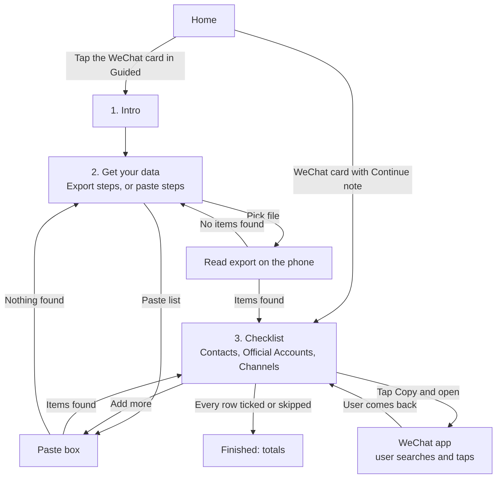
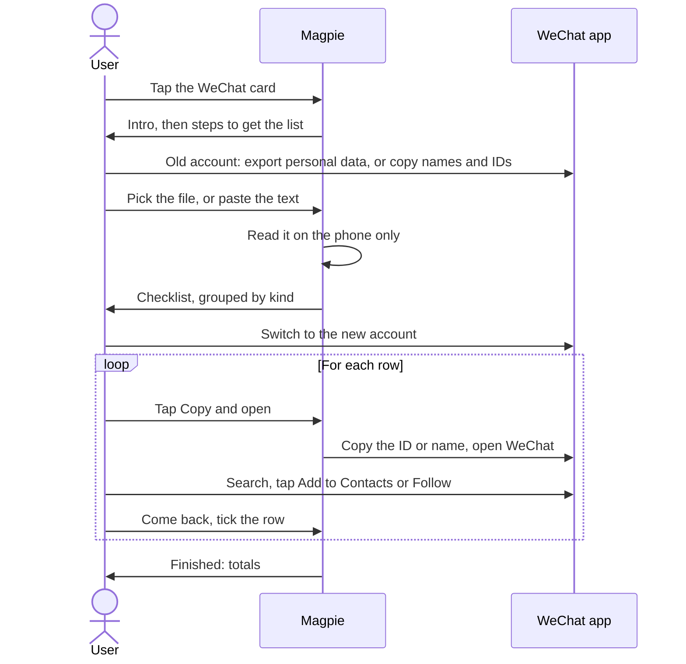

# Feature Specification: WeChat Platform (Guided)

**Feature Branch**: `feature/wechat-platform`

**Created**: 2026-11-23

**Status**: Cancelled. WeChat has no API, and every row needs copy, switch app, search, and a friend request the other person must accept, so the app adds too little value.

**Input**: User description: "wechat, WhatsApp, QQ, douyin. Spec number is 15 onwards" (this spec covers WeChat)

**Depends on**: [005 Guided Migration](../005-guided-migration/spec.md). WeChat is one more platform in the shared Guided flow. [004 Platform Picker](../004-multi-platform-picker/spec.md) lists it in the Guided section.

**Related**: [012 Steam Platform](../012-steam-platform/spec.md) designed the paste box this spec reuses. [014 Tinder Platform](../014-tinder-platform/spec.md) is the latest Guided platform spec. [016 WhatsApp](../016-whatsapp-platform/spec.md), [017 QQ](../017-qq-platform/spec.md), and [018 Douyin](../018-douyin-platform/spec.md) were written at the same time and share the questions on Chinese text and on rows that cannot open a profile by link.

## Summary

WeChat (called Weixin in mainland China) has no API that lets an outside app add a contact, follow an Official Account, or follow a Channels account for a user. WeChat sign-in for outside apps gives the user's nickname and picture only. So WeChat cannot be an Automatic platform.

This spec adds WeChat to the Guided section. The user builds a list of what the old account has (contacts, Official Accounts, Channels accounts), from WeChat's personal data export where it holds that data, or by pasting names and IDs. The user then works through a checklist. WeChat does not let an outside app open a person's or an account's page by link, so each row copies the ID or name and opens WeChat, where the user searches for it and taps Add to Contacts or Follow on the new account.

The app never signs in to WeChat, never calls WeChat, never reads WeChat's files on the phone or a computer, and never taps for the user.

## Why cancelled

The project owner cancelled this spec on 2026-11-23. Automatic WeChat is not possible (see Feasibility). In the Guided flow, WeChat profiles cannot be opened by link, so each row needs copy, switch app, search, and tap, and friend requests need the other person to accept. The user can do the same in WeChat without the app. The spec is kept as a record of the research and the design, in case the owner revisits it.

## Clarifications

### Session 2026-11-23

- Q: WeChat cannot be automated and every row needs copy and search. Ship as Guided, or cancel? → A: Cancel.

## Feasibility

Checked on 2026-11-23 against WeChat Open Platform docs and public reports. Rows marked *unconfirmed* MUST be checked in the plan against real test accounts.

| Question | Answer | Blocks Automatic? | Blocks Guided? |
| --- | --- | --- | --- |
| Can an outside app add contacts, follow Official Accounts, or follow Channels for a user? | No. The Open Platform has no such method. | Yes | No. The user taps the button. |
| What does WeChat sign-in give an outside app? | WeChat Login with scope `snsapi_userinfo` gives the user's openid, unionid, nickname, gender, region, and picture. No contact list, no follows. A mobile app must be registered and approved on the Open Platform first. | Yes | No. Guided does not sign in. |
| Can an outside app read the contact list or the followed Official Accounts? | No official method found. Tools that read WeChat's local database on a computer exist, but they break the constitution (Principle V) and Tencent has had such tools taken down. | n/a | Partly. The user pastes the list. |
| Does WeChat give a personal data export? | Yes, since version 8.0.16: Me > Settings > Privacy > Personal Information & Permissions > Export personal data. A download link goes to the bound email and must be confirmed with a scan in WeChat; it expires after 3 days. Reports say the international WeChat export includes contacts data while the mainland Weixin export holds profile data only. Format and whether Official Accounts and Channels follows are included: *unconfirmed*. | n/a | No. Paste is the fallback. |
| Can a row open a contact, Official Account, or Channels page by link from outside WeChat? | No reliable way found. WeChat does not publish links that open a profile from another app. | n/a | No. Rows use copy and search. |
| Does WeChat limit friend requests? | Yes. WeChat limits how many friend requests an account sends, more strictly for new accounts, and may restrict accounts that add many people fast. Numbers are not published. | n/a | No. The guide tells the user to go slowly. |
| May one person have two accounts on one phone? | WeChat lets the user switch between accounts in Settings (limit *unconfirmed*). Each account needs its own phone number. | n/a | No |
| Can chat history, groups, Moments, Favorites, Stickers, mini programs, or WeChat Pay move? | No. WeChat's own chat migration moves history between devices for the same account only. A group needs a member to invite the new account. | Yes | Yes. Out of scope. |

**Verdict**: Automatic WeChat is not feasible. Guided WeChat is feasible with copy-and-search rows. It needs no WeChat developer account, because the app never talks to WeChat.

## What WeChat items this feature covers

| Item | How the app gets it | What the user does on the new account | Verdict |
| --- | --- | --- | --- |
| Contacts | Export file (if it holds them) or pasted WeChat IDs | Search the WeChat ID, tap Add to Contacts. The other person must accept. | In scope |
| Official Accounts | Export file (if it holds them) or pasted names | Search the name, tap Follow | In scope |
| Channels accounts | Pasted names | Search the name, tap Follow | In scope |
| Group chats | n/a | Ask a member to invite the new account | Out of scope. The guide says this in one line. |
| Chat history, Moments, Favorites, Stickers, mini programs, WeChat Pay balance and cards | n/a | n/a | Not possible |

## How the screens connect

## How a WeChat move works, from start to end

## User Scenarios & Testing *(mandatory)*

### User Story 1 - Get my WeChat list into the app (Priority: P1)

A user wants to move from an old WeChat account to a new one. They tap the WeChat card in the Guided section. The intro says the app never asks for the WeChat password, never signs in to WeChat, never reads WeChat's files, and never taps for them, and that chats and groups cannot move. The get-your-data screen shows two ways: export personal data from the old account and pick the file, or paste a list of WeChat IDs and names. The app reads the file or text and opens the checklist.

**Why this priority**: Without a list, there is nothing to move.

**Independent Test**: Paste a text with 5 WeChat IDs marked as contacts and 3 names marked as Official Accounts, plus blank lines and duplicates. Confirm the checklist shows 8 rows of the right kinds. If the plan confirms the export holds contacts, pick a real test export and confirm every contact shows once.

**Acceptance Scenarios**:

1. **Given** the WeChat card is ready, **When** Home shows, **Then** it is in the Guided section and not in Automatic.
2. **Given** the user opens the WeChat card, **When** the intro shows, **Then** it says the app never asks for the password, never signs in to WeChat, never reads WeChat's files, never taps for them, and that chats, groups, and payments cannot move.
3. **Given** the user is on get-your-data, **When** they read the steps, **Then** each step has a picture with a text alternative and uses WeChat's current wording.
4. **Given** the user pastes text and chooses a kind for it, **When** the app reads it, **Then** each non-empty line becomes one item of that kind, and duplicate lines show once.
5. **Given** the user picks a file that is not a WeChat export, or an export with no items in scope, **When** the app reads it, **Then** it says so in plain words and the user stays on get-your-data.
6. **Given** a checklist already exists, **When** the user taps Add more and pastes again, **Then** new items are added, items already in the list are not added twice, and existing ticks and skips are kept.

---

### User Story 2 - Add the items on the new account (Priority: P1)

The user switches WeChat to the new account, then works through the checklist. Each row shows the name or ID, the kind, and the button to tap in WeChat. Tapping Copy and open copies the ID or name and opens WeChat. The user searches, taps Add to Contacts or Follow, comes back, and ticks the row.

**Why this priority**: This is the move itself.

**Independent Test**: With WeChat signed in to a test new account, tap Copy and open on one row of each kind, paste into WeChat search, tap the named button, tick each row, and confirm the new account has a sent friend request and the two follows.

**Acceptance Scenarios**:

1. **Given** the checklist shows, **When** the user taps Copy and open on a row, **Then** the row's ID or name is on the clipboard and WeChat opens, and a short note says "Copied. Paste it in WeChat search."
2. **Given** WeChat is not installed, **When** the user taps Copy and open, **Then** the text is still copied and a plain note says WeChat is not installed.
3. **Given** a row shows, **When** the user reads it, **Then** it names the button to tap in WeChat: Add to Contacts or Follow.
4. **Given** the checklist shows, **When** the user reads its note, **Then** it says to switch WeChat to the new account first, that a friend request needs the other person to accept, and that adding many contacts fast can get the new account limited, so go slowly.
5. **Given** a move ran, **When** the user checks the old account, **Then** nothing on it has changed.

---

### User Story 3 - Stop and continue later (Priority: P2)

A user with 300 contacts adds 20 a day to stay under WeChat's limits. The WeChat card shows a Continue note with the count left, and tapping it opens the checklist where they left it. Spec 005 provides this.

**Independent Test**: Tick 5 of 20 rows, close the app, open it, and confirm the WeChat card shows 15 left and the 5 ticks are kept.

**Acceptance Scenarios**:

1. **Given** the user ticked some rows, **When** they close and open the app, **Then** every tick and skip is still there.
2. **Given** WeChat has an unfinished checklist, **When** Home shows, **Then** the WeChat card shows a Continue note with the count of open rows.

---

### Edge Cases

- A contact turned off "Add me by WeChat ID": search finds nothing. The user taps Skip. The guide says the user can ask that person to add the new account instead.
- A contact has no WeChat ID set, only a nickname: the user pastes the nickname, but WeChat search by nickname does not find people. The row note says to ask the person, and the user can skip it.
- A contact asks a verification question or ignores the request: the row is still ticked when the request is sent. The app does not track acceptance.
- An Official Account was closed or renamed: search finds nothing or a different account. The user checks the name and picture, or taps Skip.
- Two Official Accounts have the same name: the row shows the ID too when the export gives it.
- The new account is limited by WeChat for adding too many people: WeChat shows its own message. The user stops and continues another day (User Story 3).
- The pasted text has the same line many times, extra spaces, or full-width characters: each item shows once.
- WeChat is still signed in to the old account: the user may add items to the wrong account. The app cannot check this and only reminds the user (spec 005, FR-014).
- The export link expired (after 3 days): the guide says to request a new export.
- WeChat changes its export format: the app says the file is not the expected export, and the paste path still works.

## Requirements *(mandatory)*

### Functional Requirements

- **FR-WC-001**: The WeChat card MUST appear in the Guided section of Home through the one list of platforms (spec 004, FR-001), only once its guide and readers are ready and checked against real test accounts (spec 005, FR-001). It MUST NOT appear in the Automatic section.
- **FR-WC-002**: Tapping the WeChat card MUST open the shared Guided flow (spec 005, FR-002) with WeChat's guide text, pictures, and readers. WeChat MUST NOT get WeChat-only screens, except the paste box and copy-and-search rows below, which are shared with every Guided platform that needs them.
- **FR-WC-003**: The get-your-data screen MUST offer Paste list, and MUST offer Pick file only if the plan confirms that a WeChat export holds contacts or follows. It MUST show numbered steps with pictures for each offered way.
- **FR-WC-004**: The paste box MUST accept free text up to at least 1 MB, MUST let the user choose the kind for each paste (Contacts, Official Accounts, or Channels, with Contacts as the default), and MUST turn each non-empty line into one item of that kind, trimmed of spaces.
- **FR-WC-005**: The app MUST list each item once per kind, treating lines that differ only in spaces, letter case of an ID, or full-width versus half-width characters as the same item.
- **FR-WC-006**: After a checklist exists, the checklist header MUST offer Add more, which adds new items without duplicates and keeps existing ticks and skips. This extends spec 005, FR-017, which allows a list to be loaded only once.
- **FR-WC-007**: Rows MUST be grouped by kind in this order: Contacts, Official Accounts, Channels. Within a group, rows MUST keep file or paste order.
- **FR-WC-008**: Each row MUST show the name or ID, and MUST name the button to tap in WeChat: Add to Contacts or Follow.
- **FR-WC-009**: Because WeChat has no reliable profile link, each row MUST offer Copy and open in place of the open-profile link of spec 005, FR-010. Copy and open MUST copy the row's ID (or name when there is no ID) to the clipboard and open the WeChat app. If WeChat is not installed, the text MUST still be copied and a plain note MUST say so. The tick box MUST NOT copy or open anything.
- **FR-WC-010**: The checklist note MUST remind the user to switch WeChat to the new account first, MUST say that a friend request needs the other person to accept, and MUST say that adding many contacts fast can get the new account limited.
- **FR-WC-011**: The app MUST NOT ask for or keep the WeChat password, sign in to WeChat, call any WeChat endpoint, read WeChat's files on the phone or a computer, open a hidden browser, or tap any WeChat button for the user (spec 005, FR-012 and FR-013; constitution Principle V).
- **FR-WC-012**: The export file and pasted text MUST be read on the phone only and MUST NOT be uploaded or logged. The app MUST keep only each item's name or ID, kind, and tick state, and MUST NOT keep the rest of the file or text. Contacts' phone numbers, if the export has them, MUST NOT be kept or shown.
- **FR-WC-013**: The intro, guide, checklist notes, and row labels MUST be usable by a user who reads only Chinese. (never answered, spec cancelled) The app is English only today, and most WeChat, QQ, and Douyin users read Chinese. How should Chinese be handled? A: a separate spec adds Simplified Chinese to the whole app, and WeChat, QQ, and Douyin wait for it. B: the app stays English, and the guides quote WeChat's Chinese button names next to the English ones. C: Chinese guide text for these platforms only, the rest of the app in English.
- **FR-WC-014**: Whether WeChat ships at all: answered Cancel on 2026-11-23 (see Clarifications).
- **FR-WC-015**: Settings MUST say that Magpie is not made by or linked with Tencent, WeChat, or Weixin. The WeChat logo MUST be the official mark, unmodified, used only to name the platform.
- **FR-WC-016**: The feature MUST work the same way on Android and iOS, following spec 005's Platform differences table and the rows added below. Screens follow the default single column of constitution Principle VI in every size class and orientation.

### Platform differences (Android and iOS)

These rows add to spec 005's table.

| Area | Android | iOS |
| --- | --- | --- |
| Paste list | The paste box takes text by the system paste action. The app MUST NOT read the clipboard on its own. | Same. iOS shows its own paste prompt; the app MUST NOT read the clipboard on its own. |
| Copy and open | The app copies the text and opens WeChat by its app link. How to tell that WeChat is not installed is checked in the plan. | Same. iOS needs the WeChat app link declared before the app can check if WeChat is installed; the plan checks this. |
| Pick file | The system file picker. The export arrives by email, so the user saves it to Files first. | Same, with the Files app. |
| Install source in mainland China | Google Play does not work in mainland China. Reaching those users is out of scope for this spec. | The App Store in mainland China needs an ICP filing for the app. Out of scope for this spec. |

### Key Entities *(include if feature involves data)*

WeChat adds no new entity. It uses spec 005's entities.

- **Platform**: WeChat is a new entry in the list of platforms, in the Guided section.
- **Follow Item**: One WeChat item with its name or ID, its kind (contact, Official Account, Channels account), and its state.

## WeChat section *(platform-specific)*

- **Sign-in**: none. WeChat Login (Open Platform, scope `snsapi_userinfo`) is not used, because it gives identity only and the Guided path does not need it.
- **Export**: Me > Settings > Privacy > Personal Information & Permissions > Export personal data (wording differs between WeChat and Weixin and between versions). The plan MUST check both versions' file format and contents with real test accounts.
- **Items and buttons**:

| Kind | What the user pastes | What the user searches in WeChat | Button on the new account |
| --- | --- | --- | --- |
| Contact | WeChat ID, one per line | The WeChat ID, in Add Contacts | Add to Contacts |
| Official Account | Account name or ID, one per line | The name, in Search | Follow |
| Channels account | Account name, one per line | The name, in Channels search | Follow |

- **Where the user finds each list on the old account**: Contacts tab for contacts (each contact's profile shows the WeChat ID), Contacts > Official Accounts for Official Accounts, Me > Channels > Following for Channels. The guide gives the exact current steps.
- **App link**: the plan names the link that opens the WeChat app, and checks it on Android and iOS.
- **Network**: none on the WeChat path. Only the guide fetch from spec 005 (FR-021) applies. The plan MUST check whether the guide host is reachable from mainland China; the built-in guide covers the case where it is not.

## Success Criteria *(mandatory)*

### Measurable Outcomes

- **SC-001**: A first-time user goes from tapping the WeChat card to the first ticked row in under 5 minutes.
- **SC-002**: For a test paste of 50 lines with duplicates and blank lines, the checklist shows 100% of the distinct items with the right kind and no duplicates.
- **SC-003**: In a check of the app's network use during a WeChat move, no request goes to a WeChat or Tencent host and no request carries list contents.
- **SC-004**: In testing, a user finds and adds a row's item in WeChat in under 30 seconds on average after tapping Copy and open.
- **SC-005**: Adding WeChat needs no change to Home or the Guided flow beyond the new platform entry, its guide, its readers, and the shared paste box, Add more, and copy-and-search rows.

## Assumptions

- Spec 005 (Guided flow) is planned and built before WeChat ships.
- The user can see each contact's WeChat ID on the old account and copy it, or type it.
- The user can switch WeChat between the old and new accounts on one phone, or uses two phones.
- The app does not track whether a friend request was accepted. A row is done when the user ticks it.
- Group chats, chat history, Moments, Favorites, Stickers, mini programs, and WeChat Pay are out of scope.
- Publishing Magpie in mainland China app stores is out of scope.
- A future WeChat API that adds contacts or follows for a user would move WeChat to the Automatic section through a new spec.

## What the project owner needs to do

None while the spec is cancelled. If you revisit it, these steps need your accounts and cannot be done by an agent.

1. **Answer the open questions** left in the spec (run `/speckit-clarify`).
2. **Test accounts**: have two WeChat accounts, each with its own phone number. The old one should have a few contacts, Official Accounts, and Channels follows.
3. **Export test**: request the personal data export on the old account, in both WeChat and Weixin if you can, and note whether it lists contacts, Official Accounts, or Channels follows.
4. **Switch test**: check that you can switch between both accounts on one phone, and note the steps.
5. **Copy test**: on the old account, note which lists let you copy names or IDs, and which need typing.
