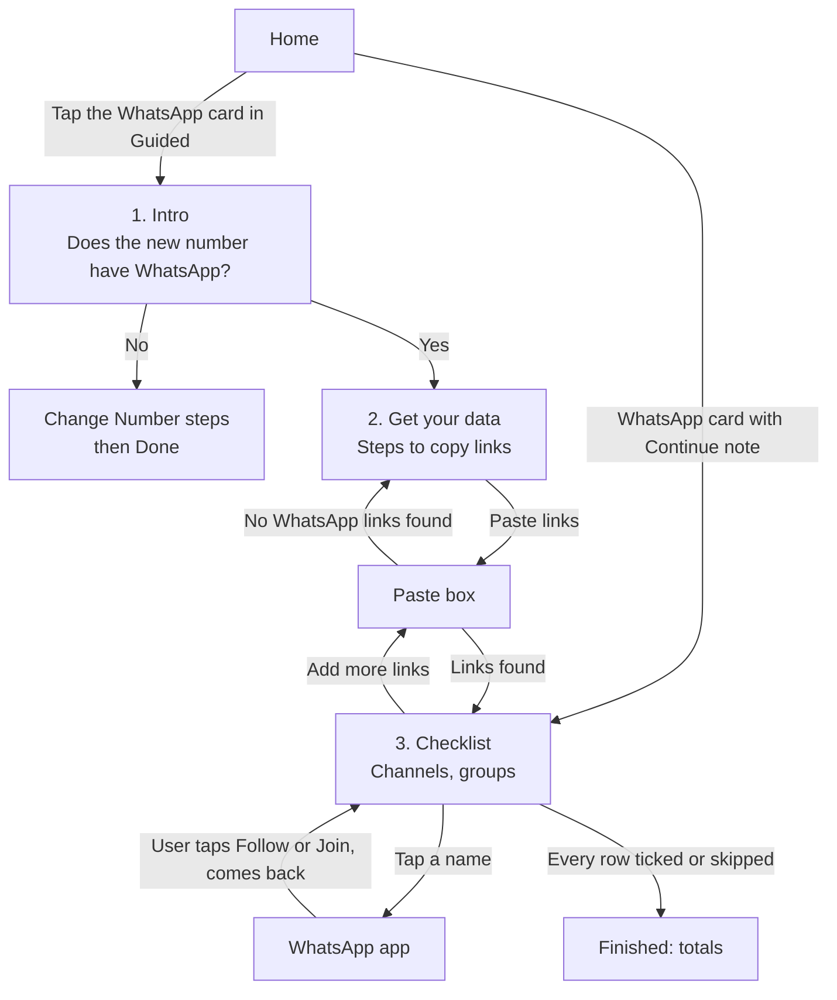

# Feature Specification: WhatsApp Platform (Guided)

**Feature Branch**: `feature/whatsapp-platform`

**Created**: 2026-11-23

**Status**: Draft

**Input**: User description: "wechat, WhatsApp, QQ, douyin. Spec number is 15 onwards" (this spec covers WhatsApp)

**Depends on**: [005 Guided Migration](../005-guided-migration/spec.md). WhatsApp is one more platform in the shared Guided flow. [004 Platform Picker](../004-multi-platform-picker/spec.md) lists it in the Guided section.

**Related**: [012 Steam Platform](../012-steam-platform/spec.md) designed the paste box this spec reuses. [015 WeChat](../015-wechat-platform/spec.md), [017 QQ](../017-qq-platform/spec.md), and [018 Douyin](../018-douyin-platform/spec.md) were written at the same time.

## Summary

A WhatsApp account belongs to a phone number. WhatsApp already has its own way to move an account to a new number: Change Number moves the profile, chats, and settings. Contacts are not part of the account at all; WhatsApp shows the people in the phone's address book. So for most users the right move is Change Number, and Magpie adds nothing.

Magpie helps in the one case Change Number does not cover: the new number already has its own WhatsApp account, and the user wants the old account's Channels and groups there too. WhatsApp has no API for a personal account, so this is a Guided platform. The user copies Channel links and group invite links from the old account, pastes them into the app, and works through a checklist. Each row opens the link in WhatsApp, where the user taps Follow or Join group on the new account.

The intro asks first whether the new number already has WhatsApp. If not, the app shows the Change Number steps and stops there.

The app never signs in to WhatsApp, never calls WhatsApp, and never taps for the user.

## Feasibility

Checked on 2026-11-23 against WhatsApp's Help Center and public reports. Rows marked *unconfirmed* MUST be checked in the plan against real test accounts.

| Question | Answer | Blocks Automatic? | Blocks Guided? |
| --- | --- | --- | --- |
| Does WhatsApp offer an API for a personal account? | No. The WhatsApp Business Platform is for businesses messaging their customers; it cannot read or change a personal account's Channels or groups. WhatsApp's terms forbid unofficial clients and automation. | Yes | No. The app never talks to WhatsApp. |
| Does WhatsApp move an account to a new number itself? | Yes. Settings > Account > Change number moves the profile picture, name, about, chats, and settings. The official FAQ says the user may need to rejoin groups; some guides say groups stay (*unconfirmed*). It cannot be undone. What happens when the new number already has an account: *unconfirmed*. | n/a | No. The app points to it. |
| Are contacts part of the account? | No. WhatsApp shows the people in the phone's address book who use WhatsApp. They move with the phone's contacts (Google or iCloud), not with the account. | n/a | Out of scope. |
| Does WhatsApp give an export? | Yes. Settings > Account > Request account info gives a report in about 3 days, as a ZIP of HTML and JSON files. Guides say it lists contacts and group names, not invite links. A Channels report option is mentioned in some guides (*unconfirmed*). | n/a | No. Group names alone cannot rejoin a group, so the app uses pasted links. |
| Can a row open a Channel or a group by link? | Yes. Channel links (`whatsapp.com/channel/...`) and group invite links (`chat.whatsapp.com/...`) open WhatsApp. | n/a | No |
| Who can get a group invite link? | Group admins, and members when admins allow it. Some groups need admin approval to join. | n/a | Partly. Without a link, the user asks an admin. |
| May one phone hold two accounts? | Yes on Android (two accounts in one app). iOS: *unconfirmed*. A second phone or the WhatsApp Business app also works. | n/a | No |

**Verdict**: Automatic WhatsApp is not feasible. For most users, WhatsApp's own Change Number is the full answer. Guided WhatsApp is feasible for Channels and groups, with pasted links, when the new number already has an account.

## What WhatsApp items this feature covers

| Item | How the app gets it | What the user does on the new account | Verdict |
| --- | --- | --- | --- |
| Followed Channels | Pasted Channel links | Tap Follow | In scope |
| Groups and Communities | Pasted invite links | Tap Join group, or Request to join | In scope |
| Groups with no invite link | n/a | Ask an admin to add the new number | Out of scope. The guide says this in one line. |
| Contacts | n/a | n/a | Out of scope. They live in the phone's address book. |
| Chats, media, call history, status, profile | n/a | Change Number, or WhatsApp's own chat transfer | Out of scope |

## How the screens connect

## User Scenarios & Testing *(mandatory)*

### User Story 1 - Find the right way to move (Priority: P1)

A user taps the WhatsApp card. The intro asks one question with two inline choices: "Does your new number already have WhatsApp?" If they choose No, the app shows WhatsApp's Change Number steps with pictures, says what moves and what does not, and offers Done. No list is made. If they choose Yes, the app goes on to get-your-data.

**Why this priority**: Most users need Change Number, which moves far more than Magpie can. Sending them there first saves them time and avoids a worse move.

**Independent Test**: Open the WhatsApp card, choose No, and confirm the Change Number steps show and Done returns to Home with no saved list. Choose Yes and confirm get-your-data opens.

**Acceptance Scenarios**:

1. **Given** the WhatsApp card is ready, **When** Home shows, **Then** it is in the Guided section and not in Automatic.
2. **Given** the intro shows, **When** the user reads it, **Then** it says the app never asks for the password, never signs in to WhatsApp, never taps for them, and that contacts stay in the phone's address book.
3. **Given** the user chooses No, **When** the Change Number steps show, **Then** they say that Change Number moves the profile, chats, and settings, that it cannot be undone, and that groups may need to be rejoined.
4. **Given** the user chooses Yes, **When** the next screen shows, **Then** it is get-your-data.

---

### User Story 2 - Get my Channel and group links into the app (Priority: P1)

The new number already has WhatsApp. The get-your-data screen shows numbered steps: on the old account, open each followed Channel, tap the Channel name, and copy its link; open each group where invite links are allowed, and copy the invite link. The user pastes all the text into the app. The app finds every Channel link and group invite link and opens the checklist.

**Why this priority**: Without a list, there is nothing to move.

**Independent Test**: Paste a text with 4 Channel links, 2 group invite links, and other text and links. Confirm the checklist shows 6 rows of the right kinds and ignores the rest.

**Acceptance Scenarios**:

1. **Given** the user pastes text with WhatsApp links, **When** the app reads it, **Then** the checklist lists each Channel and group once, with its kind, and ignores all other text.
2. **Given** the user pastes text with no supported links, **When** the app reads it, **Then** it says so in plain words and the user stays on the paste box.
3. **Given** a checklist already exists, **When** the user taps Add more links and pastes again, **Then** new items are added without duplicates and existing ticks and skips are kept.

---

### User Story 3 - Follow and join on the new account (Priority: P1)

The user works through the checklist. Tapping a row opens the link in WhatsApp. The user checks that WhatsApp shows the new account, taps Follow or Join group, comes back, and ticks the row.

**Why this priority**: This is the move itself.

**Independent Test**: With WhatsApp signed in to a test new account, tap one Channel row and one group row, tap the named button, tick both, and confirm the new account follows the Channel and joined (or requested to join) the group.

**Acceptance Scenarios**:

1. **Given** the checklist shows, **When** the user taps a row's name, **Then** the link opens in WhatsApp, or a plain note says WhatsApp is not installed.
2. **Given** a row shows, **When** the user reads it, **Then** it names the button: Follow for a Channel, Join group for a group, with a note that some groups need an admin to approve.
3. **Given** the checklist shows, **When** the user reads its note, **Then** it reminds them to switch WhatsApp to the new account first.
4. **Given** a move ran, **When** the user checks the old account, **Then** nothing on it has changed.

---

### User Story 4 - Stop and continue later (Priority: P3)

Spec 005 keeps ticks and shows a Continue note on the card. Lists here are usually short, so this matters less than on other platforms.

**Acceptance Scenarios**:

1. **Given** the user ticked some rows, **When** they close and open the app, **Then** every tick and skip is still there, and the card shows a Continue note.

---

### Edge Cases

- An invite link was reset by the admin: WhatsApp says the link is no longer valid. The user taps Skip and asks an admin for a new link.
- A group is full: WhatsApp says so. The user taps Skip.
- A Channel was deleted or suspended: WhatsApp shows its own message. The user taps Skip.
- The pasted text has the same link many times, or links with extra parts after the code: each item shows once.
- WhatsApp is still on the old account: the user may follow with the wrong account. The app cannot check this and only reminds the user (spec 005, FR-014).
- The user chooses No in the intro but the new number does have WhatsApp: Change Number steps do not fit. The steps screen has a Back control to the question.

## Requirements *(mandatory)*

### Functional Requirements

- **FR-WA-001**: The WhatsApp card MUST appear in the Guided section of Home through the one list of platforms (spec 004, FR-001), only once its guide and link reader are ready and checked against real test accounts (spec 005, FR-001). It MUST NOT appear in the Automatic section.
- **FR-WA-002**: Tapping the WhatsApp card MUST open the shared Guided flow (spec 005, FR-002). The intro MUST ask "Does your new number already have WhatsApp?" with two inline choices, Yes and No.
- **FR-WA-003**: Choosing No MUST show WhatsApp's Change Number steps, with a picture per step and a text alternative, and a Done button that returns to Home. It MUST NOT save a list. It MUST say that Change Number cannot be undone and that groups may need to be rejoined.
- **FR-WA-004**: Choosing Yes MUST open get-your-data, with numbered steps for copying Channel links and group invite links on the old account, and Paste links.
- **FR-WA-005**: The paste box MUST accept free text up to at least 1 MB, MUST find every Channel link and group invite link in it on the phone only, and MUST ignore all other text and links.
- **FR-WA-006**: The app MUST list each item once, treating links to the same Channel or group as one even when they differ in extra parts after the code.
- **FR-WA-007**: After a checklist exists, the checklist header MUST offer Add more links, which adds new items without duplicates and keeps existing ticks and skips. This extends spec 005, FR-017.
- **FR-WA-008**: Rows MUST be grouped as Channels, then groups, in paste order. Each row MUST show the name when the pasted text gives one next to the link, or else the kind and a short form of the link, and MUST name the button: Follow or Join group.
- **FR-WA-009**: Each row MUST open its link in WhatsApp (spec 005, FR-010). If WhatsApp is not installed, a plain note MUST say so.
- **FR-WA-010**: The checklist note MUST remind the user to switch WhatsApp to the new account first, and MUST say that some groups need an admin to approve.
- **FR-WA-011**: The app MUST NOT ask for or keep the WhatsApp password or codes, sign in to WhatsApp, call any WhatsApp endpoint, read WhatsApp's files or backups, or tap any WhatsApp button for the user (spec 005, FR-012 and FR-013; constitution Principle V).
- **FR-WA-012**: Pasted text MUST be read on the phone only and MUST NOT be uploaded or logged. The app MUST keep only each item's name, kind, link, and tick state. Phone numbers in pasted text MUST NOT be kept.
- **FR-WA-013**: Whether WhatsApp ships, and in which form: [NEEDS CLARIFICATION: WhatsApp's own Change Number covers most users, and the Guided list helps only when the new number already has an account. A: ship as written (Change Number steps plus a Channels and groups checklist). B: ship only the Change Number steps, with no checklist. C: cancel, because WhatsApp already solves the move.]
- **FR-WA-014**: Settings MUST say that Magpie is not made by or linked with WhatsApp or Meta. The WhatsApp logo MUST be the official mark, unmodified, used only to name the platform.
- **FR-WA-015**: The feature MUST work the same way on Android and iOS, following spec 005's Platform differences table and the rows added below. Screens follow the default single column of constitution Principle VI in every size class and orientation.

### Platform differences (Android and iOS)

These rows add to spec 005's table.

| Area | Android | iOS |
| --- | --- | --- |
| Paste links | The paste box takes text by the system paste action. The app MUST NOT read the clipboard on its own. | Same. iOS shows its own paste prompt. |
| Open a WhatsApp link | WhatsApp opens Channel and invite links when installed. | Same, through universal links. |
| Two accounts on one phone | WhatsApp allows two accounts in one app. The Change Number and switch steps say so. | *Unconfirmed*. The guide says to use a second phone or WhatsApp Business if one app cannot hold both. |

### Key Entities *(include if feature involves data)*

WhatsApp adds no new entity. It uses spec 005's entities.

- **Platform**: WhatsApp is a new entry in the list of platforms, in the Guided section.
- **Follow Item**: One Channel or group, with its name when known, its kind, its link, and its state.

## WhatsApp section *(platform-specific)*

- **Sign-in**: none. WhatsApp has no sign-in for outside apps on personal accounts.
- **Supported link shapes**:

| Kind | Link shape | Button on the new account |
| --- | --- | --- |
| Channel | `https://whatsapp.com/channel/<channel code>` (also with `www.`) | Follow |
| Group or Community | `https://chat.whatsapp.com/<invite code>` | Join group, or Request to join |

- **Where the user finds each link on the old account**: Updates > Channels > open the Channel > tap its name > Copy link. Group info > Invite via link > Copy link (admins, or members when allowed). The guide gives the exact current wording.
- **Change Number**: Settings > Account > Change number. The plan MUST check, with test numbers, what moves (in particular groups and Channels) and what happens when the new number already has an account, and update the steps to match.
- **Network**: none on the WhatsApp path. Only the guide fetch from spec 005 (FR-021) applies.

## Success Criteria *(mandatory)*

### Measurable Outcomes

- **SC-001**: A user whose new number has no WhatsApp yet reaches the Change Number steps in 2 taps from Home.
- **SC-002**: For a test paste with Channel links, invite links, and other text, the checklist shows 100% of the supported items, no duplicates, and no other items.
- **SC-003**: In a check of the app's network use during a WhatsApp move, no request goes to a WhatsApp or Meta host.
- **SC-004**: 100% of rows open the right Channel or group in WhatsApp when it is installed.
- **SC-005**: Adding WhatsApp needs no change to Home or the Guided flow beyond the new platform entry, its guide, its link reader, the intro question, and the shared paste box and Add more links.

## Assumptions

- Spec 005 (Guided flow) is planned and built before WhatsApp ships.
- The user can copy Channel links and invite links on the old account. A group without an invite link needs an admin and is out of scope.
- Contacts move with the phone's address book, not with Magpie.
- Chats, media, and calls are out of scope; WhatsApp's own tools move them.
- The account info report is not used, because it has no invite links. If the plan finds that a Channels report lists Channel links, Pick file can be added through a spec change.

## What the project owner needs to do

These steps need real phone numbers and cannot be done by an agent.

1. **Answer the open question** in FR-WA-013 (run `/speckit-clarify`).
2. **Test numbers**: have two numbers with WhatsApp, and a third number with no WhatsApp for the Change Number test.
3. **Change Number test**: on a test account with a Channel and a group, run Change Number to the third number, and note whether the Channel and the group stay.
4. **Link test**: on Android and iPhone, copy a Channel link and a group invite link on the old account, open them while signed in to the new account, and note what shows.
5. **Two accounts test**: check whether WhatsApp on iPhone can hold two accounts.
