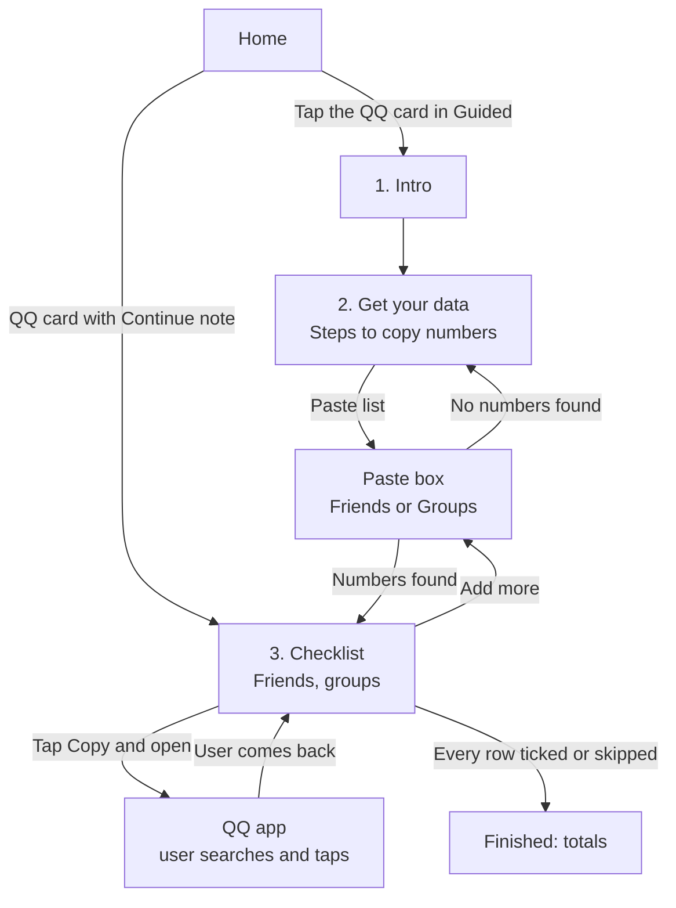

# Feature Specification: QQ Platform (Guided)

**Feature Branch**: `feature/qq-platform`

**Created**: 2026-11-23

**Status**: Cancelled. QQ has no API, and every row needs copy, switch app, search, and a request the other side must accept, so the app adds too little value.

**Input**: User description: "wechat, WhatsApp, QQ, douyin. Spec number is 15 onwards" (this spec covers QQ)

**Depends on**: [005 Guided Migration](../005-guided-migration/spec.md). QQ is one more platform in the shared Guided flow. [004 Platform Picker](../004-multi-platform-picker/spec.md) lists it in the Guided section.

**Related**: [015 WeChat](../015-wechat-platform/spec.md) is the closest pattern: also Tencent, also copy-and-search rows. [016 WhatsApp](../016-whatsapp-platform/spec.md) and [018 Douyin](../018-douyin-platform/spec.md) were written at the same time. 015, 017, and 018 share the question on Chinese text.

## Summary

QQ has no API that lets an outside app add a friend or join a group for a user. QQ sign-in for outside apps (QQ Connect) gives the user's nickname and picture only. So QQ cannot be an Automatic platform.

This spec adds QQ to the Guided section. A QQ friend and a QQ group each have a number, which QQ shows on the profile and in group info. The user copies the numbers from the old account and pastes them into the app. The app builds a checklist of friends and groups. For each row, the user taps Copy and open; the app copies the number and opens QQ, where the user searches the number and taps Add Friend or Join Group on the new account.

The app never signs in to QQ, never calls QQ or Tencent, never reads QQ's files, and never taps for the user.

## Why cancelled

The project owner cancelled this spec on 2026-11-23. Automatic QQ is not possible (see Feasibility). In the Guided flow, each row needs copy, switch app, search, and tap, and most friends and groups must accept. The user can do the same in QQ without the app. The spec is kept as a record of the research and the design, in case the owner revisits it.

## Clarifications

### Session 2026-11-23

- Q: QQ cannot be automated and every row needs copy and search. Ship as Guided, or cancel? → A: Cancel.

## Feasibility

Checked on 2026-11-23 against QQ Connect and Tencent MSDK docs and public reports. Rows marked *unconfirmed* MUST be checked in the plan against real test accounts.

| Question | Answer | Blocks Automatic? | Blocks Guided? |
| --- | --- | --- | --- |
| Can an outside app add friends or join groups for a user? | No. QQ Connect has no such method. | Yes | No. The user taps the button. |
| What does QQ sign-in give an outside app? | QQ Connect OAuth gives an openid and, with `get_user_info`, the nickname and picture. Registering an app needs Tencent's developer identity check; whether developers outside mainland China can pass it is *unconfirmed*. | Yes | No. Guided does not sign in. |
| Can an outside app read the friend list or group list? | No, for this app. Tencent's game SDK had friend permissions for approved games only, and Tencent's docs say those were changed after a personal information protection review, with new access paused. Scripts that read QQ Zone pages exist; they break the constitution (Principle V). | n/a | Partly. The user pastes the numbers. |
| Does QQ give a personal data export with friends or groups? | None found (*unconfirmed*). | n/a | No. Paste works without it. |
| Can a row open a friend's or group's page by link from outside QQ? | No documented way found. QQ group share links exist, but whether they open QQ from another app is *unconfirmed*. | n/a | No. Rows use copy and search. |
| Do friends and groups control who can join? | Yes. A person can require a verification answer or block adding. A group can need admin approval, a question, or invite only. | n/a | No. The row note says so. |
| May one phone hold two accounts? | QQ lets the user sign in to several accounts and switch (limit *unconfirmed*). | n/a | No |
| Can chat history, QQ Zone, QQ Wallet, VIP, or Q coins move? | No. | Yes | Yes. Out of scope. |

**Verdict**: Automatic QQ is not feasible. Guided QQ is feasible with pasted numbers and copy-and-search rows. It needs no Tencent developer account.

## What QQ items this feature covers

| Item | How the app gets it | What the user does on the new account | Verdict |
| --- | --- | --- | --- |
| Friends | Pasted QQ numbers | Search the number, tap Add Friend. The other person may need to accept. | In scope |
| Groups | Pasted group numbers | Search the number, tap Join Group. An admin may need to approve. | In scope |
| QQ Channels and followed official accounts | n/a | n/a | Out of scope. Whether these are still offered and searchable is *unconfirmed*; add by a spec change if needed. |
| Chat history, QQ Zone posts, QQ Wallet, VIP, Q coins | n/a | n/a | Not possible |

## How the screens connect

## User Scenarios & Testing *(mandatory)*

### User Story 1 - Get my QQ list into the app (Priority: P1)

A user wants to move from an old QQ account to a new one. They tap the QQ card in the Guided section. The intro says the app never asks for the QQ password, never signs in to QQ, never reads QQ's files, and never taps for them, and that chats and QQ Zone cannot move. The get-your-data screen shows how to copy a friend's QQ number from their profile and a group's number from group info. The user pastes the numbers, chooses Friends or Groups for the paste, and the app opens the checklist.

**Why this priority**: Without a list, there is nothing to move.

**Independent Test**: Paste 6 lines marked as Friends, some "name number", some number only, one with no number, and one duplicate. Confirm the checklist shows 4 friend rows with names where given. Paste 2 group numbers marked as Groups and confirm 2 group rows are added.

**Acceptance Scenarios**:

1. **Given** the QQ card is ready, **When** Home shows, **Then** it is in the Guided section and not in Automatic.
2. **Given** the user opens the QQ card, **When** the intro shows, **Then** it says the app never asks for the password, never signs in to QQ, never reads QQ's files, never taps for them, and that chats, QQ Zone, and payments cannot move.
3. **Given** the user pastes text and chooses a kind, **When** the app reads it, **Then** each line with a QQ number becomes one item of that kind, the rest of the line becomes its name, and lines with no number are ignored.
4. **Given** the user pastes text with no numbers, **When** the app reads it, **Then** it says so in plain words and the user stays on the paste box.
5. **Given** a checklist already exists, **When** the user taps Add more and pastes again, **Then** new items are added without duplicates and existing ticks and skips are kept.

---

### User Story 2 - Add friends and join groups on the new account (Priority: P1)

The user switches QQ to the new account and works through the checklist. Tapping Copy and open copies the number and opens QQ. The user searches the number, taps Add Friend or Join Group, answers any question the other side asks, comes back, and ticks the row.

**Why this priority**: This is the move itself.

**Independent Test**: With QQ signed in to a test new account, tap Copy and open on one friend row and one group row, paste into QQ's add search, tap the named button, tick both, and confirm a friend request and a join request were sent.

**Acceptance Scenarios**:

1. **Given** the checklist shows, **When** the user taps Copy and open on a row, **Then** the number is on the clipboard and QQ opens, and a short note says "Copied. Paste it in QQ search."
2. **Given** QQ is not installed, **When** the user taps Copy and open, **Then** the number is still copied and a plain note says QQ is not installed.
3. **Given** a row shows, **When** the user reads it, **Then** it names the button: Add Friend or Join Group.
4. **Given** the checklist shows, **When** the user reads its note, **Then** it says to switch QQ to the new account first, that friends and group admins may need to accept, and that adding many friends fast can get the new account limited.
5. **Given** a move ran, **When** the user checks the old account, **Then** nothing on it has changed.

---

### User Story 3 - Stop and continue later (Priority: P2)

A user with many friends adds some each day. The QQ card shows a Continue note with the count left, and tapping it opens the checklist where they left it. Spec 005 provides this.

**Acceptance Scenarios**:

1. **Given** the user ticked some rows, **When** they close and open the app, **Then** every tick and skip is still there.
2. **Given** QQ has an unfinished checklist, **When** Home shows, **Then** the QQ card shows a Continue note with the count of open rows.

---

### Edge Cases

- A friend does not allow adding by number, or asks a question the user cannot answer: the user taps Skip, or asks the friend to add the new account.
- A group is invite only, full, or was dissolved: QQ shows its own message. The user taps Skip.
- A line holds two numbers (for example a name with digits and a QQ number): the app takes the last 5 to 11 digit run on the line as the number and shows the line so the user can check it.
- The same number is pasted as both a friend and a group: it shows once in each group of rows, because QQ numbers and group numbers are separate.
- The pasted text has full-width digits or extra spaces: each item still shows once.
- QQ is still on the old account: the user may add items to the wrong account. The app cannot check this and only reminds the user (spec 005, FR-014).
- The new account reached QQ's friend limit: QQ shows its own message. The user stops.

## Requirements *(mandatory)*

### Functional Requirements

- **FR-QQ-001**: The QQ card MUST appear in the Guided section of Home through the one list of platforms (spec 004, FR-001), only once its guide and reader are ready and checked against real test accounts (spec 005, FR-001). It MUST NOT appear in the Automatic section.
- **FR-QQ-002**: Tapping the QQ card MUST open the shared Guided flow (spec 005, FR-002) with QQ's guide text, pictures, and reader. QQ MUST NOT get QQ-only screens. The paste box and copy-and-search rows are the shared ones from spec 015 (FR-WC-004 and FR-WC-009); if 015 is not built, this spec builds them.
- **FR-QQ-003**: The get-your-data screen MUST show numbered steps with pictures for copying a friend's QQ number and a group's number on the old account, and MUST offer Paste list.
- **FR-QQ-004**: The paste box MUST accept free text up to at least 1 MB, MUST let the user choose the kind for each paste (Friends or Groups, with Friends as the default), and MUST turn each line holding a run of 5 to 11 digits into one item: the last such run is the number, and the rest of the line, trimmed, is the name. Lines with no such run MUST be ignored.
- **FR-QQ-005**: The app MUST list each number once per kind, treating full-width and half-width digits as the same.
- **FR-QQ-006**: After a checklist exists, the checklist header MUST offer Add more, which adds new items without duplicates and keeps existing ticks and skips. This extends spec 005, FR-017.
- **FR-QQ-007**: Rows MUST be grouped as Friends, then Groups, in paste order. Each row MUST show the name and number, or the number alone, and MUST name the button: Add Friend or Join Group.
- **FR-QQ-008**: Each row MUST offer Copy and open in place of the open-profile link of spec 005, FR-010. It MUST copy the number and open the QQ app. If QQ is not installed, the number MUST still be copied and a plain note MUST say so. The tick box MUST NOT copy or open anything.
- **FR-QQ-009**: The checklist note MUST remind the user to switch QQ to the new account first, MUST say that friends and group admins may need to accept, and MUST say that adding many friends fast can get the new account limited.
- **FR-QQ-010**: The app MUST NOT ask for or keep the QQ password, sign in to QQ, call any QQ or Tencent endpoint, read QQ's files, open a hidden browser, or tap any QQ button for the user (spec 005, FR-012 and FR-013; constitution Principle V).
- **FR-QQ-011**: Pasted text MUST be read on the phone only and MUST NOT be uploaded or logged. The app MUST keep only each item's name, number, kind, and tick state.
- **FR-QQ-012**: The intro, guide, checklist notes, and row labels MUST be usable by a user who reads only Chinese. (never answered, spec cancelled) same question as spec 015, FR-WC-013; one answer covers 015, 017, and 018. A: a separate spec adds Simplified Chinese to the whole app first. B: English app, guides quote QQ's Chinese button names. C: Chinese guide text for these platforms only.
- **FR-QQ-013**: Whether QQ ships at all: (never answered, spec cancelled) every QQ row needs copy, switch app, search, and tap, and most rows need the other side to accept. Ship QQ as Guided as written, or cancel like Steam and Tinder?
- **FR-QQ-014**: Settings MUST say that Magpie is not made by or linked with Tencent or QQ. The QQ logo MUST be the official mark, unmodified, used only to name the platform.
- **FR-QQ-015**: The feature MUST work the same way on Android and iOS, following spec 005's Platform differences table and the rows added below. Screens follow the default single column of constitution Principle VI in every size class and orientation.

### Platform differences (Android and iOS)

These rows add to spec 005's table.

| Area | Android | iOS |
| --- | --- | --- |
| Paste list | The paste box takes text by the system paste action. The app MUST NOT read the clipboard on its own. | Same. iOS shows its own paste prompt. |
| Copy and open | The app copies the number and opens QQ by its app link. How to tell that QQ is not installed is checked in the plan. | Same. iOS needs the QQ app link declared before the app can check if QQ is installed; the plan checks this. |
| Install source in mainland China | Google Play does not work in mainland China. Out of scope for this spec. | The App Store in mainland China needs an ICP filing for the app. Out of scope for this spec. |

### Key Entities *(include if feature involves data)*

QQ adds no new entity. It uses spec 005's entities.

- **Platform**: QQ is a new entry in the list of platforms, in the Guided section.
- **Follow Item**: One friend or group, with its number, its name when given, its kind, and its state.

## QQ section *(platform-specific)*

- **Sign-in**: none. QQ Connect is not used, because it gives identity only and the Guided path does not need it.
- **Items and buttons**:

| Kind | Number | Where the user finds it on the old account | What the user does in QQ | Button |
| --- | --- | --- | --- | --- |
| Friend | QQ number, 5 to 11 digits | Open the friend's profile | Add > search the number | Add Friend |
| Group | Group number | Group chat > group info | Add > Groups > search the number | Join Group |

- **App link**: the plan names the link that opens the QQ app, and checks it on Android and iOS.
- **Network**: none on the QQ path. Only the guide fetch from spec 005 (FR-021) applies. The plan MUST check whether the guide host is reachable from mainland China; the built-in guide covers the case where it is not.

## Success Criteria *(mandatory)*

### Measurable Outcomes

- **SC-001**: A first-time user goes from tapping the QQ card to the first ticked row in under 5 minutes.
- **SC-002**: For a test paste of 50 lines of mixed names, numbers, blank lines, and duplicates, the checklist shows 100% of the distinct numbers, with the right names, and no other items.
- **SC-003**: In a check of the app's network use during a QQ move, no request goes to a QQ or Tencent host.
- **SC-004**: In testing, a user finds and adds a row's friend or group in QQ in under 30 seconds on average after tapping Copy and open.
- **SC-005**: Adding QQ needs no change to Home or the Guided flow beyond the new platform entry, its guide, its number reader, and the shared paste box, Add more, and copy-and-search rows.

## Assumptions

- Spec 005 (Guided flow) is planned and built before QQ ships.
- The user can see and copy each friend's QQ number and each group's number on the old account.
- The user can switch QQ between both accounts on one phone, or uses two phones.
- The app does not track whether a friend or an admin accepted. A row is done when the user ticks it.
- Chats, QQ Zone, QQ Channels, QQ Wallet, VIP, and Q coins are out of scope.
- Publishing Magpie in mainland China app stores is out of scope.

## What the project owner needs to do

None while the spec is cancelled. If you revisit it, these steps need your accounts and cannot be done by an agent.

1. **Answer the open questions** left in the spec (run `/speckit-clarify`).
2. **Test accounts**: have two QQ accounts. The old one should have a few friends and groups, including a group that needs admin approval.
3. **Copy test**: on the old account, check where a friend's QQ number and a group's number show, and whether they can be copied.
4. **Switch test**: check that you can switch between both accounts on one phone.
5. **Export check**: look in QQ's settings for a personal data export, and note whether it lists friends or groups.
