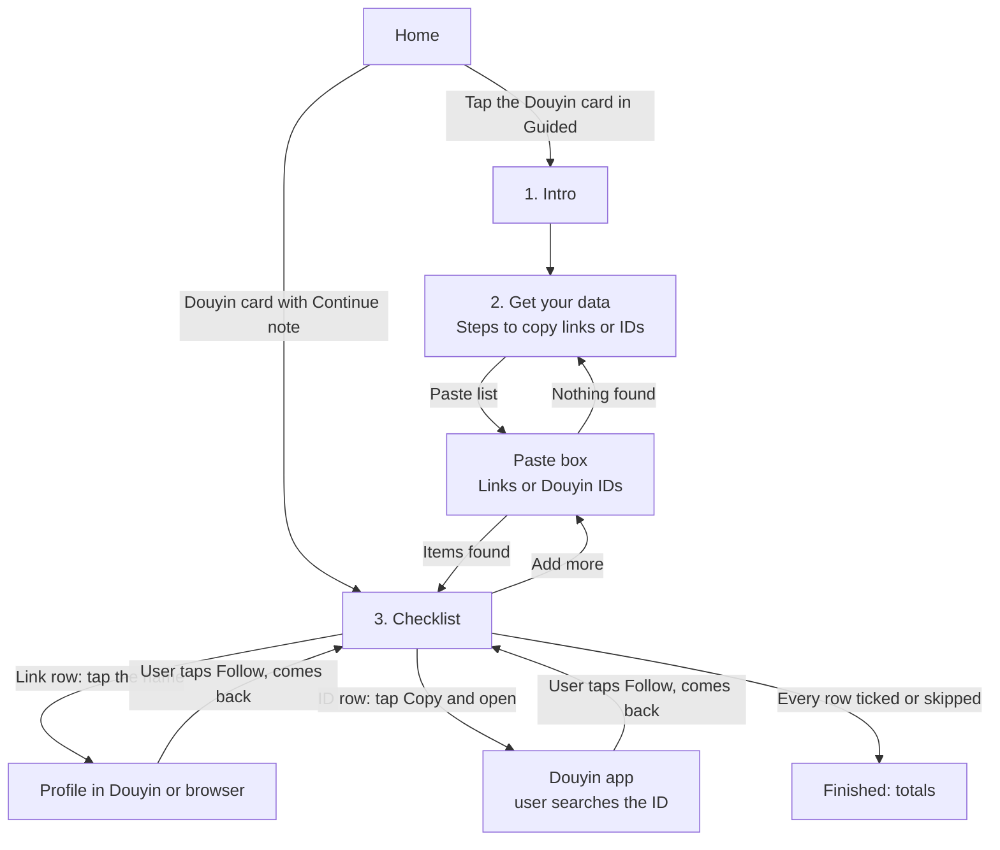

# Feature Specification: Douyin Platform (Guided)

**Feature Branch**: `feature/douyin-platform`

**Created**: 2026-11-23

**Status**: Draft

**Input**: User description: "wechat, WhatsApp, QQ, douyin. Spec number is 15 onwards" (this spec covers Douyin)

**Depends on**: [005 Guided Migration](../005-guided-migration/spec.md). Douyin is one more platform in the shared Guided flow. [004 Platform Picker](../004-multi-platform-picker/spec.md) lists it in the Guided section.

**Related**: [015 WeChat](../015-wechat-platform/spec.md) defines the shared paste box and copy-and-search rows. [016 WhatsApp](../016-whatsapp-platform/spec.md) and [017 QQ](../017-qq-platform/spec.md) were written at the same time. 015, 017, and 018 share the question on Chinese text. Douyin and TikTok are separate apps with separate accounts; TikTok is planned in spec 005 and is not covered here.

## Summary

Douyin has no API that lets an outside app follow an account for a user, and no documented API that gives an outside app the list of accounts a user follows. So Douyin cannot be an Automatic platform.

This spec adds Douyin to the Guided section. On the old account, the user opens the Following list and copies each account's profile link (Share > Copy link) or Douyin ID. The user pastes them into the app, which builds a checklist. A row with a link opens the profile in Douyin, or in the browser when Douyin does not open it; a row with an ID copies the ID and opens Douyin for a search. The user taps Follow on the new account and ticks the row.

The app never signs in to Douyin, never calls Douyin, and never taps for the user.

## Feasibility

Checked on 2026-11-23 against the Douyin Open Platform docs and public reports. Rows marked *unconfirmed* MUST be checked in the plan against real test accounts.

| Question | Answer | Blocks Automatic? | Blocks Guided? |
| --- | --- | --- | --- |
| Can an outside app follow an account for a user? | No. The Douyin Open Platform has no such method. | Yes | No. The user taps Follow. |
| Can an outside app read the user's Following list? | No documented method found. The platform has a follow-event notice (`user.intention` scope) for approved business apps, which tells an account when someone follows it; it is not a list. Unofficial "follow list" APIs exist; the constitution forbids them (Principle V). | n/a | Partly. The user pastes links or IDs. |
| What does Douyin sign-in need? | OAuth through the Douyin Open Platform. Registering a mobile app is reported to need a mainland China business licence (*unconfirmed*). | Yes | No. Guided does not sign in. |
| Does Douyin give a personal data export with the Following list? | None found (*unconfirmed*). | n/a | No. Paste works without it. |
| Can a row open a profile by link? | A profile share link (`v.douyin.com/...`) opens the profile. Whether the Douyin app opens it directly from another app, or the browser opens first, is *unconfirmed*. | n/a | No. The browser is the fallback, and ID rows use copy and search. |
| Does Douyin limit follows? | Douyin limits how fast and how many accounts a user follows, more strictly for new accounts. Numbers are not published. | n/a | No. The guide tells the user to go slowly. |
| May one phone hold two accounts? | Douyin lets the user add accounts and switch between them (limit *unconfirmed*). Each account needs a phone number. | n/a | No |
| Can videos, likes, favorites, messages, fans, Douyin coins, or purchases move? | No. Fans cannot be moved; they choose whom to follow. | Yes | Yes. Out of scope. |

**Verdict**: Automatic Douyin is not feasible. Guided Douyin is feasible with pasted profile links or IDs. It needs no Douyin developer account.

## What Douyin items this feature covers

| Item | How the app gets it | What the user does on the new account | Verdict |
| --- | --- | --- | --- |
| Followed accounts (including mutual follows) | Pasted profile links or Douyin IDs | Tap Follow | In scope |
| Fans (followers) | n/a | n/a | Not possible. The new account can post its link; fans choose. |
| Favorites, liked videos, collections, watch history | n/a | n/a | Out of scope |
| Group chats, messages, live subscriptions | n/a | n/a | Out of scope |
| Own videos, Douyin coins, shop orders | n/a | n/a | Not possible |

## How the screens connect

## User Scenarios & Testing *(mandatory)*

### User Story 1 - Get my Following list into the app (Priority: P1)

A user wants to move from an old Douyin account to a new one. They tap the Douyin card in the Guided section. The intro says the app never asks for the Douyin password, never signs in to Douyin, and never taps Follow for them, and that fans, videos, and favorites cannot move. The get-your-data screen shows how to open Me > Following on the old account and copy each account's profile link or Douyin ID. The user pastes, chooses Links or Douyin IDs for the paste, and the app opens the checklist.

**Why this priority**: Without a list, there is nothing to move.

**Independent Test**: Paste a text with 5 Douyin profile share messages, 1 video link, and other text, as Links. Confirm 5 rows show and the video link is ignored. Paste 3 Douyin IDs with one duplicate as Douyin IDs and confirm 2 more rows.

**Acceptance Scenarios**:

1. **Given** the Douyin card is ready, **When** Home shows, **Then** it is in the Guided section and not in Automatic.
2. **Given** the user opens the Douyin card, **When** the intro shows, **Then** it says the app never asks for the password, never signs in to Douyin, never taps for them, and that fans, videos, and favorites cannot move.
3. **Given** the user pastes text as Links, **When** the app reads it, **Then** each Douyin profile link becomes one row, and all other text and links are ignored.
4. **Given** the user pastes text as Douyin IDs, **When** the app reads it, **Then** each non-empty line becomes one ID row.
5. **Given** the paste has nothing the app can use, **When** the app reads it, **Then** it says so in plain words and the user stays on the paste box.
6. **Given** a checklist already exists, **When** the user taps Add more and pastes again, **Then** new items are added without duplicates and existing ticks and skips are kept.

---

### User Story 2 - Follow on the new account (Priority: P1)

The user switches Douyin to the new account and works through the checklist. A link row opens the profile; an ID row copies the ID and opens Douyin. The user taps Follow, comes back, and ticks the row.

**Why this priority**: This is the move itself.

**Independent Test**: With Douyin signed in to a test new account, tap one link row and one ID row, tap Follow for each, tick both, and confirm the new account follows both accounts. Repeat with Douyin removed and confirm the link row opens in the browser.

**Acceptance Scenarios**:

1. **Given** a link row, **When** the user taps the name, **Then** the profile opens in Douyin, or in the browser when Douyin does not open it.
2. **Given** an ID row, **When** the user taps Copy and open, **Then** the ID is on the clipboard and Douyin opens, with a short note "Copied. Paste it in Douyin search." If Douyin is not installed, the ID is still copied and a plain note says so.
3. **Given** the checklist shows, **When** the user reads its note, **Then** it says to switch Douyin to the new account first, and that following many accounts fast can get the new account limited, so go slowly.
4. **Given** a move ran, **When** the user checks the old account, **Then** nothing on it has changed.

---

### User Story 3 - Stop and continue later (Priority: P2)

A user who follows 500 accounts follows some each day. The Douyin card shows a Continue note with the count left, and tapping it opens the checklist where they left it. Spec 005 provides this.

**Acceptance Scenarios**:

1. **Given** the user ticked some rows, **When** they close and open the app, **Then** every tick and skip is still there.
2. **Given** Douyin has an unfinished checklist, **When** Home shows, **Then** the Douyin card shows a Continue note with the count of open rows.

---

### Edge Cases

- An account was banned, deleted, or set private: the profile shows Douyin's own message. The user taps Skip, or taps Follow if Douyin still shows it.
- A short link expired or is broken: Douyin or the browser shows an error. The user taps Skip, or pastes the account's Douyin ID instead.
- The same account is pasted as a link and as an ID: the app cannot tell they are the same without asking Douyin, so both rows show. The guide says to use one way per account.
- A share message has extra text around the link: only the link is used.
- The browser opens the profile but asks to open Douyin: the user taps Douyin's own open button, or follows in the browser if signed in there.
- Douyin is still on the old account: the user may follow with the wrong account. The app cannot check this and only reminds the user (spec 005, FR-014).
- The new account hit Douyin's follow limit: Douyin shows its own message. The user stops and continues another day (User Story 3).

## Requirements *(mandatory)*

### Functional Requirements

- **FR-DY-001**: The Douyin card MUST appear in the Guided section of Home through the one list of platforms (spec 004, FR-001), only once its guide and readers are ready and checked against real test accounts (spec 005, FR-001). It MUST NOT appear in the Automatic section.
- **FR-DY-002**: Tapping the Douyin card MUST open the shared Guided flow (spec 005, FR-002) with Douyin's guide text, pictures, and readers. Douyin MUST NOT get Douyin-only screens. The paste box and copy-and-search rows are the shared ones from spec 015 (FR-WC-004 and FR-WC-009); if 015 is not built, this spec builds them.
- **FR-DY-003**: The get-your-data screen MUST show numbered steps with pictures for copying profile links and Douyin IDs from the old account's Following list, and MUST offer Paste list.
- **FR-DY-004**: The paste box MUST accept free text up to at least 1 MB and MUST let the user choose Links (the default) or Douyin IDs for each paste. For Links, the app MUST find every Douyin profile link (shapes in the Douyin section) on the phone only and ignore all other text and links. For Douyin IDs, each non-empty line, trimmed, MUST become one ID.
- **FR-DY-005**: The app MUST list each link once, treating links that differ only in tracking parts or a trailing slash as one, and each ID once, ignoring letter case and spaces.
- **FR-DY-006**: After a checklist exists, the checklist header MUST offer Add more, which adds new items without duplicates and keeps existing ticks and skips. This extends spec 005, FR-017.
- **FR-DY-007**: Rows MUST keep paste order. Each row MUST show the ID, or "Douyin account" and a short form of the link, and MUST name the button Follow.
- **FR-DY-008**: A link row MUST open its link as a normal web link, so Douyin opens it when it handles that link and the browser when not (spec 005, FR-010). An ID row MUST offer Copy and open in its place, which copies the ID and opens Douyin; if Douyin is not installed, the ID MUST still be copied and a plain note MUST say so. The tick box MUST NOT open or copy anything.
- **FR-DY-009**: The checklist note MUST remind the user to switch Douyin to the new account first, and MUST say that following many accounts fast can get the new account limited.
- **FR-DY-010**: The app MUST NOT ask for or keep the Douyin password or codes, sign in to Douyin, call any Douyin endpoint (including to expand short links), open a hidden browser, or tap any Douyin button for the user (spec 005, FR-012 and FR-013; constitution Principle V).
- **FR-DY-011**: Pasted text MUST be read on the phone only and MUST NOT be uploaded or logged. The app MUST keep only each item's link or ID, and tick state.
- **FR-DY-012**: The intro, guide, checklist notes, and row labels MUST be usable by a user who reads only Chinese. [NEEDS CLARIFICATION: same question as spec 015, FR-WC-013; one answer covers 015, 017, and 018. A: a separate spec adds Simplified Chinese to the whole app first. B: English app, guides quote Douyin's Chinese button names. C: Chinese guide text for these platforms only.]
- **FR-DY-013**: Whether Douyin ships at all: [NEEDS CLARIFICATION: users must copy each followed account's link one by one, which is slow for long lists, but each row then opens the profile directly. Ship Douyin as Guided as written, or cancel like Steam and Tinder?]
- **FR-DY-014**: Settings MUST say that Magpie is not made by or linked with ByteDance or Douyin. The Douyin logo MUST be the official mark, unmodified, used only to name the platform.
- **FR-DY-015**: The feature MUST work the same way on Android and iOS, following spec 005's Platform differences table and the rows added below. Screens follow the default single column of constitution Principle VI in every size class and orientation.

### Platform differences (Android and iOS)

These rows add to spec 005's table.

| Area | Android | iOS |
| --- | --- | --- |
| Paste list | The paste box takes text by the system paste action. The app MUST NOT read the clipboard on its own. | Same. iOS shows its own paste prompt. |
| Open a profile link | Douyin opens the links it claims; the browser opens the rest. Which links it claims is checked in the plan. | Same, through universal links. Checked in the plan. |
| Copy and open | The app copies the ID and opens Douyin by its app link. How to tell that Douyin is not installed is checked in the plan. | Same. iOS needs the Douyin app link declared first; the plan checks this. |
| Install source in mainland China | Google Play does not work in mainland China. Out of scope for this spec. | The App Store in mainland China needs an ICP filing for the app. Out of scope for this spec. |

### Key Entities *(include if feature involves data)*

Douyin adds no new entity. It uses spec 005's entities.

- **Platform**: Douyin is a new entry in the list of platforms, in the Guided section.
- **Follow Item**: One followed account, with its profile link or Douyin ID, and its state.

## Douyin section *(platform-specific)*

- **Sign-in**: none. The Douyin Open Platform is not used.
- **Supported link shapes**:

| Kind | Link shape | Notes |
| --- | --- | --- |
| Profile share link | `https://v.douyin.com/<code>/` | From Share > Copy link on a profile. The app does not expand it; it opens it as is. The same short form is used for videos, so the plan MUST check whether a profile link can be told apart from a video link without a network call. If not, the guide says to paste profile links only, and every short link becomes a row. |
| Profile page | `https://www.douyin.com/user/<id>` | From the Douyin website. |
| Douyin ID | Letters, digits, `_`, and `.` | Shown on the profile under the name. Used for copy and search. |

- **Where the user finds the list on the old account**: Me > Following. Each profile shows the Douyin ID and has Share > Copy link. The guide gives the exact current wording.
- **App link**: the plan names the link that opens the Douyin app, and checks it on Android and iOS.
- **Network**: none on the Douyin path. Only the guide fetch from spec 005 (FR-021) applies. The plan MUST check whether the guide host is reachable from mainland China; the built-in guide covers the case where it is not.

## Success Criteria *(mandatory)*

### Measurable Outcomes

- **SC-001**: A first-time user goes from tapping the Douyin card to the first ticked row in under 5 minutes.
- **SC-002**: For a test paste of share messages, profile links, other links, and other text, the checklist shows 100% of the profile links, no duplicates, and no other items.
- **SC-003**: In a check of the app's network use during a Douyin move, no request goes to a Douyin or ByteDance host.
- **SC-004**: 100% of link rows open the right profile, in Douyin when it handles the link and in the browser when not.
- **SC-005**: Adding Douyin needs no change to Home or the Guided flow beyond the new platform entry, its guide, its link and ID readers, and the shared paste box, Add more, and copy-and-search rows.

## Assumptions

- Spec 005 (Guided flow) is planned and built before Douyin ships.
- The owner of an account can see their own Following list even when it is set private.
- The user can copy profile links or Douyin IDs on the old account one by one. A long list takes several sittings.
- The user can switch Douyin between both accounts on one phone, or uses two phones.
- Fans, favorites, likes, history, messages, and purchases are out of scope.
- Moving between Douyin and TikTok is out of scope.
- Publishing Magpie in mainland China app stores is out of scope.

## What the project owner needs to do

These steps need your Douyin accounts and cannot be done by an agent.

1. **Answer the open questions** in FR-DY-012 and FR-DY-013 (run `/speckit-clarify`).
2. **Test accounts**: have two Douyin accounts. The old one should follow a few accounts, including one private account.
3. **Link test**: on Android and iPhone, copy a profile link from the old account and open it from another app, with Douyin installed and without. Note what opens.
4. **Short link test**: copy a profile link and a video link and compare their shape, to see if they can be told apart.
5. **Export check**: look in Douyin's settings for a personal data download, and note whether it lists followed accounts.
