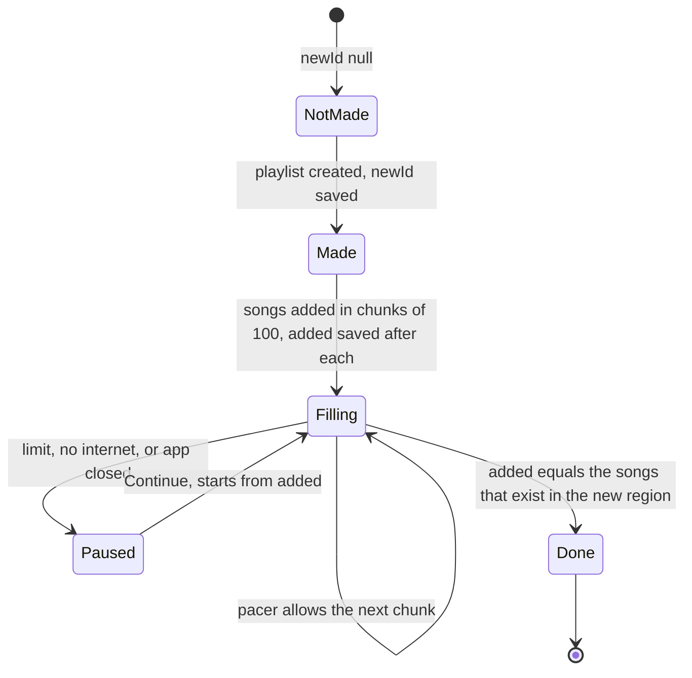
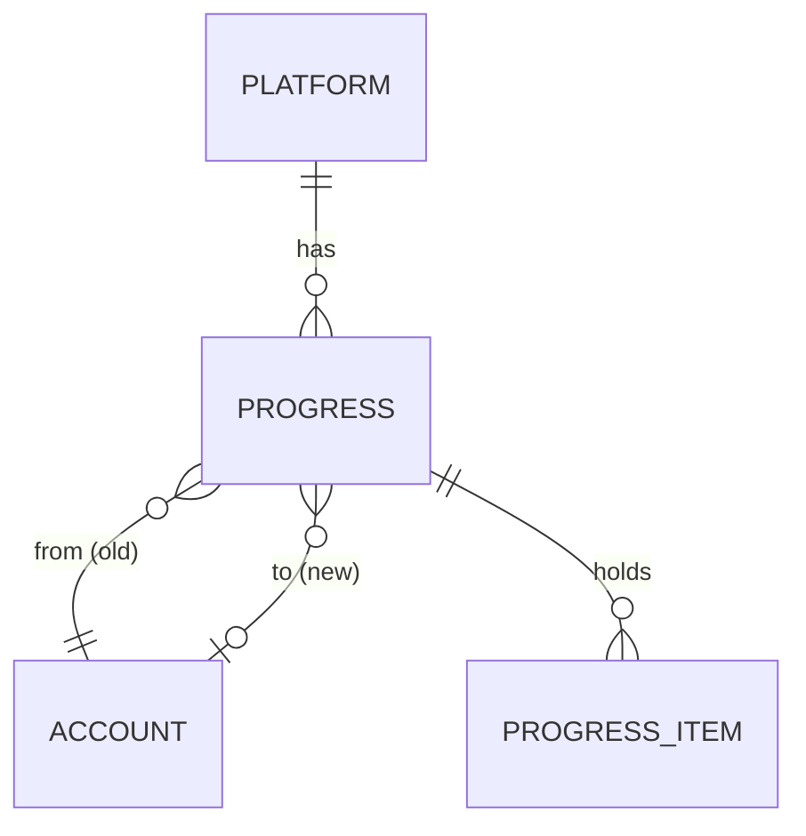

# Data Model: Apple Music Platform

Apple Music fits the store from [008 data-model](../008-github-platform/data-model.md) (schema version 2). **No table changes and no migration.** Two small store additions serve every platform, and Apple Music adds its own item kinds and `data` shapes.

## Store additions (shared)

| Addition | What | Why |
| --- | --- | --- |
| `NewItem.reason?: string` | When set, `saveItems` stores the row with `picked = 0`, `status = 'couldnt_move'`, and this reason. Existing rows are not touched (`INSERT OR IGNORE`, as today). | FR-AM-008: items that cannot move show in Pick with the reason and never count as picked. |
| `setItemData(progressId, itemId, data)` | Updates `progress_item.data` and `updated_at` for one row. | FR-AM-011: a playlist's new ID and added count are saved after each request, so a stop never makes a second playlist or adds songs twice. |

The mover passes a `save(data)` callback to `driver.add` that calls `setItemData` for the item being moved ([contracts/platform-driver.md](contracts/platform-driver.md)).

## Accounts

| Field | Apple Music value |
| --- | --- |
| `id` | Fingerprint from research R4, or the ID from Apple's identity endpoint if the access check finds one. |
| `handle` | "Apple Music · <country>" from the storefront, for example "Apple Music · VN". |
| `name` | The library counts, for example "1,234 songs, 12 playlists". |
| `photoUrl` | null. |

The fingerprint's library ID set is kept in memory for the same-account check and is not stored.

## Item kinds

In Pick order. Headings come from `src/strings.ts`.

| Kind | Heading | `item_id` | Title | Thumbnail |
| --- | --- | --- | --- | --- |
| `song` | Songs | `song:<catalogId>`, or `song:<libraryId>` when there is no catalog ID | "<song> · <artist>" | Artwork URL at 120 px |
| `album` | Albums | `album:<catalogId>` or `album:<libraryId>` | "<album> · <artist>" | Artwork URL at 120 px |
| `playlist` | Playlists | `playlist:<libraryId>` | Playlist name | Artwork URL at 120 px, or null |
| `artist` | Artists | `artist:<catalogId>` | Artist name | null |

`artist` exists only if the access check passes (research R1, R8). Move order: songs, albums, artists, playlists, so a playlist's songs that are also library songs are already in the library.

## `data` shapes

Checked on read. A row whose `data` fails the check moves as `couldnt_move` with "Could not read this item", and is logged with no content.

| Kind | Shape | Notes |
| --- | --- | --- |
| `song`, `album`, `artist` | `{ "catalogId": string }` | Rows with no catalog ID have `reason` set and `data` null. |
| `playlist`, made by the user | `{ "own": true, "songs": string[], "newId": string \| null, "added": number }` | `songs`: catalog IDs in order; songs with no catalog ID are left out and counted in the row note. `newId` and `added` start as null and 0 and change only through `save()`. |
| `playlist`, added from Apple or another user | `{ "own": false, "globalId": string }` | Added by its global ID. |

## Playlist move states

The item state is the shared one (`waiting`, `moving`, `moved`, `already_there`, `later`, `couldnt_move`). Inside an own playlist, `data` tracks how far the add got:

## Tokens and secrets

| What | Where | Lifetime |
| --- | --- | --- |
| Developer token | `EXPO_PUBLIC_APPLE_MUSIC_DEVELOPER_TOKEN`, built into the app from the local `.env`. Public by design (research R3). | Up to 180 days. |
| MusicKit private key | Owner's machine only. Never in the repository or the app. | Until the owner revokes it. |
| Old account music user token | Memory only. | Dropped after `listOld`. |
| New account music user token | `expo-secure-store`, key `appleMusicNewToken`. | Deleted at the summary when nothing is left, on Sign out, Start again, and Delete all. |
| Sign-in `state` | Memory only. | One sign-in. |

## Entities

`PROGRESS_ITEM` holds songs, albums, artists, and playlists, told apart by `kind`. A playlist lists its songs inside its own `data`, not as separate rows.
